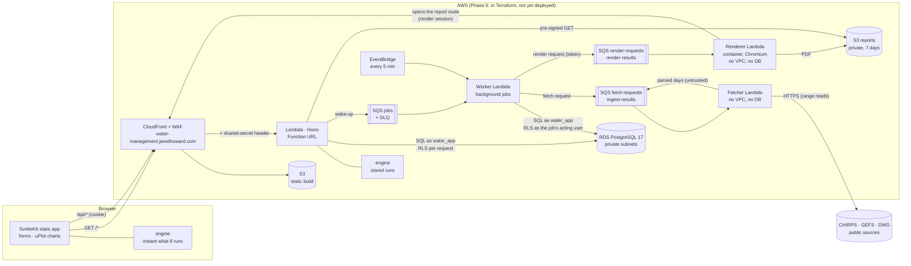

# Architecture

A web app for daily catchment water-balance modelling. It replaces the client's
**Water Balance Tool b023** Excel workbook ([model.md](./model.md)). Each
**project** is one catchment. Users keep as many projects as they need and
share each one with per-project roles.

## System



Locally the same pieces run as `vite dev` on `:7777`, a Node server
(`@hono/node-server`) on `:3001`, and Postgres 17 in docker on `:5434`
(plus Mailpit, which catches all email, and MinIO, which holds report PDFs;
the background-job worker is an opt-in Node process, `pnpm dev:run:worker`,
polling the same Postgres and rendering reports in the local Chromium, and
data feeds read synthetic fixture files, never the internet). The
browser calls the backend directly on `:3001` (CORS with credentials). In
production, CloudFront serves the site and **proxies `/api/*` from the same
origin**, so the session cookie is first-party.

## Workspaces

| Path | Package | What it is |
| --- | --- | --- |
| `packages/engine` | `@water-management/engine` | **The model.** Pure TypeScript with no I/O, no DB and no DOM. `runModel(ModelInput): ModelOutput`, plus the shared types (`project.ts`) for projects, model data, series and run outputs. Imported as source by both apps. Subpath exports: `/calendar` (only the pure date helpers, `src/calendar.ts`, for code that must not pull in the model, such as the fetcher Lambda) and `/testing`. |
| `backend` | `@water-management/backend` | Hono API: auth (incl. password reset, email verification, invites — email via `src/mail/`: Mailpit locally, SES in prod), projects, teams, members, the model document, series, runs, run comparison and CSV/JSON export. `src/app.ts` builds the app; `server.ts` (local, loads dotenv) and `lambda.ts` (AWS) are the entry points. esbuild bundles `lambda.ts` into `dist/lambda.mjs`. A third entry, `lambda-migrate.ts`, is the production migrate Lambda: it sets up `water_app` and applies the migrations as the schema owner. `src/jobs/` is the background job queue ([§ Background work](#background-work)); its entries are `jobs/worker.ts` (local, loads dotenv) and `lambda-worker.ts` (AWS). |
| `backend/migrations` | none | Plain SQL migrations, applied by `backend/scripts/migrate.ts`. |
| `frontend` | `@water-management/frontend` | SvelteKit 5 as an SPA: `adapter-static` with a fallback `index.html`, `ssr = false`, `prerender = false`. Served as static files, and all data comes from the API. CloudFront maps 404s to `index.html` so deep links work. |
| `e2e` | none | Playwright specs. They run locally against their own `water_e2e` DB and servers on `:3101`/`:7801` (a worktree gets its own slot: `e2e/support/env.ts`); CI runs them as 14 shards. |
| `scripts/wbt-import` | none (Python 3.14 + openpyxl) | Reads a b023 `.xlsm` into `project.json` and regression fixtures, written under `data/` (gitignored). |
| `infra` | none | Terraform: S3, CloudFront, WAF, security headers, the API Lambda + Function URL, the migrate Lambda and the job worker Lambda (all in a VPC; the worker's SQS queue, DLQ and 5-minute schedule in `jobs.tf`), RDS PostgreSQL 17 in private subnets, SES, ACM, Route 53, budget and alarms. Written and tested plan-only; not applied yet ([deployment.md](./deployment.md)). |

## Why one engine in two places

The same `runModel` runs:

- **in the browser**, for instant feedback while editing (a full run of a multi-decade,
  multi-farm catchment takes milliseconds). Nothing is saved. Automatic
  calibration (`engine/src/calibrate`) runs there too, in a Web Worker
  (`frontend/src/lib/calibration/autocal.worker.ts`): about a minute of model
  runs on the input from `GET /projects/:id/model-input`, with the unsaved
  Settings form in place of the saved settings. It fills the form and never
  saves. The uncertainty ensemble (issue #4 phase 9, [model.md §2.10e](./model.md#210e-uncertainty-bands-engine--0260-issue-4-phase-9))
  runs in the same worker: hundreds of full `runModel`s on a run's own input
  (`GET …/runs/:runId/model-input`), with options the server resolved and a
  seed the database drew; the server re-runs a few members before storing
  the result (`POST …/uncertainty/:uid/result`).
- **in the backend**, for `POST /projects/:id/runs`. The backend loads the
  project as `water_app`, runs the engine, and stores the input snapshot,
  summary and output series, and the input series themselves, once per
  distinct content per project (`series_blob`, 021). Stored runs are what
  users share and compare. `loadRunInput(db, runId)`
  (`backend/src/runs/execute.ts`) rebuilds a stored run's exact input, so a
  run can be recomputed later whatever happened to the live project since:
  the base a scenario applies its overrides to (roadmap WP-3.2), and the
  input the uncertainty ensemble runs on. Runs saved before 020 kept only
  hashes of their series and can't be rebuilt that way
  ([data-model.md § Stored run inputs](./data-model.md#stored-run-inputs-021_series_blobsql)).

Because the engine is pure and deterministic, there is only one implementation
to test (invariant tests, plus the client catchment regression suite with its
documented departures from the workbook, [engine-audit.md](./engine-audit.md)),
and the browser and the stored result can never drift apart. Every run records `ENGINE_VERSION`.

## Code splitting (frontend)

SvelteKit already gives every route its own chunk. The catchment workspace
(`routes/projects/[id]`) is split further, because it carries most of the app:
only the Overview tab (the default view) ships in the route's chunk, and each
other tab (Network, Crops & demand, Transfers, Data, Settings & calibration,
Runs & results) is a dynamic `import()` of its component, as are the two
on-demand dialogs (Add data, and the Data tab's series preview) and the two
Reserve rule-table panels (engine ≥ 0.21.0: the Settings editor, loaded once
the project has a table, and the Runs & results compliance panel, loaded for a
run that has a report), and the Runs & results human-impact tables (engine ≥ 0.22.0:
`runs/HumanImpactTables.svelte`, loaded for a run with land cover, boreholes or other
water users). uPlot and the
engine code the tabs use land in shared chunks that load with the first tab
that needs them.

- `lib/components/common/lazy.ts` memoises each loader, so a hover prefetch,
  the render and a later remount share one request, and a remount renders at
  once. A failed import is forgotten so "Try again" refetches.
- `lib/components/common/Lazy.svelte` renders the standard `LoadState` while
  the chunk loads (or an error with "Try again"), then the component through a
  typed snippet, so the tab's props are still type-checked.
- The open tab's chunk starts downloading alongside the project data, and a
  tab link warms its chunk on hover or focus, so switching tabs rarely shows
  the loading state.

Help tooltips (`components/help/HelpTip.svelte`) don't import the help text
either. It is a 26 KB (gzip) chunk that the first HelpTip starts fetching when
its module loads, off the page's critical path, and every HelpTip shares it.
Until it arrives a tip renders nothing, as it does for an unknown key. Without
this, every tab with a tooltip carried the whole glossary: the Network tab adds
25 KB on top of the page instead of 51 KB.

The build targets ES2022 (`frontend/vite.config.ts`). Vite's default target
down-levels class fields, which Svelte 5 uses throughout, into helper code (~6 KB
across the bundle). The app already needs newer browsers than ES2022 does
(HelpTip's popover needs Chrome 114, Safari 17, Firefox 125).

The calibration worker (`lib/calibration/autocal.worker.ts`) bundles its own copy
of the engine, about 25 KB (50 KB from engine 0.26.0: the uncertainty ensemble
runs full model runs in it, so it carries the run's whole output side; the
bundle guard gives workers their own ceiling). It was measured sharing the page's engine chunks
instead (issue #9): that only works if engine code sits in chunks of its own,
and then a catchment’s cold open grows by about 23 KB, because a shared
chunk carries the code of all its importers. A one-off download when a fit
starts costs less than that on every open.

The `.xlsx` run export has a worker of its own
(`lib/spreadsheet/export/export.worker.ts`, 87 KB gzip), because it carries
SheetJS: a spreadsheet library in a page chunk would cost every visitor more
than the whole workspace page. Nothing on a page imports it. The Download
menu's "Workbook (.xlsx)" item dynamically imports a 0.5 KB runner
(`lib/spreadsheet/export/runner.ts`), which starts the worker with
`new Worker(new URL('./export.worker.ts', import.meta.url), { type: 'module' })`:
a same-origin script, so the CSP's `worker-src 'self'` allows it (no `blob:`
workers; `infra/scripts/check-csp.mjs` passes on the build). The worker does
the fetching (one bulk request per node, [api.md § Bulk run
series](./api.md#bulk-run-series)) and the building, posts progress per node,
and transfers the finished file back; Cancel terminates it. The zip itself
is written by `zip.ts` with the browser's `CompressionStream('deflate-raw')`,
since SheetJS's own browser deflate made files ~2.5 times larger. It imports
SheetJS's mini build (`xlsx/dist/xlsx.mini.min`: `.xlsx` without the legacy
formats and codepages, 87 KB instead of 112 KB). The bundle guard gives
spreadsheet workers (`export.worker` and the workbook import's
`import.worker`) their own ceiling, apart from the calibration worker's;
since the import stopped carrying SheetJS, that ceiling is the export
worker's.

The in-browser b023 workbook import (WP-1.31) is built the same way:
`lib/spreadsheet/import/import.worker.ts` (25 KB gzip) is the only code that
imports the parser and its workbook reader (`lib/spreadsheet/import/`; it
reads `.xlsm` and `.xlsx` alike). The import dialog dynamically imports a
~1 KB runner (`lib/spreadsheet/import/runner.ts`) when a workbook is picked,
which starts the worker the same way (`worker-src 'self'`) and posts it the
`File` itself, so the bytes are read in the worker, not copied from the page.
The protocol (`protocol.ts`, `messages.ts`): `parse` reads the workbook and
extracts the project, posting progress per sheet; `extract` builds the project
again with other options (the gauge as a reference) from the workbook the
worker still holds, in milliseconds; a failure comes back as a plain object
with the typed error's code and fields (the missing named ranges, sheet and
cell). Cancel, closing the dialog and a finished import terminate the worker.
The reader is the import's own, not SheetJS: `zip.ts` inflates only the
parts the importer reads, with the browser's
`DecompressionStream('deflate-raw')` and hard caps ([security.md § Input
handling](./security.md#input-handling)), and streams each one through a
small XML tokenizer (`xml.ts`) into readers for the workbook and styles
(`workbookParts.ts`), the sheets (`sheet.ts`: each cell a few typed-array
slots) and the shared strings (`sharedStrings.ts`: only the ones those
sheets use). No sheet is ever held whole: on the client workbook the memory
the read adds over the file itself is about 90% lower than on SheetJS
(which built a string of the ~40 MB [Flow data] XML and an object per cell),
and it reads in half the time.
It reproduces the cells SheetJS gave the parser (its reference reader,
`sheetjsReference.ts`, is kept for the tests, which compare the two readers
cell by cell on the synthetic workbook, on hand-written edge cases and,
locally, on the client workbooks); where SheetJS read markup as text, the
reader departs from it, as its modules' headers say.

The trade-off: split chunks compress a little worse than one big chunk, so the
total shipped JS+CSS grows by a few percent, in exchange for a cold open of a
catchment downloading about 85 KB (gzip) instead of about 300 KB. The bundle
guard (`pnpm check:bundle`, `scripts/guards/check_web_bundle_budget.mjs`)
holds the largest single chunk down, which is what catches a tab's code
sliding back into the page chunk.

## Request lifecycle (backend)

1. CloudFront adds `X-CloudFront-Shared-Secret`, and the backend rejects
   requests without it (`403`; the check is off locally when the secret is
   empty).
2. App-wide middleware: CORS (only `ALLOWED_ORIGINS`, with credentials),
   Hono's CSRF check (cross-origin form posts get `403`) and a 4 MB body
   limit (`413`; `POST /projects/import` has its own 5 MB cap instead).
3. On every route except the public ones (`/health`, and the sign-in and
   emailed-link `/auth/*` routes), `requireUser` verifies the `wm_session`
   JWT (HS256, jose), checks it was issued after the user's
   `sessions_revoked_at` watermark (one `app_user` lookup by primary key), and
   sets `userId`. Otherwise `401`.
4. Project routes open **one transaction** on a pooled `pg` connection as
   `water_app` and run `set_config('app.current_user_id', userId, true)`. Every
   query inside it is filtered by RLS ([data-model.md § Access control](./data-model.md#access-control)).
5. zod validates the input. The model document is saved in one transaction
   (rows missing from a `PUT` are deleted). Tree validation runs before the
   write.
6. Errors map to `{ error, details? }` with 400/401/403/404/409/413/429,
   and anything unexpected to a generic 500; raw database error text never
   reaches the client ([api.md § Errors](./api.md#errors)).

## Data flow of a model run

```mermaid
sequenceDiagram
  participant B as Browser
  participant A as API (Lambda)
  participant P as Postgres
  B->>A: POST /projects/:id/runs
  A->>P: BEGIN; set app.current_user_id
  A->>P: SELECT project, nodes, crops, areas, transfers, series (RLS)
  A->>A: runModelChecked(input)
  A->>P: INSERT model_run (inputs snapshot, summary)
  A->>P: INSERT run_series × N (double precision[])
  A->>P: lock the project's runs; INSERT series_blob (new values only), run_input_series
  A->>P: DELETE runs beyond the newest 20 (pinned, nominated and cited runs exempt; unused blobs collected)
  A->>P: COMMIT
  A-->>B: 201 { run, removedRunIds }
  B->>A: GET /runs/:runId/series?key=…&nodeId=…
  A-->>B: { startDate, values }  (one series per chart)
```

## Background work

Work that shouldn't run inside a request, or can't fit the API Lambda's 30 s,
goes through one job queue (roadmap WP-2.8; `backend/src/jobs/`,
`016_jobs.sql`). Its consumers are `rerun` (a model run off the request
path, `POST /projects/:id/jobs`), the data feeds' `feed_fetch` /
`feed_ingest` ([§ Data feeds](#data-feeds)) and the server-side PDF's
`report_render` ([§ Server-side reports](#server-side-reports)); step 2's
auto re-runs and alerts plug in as further kinds.

- **The `job` table is the source of truth in every environment**: status,
  `run_after` (delay and backoff), the dedupe key, attempts and a sanitised
  last error. A transport only wakes a worker ("look at the table now"), so a
  lost wake-up delays a job by one poll or tick and never loses it.
- **Transports** (`JOB_TRANSPORT`, `jobs/wake.ts` `wakeWorker`):
  - `inprocess`, the default: the local worker process
    (`pnpm dev:run:worker`, or `pnpm dev:full` with the app) ticks every
    `JOB_POLL_SECONDS` (15) and at once on `LISTEN job_queued`, which the
    table's insert trigger NOTIFYs at commit. Postgres only; no AWS, no
    LocalStack. `pnpm dev:jobs:tick` runs one tick and exits.
  - `memory`, for tests: the enqueueing request runs the tick inline.
  - `sqs`, production: the API sends a wake message to the `jobs` queue,
    which triggers the worker Lambda; an EventBridge schedule also ticks it
    every 5 minutes (infra/jobs.tf).
  The queue messages and the SQS sender live apart in `jobs/transport.ts`,
  which the fetcher and renderer Lambdas import: `wake.ts`'s `memory`
  transport reaches the runner, and so `pg`, every handler and the engine,
  which Lambdas without a database must not carry (`lambda-fetcher.test.ts`
  checks the fetcher's import graph; `package-lambdas.sh` refuses either
  bundle if esbuild's metafile lists a `pg` input). The feed sources and
  `series/limits.ts` take their date helpers from
  `@water-management/engine/calendar`, never the package root, so the only
  engine module in the fetcher bundle is `calendar.ts` (the same test asserts
  it).
- **A tick** (`jobs/runner.ts`) deletes jobs finished more than 30 days ago,
  then claims due jobs one at a time through `app_claim_jobs` (`FOR UPDATE
  SKIP LOCKED`, a lease) and runs each.
- **Each job runs as its acting user**, the member who queued it (an editor,
  or for `report_render` any viewer: `023_reports.sql` widens the job insert
  policy for that one kind): the worker
  opens `withUser(acting_user_id)`, checks the user still holds the handler's
  role (and fails the job closed, dead with no retry, if not), reads and
  validates the payload under RLS, runs the handler, and records `done` via
  `app_finish_job` **in the same transaction**, so the work and its "done"
  commit together. There is no principal that bypasses RLS: only claim,
  finish, purge and the queue stats cross projects, as `SECURITY DEFINER`
  functions that never return a payload.
- **Failure**: the transaction rolls back, and the failure is recorded in a new
  one. Retries back off `2^attempts` minutes; after `max_attempts` (default
  5), or on a failure no retry can fix (bad input, a lost role, no handler),
  the job is `dead` and logs `job_dead`, which alarms in production (email to
  the owners comes with WP-2.13). The stored error is written by us
  (`jobs/errors.ts`), never database text.
- **A worker that dies** mid-job leaves it `running` until its lease
  (`JOB_LEASE_SECONDS`, 360) runs out; the next tick claims it again. The
  lease token fences the old worker: if it wakes up and tries to finish, it
  gets nothing and rolls its work back.
- **Dedupe**: at most one *pending* (queued, or failed and waiting to retry)
  job per `(project, dedupe_key)`, and a pending job isn't claimed while one
  with its key is running. That departs from the roadmap's index over
  `('queued','running')`: with that one, new data arriving *during* a re-run
  would be dropped as a duplicate of the run already reading the old data.
  Here it queues, and runs once the first finishes.

Adding a kind: write `jobs/handlers/<kind>.ts` with `defineHandler({ role,
payload, run })` (`jobs/registry.ts` documents the contract) and list it in
`jobs/handlers/index.ts`. The kind must be one of the table's CHECK list,
which already names every step-2 kind (`feed_fetch`, `feed_ingest`, `rerun`,
`alert_eval`, `report_render`).

## Data feeds

Rainfall and gauge flow that arrive by themselves (roadmap WP-2.10;
`backend/src/feeds/`, `018_feeds.sql`, the `feed_fetch` / `feed_ingest`
jobs). A `data_feed` row names a source, where to read it and the series it
merges into:

| Source | Reads | Writes | Format (checked against the live sources, 2026-09) |
| --- | --- | --- | --- |
| `chirps` | CHIRPS v3 daily rainfall, 0.05° grid: the weighted mean of 1–25 cells | `rain_chirps_mm` (or `rain_catchment_mm`), mm | A GeoTIFF per day on data.chc.ucsb.edu: `daily/final/sat/` once the month is final (about three weeks after it ends), else `daily/prelim/sat/` (two days after each pentad). Float32, LZW, one row per strip, the image directory at the end, -9999 over the sea |
| `chirps_gefs` | The CHIRPS-GEFS v3 16-day forecast, same grid and cells | `rain_forecast_mm`, mm | One directory per issue date (~08:30 UTC) holding 16 GeoTIFFs, written one after another over about a minute; today's issue, else yesterday's, and only a complete one |
| `dws` | A DWS gauge's verified daily mean flow | `flow_observed_m3s` (or reference / logger), m³/s | `HyData.aspx?Station=<code>100.00&DataType=Daily&…`: a `<pre>` holding a fixed-width `DATE     D AVG F/R  QUAL` table (date, flow in m³/s, quality code; a gap row leaves the flow blank and keeps the code); at most 20 years per request. Only river gauges (third letter `H`, sent as `SiteType=RIV`): DWS's station catalogue lists only H codes as River and only R codes as Reservoir, archived pages ask for R stations with `SiteType=RES` and E with `MET`, and a reservoir's daily table (variable 100.00) is its spillway discharge derived from the dam level, not the river's flow, so `R`, `E` and every other letter are refused by the config schema (`DWS_RIVER_GAUGE`). Our network gets HTTP 403 from the site, so the request follows two open-source clients and the layout an archived page (web.archive.org, 2024) (see [followups.md](./followups.md)) |

- **The GeoTIFFs are read with HTTP range requests** (`feeds/sources/tiff.ts`,
  no dependency): the header, the image directory at the end of the file,
  then one ~16 KB strip per grid row a cell falls in. A global day is 15–70 MB;
  a fetch reads a few tens of KB per day. The reader refuses anything outside
  that layout (BigTIFF, tiles, a predictor, another sample type, a GDAL
  scale / offset, GeoKeys other than geographic WGS 84 in degrees) rather
  than guess, matches `GDAL_NODATA` as the float32 it was stored as, places a
  PixelIsPoint tiepoint at the pixel's centre (GeoTIFF 1.0 § 2.5.2.2), and
  snaps the float32-rounded 0.05° pixel scale, which otherwise drifts a whole
  pixel across the grid.
- **Parsers fail loudly.** A changed page, a corrupt grid, a cell over the sea
  or outside the grid, a server error page answered with HTTP 200: the fetch
  fails with a message we wrote (`feeds/errors.ts`), nothing is merged, and the
  feed shows as failing. A DWS row without a usable value, or with a quality code
  that says the data is missing (`DWS_GAP_CODES`), is a gap, never a zero.
- **The window.** CHIRPS reads from 50 days before its newest day to
  yesterday, so final values overwrite preliminary ones, at most 120 days per
  fetch; the first fetch reads 60 days, or from the feed's `startDate`. GEFS
  reads the newest complete issue and merges all 16 days, so each issue
  replaces the last from its issue date on; one caught half-written is never
  merged (the fetch falls back to yesterday's, or fails and retries). DWS re-reads a year before its newest day (verified
  data is revised in arrears), 10 years on the first fetch; rows the page
  dates outside that window, or after today, are dropped (`outside`).
  A feed's `startDate` is a floor for every fetch, not just the first: the re-read
  never reaches before it, where the series may hold the owner's own data.
  Each successful answer records the last day it asked for (`last_meta.through`):
  when the next window would end without reaching a day after it (a backfill
  starting before the station's record, or a gap longer than one window), the
  window starts from there instead, less the re-read, so it moves past days
  with no data rather than asking for the same empty window forever (#29).
- **Merging** goes through `series/merge.ts mergeInto`, the same path as
  `POST /projects/:id/series/merge`, with `keepOnNull`: a day the source has no
  value for never erases one already there. **A feed replaces only the days
  it wrote itself** (#30, `030_feed_days`): on a day the source has a value,
  the feed writes it if the series is empty there or holds a value this feed
  wrote (so final CHIRPS replaces preliminary, and a re-read revises), and
  otherwise keeps what is there, an upload's or an import's, counting those
  days in `last_meta.kept` (the feed card's "N days kept your own values").
  The series row remembers which days its feed wrote (`time_series.feed_id`
  and `feed_days`, a `datemultirange`, [data-model.md § Feed days](./data-model.md#feed-days-030_feed_dayssql)),
  changed in the same locked write as the values. A user's write takes days
  back: `POST …/series/merge` releases the days it sends and `PUT` the whole
  series, even where the value is the same, so from then on the user's value
  wins. Removing the feed, or pointing it at another series, releases all its
  days there: they become ordinary data that any later feed keeps. Days a
  feed wrote before `030` are nobody's. Days outside the fetched window are
  never touched, and no other series is. To compare your own record with a
  feed side by side, give the feed its own series name (its `targetName`);
  attaching it to a series that already has data asks first, since the two
  records would mix. The merge and the feed's health
  commit in the job's transaction, as the job's acting user. A forecast
  result is keyed by its issue date (`meta.issued`, which its days must start
  on, 16 at most); one older than the issue the feed last merged (the
  `ingest-results` queue does not keep order) is dropped, series untouched
  and only its check time (`last_attempt_at`) recorded, so an older forecast
  never overwrites a newer one. Re-reading an
  unchanged window (CHIRPS does, every day) leaves the series row alone, so
  its `updatedAt` ("new data since the last run") moves only when a value
  does. An answer with a day after the newest the source can have (today, or
  a forecast's 16th day, UTC) is refused whole and recorded as a failure: it
  would otherwise pin the feed's newest date, which only moves forward, in
  the future.
- **Schedule.** Every tick lists the due feeds (`app_due_feeds`,
  `SECURITY DEFINER`): enabled ones not scheduled within a day (or an hour).
  A daily CHIRPS-GEFS feed is instead due once the latest 08:45 UTC has
  passed since it was last scheduled, since CHC publishes each issue around
  08:26–08:30 UTC and an earlier fetch reads yesterday's. For each feed the
  tick opens one transaction **as the feed's acting user** (the owner who
  last saved it), claims it (`app_claim_feed`, stamping `last_scheduled_at`)
  and queues its `feed_fetch` under RLS, so the claim and the job commit
  together: a failure between them rolls the claim back and the next tick
  tries again, and one feed's failure doesn't hold up the rest (#32). A
  failing feed retries sooner: 15 minutes after one failure, doubling up to
  its interval. If the acting user is no longer an editor, the enqueue is
  refused, the feed records it (`app_feed_schedule_failed`, keeping the
  claim), and it shows failing until an owner saves it.
- **Health** (`feeds/health.ts`), shown in Settings → Data feeds: `ok`,
  `failing` (the last fetch failed), `stale` (the newest day is older than the
  source normally lags: 12 days for CHIRPS, under 12 days ahead for the
  forecast, 240 days for DWS; a feed's `staleAfterDays` overrides), `pending`
  (not fetched yet, or not since a new place or series was saved),
  `disabled`. A feed not fetched two days after it was attached or changed is
  stale ("the background worker may not be running"). Emailing owners about a stale feed
  is WP-2.13.

Where the fetch runs (`FEED_FETCHER`, `jobs/transport.ts`):

- `inline` (the default: local, CI, e2e): the `feed_fetch` job fetches and
  merges in one transaction. `FEED_SOURCE=fixtures` (the default) answers the
  sources' URLs from `backend/fixtures/feeds/`: an invented grid re-dated to
  today and encoded as real LZW GeoTIFFs in the CHC layout, and a synthetic
  DWS page replayed over the requested window. No network.
  `FEED_SOURCE=live` in a gitignored `.env.development.local` tries the real
  sources.
- `sqs` (production): the worker has no internet, so `feed_fetch` sends a
  versioned `fetch` message to the `fetch-requests` queue. The **fetcher
  Lambda** (`lambda-fetcher.ts`, outside the VPC, no database) fetches with
  `FEED_SOURCE=live` and sends the result as an `ingest` message to
  `ingest-results`. The worker checks that it answers a real `feed_fetch` job
  of that feed (`app_feed_fetch_job`), queues a `feed_ingest` job as that
  job's user, and the job validates the result (`FetchResult`) before
  merging. A result for a feed saved with new settings since the fetch is
  dropped. The queue can redeliver and reorder, so before sending, the
  `feed_fetch` job records itself and its window on the feed
  (`app_begin_feed_fetch`, `029_feed_fetch.sql`), and the `feed_ingest` job
  claims and clears that record (`app_take_feed_fetch`): only the newest
  fetch's answer applies, once, and an older fetch's late answer or a
  redelivery is dropped with the series and health untouched (#31). Every
  answer (inline too) is checked against the window it asked for, which comes
  from our side, never from the answer: a day outside it (the forecast aside,
  keyed by its issue) refuses the answer whole as a failed fetch.

Not built yet: marking a fed series on the Data tab ("from CHIRPS feed"), the
audit event per merge (WP-2.4), the debounced re-run after new data (WP-2.11),
and a bounding-box config for CHIRPS (cells only).

## Server-side reports

The printable report ([ui.md § Report](./ui.md#report)) rendered to a PDF on
the server, so it can be emailed or sent on a schedule without anyone opening
a browser (roadmap WP-2.15 Phase B, issue #26; `backend/src/reports/`,
`023_reports.sql`, the `report_render` job). There is **one implementation of
the report**: the job opens the same SvelteKit route a person prints from, in
headless Chromium (playwright-core), and never re-draws a chart.

```mermaid
sequenceDiagram
  participant U as Member (browser)
  participant API
  participant DB as Postgres (RLS)
  participant W as Worker (report_render)
  participant C as Headless Chromium
  participant S as S3 / MinIO
  U->>API: POST /projects/:id/reports { runId?, email? }
  API->>DB: report row + report_render job (as U)
  W->>DB: claim; as U: render token (committed at once)
  W->>C: launch (hard timeout, closed in finally)
  C->>API: POST /auth/render-session { token }
  API->>DB: consume token (single use, 5 min)
  API-->>C: render session: this project and run only
  C->>API: GET the report route's reads (as U, RLS)
  C-->>W: main[data-report-ready], then page.pdf(A4)
  W->>S: put reports/<project>/<report>.pdf
  W->>DB: report done (pages, bytes); email the link to members
  U->>API: GET /projects/:id/reports/:jobId
  API-->>U: { status, url: pre-signed, 1 h }
```

- **The render token** (`render_token`, the `email_token` pattern with
  purpose `report`): 32 random bytes, stored as SHA-256, single use, 5
  minutes, for one project and one run, issued by the job as the requester.
  It is minted in its **own committed transaction**, because the browser
  presents it on another connection while the job's transaction is still
  open. `POST /auth/render-session` consumes it and sets a 10-minute session
  cookie whose JWT carries `scope: { p, r }`; `requireUser` refuses a scoped
  session anywhere but the report's own reads (`reports/scope.ts`). It is a
  new trust boundary: [security.md § Render tokens](./security.md#render-tokens).
- **The render** (`reports/render.ts`): a fresh browser and context (light
  theme, UTC, 1200 × 1600), the token exchange through the context's own
  request client (so the cookie lands in its jar), `page.goto`, a wait for
  `main[data-report-ready="true"]`, or the page's own "can't show this"
  message (no access, no run: failed at once, no retry), then
  `page.pdf({ format: 'A4', printBackground: true })`. A hard timeout
  (`REPORT_RENDER_TIMEOUT_MS`, 90 s locally, 100 s in the Lambda) covers the
  whole thing, and the browser is closed in `finally`. A timeout or a browser
  crash is retried (3 attempts); Playwright's own messages (URLs, call logs)
  never reach the stored error.
- **Storage** (`reports/storage.ts`, `STORAGE`): one S3 client.
  `local` (the default) is MinIO from docker-compose on :9002, bucket created
  on first use; `s3` is the private production bucket (SSE, 7-day
  lifecycle). The key is **derived from the ids**, never stored or taken from
  a message, so no row or message can point a download at another project's
  PDF. Downloads are pre-signed GETs, an hour, signed by the API when a
  viewer asks for the status.
- **Email** (`reports/store.ts finishReport`): after a good render, in the
  job's transaction, to the requester if they asked and to members named at
  request time **who are still viewers or above**, through the existing mail
  transport (Mailpit locally, SES in production). The link is to the app's
  download page (`/projects/:id/reports/:jobId`), which needs the reader
  signed in and a member: the email grants nothing on its own. A failed send
  is noted on the report, not a failed job (the PDF is there to download).
- **Schedules** (`report_schedule` + recipients): weekly or monthly, at an
  hour in the schedule's own IANA zone (`reports/due.ts`, pure and tested
  under skewed process zones). Every tick (`jobs/runner.ts`) reads the
  enabled schedules through `app_report_schedules_to_check`, works out the
  latest due time, claims it atomically (`app_claim_report_schedule`: later
  than the last one, after the schedule was saved), and queues a render of
  the project's **latest run** as the schedule's acting user (the editor who
  last saved it) with the dedupe key `report_schedule:<id>:<time>`. A time
  that finds no runs, or an acting user who is no longer an editor, queues
  nothing and says why on the schedule. A missed week is sent once, late;
  older misses aren't replayed.
- **Retention:** PDFs 7 days (the bucket's lifecycle in production); the
  tick deletes report rows after 8 days (`app_purge_reports`), and locally
  their MinIO objects too.

Where the render runs (`REPORT_RENDERER`, `jobs/transport.ts`):

- `inline` (the default: local, CI, e2e): in the `report_render` job itself,
  with the Chromium Playwright installed for e2e (`pnpm test:e2e:install`),
  against `RENDER_SITE_URL` / `RENDER_API_URL` (the dev site and API; e2e
  points them at its own). The render holds the job's transaction open for its
  few seconds, the same trade the inline feed fetch makes; production never
  does this.
- `sqs` (production): the worker Lambda (a zip, in the VPC with no internet)
  can host neither Chromium nor a route to the site. `report_render` sends a
  versioned `render` message (ids and the token only) to `render-requests`
  and marks the report `rendering`. The **renderer Lambda**
  (`lambda-renderer.ts`, a container image from `backend/renderer.Dockerfile`
  on Playwright's image, 2 GB, 120 s, **outside the VPC**, no database, no
  secrets) opens the public site through CloudFront, stores the PDF, and
  answers with the outcome only on `render-results`. The worker finds the
  report still waiting (`app_report_render_target`) and queues a follow-up
  `report_render` job carrying the result, as the requester, which records
  it and sends the mail. A renderer that never answers leaves the report
  shown as failed after an hour; its DLQ alarms.
- **Why a container image and not the worker:** Chromium and its libraries
  don't fit a zip Lambda comfortably, and the worker has no internet (no NAT,
  by design: [network.tf](../infra/network.tf)). The renderer mirrors the data
  feeds' fetcher: the one part that needs the internet sits outside the VPC
  and never touches the database.

## Key choices

## Key choices

| Choice | Why |
| --- | --- |
| **Postgres, with RLS** rather than app-only checks | Per-project sharing is the core of multi-tenancy. RLS makes a forgotten `WHERE` clause fail closed. The runtime role can't bypass it. |
| **`double precision[]` per series** | A decades-long daily series is one row, not one row per day. The engine and the charts always want whole series ([data-model.md](./data-model.md#time-series-storage)). |
| **JWT in an httpOnly cookie** | No token in JS-readable storage. Same-origin behind CloudFront, so `SameSite=Lax` works. |
| **Plain SQL migrations** | The schema is mostly RLS policies and triggers, which an ORM would hide. |
| **uPlot** | Draws decades-long daily series quickly, and it's small. |
| **Static frontend** | Cheap hosting on S3 + CloudFront, and no server-side rendering to secure. |
| **Python importer first** | openpyxl reads a large `.xlsm` reliably in read-only mode. An in-browser SheetJS importer comes later ([plan.md](./plan.md)). |
| **A Postgres job table as the queue**, SQS only as a wake-up | One source of truth for status, debounce, dedupe and history the UI can show, with the same code locally (no SQS emulator) and in production. SQS adds the wake-up, a DLQ and the bridge to the non-VPC fetcher step 2 needs. |
| **Lambda + RDS PostgreSQL 17 (t4g.micro)** | Low, predictable cost for a low-traffic expert tool. Always warm, and the same `pg` code path as local. Trade-offs in [plan.md 6b](./plan.md#6b-terraform-additions-infra). |

## Repo layout

```
water-management/
├── package.json           Root scripts (setup / dev / db / build / check / test)
├── docker-compose.yml     Postgres 17 on :5434, Mailpit (SMTP :1026, UI :8026)
├── dev/postgres/          First-boot SQL: water_app role, water_test DB
├── packages/engine/       Model + shared types (vitest)
├── backend/               Hono API, migrations/, scripts/migrate.ts (vitest: unit + db), fixtures/feeds/ (synthetic feed sources)
├── frontend/              SvelteKit static app (vitest)
├── scripts/               check_root_scripts.mjs, guards/ + release/ (node:test), wbt-import/ (Python)
├── infra/                 Terraform
├── docs/                  This documentation
├── data/                 Generated client fixtures (gitignored; workbooks live outside the repo in ../project-water-management-source/)
└── .github/workflows/     CI, deploy (release-gated), security scans
```
