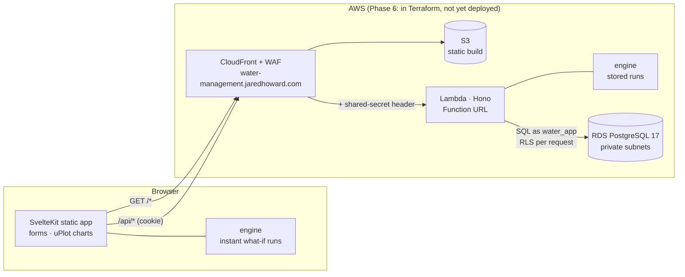

# Architecture

A web app for daily catchment water-balance modelling. It replaces the client's
**Water Balance Tool b023** Excel workbook ([model.md](./model.md)). Each
**project** is one catchment. Users keep as many projects as they need and
share each one with per-project roles.

## System



Locally the same pieces run as `vite dev` on `:7777`, a Node server
(`@hono/node-server`) on `:3001`, and Postgres 17 in docker on `:5434`
(plus Mailpit, which catches all email). The
browser calls the backend directly on `:3001` (CORS with credentials). In
production, CloudFront serves the site and **proxies `/api/*` from the same
origin**, so the session cookie is first-party.

## Workspaces

| Path | Package | What it is |
| --- | --- | --- |
| `packages/engine` | `@water-management/engine` | **The model.** Pure TypeScript with no I/O, no DB and no DOM. `runModel(ModelInput): ModelOutput`, plus the shared types (`project.ts`) for projects, model data, series and run outputs. Imported as source by both apps. |
| `backend` | `@water-management/backend` | Hono API: auth (incl. password reset, email verification, invites — email via `src/mail/`: Mailpit locally, SES in prod), projects, teams, members, the model document, series, runs, run comparison and CSV/JSON export. `src/app.ts` builds the app; `server.ts` (local, loads dotenv) and `lambda.ts` (AWS) are the entry points. esbuild bundles `lambda.ts` into `dist/lambda.mjs`. A third entry, `lambda-migrate.ts`, is the production migrate Lambda: it sets up `water_app` and applies the migrations as the schema owner. |
| `backend/migrations` | none | Plain SQL migrations, applied by `backend/scripts/migrate.ts`. |
| `frontend` | `@water-management/frontend` | SvelteKit 5 as an SPA: `adapter-static` with a fallback `index.html`, `ssr = false`, `prerender = false`. Served as static files, and all data comes from the API. CloudFront maps 404s to `index.html` so deep links work. |
| `e2e` | none | Playwright specs. They run locally against their own `water_e2e` DB and servers on `:3101`/`:7801` (a worktree gets its own slot: `e2e/support/env.ts`); CI runs them as 14 shards. |
| `scripts/wbt-import` | none (Python 3.14 + openpyxl) | Reads a b023 `.xlsm` into `project.json` and regression fixtures, written under `data/` (gitignored). |
| `infra` | none | Terraform: S3, CloudFront, WAF, security headers, the API Lambda + Function URL and the migrate Lambda (both in a VPC), RDS PostgreSQL 17 in private subnets, SES, ACM, Route 53, budget and alarms. Written and tested plan-only; not applied yet ([deployment.md](./deployment.md)). |

## Why one engine in two places

The same `runModel` runs:

- **in the browser**, for instant feedback while editing (a full client catchment run,
  16k days × 13 elements, takes about 18 ms). Nothing is saved. Automatic
  calibration (`engine/src/calibrate`) runs there too, in a Web Worker
  (`frontend/src/lib/calibration/autocal.worker.ts`): about a minute of model
  runs on the input from `GET /projects/:id/model-input`, with the unsaved
  Settings form in place of the saved settings. It fills the form and never
  saves.
- **in the backend**, for `POST /projects/:id/runs`. The backend loads the
  project as `water_app`, runs the engine, and stores the input snapshot,
  summary and output series. Stored runs are what users share and compare.

Because the engine is pure and deterministic, there is only one implementation
to test (invariant tests, plus the client catchment regression suite with its
documented departures from the workbook, [engine-audit.md](./engine-audit.md)),
and the browser and the stored result can never drift apart. Every run records `ENGINE_VERSION`.

## Code splitting (frontend)

SvelteKit already gives every route its own chunk. The catchment workspace
(`routes/projects/[id]`) is split further, because it carries most of the app:
only the Overview tab (the default view) ships in the route's chunk, and each
other tab (Network, Crops & demand, Transfers, Data, Settings & calibration,
Runs & results) is a dynamic `import()` of its component, as are the two
on-demand dialogs (Add data, and the Data tab's series preview). uPlot and the
engine code the tabs use land in shared chunks that load with the first tab
that needs them.

- `lib/components/common/lazy.ts` memoises each loader, so a hover prefetch,
  the render and a later remount share one request, and a remount renders at
  once. A failed import is forgotten so "Try again" refetches.
- `lib/components/common/Lazy.svelte` renders the standard `LoadState` while
  the chunk loads (or an error with "Try again"), then the component through a
  typed snippet, so the tab's props are still type-checked.
- The open tab's chunk starts downloading alongside the project data, and a
  tab link warms its chunk on hover or focus, so switching tabs rarely shows
  the loading state.

The trade-off: split chunks compress a little worse than one big chunk, so the
total shipped JS+CSS grows by a few percent, in exchange for a cold open of a
catchment downloading about 90 KB (gzip) instead of about 300 KB. The bundle
guard (`pnpm check:bundle`, `scripts/guards/check_web_bundle_budget.mjs`)
holds the largest single chunk down, which is what catches a tab's code
sliding back into the page chunk.

## Request lifecycle (backend)

1. CloudFront adds `X-CloudFront-Shared-Secret`, and the backend rejects
   requests without it (`403`; the check is off locally when the secret is
   empty).
2. App-wide middleware: CORS (only `ALLOWED_ORIGINS`, with credentials),
   Hono's CSRF check (cross-origin form posts get `403`) and a 4 MB body
   limit (`413`).
3. On every route except the public ones (`/health`, and the sign-in and
   emailed-link `/auth/*` routes), `requireUser` verifies the `wm_session`
   JWT (HS256, jose), checks it was issued after the user's
   `sessions_revoked_at` watermark (one `app_user` lookup by primary key), and
   sets `userId`. Otherwise `401`.
4. Project routes open **one transaction** on a pooled `pg` connection as
   `water_app` and run `set_config('app.current_user_id', userId, true)`. Every
   query inside it is filtered by RLS ([data-model.md § Access control](./data-model.md#access-control)).
5. zod validates the input. The model document is saved in one transaction
   (rows missing from a `PUT` are deleted). Tree validation runs before the
   write.
6. Errors map to `{ error, details? }` with 400/401/403/404/409/413/429,
   and anything unexpected to a generic 500; raw database error text never
   reaches the client ([api.md § Errors](./api.md#errors)).

## Data flow of a model run

```mermaid
sequenceDiagram
  participant B as Browser
  participant A as API (Lambda)
  participant P as Postgres
  B->>A: POST /projects/:id/runs
  A->>P: BEGIN; set app.current_user_id
  A->>P: SELECT project, nodes, crops, areas, transfers, series (RLS)
  A->>A: runModelChecked(input) ~20 ms
  A->>P: INSERT model_run (inputs snapshot, summary)
  A->>P: INSERT run_series × N (double precision[])
  A->>P: DELETE runs beyond the newest 20
  A->>P: COMMIT
  A-->>B: 201 { run, removedRunIds }
  B->>A: GET /runs/:runId/series?key=…&nodeId=…
  A-->>B: { startDate, values }  (one series per chart)
```

## Key choices

| Choice | Why |
| --- | --- |
| **Postgres, with RLS** rather than app-only checks | Per-project sharing is the core of multi-tenancy. RLS makes a forgotten `WHERE` clause fail closed. The runtime role can't bypass it. |
| **`double precision[]` per series** | 16k values is one row, not 16k rows. The engine and the charts always want whole series ([data-model.md](./data-model.md#time-series-storage)). |
| **JWT in an httpOnly cookie** | No token in JS-readable storage. Same-origin behind CloudFront, so `SameSite=Lax` works. |
| **Plain SQL migrations** | The schema is mostly RLS policies and triggers, which an ORM would hide. |
| **uPlot** | Draws 16k-point time series quickly, and it's small. |
| **Static frontend** | Cheap hosting on S3 + CloudFront, and no server-side rendering to secure. |
| **Python importer first** | openpyxl reads the 87 MB `.xlsm` reliably in read-only mode. An in-browser SheetJS importer comes later ([plan.md](./plan.md)). |
| **Lambda + RDS PostgreSQL 17 (t4g.micro)** | Low, predictable cost for a low-traffic expert tool. Always warm, and the same `pg` code path as local. Trade-offs in [plan.md 6b](./plan.md#6b-terraform-additions-infra). |

## Repo layout

```
water-management/
├── package.json           Root scripts (setup / dev / db / build / check / test)
├── docker-compose.yml     Postgres 17 on :5434, Mailpit (SMTP :1026, UI :8026)
├── dev/postgres/          First-boot SQL: water_app role, water_test DB
├── packages/engine/       Model + shared types (vitest)
├── backend/               Hono API, migrations/, scripts/migrate.ts (vitest: unit + db)
├── frontend/              SvelteKit static app (vitest)
├── scripts/               check_root_scripts.mjs, guards/ + release/ (node:test), wbt-import/ (Python)
├── infra/                 Terraform
├── docs/                  This documentation
├── data/                 Generated client fixtures (gitignored; workbooks live outside the repo in ../project-water-management-source/)
└── .github/workflows/     CI, deploy (release-gated), security scans
```
