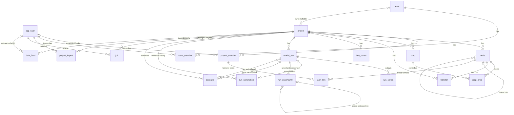

# Data model

Postgres 17 (locally in docker on `:5434`; in production RDS PostgreSQL 17, see
[deployment.md](./deployment.md)). The schema lives in plain SQL
migrations under `backend/migrations/` and is applied by a small runner
(`pnpm dev:db:migrate`). Once deployed, migrations only move forward: never edit
one that has shipped, add a new numbered file instead. Until the first
production deploy, `001_init.sql` may still be edited in place.

The TypeScript shapes that mirror these tables are in
`packages/engine/src/project.ts`. The backend (storage and validation) and the
frontend (forms) share them. The HTTP contract is in [api.md](./api.md).

## Entity overview

## Tables and their workbook origin

| Table | Purpose | b023 workbook origin |
| --- | --- | --- |
| `app_user` | Account: email (citext, unique), display name, bcrypt hash | none (the workbook has no users) |
| `team` | A group of users (name, creator) whose projects its members share; see [Teams](#teams-002_teamssql) | none |
| `team_member` | (team, user, team role) | none |
| `project` | One catchment/place: name, description, optional `team_id`. `settings jsonb` holds model-wide parameters (`ProjectSettings`) | One workbook. `settings` ← `[Crop demand]` A-pan and effective rain (plus `effectiveRainStoreMm`, the soil-water store, which the workbook doesn't have: default 25 mm, engine ≥ 0.14.0; and `lakeEvapFactor`, dam evaporation ÷ A-pan, default 0.75, engine ≥ 0.16.0), `[Farm demand]` Feb days, `[Farm spec]` method and Hi/Lo split, `[Flow Calibration Cfg]`, `[EWR Cfg]` pragmatic EWR, `[Home]` date window, `[Flow Calibration Cfg]` calibration window (`calibrationStart/End`) and `[Flow data]` rUseFlow (`calibrationFlowKind`). App-only keys (e.g. `runoffModel`, `panCoefficient`, `chirpsBiasCorrection`, `chirpsFitPeriod` (engine 0.29.0), `rainSource` (engine 0.30.0: periods whose catchment rain comes from `rain_catchment_alt_mm` × monthly factors, [model.md §2.4e](./model.md#24e-rain-source-periods-engine--0300-issue-40-b)), `pe` (engine 0.31.0: GR4J's potential-evaporation input, `{ kind: 'pan' }` or `{ kind: 'monthly', mm, source }`, [model.md §2.4a](./model.md#24a-rain-to-flow-gr4j-engine--050-issue-4); no SQL migration, since a project saved without it takes `{ kind: 'pan' }` from `mergeSettings`, what it always ran), `panCoefficientSource` (engine 0.31.1: free-text provenance of the pan-coefficient row, never read by the model), `zeroRainRuns` with its multi-day accumulation fields from engine 0.20.0, `dataQuality`, `reportStart/End`) have no workbook cell; missing keys take `defaultProjectSettings()` |
| `project_member` | (project, user, role) | none |
| `node` | A network element: `farm`, `gauge` or (engine ≥ 0.22.0, migration 011) `user`, an other water user, `downstream_node_id` (tree to one outflow gauge), areas, flow-share override, dam and diversion parameters, irrigation efficiency and loss return | `[Network]` (name, type, upstream links reversed into one downstream link) + `[Farm spec]` (every numeric column) |
| `crop` | A crop with 12 monthly crop factors (water-year order, Oct … Sep) and a display `sort_order` (003) | `[Crop demand]` crop table |
| `crop_area` | Planted m² per (farm node, crop) | `[Farm demand]` crop-area grid |
| `land_cover` | A land-cover patch on a farm (migration 013, engine ≥ 0.24.0, [model.md §2.5a](./model.md)): `node_id`, `cover_class` (`eucalyptus`, `pine`, `invasive`, `invasiveRiparian`, `other`), `area_km2` ≥ 0, `density_pct` 0–1 (condensed cover), `factors jsonb` null or `{ mar, lowFlow }` each 0–1 (CHECKs). Part of the model document, rewritten whole on save like `crop_area`; cascades with its node. RLS viewer/editor policies, same-project trigger on `node_id`, indexes on `project_id` and `node_id` | none (b023 has no land cover) |
| `transfer` | A structured transfer rule: from/to node, months, max rate m³/s, optional daily cap, min source storage %, enabled, `priority` (integer, lower moves first; equal priorities share a source dam pro rata, engine ≥ 0.16.0; migration 006 set it to each rule's old position in id order) | `[Transfers]` "Draw From" parameters. The hand-written InOut formulas become the rule itself (see [model.md §2.6](./model.md#26-transfers-transfers)). |
| `time_series` | A daily input series, stored as one array per (project, kind, name). `kind` is free text in the table; the API and `pnpm import:project` accept only `SERIES_KINDS` (engine 0.30.0 adds `rain_catchment_alt_mm` and `rain_reanalysis_mm`, read only by a rain-source period). `product` / `product_version` (032) and `day_boundary` (033) describe the values. `name` tells several series of one kind apart; a run uses the first of each kind by name | `[Flow data]` columns G–K: gauge flow, logger flow, catchment rain, CHIRPS rain, forecast rain. Column F (Pitman flow) is not a series kind from engine 0.10.0 ([audit P1](./engine-audit.md)); rows of that kind left in an older database are ignored by runs. With the importer's `--gauge-as-reference`, the gauge column becomes `flow_reference_m3s` (a gauge on another river, which runs never read; [model.md §2.10](./model.md#210-calibration-statistics-flow-calibration-cfg)) |
| `model_run` | One run: who and when, `engine_version`, date window, an **input snapshot** (`inputs jsonb`) and a small `summary jsonb`, plus the modeller's written `notes` (007) and a `pinned` flag (015), the only columns that change after the run is made, and `scenario_id` (024), the scenario that made it (null for a run of the live model) | A "Calc. Model" press plus the `[Log]` entry |
| `scenario` | Named overrides on a base run (024, WP-3.2): `base_run_id`, `ops jsonb`, `ops_sha256`, `owned_node_ids`, `owner_user_id`, `status`; see [Scenarios](#scenarios-024_scenariossql) | none (the workbook is copied by hand for a what-if) |
| `run_series` | One daily output array per (run, node, key). `node_id` null = catchment-level; otherwise a node of the **run's own** model snapshot, not a foreign key to the live `node` table (since 024: a scenario run has nodes the live model doesn't, and a node deleted from the model keeps its series in earlier runs) | Element-sheet columns (storage, spill, outflow, deficit, EWR shortfall…) and `[Flow data]` natural flow and simulated outflow |
| `project_import` | What the importer flagged when the project was imported (017): file name, source, importer version, who and when, and the notes and unmapped report as jsonb. Written once by the import, never changed; see [Import reports](#import-reports-017_project_importsql) | The whole workbook (or project file), as the browser importer read it |

### Field mapping details

| `node` column | Farm spec column | Notes |
| --- | --- | --- |
| `area_km2` | Total area farms (km²) | Used by the *Area* flow-share method and for `RainToM3` |
| `area_hi_km2` / `area_lo_km2` | Farm area high / low MAP | *Hi/Lo* method |
| `flow_share_manual` | External fragmentation (%) | *Specific* method (0–1) |
| `pct_upstream_to_dam` | "Upstream inflow above dam (%)" | The share of upstream inflow that enters the dam (engine ≥ 0.9.0). The workbook's formula applied it to the water passing below the dam; the client confirmed the label's meaning ([model.md Q1](./model.md#3-workbook-quirks-and-suspected-bugs)). Defaults to 1 (a dam on the river). |
| `pct_runoff_to_dam` | Farm runoff above (into) dam (%) | |
| `dam_capacity_m3` | Composite dam capacity (m³) | |
| `dam_initial_pct` | Initial dam volume (%) | |
| `dam_min_pct` | (not imported; the workbook's "Min dam volume" is the transfer minimum) | The dam's **minimum operating level** (dead storage, engine ≥ 0.16.0, Q5): irrigation draws only above `capacity × dam_min_pct`, and transfers keep `capacity × MAX(rule min, dam_min_pct)`. Migration 006 reset every stored value to 0; the importer writes 0 |
| `divert_capacity_m3_day` | Downstream diversion back to dam | The workbook enters m³/s and converts it. We store m³/day. |
| `dam_area_full_m2` | (none) | Dam surface area when full, m² (≥ 0, nullable; engine ≥ 0.16.0, [audit N2](./engine-audit.md)). NULL = unknown: runs estimate capacity ÷ 3 m and warn (W6). The importer writes NULL |
| `dam_area_exponent` | (none) | b in A = A_full × (S / capacity)^b, 0 < b ≤ 3, default 0.7 (Liebe et al. 2005) |
| `dam_seepage_per_day` | (none) | Seepage as a fraction of storage per day (0–1), default 0; it joins the farm's outflow |
| `irrigation_efficiency` | (from "Irrigation return flow (%)" r: e = 1 − r, floored at 0.01, or 1 when r = 0) | Application efficiency e, 0 < e ≤ 1 (CHECK), default 0.8 (engine ≥ 0.16.0, [audit N1](./engine-audit.md)): abstraction demand = crop requirement ÷ e |
| `loss_return_fraction` | (1 when r > 0, else 0) | Share β (0–1) of the application losses `(1 − e) × supplied` that returns to the river the same day; default 0.5. Migration 006 backfilled both from `return_flow_pct` and dropped that column |

| `user_demand_m3_day` | (none: b023 has no such element) | Kind `user` only (migration 011, engine ≥ 0.22.0, [model.md §2.7c](./model.md#27c-other-water-users-engine--0220-roadmap-wp-133)): demand from the river, m³/day per water-year month (12 values ≥ 0, CHECK); NULL = none |
| `user_return_pct` | (none) | Kind `user` only: share (0–1) of what it takes that returns below it the same day; default 0 |
| `borehole_capacity_m3_day` | (none: b023 has no groundwater) | Farms and users (migration 012, engine ≥ 0.23.0, [model.md §2.7d](./model.md)): most pumped per day, m³/day; NULL = no boreholes (every existing row) |
| `borehole_rule` | (none) | `supplemental` (default), `primary` or `drought` (CHECK); the API refuses `drought` without a farm dam and any borehole on a gauge |
| `borehole_trigger_pct` | (none) | Drought rule: runs while the dam is below this fraction of capacity (0–1, default 0.3) |
| `stream_depletion_frac` | (none) | Share d (0–1, default 0) of the pumping taken from the river at the node |
| `stream_depletion_lag_days` | (none) | Lag time constant k (0–36 500 days, default 0 = same day) |
| `user_priority` | (none) | Kind `user` only: `senior` (default) or `junior` (CHECK). The API refuses crop areas and transfers on a user node |

Every percentage is stored as a **fraction 0–1** (CHECK constraints enforce the
range).

Ordering: `sort_order` (on `node`, and on `crop` since 003) is only for display. The engine works out the
calculation order from the tree (upstream first, with `sort_order` as the
tie-break). The workbook's row-order rule ("upstream elements must be listed
first") therefore disappears.

The backend checks these on every `PUT /model`: node names are unique, the
references stay inside the same document, the graph is a tree, and there is
exactly one node with no downstream (the outflow gauge). The engine
(`buildTopology`) enforces the last two again and throws, so a run never picks
one of several outlets by array order.

## Time-series storage

A daily series is stored as **one row with a `double precision[]` array** plus a
`start_date`. `values[i]` is the value on `start_date + i` days, and `NULL`
elements mean "no reading".

Why arrays and not one row per day:

- **Size and speed.** A multi-decade daily record is well over ten thousand days. One row per day would be
  that many rows per input series and, for outputs, days × (nodes × keys) rows per run
  (millions of rows per run, each with ~24 bytes of tuple overhead). An array is
  one TOASTed value (8 bytes a day raw, compressed on disk). It loads with one index
  lookup and goes straight into a `Float64Array` in the engine.
- **The access pattern is whole-series.** The engine always needs a full series,
  and a chart fetches one series at a time. Nothing queries "flow on 3 March
  across all projects".
- **Simplicity.** There is no extension to install (TimescaleDB is not
  available on Aurora or RDS) and nothing to partition.

Trade-offs we accept: updating one day rewrites the whole array (fine, since
inputs are uploaded in bulk), and SQL date-range aggregates need `unnest … WITH
ORDINALITY` (fine for occasional reports).

### Series provenance (032_series_provenance.sql)

`time_series.product` and `product_version` say what the values are, e.g.
`CHIRPS` `2.0` (a b023 workbook's CHIRPS column), `CHIRPS sat` `3.0` or
`CHIRPS rnl` `3.0` (the CHIRPS feed's two daily products). Both or neither;
`NULL` = not recorded. The product is recorded apart from the version, and a
change of either is a change of forcing: v2.0 and v3.0 differ by an
era-dependent factor, and v3.0's `sat` and `rnl` disaggregate the same
pentads with different daily timing (issue #40 part c).

- **Set by** an upload (`PUT …/series` with `product` + `productVersion`; a
  replace that doesn't say clears it), a merge into an empty or new series,
  an import or project document, a copy, a data feed (the series it creates
  or, confirmed, replaces), a restore (the revision's label comes back with
  its values), and `PATCH /projects/:id/series/:seriesId` (a person saying
  what an existing series is, logged as `series.labelled`).
- **Kept** by a merge. A merge of days labelled with another product or
  version into a series holding values is refused (409): replace the series
  whole, or use another name. A data feed never merges into a series holding
  another label, or an unrecorded one, without an owner's confirmation
  ([architecture.md § Data feeds](./architecture.md#data-feeds)).
- **Read by** runs: each input series' label goes into the run's snapshot
  (`inputs.series[kind].provenance`), so the run comparison can say the
  version changed, and into the live model input, which the in-browser fit
  records as the fit's `forcing.chirpsSource`
  ([model.md §2.10b](./model.md)). The model never reads it, though a
  rain-source period's summary carries its series' label
  (`summary.rainSource.periods[].seriesProvenance`), so run comparison shows
  a change of the alternative gauge's product.
- **Not only CHIRPS.** The Upload form asks CHIRPS series for one of the
  known CHIRPS products, and the alternative catchment gauge
  (`rain_catchment_alt_mm`) and the reanalysis (`rain_reanalysis_mm`) for a
  free product and version (e.g. `SASSCAL AWS` `1`, `ERA5` `1`), optional
  (engine 0.30.0, issue #40 (b)).

### Series day boundary (033_series_day_boundary.sql)

`time_series.day_boundary` says how a series' days were built from
sub-daily readings (issue #40 (b) amendment 5, [model.md
§2.4e](./model.md#24e-rain-source-periods-engine--0300-issue-40-b)):
`'08:00'` = each day is 08:00 to 08:00 the next morning, booked to the day
it starts (the manual-gauge convention); `'00:00'` = midnight to midnight;
`NULL` = daily values as uploaded (a CHECK allows only these). The browser
adds an hourly or other sub-daily CSV up into days (each timestamp closes
its interval) and sends the boundary with the values.

- **Set by** an upload (`PUT …/series` with `dayBoundary`; a replace that
  doesn't say clears it), a merge into an empty or new series, a copy, and
  the project document (export and import).
- **Kept** by a merge. A merge that says the other boundary (`null`
  included) into a series holding values is refused (409), the same splice
  rule as the product/version guard above.
- **Kept by a series revision** (`series_revision.day_boundary`, 033), so a
  restore puts the boundary back with the values, as it does the product
  and version. The model never reads it.
- water_app's existing `time_series` grants and RLS policies cover the
  column.
- Checked by the same rules in the database (`CHECK`s) and the engine
  (`provenanceError`): 1–40 letters, digits, spaces, dots, dashes or
  underscores for the product, 1–20 without spaces for the version.

**Run output volume.** Each run stores tens to a couple of hundred output arrays
(nodes × keys, 8 bytes a day each before compression), so a multi-decade run is a few
MB to a few tens of MB. The engine is deterministic, so a run saved since
migration 021 can be recomputed from its `inputs` snapshot plus its stored
input series (`loadRunInput`, see **Stored run inputs** below) on the same
`engine_version`.

- **Cap per project.** Each new run deletes the project's oldest runs beyond
  `RUNS_KEPT_PER_PROJECT` (default **20**; unset or invalid → 20), with their
  `run_series` (cascade). It runs in the same transaction as the new run, as
  the signed-in editor, so RLS applies. Trims run one at a time per project
  (a transaction-scoped advisory lock, as the pin limit's trigger takes), so
  two runs saved at the same moment can't each trim before the other commits
  and leave the project over the cap. `POST …/runs` returns the removed ids
  (`removedRunIds`). A **kept** run is never trimmed and doesn't count
  against the cap: one an editor **pinned** (see **Pinned runs** below), one
  the evidence history names (current or past nomination, see **Evidence
  nomination** below), or one something **cites** (`model_run_cited`, see
  **Cited runs** below): a publication in the history cites its run
  ([Publications](#publications-022_publicationsql)), and a scenario its base
  ([Scenarios](#scenarios-024_scenariossql)). All of them go through
  one exemption, `RUN_KEPT_SQL` in `backend/src/runs/execute.ts`, which
  `trimRuns` and the `DELETE` route share. So a project holds at most 20
  unpinned, unnominated, uncited runs, plus at most 10 pinned, plus the runs
  its (at most 50) nominations name, plus the cited ones (the runs its at most
  12 publications hold among them). A trimmed run's stored inputs go with it
  (see **Stored run inputs**).
- **Output keys: none trimmed, on measurement.** On the local examples,
  TOAST compression already shrinks the constant or mostly-zero series
  (`transfer`, `is_summer`, catchment `ewr`, `deficit` on well-supplied farms)
  to a few hundred bytes to a few KB per run, against 30–60 KB for the
  high-entropy ones (`outflow`, `runoff`, `spill`, `inflow_upstream`). Every
  high-entropy key is charted or exported, so dropping keys would save little
  and change the API. If space ever matters, `real` (float4) outputs or a
  lower cap are the levers.
- **Working columns (engine ≥ 0.12.0).** Each farm also stores its 11
  intermediate columns (gross demand, effective rain, K–P, S, T and the
  balance check V; engine ≥ 0.14.0 adds a 12th, `soil_water`; [model.md §2.7](./model.md#27-farm-balance-one-sheet-per-element)),
  so a day can be checked by hand from the export. On the two-farm e2e
  catchment (120 days) they added 52 % to the run's `run_series` bytes
  (21.6 KB on 41.3 KB); expect roughly that share on a long run, since most of
  them are high-entropy. The alternative, recomputing them at export time from
  the input snapshot, would need the input series the snapshot doesn't keep,
  and would be a second implementation to keep in step with the engine.

**Run input snapshots.** `model_run.inputs` holds the settings and model data
the run used (a checkpoint; the continuous record between runs is
`model_revision`, § Change history and audit log). Input *series* values are not copied into it (they are large):
for each series kind the snapshot keeps `{ startDate, length, valuesSha256 }`,
where `valuesSha256` is the SHA-256 hex of `JSON.stringify(values)` (engine
`seriesDigest`, hashed by `backend/src/runs/execute.ts` `seriesHash`; it lives
in the `inputs` jsonb). Runs stored before it have no hash. Since migration
020 the values themselves are kept once per distinct content, keyed by that
same hash (see **Stored run inputs** below), so re-uploading a series no
longer stops an older run being recomputed; a run saved before 020 still
can't be. `GET /compare/runs` returns the whole snapshot, and
`GET …/runs/:runId` its `settings`. The compare "what changed" list (engine `diffInputs`, see
[run-comparison.md](./run-comparison.md)) sees a series being extended or
trimmed, and values edited within the same dates when both runs carry a hash.
The same hash could later drive an "inputs changed since this run" flag.

**Run notes (007_run_notes.sql).** A run is evidence, so it is immutable
except for one column: `model_run.notes` (text, `''` = none, at most 4 000
characters by `CHECK`), the modeller's written explanation, e.g. why a WR2012
*query* or *not usable* flag stands. `notes_updated_at` / `notes_updated_by`
(→ `app_user`, `ON DELETE SET NULL`, indexed) record the last change; the
`model_run_stamp_notes` BEFORE UPDATE trigger sets them whenever `notes`
changes and restores them on any other update, so the stamp can't be forged.
Immutability is enforced by privilege, not just by the API: `water_app` has
**no table-level `UPDATE` on `model_run`**, only `GRANT UPDATE (notes)`, so an
`UPDATE` naming any other column fails with `insufficient_privilege` whoever
runs it. The `model_run_update` policy (re-created in 007 with the same
editor-on-both-sides rule) limits even that to editors and owners; a viewer's
`UPDATE` matches no row. `PATCH /projects/:id/runs/:runId` is the only writer
([api.md](./api.md#runs)); the catalogue test pins `model_run`'s updatable
columns to exactly `notes` and `pinned` (below).

**Pinned runs (015_run_pinned.sql).** `model_run.pinned` (boolean, default
`false`) keeps a run, typically a baseline, past the storage cap: `trimRuns`
skips it and it doesn't count against `RUNS_KEPT_PER_PROJECT`, and
`DELETE …/runs/:runId` answers `409` until it is unpinned. It is the second
column `water_app` may update (`GRANT UPDATE (pinned)`, next to `notes`); the
`model_run_update` policy is unchanged, so only editors and owners can pin
and a viewer's `UPDATE` matches no row. **Ceiling: 10 pinned runs per
project** (a **cited** run's pin doesn't count, since 024: it is kept anyway,
and unpinning it is refused with `409 this run is cited by …`), so storage stays bounded (a long run is up to a few tens of MB, so
10 pins add at most half the cap again). The `model_run_pin_limit` BEFORE
UPDATE OF `pinned` trigger (`SECURITY DEFINER`, `search_path` pinned) refuses
an 11th pin with `check_violation`, under a per-project advisory lock so two
pins can't race past it; the API checks first and answers `409` with the
reason. `PINNED_RUNS_PER_PROJECT_MAX` in `backend/src/runs/execute.ts` holds
the same number. Pinning doesn't touch the note's stamp. A partial index
(`model_run_pinned_idx`, `WHERE pinned`) keeps counting a project's pins
cheap. `pinned` is on every run's metadata (`RunMeta`), so a feature that needs
a kept base run (scenarios, issue #18) can read it from the run list.

**Evidence nomination (010_run_nomination.sql).** Which run, and so which
runoff model, the project stands behind as evidence, so an applicant can't
pick whichever model is kindest after the fact (the licensing assessor's
concern, [followups.md](./followups.md), roadmap WP-3.1 "cited runs").
`run_nomination` is an **append-only history**, one row per nomination:
`project_id`, `run_id` (→ `model_run`), `runoff_model` and `engine_version`
(copied from the run), `reason` (required, trimmed, at most 2 000 characters
by `CHECK`), `nominated_by` (→ `app_user`) and `nominated_at`. The newest row
(by `nominated_at`, unique per project) is the **current** nomination; every
older row is kept, so the history reads "nominated A on …, then replaced by
B on … because …". A run can be nominated again later (A, B, A).

- **Append-only by privilege.** `water_app` has `SELECT` and `INSERT` only: no
  `UPDATE`, `DELETE` or `TRUNCATE`, and the table has no update or delete
  policy. The catalogue test pins this (`APPEND_ONLY`).
- **Unforgeable stamps.** The `run_nomination_stamp` BEFORE INSERT trigger
  (`SECURITY DEFINER`, `search_path` pinned) sets `nominated_by` from
  `app.current_user_id`, `nominated_at` from `clock_timestamp()`, and
  `runoff_model` / `engine_version` from the run itself, whatever the `INSERT`
  says. Runs are immutable except `notes`, so the copy can't drift.
- **Rules the trigger enforces** (the API checks them first for a clear `409`):
  the run belongs to the same project (`foreign_key_violation`); it is not a
  legacy-model run, which is workbook comparison only (audit H1); it is not
  already the current nomination; the project has fewer than **50**
  nominations. The trigger takes a per-project advisory lock, so two
  nominations can't race past these checks or share a timestamp.
- **RLS:** viewers read, editors and owners insert (`run_nomination_select`,
  `run_nomination_insert`).
- **A nominated run is kept for good**, current or past. The foreign key is
  `NO ACTION`, so deleting the run fails (`DELETE …/runs/:runId` answers `409`
  first); `trimRuns` skips it, and it does not count against
  `RUNS_KEPT_PER_PROJECT` (the cap keeps the newest 20 runs that are neither
  nominated nor pinned). `NO ACTION` rather than `RESTRICT` is checked at the end of the
  statement, so deleting the whole project (owner only) still cascades to
  both tables. The 50-nomination limit bounds how many runs can be kept this
  way.
- No `ON DELETE` on `nominated_by`, the same as `model_run.created_by`: there
  is no account deletion yet. When there is, it must keep the history (for
  example a tombstone user), not cascade it away.
- Migration 009 was reserved for pinned runs (issue #7), which landed as
  015 instead. 009 is an unused gap; the runner applies every unapplied file
  in name order, so the gap is harmless.

**Uncertainty bands (014_run_uncertainty.sql).** One row per ensemble a
run's editor starts ([model.md §2.10e](./model.md#210e-uncertainty-bands-engine--0260-issue-4-phase-9)):
`project_id`, `run_id` (→ `model_run`, cascade), `baseline_id` (→ another
`run_uncertainty` row, cascade; set for a **paired** band, which re-runs that
baseline's kept members on this run), `runoff_model`, `engine_version`,
`method` (`lhs`), `seed`, `members`, `options jsonb` (the resolved options:
dimensions, rain sources, records, the acceptance **thresholds**), `status`
(`started` → `complete`), and on completion `accepted`, `summary jsonb` (the
bands, coverage, notes and decision rule) and `result jsonb` (the header, the
kept members' parameters and outputs, every member's scores and verdict, the
coverage), `created_by`, `created_at`, `completed_at`. A CHECK ties the four
completion columns to `status`. Indexes cover every foreign key, `run_id`
leading `(run_id, created_at DESC)`. A 300-member result is ~200–300 KB.

Un-cherry-pickable by privilege (the licensing assessor's concern, issue #15):

- **The database draws the seed.** The `run_uncertainty_start` BEFORE INSERT
  trigger (`SECURITY DEFINER`, `search_path` pinned) sets `seed` (and
  `options.seed`) itself, stamps `created_by` / `created_at` from the session,
  forces `status = 'started'` and empty results, checks the run (and a
  baseline) belong to the project, and caps a run at **50** starts under a
  per-run advisory lock. A paired row copies its baseline's options, seed,
  members, method and model, and needs a complete, unpaired baseline of
  another run.
- **Every start is kept.** `water_app` has `SELECT`, `INSERT`, and `UPDATE` of
  `status`, `accepted`, `summary`, `result`, `completed_at` only; no `DELETE`
  and no delete policy (the catalogue test's `COLUMN_ONLY_UPDATE` and
  `NO_DELETE`). An ensemble started and never completed stays, visibly
  abandoned.
- **Completed once.** The update policy only sees `started` rows, and the
  `run_uncertainty_complete` trigger lets only whoever started a row complete
  it, only to `complete`, stamping `completed_at`. Options and thresholds are
  outside the column grant.
- Rows go only with their run (a nominated run can't be deleted) or project.
- **RLS:** viewers read; editors insert and complete (`run_uncertainty_select`,
  `_insert`, `_update`).

**Calibration provenance lives in `project.settings`** (no table, column or
migration; issue #4). `settings.calibrationExclusions` is the list of periods
left out of every calibration score, each a whole water year or a date range
with a required reason. `settings.fitRecord` is the record of the automatic fit
whose parameters Apply wrote: objective, seed, budget, window, exclusions, the
in-sample and validation scores, notes, engine version and time, and the pan
coefficient / A-pan evaporation and (engine ≥ 0.31.0) GR4J's PE input,
`forcing.pe`, it ran under (`forcing`, since it is held
fixed and never calibrated — a fit is only valid for the forcing it was
fitted under) ([model.md §2.10b](./model.md)). The backend recomputes its `editedParams` on
every settings save (`patchSettings` in `backend/src/projects/settings.ts`) and
again when a run snapshots the settings (`executeRun`), so each
`model_run.inputs.settings` carries the fit record as it stood for that run's
parameters, marked when they were edited by hand after the fit. Both keys ride
the existing `project` and `model_run` RLS (viewer reads, editor writes), so
they add no policy. They are small: a fit record is a few KB.

### Change history and audit log (030_history.sql)

Roadmap WP-2.4, issue #28: "who changed which parameter, when, and why did
the result change?", and put back any earlier version.

- **`model_revision`**: one row per save of the model or the settings, at
  the **document** level, written in the same transaction by the route that
  saves (not by row triggers: `saveModel` rewrites every node and crop area,
  so a trigger would log hundreds of meaningless changes per save). It holds
  `source` (`model_put`, `settings_patch`, `restore`, `import`, `copy`,
  `baseline`), the optional `reason` (≤ 500, from the save bar), `snapshot`
  `{ settings, model }` (the shape of `model_run.inputs` without series),
  `changes` (the engine's `diffInputs` lines against the previous revision),
  `node_ids` (for the farm filter), and `restored_from` / `restored_from_run`.
  A save whose snapshot is unchanged writes nothing; a reorder is recorded,
  with a line saying it only changed the order. A **`baseline`** row stores
  the state before the first change to a project that predates history, so
  that state can be restored too.
- **`series_revision`**: a series' previous values, written *before* a
  replace, a delete or a merge from the UI (not for feed or key merges,
  which are append-mostly: they get an audit event only). `series_id` is a
  plain uuid, not a foreign key, so a deleted series can still be restored by
  its old id; `unit` is kept with it. **Retention**: the newest 5 per
  (project, kind, name) and nothing older than 180 days, trimmed by a
  `SECURITY DEFINER` trigger on insert. `product` / `product_version` (032)
  keep the series' label with its values, so a restore puts it back.
  `reason` is `replace`, `delete`, `manual_merge`, or `feed_replace` (032: the
  values a data feed replaced under an owner's confirmation).
- **`audit_event`**: append-only access, data and publication events, with
  `actor_user_id` (must be the caller), `actor_label` (the display name then),
  `kind`, `subject jsonb`, `change_set`, and `actor_api_key_id` (reserved,
  unused until API keys exist). Kinds recorded: `member.added/removed/role`
  (an accepted invite logs `member.added` in `app_accept_invites`),
  `farmer.linked/unlinked` (including unlinks a model save, a member leaving
  or a restore causes, and a farmer invite's links, cause `invite`, logged
  in `app_accept_invites`), `invite.sent/revoked` (email masked
  `j•••@domain`; a farmer invite adds its number of `farms`),
  `publication.published/notice_changed`, `share_link.created/revoked`,
  `series.created/replaced/merged/deleted` (day range, `valuesSha256`, days
  changed; a replace that changed the series' product or version adds
  `provenance: { from, to }`), `series.labelled` (032: a label changed by
  PATCH, `provenance: { from, to }`), `run.created/changed/deleted/trimmed`, `feed.configured`,
  `feed.failed` (only the first failure after a success), `project.changed`,
  `report_schedule.configured`, `scenario.created/changed/deleted`, the
  application workflow's `scenario.submitted/withdrawn/reopened/decided/shared/unshared`
  (036; an application's events carry `application: true` and no name until
  it is decided), and restores. `api_key.*` is reserved.
- **Change sets.** `withUser` sets `app.change_set_id` to a fresh UUID per
  request (transaction-local), read by `app_change_set_id()`, so a save and
  the farmer unlinks it caused show as one entry.
- **`project.history_since`**: when recording started for the project (its
  creation, or the migration's time for an older project). The History tab's
  empty state says "History starts from {date}".
- **Access.** Viewers and above read all three tables; farmers see nothing
  (D4), and strangers nothing. `water_app` has `SELECT` and `INSERT` only,
  and there is no `UPDATE` or `DELETE` policy for anyone (append-only; the
  catalogue test lists them in `APPEND_ONLY`). Only the retention trigger
  deletes, and only old `series_revision` rows of the series being written.
- **Restore** always writes a *new* revision pointing at what it restored
  (history is never rewritten). It answers `409` when the inputs already
  match, and when the old model fails today's validation. A restored farm
  node comes back with its old id but **without its farmer links** (they were
  cascaded away); the response and the UI list whom to re-link, from the
  `farmer.unlinked` events. Series values aren't part of a model version:
  they come back only through `series_revision`, within its retention. A
  scenario run's inputs can't be restored into the project (`409`): they are
  the scenario applied to its base run (WP-3.2).
- **Relation to run snapshots.** A run's `inputs` is an occasional full
  checkpoint; `model_revision` is the continuous record between checkpoints,
  in the same shape. "Why did the result change between run A and run B?" is
  the revisions between their dates; "restore the inputs this run used"
  writes `A.inputs.{settings, model}` as a new revision.
- **The guard.** `backend/src/history/write-routes.db.test.ts` is a table of
  every non-GET route under `/projects/:id`: each either `records` (with a
  `call` that proves the revision or event is written) or is `exempt` with a
  reason. A new write route fails the inventory until it's listed. Exempt
  today, with reasons in the table: project delete, `POST /jobs`, feed
  run-now, evidence nomination (its own append-only history), uncertainty
  ensembles, `POST /reports`.

### Stored run inputs (021_series_blob.sql)

Roadmap WP-3.1: a run can be recomputed exactly years later, whatever
happens to the live project. `executeRun` writes each input series' values
to a content-addressed store and `loadRunInput(db, runId)`
(`backend/src/runs/execute.ts`) rebuilds the run's exact `ModelInput`: the
snapshot's settings and model plus the stored series. The DB test
`runs/reproducible.db.test.ts` re-runs `runModelChecked(loadRunInput(run))`
on all three example catchments and finds the stored summary and every
daily output byte-identical (compared as RFC 8785 canonical JSON, engine
`canonicalJson`).

- **`series_blob`** `(project_id, sha256)` PK, `"values" float8[]`,
  `created_at`. `sha256` is the snapshot's `valuesSha256` for those values
  (hex, `CHECK`ed). The start date is not part of the content; it is on the
  reference. Deduplicated **within a project**: a series that didn't change
  between runs is stored once however many runs use it. Not across projects,
  on purpose ([security.md](./security.md#authorization-per-project-roles-enforced-by-postgres-rls)).
- **`run_input_series`** `(run_id, kind)` PK, `project_id`, `start_date`,
  `sha256`: which blob each kind of the run used. `run_id` → `model_run`
  cascade; `(project_id, sha256)` → `series_blob`, `NO ACTION` (checked at
  the end of the statement, so deleting a whole project still cascades, but
  no statement can leave a run pointing at a missing blob). Index
  `(project_id, sha256)` covers both foreign keys and the lookups below.
- **Writes.** `executeRun` stores the inputs last, after the outputs, under
  the project's run lock (`lockProjectRuns`, the advisory lock `trimRuns`
  already took): it asks which of the run's hashes the project already holds,
  inserts only the new values (`ON CONFLICT DO NOTHING`), then the run's
  references. A reference may only be inserted by an editor, for a run of the
  same project saved in the same transaction (`model_run.created_at =
  now()`). Nothing updates either table.
- **Reads.** `series_blob` is visible through a `run_input_series` row the
  user can see, which is visible through a `model_run` the user can see
  (viewer). `loadRunInput` re-hashes each blob and checks it against the
  snapshot's hash, start date and length.
- **`loadRunInput` errors** (`RunInputError.problem`): `not_found` (no such
  run visible to the user); `not_reproducible` (saved before 021, so it has
  snapshot hashes but no stored series: "this run is not reproducible from
  stored inputs: it was made on YYYY-MM-DD, before runs stored their input
  series"); `inconsistent` (a stored series is missing, or disagrees with the
  snapshot's start, length or SHA-256; never expected, and the run is then
  not presented as reproduced). No backfill: older runs keep hash-only
  snapshots.
- **Garbage collection and retention.** A reference goes with its run
  (cascade: trimmed by the cap, deleted by an editor, or the whole project).
  The statement-level `run_input_series_gc` trigger (`series_blob_gc`,
  `SECURITY DEFINER`, `search_path` pinned) then deletes every blob of the
  affected projects that no remaining run references. So a blob lives exactly
  as long as some run uses it: blobs of kept runs (pinned, nominated, cited)
  are never collected, a trimmed run's are, unless a newer or kept run shares
  them. The run lock serialises this against a new run reusing the same blob
  (the trim and the `DELETE …/runs/:runId` route take it too).
- **Storage.** Measured on the largest example (Sandspruit: 4 input series,
  16 447 days each, about 525 KB raw): its blobs take **52 KB** on disk after
  TOAST compression (13 KB a series), stored once. Each further run that
  reuses them adds only its references, **~0.6 KB** (4 rows), against
  **~5.1 MB** of `run_series` outputs for the same run; a re-uploaded series
  adds one compressed array (~13 KB here) the first time a run uses it. So the
  input store is about 1 % of the first run and noise after that; the
  outputs cap (`RUNS_KEPT_PER_PROJECT`) remains what bounds a project's size.
  A project's input store is bounded by the distinct series versions its
  kept and newest runs used.
- **Cost.** `executeRun` on the examples, median of 9 (runs reusing their
  inputs): Kleinberg 823 → 837 ms, Droëvlei 617 → 644 ms, Sandspruit
  1440 → 1469 ms (+2–4 %, one extra lookup and the reference insert; the run
  lock is held from the input writes to commit, where the trim already held
  it).

**Cited runs (021_series_blob.sql, 022_publication.sql, 024_scenarios.sql).**
A run a publication holds (WP-2.3), a scenario is based on (WP-3.2), or that
an evidence pack or assessment cites (WP-3.13, WP-3.14) must never be trimmed
or deleted, and no editor action may lift that (unlike a pin). "Cited" is
derived, not stored: `model_run_cited(p_run uuid)` (SQL, `STABLE SECURITY
DEFINER`, `search_path` pinned) is part of `RUN_KEPT_SQL`, so `trimRuns`
spares a cited run, it doesn't count against the cap, and the `DELETE` route
answers `409` (`run is published: …` for a publication, `this run is cited by
scenario "…", so it is kept` for a scenario). Its body since 024 is
`EXISTS (… run_publication p WHERE p.run_id = p_run) OR EXISTS (… scenario s
WHERE s.base_run_id = p_run)`. **Each later citing table's migration adds one
clause**: `CREATE OR REPLACE FUNCTION model_run_cited` with the latest body
(024's) plus `OR EXISTS (SELECT 1 FROM <table> WHERE <run column> = p_run)`,
same signature, `SECURITY DEFINER` and `search_path`, alongside a `NO ACTION`
foreign key to `model_run`, and adds its kind to `CITED_BY_SQL`
(`backend/src/runs/execute.ts`, `RunMeta.citedBy`: `publication` and
`scenario` today). `RUN_KEPT_SQL`, `trimRuns` and the routes need no change.
`SECURITY DEFINER` so a citation the caller can't see still keeps the run. A
cited run's pin doesn't count against the 10-pin ceiling, and unpinning one
is `409`. **The publication-history cap (keep the newest 12) skips a
publication whose run a scenario is based on** (024 re-creates
`run_publication_cap` from 022's body): the scenario still keeps the run
either way, but its "published" provenance, what a scenario base's banner and
WP-3.3's "the base must be published" rest on, would otherwise vanish. So a
project holds at most 12 publications plus one per scenario base.

### Scenarios (024_scenarios.sql)

Roadmap WP-3.2, [scenarios.md](./scenarios.md). A scenario is a named, ordered
list of overrides (engine `ScenarioOp`) on a **base run**, applied to that
run's stored input (above), never the live model.

- **`scenario`**: `id`, `project_id` (→ `project`, cascade), `name` (1–200
  characters, unique per project ignoring case and surrounding spaces:
  `scenario_name_idx`, which also covers the project foreign key),
  `description` (≤ 4 000), `base_run_id` (→ `model_run`, `NO ACTION`), `ops
  jsonb` (an array of at most 500 ops and 1 MiB of JSON text, `CHECK`),
  `ops_sha256` (hex, the SHA-256 of the ops as RFC 8785 canonical JSON,
  written by the API), `owned_node_ids uuid[]` (≤ 500: the proposer's own
  nodes; ops on them are proposals, the rest baseline assumptions),
  `owner_user_id` (→ `app_user`), `status` (`draft` | `submitted` |
  `withdrawn` | `decided`), `created_at`, `updated_at`. Indexes cover
  `base_run_id` and `owner_user_id`.
- **`NO ACTION`, not the plan's `RESTRICT`**, on `base_run_id`: checked at the
  end of the statement, so deleting a whole project (which cascades to both
  `model_run` and `scenario`) still works, as for `run_nomination`. Any other
  delete of a base run fails, and `model_run_cited` keeps it from being tried.
- **`model_run.scenario_id`** (→ `scenario`, `ON DELETE SET NULL`, partial
  index `WHERE scenario_id IS NOT NULL`): which scenario made the run. Set on
  insert only (the app has no `UPDATE` on it). The run's own snapshot keeps
  what the scenario was when it ran, in `inputs.scenario`: `{ id, name,
  baseRunId, ops, opsSha256, ownedNodeIds, classified }`, so deleting,
  editing or rebasing the scenario never changes what its runs say.
- **Triggers.** `scenario_guard` (BEFORE INSERT, UPDATE, DELETE; `SECURITY
  DEFINER`, `search_path` pinned): stamps `owner_user_id` from the session and
  the times; the base must be a run of the **same project** and not itself a
  scenario run (`foreign_key_violation` / `check_violation`); `project_id`,
  owner and creation time never change; a scenario that isn't a `draft` is
  **frozen** (its `ops`, `ops_sha256`, `base_run_id` and `owned_node_ids`
  can't change) and a `submitted` or `decided` one can't be deleted; status
  moves only `draft → submitted → withdrawn | decided`, `withdrawn → draft`.
  `model_run_scenario_same_project` (BEFORE INSERT): a run's scenario is one
  of its own project's. The API answers each of these with a `409` first.
- **RLS**: `SELECT` viewer, `INSERT` / `UPDATE` / `DELETE` editor. **Farmers
  read nothing** (no policy names them, so the viewer floor refuses them), as
  for `model_run`: a scenario's ops and base name every farm. 036 replaced
  these four with origin-aware ones (§ Applicants); a team scenario keeps
  exactly this rule. `water_app` has `SELECT, INSERT, UPDATE, DELETE`.
- **`run_series.node_id` since 024.** 001 made it a foreign key to `node`
  (`ON DELETE CASCADE`) with a same-project trigger. A scenario run stores
  series for nodes the live model never had (`node.add`), and the cascade
  deleted a node's series from every earlier run when the node was deleted
  from the model, so a kept or cited run silently lost part of its results.
  The key, its trigger and its index are gone; the statement-level
  `run_series_nodes_in_run` triggers (AFTER INSERT and AFTER UPDATE, one
  read of each run's snapshot per statement) check that every row's run is
  in the same project and its `node_id` is a node of that run's
  `inputs.model.nodes`. A run's series now go only with the run.
- **Concurrency.** Creating, rebasing and deleting a scenario take the
  project's run lock (`lockProjectRuns`) first, as `trimRuns` does, so a trim
  never misses a citation being added in the same moment. A scenario run
  takes the same lock before it reads its scenario, and the delete and
  rebase routes take it before they touch the row, so a run racing either
  waits for it. (Until 036 the run also held the row `FOR KEY SHARE`; that
  lock needs the `UPDATE` policy, which a shared member or an assessor
  running an application doesn't pass.) A submit holds the row `FOR UPDATE`
  from its check to its commit, so the ops it checked are the ones frozen.
- Guards: `backend/src/scenarios/scenarios.db.test.ts` (with positive
  controls), the catalogue tests (RLS, grants, covering indexes,
  `search_path`) and the route inventories (auth and farmer `403`).

### Import reports (017_project_import.sql)

When a project is imported in the browser (a b023 workbook, or a project
file), the review lists the importer's **notes** and the **unmapped report**
(plan.md 1b): what it interpreted, and what it couldn't carry across as the
workbook meant. Workbooks are hand-made and have mistakes, so that list is the
audit trail of what was flagged; the hydrologist, and later a licensing
assessor, needs it long after the import. `POST /projects/import` stores it in
the import's own transaction ([api.md § Import report](./api.md#import-report)).

- **Columns:** `project_id` (→ `project`, cascade), `imported_at`,
  `imported_by` (→ `app_user`; no `ON DELETE`, like `model_run.created_by`:
  there is no account deletion yet, and WP-1.13 makes both `SET NULL`),
  `source` (`b023-workbook` | `project-file`), `file_name` (≤ 255),
  `importer_version` (≤ 100, e.g. `b023 browser importer (web build …)`),
  `notes jsonb` (`ImportNote[]`), `unmapped jsonb` (`UnmappedItem[]`), and
  `notes_omitted` / `unmapped_omitted` (items found beyond the kept 500 per
  list). CHECKs: both lists are arrays of at most 500, and together at most
  1 MiB of jsonb text (the API's own cap is 512 KB of JSON, so the CHECK is only
  a backstop). Indexes cover both foreign keys, `(project_id, imported_at DESC)`
  leading the newest-first lookup.
- **Its own table, not a `project` column.** It is written once and never
  changed, which a column on a table editors update freely can't promise (the
  grant below can); it keeps up to ~1 MB of notes off every `GET /projects`
  row; and one row per import leaves room for re-importing a workbook into an
  existing project later.
- **One row per import, no uniqueness.** Today a project is imported once, so
  it has at most one row; `GET /projects/:id/import-report` returns the newest.
  A future re-import would add rows (the newest is the current report, the rest
  its history) and needs only the trigger's same-transaction rule relaxed.
- **Written only by the import.** The `project_import_stamp` BEFORE INSERT
  trigger (`search_path` pinned; runs as the caller, so its project lookup is
  under RLS too) stamps `imported_by` and `imported_at` from the session and
  refuses (`insufficient_privilege`) unless the project was created by that user
  **in the same transaction** (`project.created_at = now()`, the transaction's
  start). A report can't be attached to, or forged onto, an existing project,
  even by its owner.
- **Append-only by privilege.** `water_app` has `SELECT` and `INSERT` only (the
  catalogue test's `APPEND_ONLY`); no update or delete policy. Rows go with
  their project. Copying a project (`POST /projects/:id/copy`) doesn't copy the
  report: the copy wasn't imported.
- **RLS:** viewers read (`project_import_select`); an owner inserts, as
  themselves (`project_import_insert`: `app_has_role(project_id, 'owner') AND
  imported_by = app_current_user_id()`). The importer is always the new
  project's owner.
- The strings are the file's (farm names, formula text): untrusted, capped by
  the API and rendered as text only ([security.md § Import reports](./security.md#import-reports)).

## Access control

### Roles

| Role | Can |
| --- | --- |
| `farmer` | Read only the farms linked to them (`farm_link`), and leave. Nothing of the model, series or runs (§ Farmers, 019/020) |
| `contributor` | An applicant (WP-3.3). What a farmer with the same links reads, plus their own applications on the published baseline and those shared with them, their runs, and the published runs' catchment series. Nothing unpublished, no other farm's inputs, no other applicant's drafts (§ Applicants, 035/036) |
| `viewer` | Read the project, its model, series, runs and members |
| `editor` | Everything a viewer can, plus change settings and model data, upload series, run the model, write a run's notes, delete runs |
| `owner` | Everything an editor can, plus add/remove members, change roles, delete the project |

Whoever creates a project becomes its first `owner`. This happens in a trigger,
atomically with the insert. A deferred constraint trigger makes sure that a
project always keeps **at least one owner**. Any member may remove themselves.

### Farmers (019_farmer_role.sql, 020_farm_scope.sql)

A **farmer** (roadmap WP-2.1, issue #24; design
[design/farmer-view.md](./design/farmer-view.md) §10) is a direct project
member with the role `farmer`, linked to one or more farm nodes in
`farm_link (project_id, node_id, user_id, added_by, added_at)`. A farm may
have several farmers, and a farmer several farms, in any number of projects.
Only an owner adds or changes links (`POST` / `PUT /projects/:id/farmers`,
[api.md](./api.md#farmers)).

- **The role sorts below `viewer`** (`farmer < viewer < editor < owner`).
  Every existing policy asks for `viewer` or above, so it refuses a farmer
  without being touched: a table nobody wrote a farmer policy for stays closed
  to farmers (fail closed). The backend's `requireRole` ranks it the same way,
  so every route that asks for `viewer` answers a farmer `403`. Team roles
  never map to `farmer`, and the effective role is the higher of the direct
  and the team role, so a farmer who is also in the team is simply an editor
  or viewer. `019` adds the value on its own because an enum value can't be
  used in the transaction that added it.
- **What a farmer reads** is added as extra permissive `SELECT` policies,
  ORed with the viewer ones (`020`), through `app_farm_nodes(project)` (the
  current user's linked nodes, `SECURITY DEFINER`):

  | Table | A farmer may read |
  | --- | --- |
  | `project` | the row |
  | `project_member` | their own row only, never the list (it holds neighbours' emails) |
  | `node` | their linked farms, and the gauges; no other farm, not even its name, and no other water user |
  | `crop_area`, `land_cover` | rows on their linked farms |
  | `crop` | only the crops planted on their linked farms |
  | `transfer` | rules with either end on a linked farm (the other end is an id they can't resolve) |
  | `farm_link` | their own links |
  | `run_publication` | every publication of the project (the notice, counts-only `catchment_view`; 022) |
  | `publication_farm` | the projections of their linked farms (022) |
  | `run_series` | their linked farms' farm-allowlist series (`demand`, `supplied`, `deficit`, `dam_storage`, `spill`, `transfer`) of the **current** publication's run, nothing else (022) |
  | everything else | nothing: no `time_series` (observed and logger flows reveal neighbours' use in a small catchment), no `model_run` (its inputs and summary hold every farm), no other `run_series` (flows such as `inflow_upstream` are a neighbour's outflow when one farm is upstream; catchment series reveal the neighbours' use), no `scenario` (its ops and base name every farm; 024), no invites, teams, jobs, feeds or evidence |

  A farmer writes nothing: every write policy asks for `editor` or `owner`.
- **A link needs a membership and goes with it**: `farm_link` has a foreign
  key to `project_member (project_id, user_id) ON DELETE CASCADE`, so removing
  a farmer, their leaving, or the project going removes their links, and a
  deleted farm node takes its links with it. A save of the model keeps them
  (nodes are upserted by id); a farm changed into a gauge or water user loses
  them (trigger `node_unlink_farmers`), and the Network tab says so first. A trigger allows only `farm`
  nodes and only members whose role is `farmer`; `assert_same_project` keeps
  the node in the project.
- **Farmer invites** (034, WP-2.2): an address without a verified account is
  invited with the role `farmer`, and `invite_node (invite_id, project_id,
  node_id)` holds the farms the invite will link. Accepting it creates the
  membership and those `farm_link` rows together (`app_accept_invites`,
  [§ Email tokens and invites](#email-tokens-and-invites-004_emailsql)).
  Deleting a farm, or turning it into a gauge or water user
  (`node_unlink_farmers` also clears `invite_node`), takes it out of every
  pending invite; the invite stays with its other farms.
- **Who can see a farm** (022, design §10.2): `app_farm_access(project,
  node)` lists everyone who can read that farm, by display name and effective
  role, never an email: its linked farmers, and every viewer-and-above member
  (direct or through the team). It answers a viewer or a user linked to that
  farm, and no row to anyone else, so a farmer on another farm can't ask.
- **Anonymised context** (decision D1, option b): `app_farm_context(project,
  node)` returns the number of farms upstream and downstream of a node and
  the catchment's farm count, never ids or names, to a viewer or a user
  linked to that node, and no row to anyone else.
- **The aggregate rule** (decision D2): `app_other_farm_holders(project)`
  counts the holders of the farms *not* linked to the current user, farms
  linked to the same user counted once and an unlinked farm on its own. A
  farmer-facing aggregate of farm quantities (totals, the even share) is shown
  only when it is at least `k − 1` (`k = 5`, pending the client). One owner
  holding three of five farms therefore can't read the other two's combined
  figures.
- Guards: `src/farms/farms.db.test.ts` (every table, with positive controls,
  and every `/projects/:id` route answering a farmer `400`/`403`), and a
  catalogue test that every table with a node column has a farmer-aware
  `SELECT` policy or is listed as never read by farmers (none since 022 gave
  `run_series` its publication-scoped farmer policy).

### Applicants (035/036)

A **contributor** (roadmap WP-3.3) is a licence applicant or their
consultant: a direct project member (`POST /projects/:id/members` with
`role: 'contributor'`; the UI calls it "Applicant"), ranked `farmer <
contributor < viewer < editor < owner`. `035_contributor_role.sql` adds the
enum value alone (it can't be used in the transaction that adds it);
`036_contributor_scope.sql` adds everything else.

- **Below viewer, like a farmer.** Every existing policy and every
  `requireRole(…, 'viewer')` refuses a contributor untouched (fail closed);
  what they may do is only extra permissive policies. Team roles never map
  to `contributor`, and `app_project_role` takes the max, so a team member
  who is also a contributor is an editor (and their scenarios are team
  scenarios). Hence D1: a consultancy mustn't host the baseline in its own
  team while its staff act for applicants.
- **Farm links.** A contributor keeps farm links (an irrigator applying to
  raise their own dam): `farm_link_check` admits `farmer` or `contributor`,
  and `/farmers` lists and relinks both (`role` on each row). Every farmer
  policy of 020/022 is keyed on `app_farm_nodes()` (the links), not on the
  role, so a linked contributor reads exactly what a farmer with the same
  links reads; the policies that admit "every member" (`app_has_role(…,
  'farmer')`: `project`, `run_publication`, `audit_event` insert) admit a
  contributor, who ranks above a farmer. The audit of WP-2.1's helpers found
  one role test to widen (`farm_link_check`); `app_accept_invites` links
  farms only on a farmer invite, and `app_farm_access` lists a linked
  contributor as the farm's farmer.
- **`scenario.origin`** `'team' | 'applicant'`, stamped by `scenario_guard`
  from the creator's role and never changed, plus the decision:
  `submitted_at`, `decided_at`, `decided_by → app_user` (covering index),
  `outcome` (`approved`, `approved_with_conditions`, `refused`; only when
  decided) and `decision_note` (≤ 4000). A partial index
  `(project_id, status) WHERE origin = 'applicant'` serves the Applications
  list. `scenario_guard` (from 024's body) also: an application's base is a
  published run of the project (on insert and rebase); only its owner moves
  it (submit, withdraw, back to draft) or edits it; only an editor who isn't
  its owner decides it, with an outcome and nothing else changed; the
  decision is set once. `scenario_drop_application_runs` deletes a deleted
  application's runs that nothing keeps (else `SET NULL` would show them to
  every viewer).
- **`scenario_member (scenario_id, project_id, user_id, added_by,
  added_at)`**: the people an applicant shares an application with.
  `(project_id, user_id)` references `project_member` `ON DELETE CASCADE`
  (leaving the project ends the share), with covering indexes. A trigger
  admits only an application of the same project, a contributor-or-above
  member, never its owner. RLS: read by whoever reads the application; only
  its owner adds; the owner removes anyone and anyone listed may leave; no
  update.
- **Who reads a scenario** is one function, `app_scenario_visible(project,
  id, origin, status, owner)` (taking columns so the insert's `RETURNING`
  passes it); `app_scenario_readable(id)` looks the row up and calls it. A
  team scenario: viewers. An application: its owner and members (while
  contributors or above), editors once not a draft, viewers once decided.
  Writes: a team scenario, editors; an application, its owner, and an
  editor for the move to `decided`.
- **`model_run`**: `model_run_select` (from 001) now reads a scenario run
  only through `app_scenario_readable`, so an application's draft runs are
  hidden from the editors too. A contributor may insert runs of the
  scenarios they read (as themselves) and delete their own applications'
  runs that nothing keeps (`app_run_kept`, `RUN_KEPT_SQL`'s rule past RLS). A
  published run is **not** readable as a row: its `inputs` and `summary`
  hold every farm.
- **`run_series`**: `run_series_select` (from 001) excludes
  `app_hidden_scenario_runs()` (applications the caller can't read);
  `run_series_select_contributor` reads the contributor's applications' runs
  and the share links' catchment keys (`natural_flow`, `simulated_outflow`,
  `observed_flow`, `ewr`, `ewr_shortfall`, `node_id IS NULL`) of a published
  run (current or in the history) when the catchment has at least 5 farm
  holders, counted as `app_share_series` counts them. Both helpers are
  uncorrelated set-returning functions, so a query evaluates each once (a
  hashed subplan), not per row. `series_blob` / `run_input_series` gain a
  contributor insert policy for their runs' stored inputs.
- **The published baseline for the server**:
  `app_published_run_input(project, run)` and `app_published_run_series`
  return a published run's snapshot and stored series to a contributor or
  above, for `loadPublishedRunInput`; the API never returns them to a
  contributor. `app_run_brief` gives the base banner its label and date.
- Guards: `src/scenarios/applications.db.test.ts` (every "cannot see" with
  its positive control, and every `/projects/:id` route answering a
  contributor `400`/`403` except the listed ones), the catalogue tests.

### Publications (022_publication.sql)

The **published baseline** (roadmap WP-2.3; design
[design/farmer-view.md](./design/farmer-view.md) §2, §4): the run an editor
chose for the project's stakeholders, with the WUA's restriction notice.

- `run_publication (id, project_id, run_id → model_run, published_by →
  app_user SET NULL, published_at, note ≤ 2000, restriction_level none |
  advisory | restricted, restriction_pct numeric(5,2) NULL (0–100, NULL with
  none), notice_en / notice_af ≤ 2000, next_expected_on date NULL (E10),
  catchment_view jsonb, superseded_at, updated_at, updated_by → app_user SET
  NULL)`. A partial unique index on `(project_id) WHERE superseded_at IS
  NULL` allows one **current** publication per project; publishing
  supersedes the current one in the same transaction (under a per-project
  advisory lock). Indexed on `(project_id, published_at DESC)`, `run_id`,
  `published_by`, `updated_by`.
- `publication_farm (publication_id → run_publication CASCADE, project_id,
  node_id → node CASCADE, view jsonb, PRIMARY KEY (publication_id, node_id))`,
  indexed on `node_id` and `project_id`: one farm's `FarmProjection`
  (`packages/engine/src/views/farmView.ts`), computed once by
  `farmProjection` when the run is published, for every farm of the run's
  model snapshot that is still a farm of the project. **Append-only**: what
  the farm's farmers were shown (no `UPDATE` or `DELETE` grant; rows go with
  their publication or node).
- `catchment_view` is the engine's `CatchmentView` plus the run's engine
  version, runoff model and calibration headline: counts and dates only (days
  the reserve was not met at each EWR site over the run, the season and 30
  days; the farm count). No flow volume and no total of farm quantities,
  because every member, farmers included, reads it (design §10.3).
- **The season.** Every projection figure is over 1 October (the water
  year's start) to the run's last day (`dataUntil`), and the curtailment
  row is `computeCurtailment` over that season, not the modeller's report
  window (E5). The binding EWR site, which a run doesn't store, is
  recomputed with the engine's attribution on the run's stored flows
  (exact unless the transfer rules form a loop; see the file header).
- **Immutable but for the notice.** `water_app` has `UPDATE` on the notice
  columns (`restriction_level`, `restriction_pct`, `notice_en`, `notice_af`),
  `note`, `next_expected_on`, `superseded_at`, `updated_at` and `updated_by`
  only; the run, the projection, the publisher and the date can't change
  (the catalogue test pins the list).
- **Keeps its run.** `run_id` has no cascade (`NO ACTION`, checked at the end
  of the statement, so deleting a whole project still works; `RESTRICT` would
  fail it), a publication cites its run (`model_run_cited`, so `trimRuns`
  skips a run any publication holds) and `DELETE
  …/runs/:runId` answers `409`.
- **History: the newest 12 per project.** The `run_publication_cap` AFTER
  INSERT trigger (`SECURITY DEFINER`, since the editor who publishes may not
  delete publications) deletes the older superseded ones with their farm
  rows; their runs become trimmable again. `PUBLICATION_HISTORY_MAX` in
  `backend/src/publish/publish.ts` holds the same number.
- **RLS.** `run_publication`: SELECT any member, farmers included
  (`app_has_role(project_id, 'farmer')`); INSERT editor, as yourself
  (`published_by` = the current user); UPDATE editor; DELETE owner.
  `publication_farm`: SELECT viewer, or a farmer whose `app_farm_nodes`
  holds the node; INSERT editor. `run_series` gains
  `run_series_select_farmer` (above). `assert_same_project` (re-created from
  001 with `%run_id` → `model_run` and `%publication_id` →
  `run_publication` branches) keeps a publication's run, and a projection's
  node and publication, in the project.
- The modeller's `note` is for the project's staff: the API returns it to
  viewers and above only. RLS can't hide one column, so it is readable by a
  farmer at the database level; the publish dialog says farmers don't see it
  through the app ([security.md](./security.md)).
- Share links read the current publication through their own definer
  functions ([§ Share links](#share-links-025_share_linkssql)). Not built
  yet: the audit log of notice changes (WP-2.4).

### Share links (025_share_links.sql)

Read-only links to the current publication for people outside the project
(WP-2.3 phase 2; [api.md § Share](./api.md#share),
[security.md § Share links](./security.md#share-links)).

- `share_link (id, project_id → project CASCADE, label ≤ 100, token_hash
  bytea UNIQUE (SHA-256, CHECK 32 bytes), created_by → app_user SET NULL,
  created_at, expires_at NOT NULL (1–365 days after created_at, CHECK),
  revoked_at, revoked_by → app_user SET NULL, last_used_at)`. Indexed on
  `(project_id, created_at DESC)`, `created_by` and `revoked_by`. The
  `share_link_issue` trigger stamps `created_by` / `created_at` and clears
  the revocation and use stamps on insert.
- **RLS.** SELECT, INSERT (as yourself) and UPDATE: owner. `water_app` has
  `UPDATE` on `revoked_at` / `revoked_by` only and no `DELETE` (the
  catalogue test's column-only and keep-forever lists): a link is revoked,
  never removed, and goes with its project.
- `app_share_view(p_hash)` (`SECURITY DEFINER`, `VOLATILE`): for a live link
  of a project with a current publication, one row of `project_name,
  published_at, published_by (display name), catchment_view (allowlisted
  keys, the outlet unnamed), restriction_level, restriction_pct, notice_en,
  notice_af, next_expected_on`; no row otherwise. Sets `last_used_at` when
  it answers and the last bump is over an hour old.
- `app_share_series(p_hash, p_key)` (`SECURITY DEFINER`, `STABLE`): one row
  of `label, unit, monthly_start, monthly[] (monthly means, NaN as none),
  recent_start, recent[] (the last 365 days)` for a catchment key of the
  current published run, only with at least 5 farm holders (`FARMER_K`).

### Teams (002_teams.sql, 008_team_viewer.sql)

Users and groups work across many catchments. A **team** (e.g. a consultancy
or a catchment management agency) has members with a team role, and projects
may belong to a team (`project.team_id`):

| Team role | Effective role on every team project |
| --- | --- |
| `viewer` | `viewer` (read-only: e.g. a WUA clerk or a client reviewer) |
| `member` | `editor` |
| `admin` | `owner` (and manages the team: rename, members, delete) |

Direct project membership still works on top — the **effective role is the
higher of the two** (`app_project_role()`). Every project policy goes through
`app_has_role()`, which uses the effective role, so team access applies to all
project-scoped tables at once. The team's creator becomes its first admin and a
team always keeps at least one admin (same trigger pattern as project owners).
Deleting a team keeps its projects with their direct members (`ON DELETE SET
NULL`). No project is orphaned, because the keep-owner trigger counts direct
`project_member` rows only: the creator starts as a direct owner, and a project
always keeps at least one. A project can only be created in, moved into or
copied into a team where the user is a `member` or `admin` (moving needs owner,
checked by the backend, and keeps the mover as a direct owner): a team `viewer`
would otherwise become the direct owner of a project inside a team they can
only read. `project_insert` and `project_update` enforce this (008);
`project_update` only gates a *change* of team, so a direct editor can still
edit a project whose team they only view. A viewer copying a team project gets
a personal copy.

`app_project_role()` maps each team role explicitly and gives an unknown one no
access (NULL), so a role added later can never fall through to `editor`. The
enum is ordered `viewer < member < admin`. `008` adds `viewer` with `ALTER TYPE
… ADD VALUE` inside the migration runner's per-file transaction, which
PostgreSQL allows as long as nothing in that transaction *uses* the new value:
the mapping compares the role as text for that reason.

### Two database roles

| DB role | Used by | Privileges |
| --- | --- | --- |
| `water` | The migration runner (and `pnpm dev:db:psql`) | Owns the schema; runs DDL |
| `water_app` | The backend at runtime (the API and the job worker) | `SELECT/INSERT/UPDATE/DELETE` on the app tables only (`model_run`: `UPDATE` on `notes` alone, 007; `job`: `SELECT/INSERT` only, 016). **No `BYPASSRLS`, no superuser, owns nothing**, so every policy applies to it. |

Locally both roles have throwaway passwords (`dev/postgres/00-roles.sql`,
`backend/.env.development`). In production, `water_app`'s password is a real
secret kept in `infra-secrets` (see [security.md](./security.md)).

### Row-level security

- Each API request that touches project data runs in **one transaction**. At the
  start the backend sets `set_config('app.current_user_id', <uuid>, true)`
  (transaction-local, so a pooled connection can't leak it to the next request).
- `app_current_user_id()` reads that setting. `app_has_role(project, minRole)`
  is `SECURITY DEFINER` and compares the effective role from
  `app_project_role()` (direct `project_member` row or team membership).
- Every `SECURITY DEFINER` function in `public` is executable by `water_app`
  only (trigger functions by nobody but the owner): `PUBLIC` is revoked, and
  the owner's default privileges (028_definer_grants) grant a new function to
  `water_app`, never `PUBLIC`. A migration that adds one should still write its
  own `REVOKE ALL … FROM PUBLIC` / `GRANT EXECUTE … TO water_app`; the
  catalogue guard fails if one is left open to `PUBLIC`.
- Policies on `project`, `project_member` and every model-data table (`node`,
  `crop`, `crop_area`, `transfer`, `time_series`, `model_run`, `run_series`):
  SELECT needs `viewer`; INSERT/UPDATE/DELETE on model data and project UPDATE
  need `editor`; member management and project delete need `owner`. Creating a
  project needs only `created_by` = the current user.
- `run_nomination` (the evidence history): SELECT needs `viewer`, INSERT
  `editor`; there is no UPDATE or DELETE for anyone (see § Evidence nomination
  above).
- `run_uncertainty` (uncertainty ensembles): SELECT needs `viewer`, INSERT and
  the one completing UPDATE `editor`; no DELETE for anyone (see § Uncertainty
  bands above).
- `job` (the background job queue): SELECT needs `viewer`; INSERT needs
  `editor` and `acting_user_id` = the current user; no UPDATE or DELETE for
  anyone (see § Jobs below).
- `project_import` (import reports): SELECT needs `viewer`; INSERT needs
  `owner`, as yourself, and only in the transaction that created the project;
  no UPDATE or DELETE for anyone (see § Import reports above).
- `scenario`: SELECT needs `viewer`, INSERT / UPDATE / DELETE `editor`; a
  submitted scenario is frozen by trigger (see § Scenarios above).
- Farmers (`farmer` role, 020): the extra farm-scoped `SELECT` policies of
  § Farmers above; `farm_link`: viewers read every link, a farmer their own,
  owners change them.
- Publications (022): `run_publication` read by any member, farmers
  included, written by editors, deleted by owners; `publication_farm` read by
  viewers and the linked farmers, inserted by editors, never changed (see
  § Publications above).
- Share links (025): `share_link` read, created and revoked by owners only,
  never deleted; the public reads only through `app_share_view` /
  `app_share_series` (see § Share links above).
- `team` / `team_member`: members read (`app_team_role()` not null); admins
  rename, delete and manage members; anyone may leave.
- A project you are not a member of is simply **invisible**: the API returns
  `404`, never `403`, so it doesn't reveal that the project exists.
- **Cross-project references are blocked** by `assert_same_project()` triggers.
  An editor of project A cannot attach a crop area, transfer or downstream link
  to a node or crop id that belongs to project B, even if they know the UUID.
  A run series names a node of its own run's snapshot (`run_series_nodes_in_run`,
  024), a scenario's base run and a run's scenario are checked the same way
  (`scenario_guard`, `model_run_scenario_same_project`).
- RLS is `ENABLE`d but not `FORCE`d. The table owner (`water`) and the
  `SECURITY DEFINER` helpers bypass it on purpose, and `water_app` is never the
  owner.
- `app_user` has no RLS: login has to look a user up by email before anyone is
  signed in. The backend never selects `password_hash` into a response.

### Email tokens and invites (004_email.sql)

| Table / column | Holds |
| --- | --- |
| `app_user.email_verified_at` | When the address was confirmed; `NULL` = unverified (accounts that predate 004 were backfilled as verified) |
| `app_user.sessions_revoked_at` | Session watermark: sessions issued earlier are rejected (set by a password reset) |
| `email_token` | `user_id`, `purpose` (`verify` / `reset`), SHA-256 `token_hash`, `expires_at`, `created_at` |
| `invite` | Pending invitation: `email`, either `project_id` + `project_role` or `team_id` + `team_role`, `invited_by`, `token_hash`, `expires_at`, `last_sent_at`, `locale` (`en` / `af`, the email's language, default `en`; 034); unique per (project, email) / (team, email) |
| `invite_node` | The farms a pending **farmer** invite links once accepted (034): `invite_id` (cascade), `project_id`, `node_id` (cascade). A trigger allows only `farm` nodes on a `farmer` invite of the same project |

- Tokens are only ever touched before sign-in, through `SECURITY DEFINER`
  functions: `app_issue_email_token()` (per-address cooldown, replaces older
  tokens of the purpose) and `app_consume_email_token()` (deletes = single
  use; `NULL` if unknown/expired; also clears tokens expired over 7 days). The RLS policies on `email_token` only allow
  a signed-in user their own rows.
- `invite` RLS: project owners (via `app_has_role(…, 'owner')`) or team admins
  (`app_team_role(…) = 'admin'`) read, create, refresh and delete; inserts and
  updates must leave `invited_by` = the current user. `app_invite_for_token()` answers the
  public "what is this link for?" lookup; `app_accept_invites(user)` converts
  every live invite for the user's **verified** address into
  `project_member` / `team_member` rows, links the farms of each farmer
  invite (`farm_link` from `invite_node`, only where the membership really is
  `farmer`: someone already on the project with another role keeps it and
  gets no link), records `member.added` and `farmer.linked` (cause `invite`),
  and deletes those invites. Invites cascade away with their project or team.
- `invite_node` RLS mirrors `invite`: project owners only, for every
  operation. Farmers never read it (the catalogue's "farmers never read"
  list).

### Sign-in lockout (005_login_throttle.sql)

| Table | Holds |
| --- | --- |
| `login_throttle` | One row per **typed email address** (not per account, so unknown addresses behave the same): `failures` since the last correct password, `locked_until`, `last_attempt_at` |

- Only touched through `SECURITY DEFINER` functions, before sign-in:
  `app_login_attempt(email, free, base, max)` counts the attempt (row lock, so
  parallel guesses are counted one by one) and returns the seconds left on a
  lock, and `app_login_succeeded(email)` deletes the row (correct password or
  password reset). A deny-all policy (`USING (false)`) closes direct access.
  Rows untouched for a day are deleted on the next attempt. Numbers:
  [security.md § Authentication](./security.md#authentication).

### Jobs (016_jobs.sql)

The background job queue's source of truth ([architecture.md § Background work](./architecture.md#background-work)).

| Column | Holds |
| --- | --- |
| `project_id`, `kind` | The project, and one of `feed_fetch`, `feed_ingest`, `rerun`, `alert_eval`, `report_render` (every step-2 kind, so later work packages add a handler, not a CHECK change) |
| `payload` | A JSON object, ≤ 256 KB (fits an SQS message). Validated by the kind's handler when it runs, as untrusted input |
| `dedupe_key` | Optional. At most one pending (`queued` or `failed`) job per `(project_id, dedupe_key)`: the partial unique index `job_dedupe_idx`. A pending job also waits while one with its key is `running` |
| `status`, `run_after`, `attempts`, `max_attempts` | `queued` → `running` → `done`; or `failed` (retry at `run_after` = failure + `2^attempts` minutes) → … → `dead`. `max_attempts` 1–10, default 5 |
| `locked_until`, `lease_token` | A running job's lease and its fencing token (set together, only while `running`) |
| `last_error` | ≤ 500 characters, written by the worker (`jobs/errors.ts`), never raw database text |
| `acting_user_id` | The member who queued it (stamped by the insert trigger): an editor, or any viewer for `report_render` (`023_reports.sql`). The job runs as this user under RLS |
| `created_at`, `started_at`, `finished_at` | `finished_at` is set exactly when `done` or `dead` |

- **Enqueue** is a plain INSERT as the signed-in editor. The `job_enqueue`
  trigger stamps the acting user and resets every lifecycle column (a forged
  `status: 'done'` becomes `queued`), clamps `run_after` to now at the
  earliest and refuses more than 7 days out. A statement trigger NOTIFYs
  `job_queued` at commit, which wakes the local worker.
- **Everything else** goes through `SECURITY DEFINER` functions executable by
  `water_app` only (revoked from `PUBLIC`), documented next to
  `app_accept_invites` as helpers that act across projects:
  - `app_claim_jobs(limit, lease)`: due `queued`/`failed` jobs and `running`
    jobs whose lease ran out, `FOR UPDATE SKIP LOCKED`, skipping a job whose
    dedupe key has one running; sets `running`, bumps `attempts`, draws a new
    `lease_token`. Returns routing columns only (id, project, kind, acting
    user, lease, attempts), never the payload. A lease that ran out with no
    attempts left becomes `dead` instead.
  - `app_finish_job(id, lease, ok, error, retry)`: only with the current
    lease (a stale worker gets `NULL` and rolls back); `done`, `failed` with
    backoff, or `dead`.
  - `app_purge_jobs(age)`: deletes `done`/`dead` jobs finished longer ago
    than `age` (at least a day; the tick passes 30 days).
  - `app_job_stats()`: counts and the oldest due job's age, for the
    production backlog alarm.
- Cascades: a job goes with its project or its acting user's account.
- Indexes: `(status, run_after)` for the claim; `(project_id, created_at)`,
  `acting_user_id` (covering the foreign keys); the dedupe index; and
  `finished_at` (partial) for the purge.

### Data feeds (018_feeds.sql, 027_feed_schedule.sql, 029_feed_fetch.sql, 032_series_provenance.sql)

One scheduled feed per row ([architecture.md § Data feeds](./architecture.md#data-feeds)).

| Column | Holds |
| --- | --- |
| `project_id`, `source` | The project, and `chirps`, `chirps_gefs` or `dws` |
| `config` | JSON ≤ 8 KB, validated per source by `feeds/config.ts`: `{ cells: [{ lat, lon, weight }] }` or `{ station }`, plus optional `startDate`, `staleAfterDays`, and for CHIRPS `product` (`sat`, the default, from 1998; `rnl` from 1981) |
| `target_kind`, `target_name` | The series the values merge into (`time_series (project_id, kind, name)`). `UNIQUE (project_id, target_kind, target_name)`: one feed per series. A fetched value replaces only a day the feed wrote itself, or fills an empty one; an uploaded or imported value is kept, and a gap never erases ([§ Feed days](#feed-days-031_feed_dayssql)). A CHIRPS feed writes nothing into a series holding another product or version (032, [§ Series provenance](#series-provenance-032_series_provenancesql)) |
| `enabled`, `schedule` | `daily` or `hourly` |
| `acting_user_id` | The owner who last saved it (stamped by the trigger). Fetches run as this user under RLS and need editor at run time. `ON DELETE SET NULL`: a deleted account leaves the feed, skipped until an owner saves it |
| `created_by`, `created_at`, `updated_at` | `updated_at` is the feed's version: a fetch result for an older version is dropped |
| `last_scheduled_at` | When the scheduler last claimed it (the schedule's clock) |
| `last_attempt_at`, `last_success_at`, `consecutive_failures`, `last_error` (≤ 500, sanitised), `last_data_date`, `last_value`, `last_meta` (≤ 4 KB) | Health, written only by the functions below. `last_meta.through` is the last day the latest successful fetch asked for, the fetch window's progress through days with no data (#29); `last_meta.merged` the days it wrote and `last_meta.kept` the days it left holding a value it didn't write (#30) |
| `replace_series_from` | An owner's confirmation that the feed may replace its target series, which holds another product or version (032): what it held then, `CHIRPS/2.0`, or `''` for an unrecorded one. The ingest stages the new record (`feed_stage`, below) and swaps it in whole only while the series still holds exactly that, then clears it (`app_feed_replace_done`). The swapped-in record is all the feed's days (`feed_id` / `feed_days` cover it), so its later re-reads still revise them. Setting it restarts the feed's history like a re-target; re-targeting without a new one clears it; any change to it, the target or the config discards the stage |
| `fetch_job_id`, `fetch_start`, `fetch_end` | The newest fetch sent to the fetcher Lambda whose answer isn't applied yet, and the days it asked for (029, #31). All three or none; no foreign key (finished jobs are purged). Written only by `app_begin_feed_fetch` / `app_take_feed_fetch` |

- **RLS**: SELECT for viewers; INSERT / UPDATE / DELETE for owners, with the
  acting user equal to the signed-in user. The `data_feed_stamp` trigger runs
  on `water_app`'s writes only: it stamps the acting user, keeps the id,
  project and creator, and never lets a direct write set health (an owner
  can't forge "last success"), nor the fetch columns. Changing the source,
  config or target clears the health and the fetch columns; switching a feed
  back on makes it due at once.
- **`SECURITY DEFINER` helpers** (`water_app` only, revoked from `PUBLIC`):
  - `app_due_feeds(limit, all)` (027): the scheduler, no user context. Lists
    enabled feeds with an acting user that are due, longest-waiting first,
    stamping nothing; `all` lists every enabled feed (`pnpm dev:feeds:run`).
    Returns id, project and acting user only.
  - `app_claim_feed(feed, all)` (027): claims one feed for the transaction's
    user, who must be its acting user: still enabled and due, `FOR UPDATE
    SKIP LOCKED`, stamping `last_scheduled_at`. The scheduler queues the
    fetch in the same transaction, so a rollback releases the claim (#32).
    Replaces 018's batch `app_claim_due_feeds`, whose claim committed apart
    from the enqueues.
  - Due (`app_feed_is_due`, 027, a plain function only the two above call):
    never scheduled; or not scheduled within a day (or an hour, for hourly),
    with a minute's slack; or, for a **daily `chirps_gefs`** feed, scheduled
    before the latest 08:45 UTC (after CHC publishes the day's issue, #33);
    or, while failing, after 15 min × 2^(failures − 1), capped at the
    interval. UTC whatever the session time zone.
  - `app_record_feed_checked(feed)` (027): a fetch whose forecast issue was
    older than the one merged, dropped by the ingest: stamps
    `last_attempt_at` only, as an editor.
  - `app_record_feed_result(feed, ok, last_date, last_value, error, meta)`:
    the fetch's outcome, as the job's user, who must be an editor of the
    feed's project. `last_data_date` only moves forward.
  - `app_feed_schedule_failed(feed)`: the scheduler couldn't queue a fetch as
    the acting user (RLS refused: no longer an editor); records a fixed
    message.
  - `app_feed_replace_done(feed)` (032): the ingest replaced the target
    series under the owner's confirmation; clears `replace_series_from`, as
    the job's user, who must be an editor (an editor can't write `data_feed`
    directly).
  - **`feed_stage`** (032): one row per feed with a confirmed replacement
    being backfilled: `start_date` + `values` (≤ 60 000, the new record so
    far), the `product` / `product_version` it will be labelled, the
    `replace_from` it was confirmed against, `updated_at` (when it last grew:
    a day without growth is `rebuild-stalled`). Cascades with the feed and
    the project. RLS: SELECT viewers; INSERT / UPDATE / DELETE editors, for a
    feed of the same project (the ingest writes it as the feed's acting user;
    an owner's save of the feed discards it through `data_feed_stamp`).
    Nothing reads it for a run: runs read `time_series` only.
  - `app_feed_fetch_now(feed)` (032): "Run now" while the feed's fetch is
    pending but waiting (a backfill's next window, a retry): makes that job
    due now, as an editor, and says whether it moved one (`water_app` can't
    UPDATE `job`).
  - `app_feed_fetch_job(job, feed)`: for the production worker's
    `ingest-results` messages, the project and acting user of a real
    `feed_fetch` job of that feed, or nothing.
  - `app_begin_feed_fetch(feed, job, start, end)` (029): a `feed_fetch` job
    about to send its request records itself and its window. The caller must
    be an editor running that job (a `running` `feed_fetch` of this feed, as
    the caller).
  - `app_take_feed_fetch(feed, job)` (029): the `feed_ingest` job claims the
    window of the fetch it answers and clears the columns in one statement
    (`FOR UPDATE`, so a second ingest of the same answer waits, then gets
    nothing). No row: not the feed's newest fetch, or already applied, so the
    answer is dropped.
- Grants: `SELECT, INSERT, UPDATE, DELETE` to `water_app`. Indexes: the
  unique constraint covers `project_id`; `acting_user_id`, `created_by`; and
  `last_scheduled_at` (partial, enabled with an acting user) for the listing.
- `feeds/feeds.db.test.ts` checks the RLS with positive controls, the forged
  health, the schedule (the GEFS due time under a far-off session time zone,
  an enqueue failing mid-tick), the acting user losing the role, and the
  ingest hand-off (the window check, late and redelivered answers, the fetch
  columns' guards).

### Feed days (031_feed_days.sql)

Which days of a series its feed wrote, so a feed replaces only those and
never an uploaded or imported value (#30, [architecture.md § Data
feeds](./architecture.md#data-feeds)). Two columns on `time_series`:

| Column | Holds |
| --- | --- |
| `feed_id` | The feed that wrote `feed_days`, or `NULL`. Composite foreign key `(project_id, feed_id)` → `data_feed (project_id, id)` (a feed of the same project; `data_feed` gains `UNIQUE (project_id, id)` for it), `ON DELETE SET NULL (feed_id)`; covered by `time_series_feed_idx (project_id, feed_id)` |
| `feed_days` | A `datemultirange` of the days `feed_id` wrote and may replace. Dates, not array offsets, so extending the series backwards moves nothing; a feed writes runs of days, so years of CHIRPS are a range or a few. `CHECK`: only with a `feed_id` |

- **On the series row, not a side table**: every write to a series already
  locks and rewrites the row (`series/merge.ts mergeInto`, `PUT`), so the
  days it takes or releases change in the same statement under the same RLS
  (`time_series_update`, an editor). No new table, policy or grant.
- **Who changes it**: the ingest (`mergeInto` with the feed's id, via
  `feedDays`) writes only empty days and days in `feed_days`, and adds the
  days it wrote. A user's `POST …/series/merge` subtracts the days it sends
  (`releaseDays`); `PUT` sets `feed_id = NULL`. The `time_series_feed_days`
  trigger clears `feed_days` whenever `feed_id` is `NULL`, including when the
  foreign key's `SET NULL` fires on removing the feed. The
  `data_feed_release_days` trigger (`AFTER UPDATE OF target_kind,
  target_name`, as the saving owner under RLS) releases the feed's days in
  its old series when it is re-targeted. A project copy or import writes new
  rows without them.
- **No backfill**: days written before `031` are nobody's, so feeds keep them.
- Tests: `series/merge.test.ts` (the day-run arithmetic and `feedDays`),
  `feeds/feeds.db.test.ts` (user values kept; final replaces preliminary and
  a re-fetch revises; a user's merge or PUT wins afterwards, under skewed
  time zones; removing and re-targeting release; the composite key).

### Reports (023_reports.sql)

Server-side PDFs of the report ([architecture.md § Server-side reports](./architecture.md#server-side-reports)).
A farmer (`019_farmer_role.sql`) ranks below viewer, so every rule below
refuses one.

| Table | Holds |
| --- | --- |
| `render_token` | The headless renderer's way in: `purpose` (`report`), `token_hash` (SHA-256, unique; never the token), `user_id` (the requester), `project_id`, `run_id` (a run of that project), `expires_at` (5 minutes after issue, whatever the caller sent: the `render_token_issue` trigger), `created_at` |
| `report` | One requested PDF: `project_id`, `run_id` (`ON DELETE SET NULL`: a trimmed run fails a queued report), `job_id` (its `report_render` job, unique, `SET NULL` once purged; the API addresses a report by it), `schedule_id` (null on demand), `requested_by`, `email_to` (user ids, ≤ 50, resolved to current members' addresses at send time), `status` (`queued` → `rendering` → `done`, or `failed` when the production renderer answers with a failure), `pages`, `bytes`, `error` (our own text, ≤ 500), `created_at`, `finished_at` (set exactly when done or failed). The PDF is at `reports/<project_id>/<id>.pdf` in the bucket: derived, never stored |
| `report_schedule` | `frequency` (`weekly` with `weekday` 1–7, or `monthly` with `month_day` 1–28), `hour` 0–23 in `timezone` (IANA), `enabled`, `acting_user_id` (the editor who last saved it; `SET NULL` when that account goes, then skipped), `created_by`, `created_at`, `updated_at`, `anchor_at` (fires only for times after this; reset when the timing or `enabled` changes), `last_fired_for` (the scheduled time last queued), `last_error` (fixed text: why a due time queued nothing) |
| `report_schedule_recipient` | `(schedule_id, user_id)`: who a schedule's PDF goes to |

- **RLS**:
  - `render_token`: INSERT as yourself for a project you can view; SELECT
    your own. **Append-only** for `water_app` (the catalogue test lists it):
    consumed only by `app_consume_render_token`.
  - `report`: SELECT for viewers; INSERT for viewers as themselves (the
    `report_enqueue` trigger stamps the requester and a fresh `queued`
    state, and checks the run, job and schedule belong to the project, the
    job being the requester's own `report_render`); UPDATE of the outcome
    columns only (`status`, `pages`, `bytes`, `error`, `finished_at`, a
    column grant) and only by the requester, which is who the job runs as;
    DELETE by the requester.
  - `report_schedule`: SELECT for viewers; INSERT / UPDATE / DELETE for
    editors, with the acting user equal to the signed-in user. The
    `report_schedule_stamp` trigger (on `water_app`'s writes) stamps the
    acting user and never lets a direct write set `last_fired_for` or
    `last_error`.
  - `report_schedule_recipient`: SELECT through a visible schedule; writes
    for editors of its project. The `report_schedule_recipient_check`
    trigger refuses anyone who isn't a direct member of the project with
    viewer or above.
  - `job`: the insert policy (latest definition here) lets a viewer queue a
    job of kind `report_render` only; every other kind still needs an editor.
- **`SECURITY DEFINER` helpers** (`water_app` only, revoked from `PUBLIC`):
  - `app_consume_render_token(hash)`: deletes the token (single use) and
    returns its user, project and run, or nothing when unknown, used or
    expired; drops tokens expired over a day ago. Pre-auth, like
    `app_consume_email_token`.
  - `app_report_schedules_to_check()`: the enabled schedules with an acting
    user and their timing, for the tick (routing and timing only).
  - `app_claim_report_schedule(id, time)`: true for the first caller only,
    for a time that has come, is after `anchor_at`, and is later than the
    last one claimed.
  - `app_report_schedule_failed(id, reason)`: records a fixed reason.
  - `app_report_render_target(report)`: the project and requester of a
    report still waiting for a render, for the production worker's
    `render-results` messages.
  - `app_purge_reports(age)`: deletes reports older than `age` (≥ 1 day; the
    tick passes 8), returning their ids so a local run can delete the PDFs.
- Indexes cover every foreign key (`render_token` user / project / run,
  `report` project / run / schedule / requester, `job_id` by its unique
  constraint, `report_schedule` project / acting user / creator, the
  recipient's user), plus `render_token.expires_at` and `report.created_at`
  for the purges.
- `reports/reports.db.test.ts` checks the token (single use, expiry, scope
  on other projects' and runs' routes, a requester who lost access), the
  report and schedule RLS with positive controls, farmers, the recipients
  rule and the tick; `reports/render.db.test.ts` renders a real PDF into
  MinIO.

The DB-backed test suite (`pnpm test:backend:db`, database `water_test`) checks
these rules as `water_app`: that non-members see nothing, that role
boundaries hold, that the last owner can't be removed, and that cross-project
ids are rejected.

## Migrations

- Files: `backend/migrations/NNN_description.sql`, applied in order. The runner
  records applied files in `schema_migrations` and runs each file in its own
  transaction.
- Run as `water` (`MIGRATION_DATABASE_URL`), never as `water_app`.
- Every new table that holds project data needs a `project_id`, RLS enabled,
  the viewer/editor policies, same-project triggers for any foreign keys to
  `node`/`crop`, and grants to `water_app`. The `/safe-migration` command walks
  through this.
- Prefer **expand/contract**: add the new column or table and backfill it, ship
  code that uses it, and drop the old one in a later migration. The running
  code and the schema must be compatible during a deploy.
- When changing a SQL function or policy, start from its **latest**
  definition (it may have been redefined in a later migration than the one
  that created it). `DROP POLICY` needs the exact policy name.
- Every SQL function pins `search_path`, and every foreign key has a covering
  index. Catalogue tests guard both.
- Production: a migrate Lambda applies migrations as the owner role before the
  new API code goes live (see [deployment.md](./deployment.md)).
