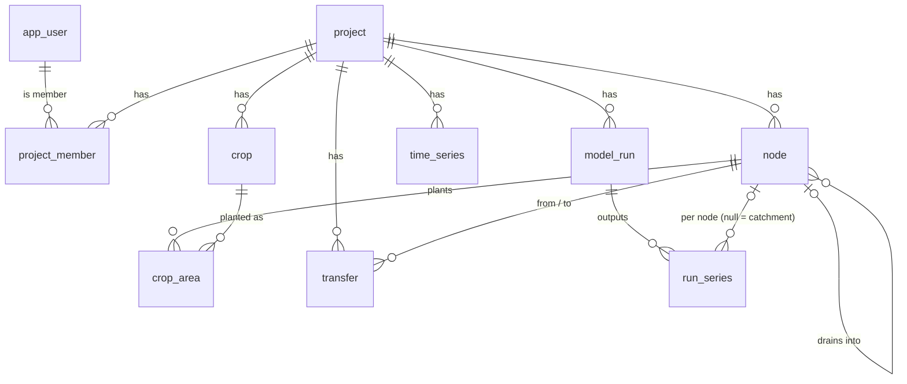

# Data model

Postgres 17 (locally in docker on `:5434`; in production RDS PostgreSQL 17, see
[deployment.md](./deployment.md)). The schema lives in plain SQL
migrations under `backend/migrations/` and is applied by a small runner
(`pnpm dev:db:migrate`). Once deployed, migrations only move forward: never edit
one that has shipped, add a new numbered file instead. Until the first
production deploy, `001_init.sql` may still be edited in place.

The TypeScript shapes that mirror these tables are in
`packages/engine/src/project.ts`. The backend (storage and validation) and the
frontend (forms) share them. The HTTP contract is in [api.md](./api.md).

## Entity overview

## Tables and their workbook origin

| Table | Purpose | b023 workbook origin |
| --- | --- | --- |
| `app_user` | Account: email (citext, unique), display name, bcrypt hash | none (the workbook has no users) |
| `project` | One catchment/place. `settings jsonb` holds model-wide parameters (`ProjectSettings`) | One workbook. `settings` ← `[Crop demand]` A-pan and effective rain, `[Farm demand]` Feb days, `[Farm spec]` method and Hi/Lo split, `[Flow Calibration Cfg]`, `[EWR Cfg]` pragmatic EWR, `[Home]` date window, `[Flow Calibration Cfg]` calibration window (`calibrationStart/End`) and `[Flow data]` rUseFlow (`calibrationFlowKind`) |
| `project_member` | (project, user, role) | none |
| `node` | A network element: `farm` or `gauge`, `downstream_node_id` (tree to one outflow gauge), areas, flow-share override, dam and diversion parameters, return-flow % | `[Network]` (name, type, upstream links reversed into one downstream link) + `[Farm spec]` (every numeric column) |
| `crop` | A crop with 12 monthly crop factors (water-year order, Oct … Sep) | `[Crop demand]` crop table |
| `crop_area` | Planted m² per (farm node, crop) | `[Farm demand]` crop-area grid |
| `transfer` | A structured transfer rule: from/to node, months, max rate m³/s, optional daily cap, min source storage %, enabled | `[Transfers]` "Draw From" parameters. The hand-written InOut formulas become the rule itself (see [model.md §2.6](./model.md#26-transfers-transfers)). |
| `time_series` | A daily input series, stored as one array per (project, kind, name) | `[Flow data]` columns E–K: Pitman flow, gauge flow, logger flow, catchment rain, CHIRPS rain, forecast rain |
| `model_run` | One run: who and when, `engine_version`, date window, an **input snapshot** (`inputs jsonb`) and a small `summary jsonb` | A "Calc. Model" press plus the `[Log]` entry |
| `run_series` | One daily output array per (run, node, key). `node_id` null = catchment-level | Element-sheet columns (storage, spill, outflow, deficit, EWR shortfall…) and `[Flow data]` natural flow and simulated outflow |

### Field mapping details

| `node` column | Farm spec column | Notes |
| --- | --- | --- |
| `area_km2` | Total area farms (km²) | Used by the *Area* flow-share method and for `RainToM3` |
| `area_hi_km2` / `area_lo_km2` | Farm area high / low MAP | *Hi/Lo* method |
| `flow_share_manual` | External fragmentation (%) | *Specific* method (0–1) |
| `pct_upstream_to_dam` | "Upstream inflow above dam (%)" | **Naming mismatch.** The workbook formula sends `H × pct` *below* the dam. See [model.md Q1](./model.md#3-workbook-quirks-and-suspected-bugs). The column keeps the label's name. The engine applies the workbook's behaviour until the hydrologist decides. |
| `pct_runoff_to_dam` | Farm runoff above (into) dam (%) | |
| `dam_capacity_m3` | Composite dam capacity (m³) | |
| `dam_initial_pct` | Initial dam volume (%) | |
| `dam_min_pct` | Min dam volume for transfers (%) | Only transfers respect it (Q5) |
| `divert_capacity_m3_day` | Downstream diversion back to dam | The workbook enters m³/s and converts it. We store m³/day. |
| `return_flow_pct` | Irrigation return flow (%) | |

Every percentage is stored as a **fraction 0–1** (CHECK constraints enforce the
range).

Ordering: `sort_order` is only for display. The engine works out the
calculation order from the tree (upstream first, with `sort_order` as the
tie-break). The workbook's row-order rule ("upstream elements must be listed
first") therefore disappears.

The backend checks these on every `PUT /model`: node names are unique, the
references stay inside the same document, the graph is a tree, and there is
exactly one node with no downstream (the outflow gauge).

## Time-series storage

A daily series is stored as **one row with a `double precision[]` array** plus a
`start_date`. `values[i]` is the value on `start_date + i` days, and `NULL`
elements mean "no reading".

Why arrays and not one row per day:

- **Size and speed.** client catchment has 16 161 days. One row per day would be
  16k rows per input series and, for outputs, 16k × (nodes × keys) rows per run
  (millions of rows per run, each with ~24 bytes of tuple overhead). An array is
  one TOASTed value (~128 KB raw, compressed on disk). It loads with one index
  lookup and goes straight into a `Float64Array` in the engine.
- **The access pattern is whole-series.** The engine always needs a full series,
  and a chart fetches one series at a time. Nothing queries "flow on 3 March
  across all projects".
- **Simplicity.** There is no extension to install (TimescaleDB is not
  available on Aurora or RDS) and nothing to partition.

Trade-offs we accept: updating one day rewrites the whole array (fine, since
inputs are uploaded in bulk), and SQL date-range aggregates need `unnest … WITH
ORDINALITY` (fine for occasional reports).

**Run output volume.** Each run stores tens to a couple of hundred output arrays
(nodes × keys, ~128 KB each before compression), so a client catchment run is a few
MB to ~25 MB. Before this matters in production (see [plan.md](./plan.md)):
store only the keys the UI and reports use, keep only the last *N* unpinned runs
per project, and consider `real` (float4) for outputs if space becomes a
problem. The engine is deterministic, so any run can be recomputed from its
`inputs` snapshot plus `engine_version`.

**Run input snapshots.** `model_run.inputs` holds the settings and model data
the run used. Input *series* are not copied into it (they are large): the run
refers to them as they were. If a series is re-uploaded, old runs can no longer
be recomputed exactly. A later migration can add a content hash of each input
series to the snapshot so the UI can flag "inputs changed since this run".
For each series kind the snapshot keeps only `{ startDate, length }`.
`GET /compare/runs` is the only endpoint that returns the snapshot. Its "what
changed" list (engine `diffInputs`, see [run-comparison.md](./run-comparison.md))
can therefore see a series being extended or trimmed, but not a value edited
within the same dates. The content hash above would close that gap as well.

## Access control

### Roles

| Role | Can |
| --- | --- |
| `viewer` | Read the project, its model, series, runs and members |
| `editor` | Everything a viewer can, plus change settings and model data, upload series, run the model, delete runs |
| `owner` | Everything an editor can, plus add/remove members, change roles, delete the project |

Whoever creates a project becomes its first `owner`. This happens in a trigger,
atomically with the insert. A deferred constraint trigger makes sure that a
project always keeps **at least one owner**. Any member may remove themselves.

### Teams (002_teams.sql)

Users and groups work across many catchments. A **team** (e.g. a consultancy
or a catchment management agency) has members with a team role, and projects
may belong to a team (`project.team_id`):

| Team role | Effective role on every team project |
| --- | --- |
| `member` | `editor` |
| `admin` | `owner` (and manages the team: rename, members, delete) |

Direct project membership still works on top — the **effective role is the
higher of the two** (`app_project_role()`). Every project policy goes through
`app_has_role()`, which uses the effective role, so team access applies to all
project-scoped tables at once. The team's creator becomes its first admin and a
team always keeps at least one admin (same trigger pattern as project owners).
Deleting a team keeps its projects with their direct members (`ON DELETE SET
NULL`); the creator of a project is always a direct owner. A project can only be
created in, or moved into, a team the user belongs to (moving needs owner).

### Two database roles

| DB role | Used by | Privileges |
| --- | --- | --- |
| `water` | The migration runner (and `pnpm dev:db:psql`) | Owns the schema; runs DDL |
| `water_app` | The backend at runtime | `SELECT/INSERT/UPDATE/DELETE` on the app tables only. **No `BYPASSRLS`, no superuser, owns nothing**, so every policy applies to it. |

Locally both roles have throwaway passwords (`dev/postgres/00-roles.sql`,
`backend/.env.development`). In production, `water_app`'s password is a real
secret kept in `infra-secrets` (see [security.md](./security.md)).

### Row-level security

- Each API request that touches project data runs in **one transaction**. At the
  start the backend sets `set_config('app.current_user_id', <uuid>, true)`
  (transaction-local, so a pooled connection can't leak it to the next request).
- `app_current_user_id()` reads that setting. `app_has_role(project, minRole)`
  is `SECURITY DEFINER` and compares the effective role from
  `app_project_role()` (direct `project_member` row or team membership).
- Policies on `project`, `project_member` and every model-data table (`node`,
  `crop`, `crop_area`, `transfer`, `time_series`, `model_run`, `run_series`):
  SELECT needs `viewer`; INSERT/UPDATE/DELETE on model data need `editor`;
  member management and project delete need `owner`.
- A project you are not a member of is simply **invisible**: the API returns
  `404`, never `403`, so it doesn't reveal that the project exists.
- **Cross-project references are blocked** by `assert_same_project()` triggers.
  An editor of project A cannot attach a crop area, transfer, downstream link or
  run series to a node or crop id that belongs to project B, even if they know
  the UUID.
- RLS is `ENABLE`d but not `FORCE`d. The table owner (`water`) and the
  `SECURITY DEFINER` helpers bypass it on purpose, and `water_app` is never the
  owner.
- `app_user` has no RLS: login has to look a user up by email before anyone is
  signed in. The backend never selects `password_hash` into a response.

The DB-backed test suite (`pnpm test:backend:db`, database `water_test`) checks
these rules as `water_app`: that non-members see nothing, that role
boundaries hold, that the last owner can't be removed, and that cross-project
ids are rejected.

## Migrations

- Files: `backend/migrations/NNN_description.sql`, applied in order. The runner
  records applied files in `schema_migrations` and runs each file in its own
  transaction.
- Run as `water` (`MIGRATION_DATABASE_URL`), never as `water_app`.
- Every new table that holds project data needs a `project_id`, RLS enabled,
  the viewer/editor policies, same-project triggers for any foreign keys to
  `node`/`crop`, and grants to `water_app`. The `/safe-migration` command walks
  through this.
- Prefer **expand/contract**: add the new column or table and backfill it, ship
  code that uses it, and drop the old one in a later migration. The running
  code and the schema must be compatible during a deploy.
- When changing a SQL function or policy, start from its **latest**
  definition (it may have been redefined in a later migration than the one
  that created it). `DROP POLICY` needs the exact policy name.
- Every SQL function pins `search_path`, and every foreign key has a covering
  index. Catalogue tests guard both.
- Production: a migrate Lambda applies migrations as the owner role before the
  new API code goes live (see [deployment.md](./deployment.md)).
