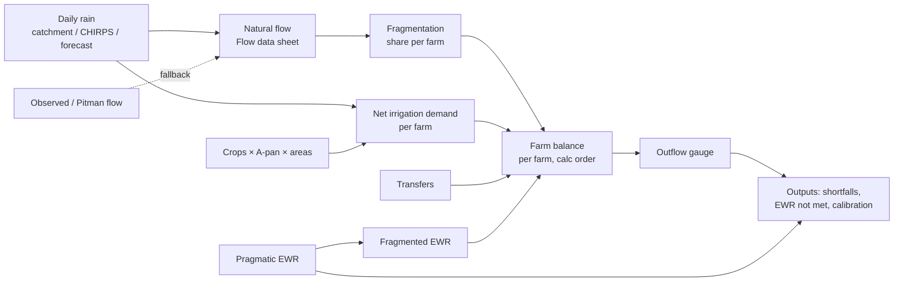

# Model reference

This document explains the water-balance model the web app reimplements. It
covers what the model does, the formulas step by step, where each step lives in
the source Excel workbooks, and which workbook behaviours look like bugs that we
need the hydrologist to confirm.

The engine (`packages/engine`) is a TypeScript port of this model. It is pure
code with no I/O, and it runs both in the browser and in the Lambda. Anything
here that differs from the engine code is a documentation bug. Fix whichever one
is wrong.

- [1. Background](#1-background)
- [2. The b023 model (what V1 ports)](#2-the-b023-model-what-v1-ports)
- [3. Workbook quirks and suspected bugs](#3-workbook-quirks-and-suspected-bugs)
- [4. The AI node-based model (v004 DEV)](#4-the-ai-node-based-model-v004-dev)
- [5. The AI runoff module (DEV 003)](#5-the-ai-runoff-module-dev-003)
- [6. Porting strategy and regression testing](#6-porting-strategy-and-regression-testing)
- [7. Glossary](#7-glossary)

---

## 1. Background

**Water Balance Tool (WBT) b023** is the Excel/VBA workbook the client used
before this app. It runs a
**daily** water balance for one river catchment, which is a network of farms
(each with an optional composite dam) that drain into one outflow gauge. It
answers three questions:

1. How much natural flow does the catchment produce each day? Rain is turned
   into flow by a calibrated recession model.
2. How much of each farm's irrigation demand can be met from its runoff,
   upstream inflow, dam storage and transfers?
3. After irrigation, is the **Environmental Water Requirement (EWR)** still met
   at each farm and at the outflow gauge? If not, by how much is it short?

**One workbook holds one catchment.** In the web app, one workbook becomes one
**project**. The user can keep several projects side by side (place A, B, C…)
and create or copy more.

Source workbooks (kept locally outside the repo in `../project-water-management-source/Original/` and `…/AI/`, never committed):

| Workbook | What it is | Status |
| --- | --- | --- |
| `Blank_WBT_b023_v001.xlsm` | The b023 template with sample data | Reference for formulas |
| the client workbook (`<client>_WBT_b023_v001_…WORKING 007.xlsm`) | Real catchment: 1981-01-01 … 2025-03-31 (16 161 days), 12 farms + 1 outflow gauge, 9 crops, 1 transfer | **Regression target** for V1 |
| `AI/WBT_NodeBased_v004_DEV.xlsm` | An experimental 16-node daily ledger with pump scenarios and stress classes | Unfinished; later phase |
| `AI/WBT_Runoff_Module_DEV_003.xlsm` | An experimental bucket rainfall-runoff model with 12 hydrological units | Unfinished; later, as an alternative flow generator |

---

## 2. The b023 model (what V1 ports)

### 2.1 Pipeline



Units: flows and volumes are **m³/day** internally. The workbook converts m³/s
with `86 400 s/day` (`rAppSet_ConvertSecToDay`). Months are laid out in
**water-year order** (Oct … Sep) wherever the workbook shows a monthly table.

**Rounding.** The workbook rounds at nearly every step (`ROUND(…, 0)` on
fragmented flows, dam splits, return flow, storage and capacity; `INT` on the
rain-added flow; 4 dp on recession indices; 2 dp / 1 dp / 0 dp in the demand
chain; 0, 1 and 3 dp and `ROUNDDOWN` in `[Shortfalls]`). **The engine (≥ 0.4.0)
rounds nothing**: rounding a model state is not neutral. It stopped every
recession at a floor of about `0.5 / (1 − f)` m³/day (32 m³/day for the
default tail factor), created or lost water whenever a flow was split (four
equal farms and 2 m³/day of natural flow gave 4 m³/day of runoff), and turned a
0.4 m³ dam into no dam ([audit R1](./engine-audit.md)). The formulas below show
the workbook's rounding for reference, marked *(workbook only)*; the UI and the
exports round for display.

### 2.2 Configuration (the "Cfg" sheets)

| Sheet | Holds | App equivalent |
| --- | --- | --- |
| `[Network]` | Elements (Farm or Gauge), upstream elements (up to 7), "Has transfer?", the one **outflow gauge**. The rows must be in calculation order (upstream first). Bifurcation is not allowed. | `node` rows; `downstream_node_id` gives the tree, and the engine works out the calculation order |
| `[Farm spec]` | Areas (total, high-MAP, low-MAP), the fragmentation method (Area / Hi-Lo / Specific), % upstream inflow "above dam", % farm runoff into dam, dam capacity, initial %, min % for transfers, downstream diversion back to dam (m³/s → m³/day), irrigation return flow % | `node` farm columns + `project.settings.flowShareMethod`, `hiLoSplit` |
| `[Crop demand]` | WR90 A-pan evaporation by month, effective-rainfall %, crop factors by month | `settings.apanMm`, `settings.effectiveRainFraction`, `crop` |
| `[Farm demand]` | Crop area (m²) per farm per crop, days per month (Feb = 28.25 by default) | `crop_area`, `settings.februaryDays` |
| `[Transfers]` | Hand-written transfer formulas, plus per-transfer parameters (from, to, months, max m³/s, min dam %) | `transfer` rows (structured rules) |
| `[Flow Calibration Cfg]` | The rain→flow parameters and the recession curve | `settings.calibration` |
| `[EWR Cfg]` | Desktop Reserve Model tables, and the percentile pick with overrides that produce the **pragmatic EWR** (m³/day per month) | `settings.ewrPragmaticM3PerDay` (V1 stores the final table) |
| `[Flow data]` (left block) | Daily inputs: Pitman natural flow, observed gauge flow, logger flow (all m³/s), catchment-average rain, CHIRPS rain, forecast rain (mm) | `time_series` rows by `kind` |

Element types: a **Farm** element can also stand for a stand-alone dam or a
natural (unused) area, depending on its parameters (see the `[Models]` sheet). A
**Gauge** only passes flow through and reports it.

### 2.3 Irrigation demand

Sheets `[Crop demand]` → `[Farm demand]` → `[Irrigation Demand]`.

1. **Gross crop requirement (mm/month)** for crop *c* in water-year month *m*:

   `grossMm[c][m] = apanMm[m] × cropFactor[c][m]` (workbook: `ROUND(…, 2)`)

2. **Gross farm demand (m³/day)** for farm *f*:

   `grossFarm[f][m] = Σc area[f][c] × grossMm[c][m] / 1000 / daysInMonth[m]` (workbook: `ROUND(…, 1)`)

   Here `daysInMonth` is 31, 30, 31, 31, **28.25**, 31, 30, 31, 30, 31, 31, 30 for
   Oct…Sep. February is configurable. 28.25 gives a 365.25-day year.

3. **Net daily demand (m³/day)** on day *t*:

   `netDemand[f][t] = MAX(0, grossFarm[f][month(t)] − croppedArea[f] × effRain / 1000 × rainUsed[t])` (workbook: `ROUND(…, 0)`)

   - `croppedArea[f]` = Σ crop areas of the farm (m²).
   - `effRain` = effective-rainfall fraction (0.65).
   - `rainUsed[t]` is the *thresholded* rain from the Flow data sheet (§2.4).
     Rain at or below the threshold counts as 0, so light rain does not reduce
     demand.

### 2.4 Natural flow from rain (`[Flow data]`)

This is the calibrated rain→runoff routine, the engine's `legacy` runoff model
(`settings.runoffModel = 'legacy'`, the default; `packages/engine/src/runoff/`
holds the seam every runoff model plugs into, and issue #4 replaces this one).
One row runs per day, and each row reads the previous row. Parameters come from `[Flow Calibration Cfg]`. The
defaults from the blank workbook are shown.

| Parameter | Blank default | Meaning |
| --- | --- | --- |
| `RainThreshold` | 2 mm | Rain at or below this produces no flow and does not offset demand |
| `a`, `b` | 0.09, 1.2 | Peak flow = `a · rain^b` |
| `RainToM3` | total farm area km² × 1000 | Converts mm over the catchment to m³ |
| `SummerMths` | 1,2,3,4,5,11,12 (blank); 10–3 in the engine defaults | Calendar months that are always "summer" |
| `FactorSummer` / `FactorWinter` | 0.1 / 1 | Seasonal response factor |
| `WinterTodayThresh` / `WinterNextDayThresh` | 35 mm / 9 mm | Rain that flips a non-summer month into winter response |
| `MinFlowRatioToResetBase` | 1.5 | Rain pulse / base flow ratio above which base flow resets |
| `ShiftPeakIndexLo` / `Hi` | 0.9 / 3.5 | Range of the recession index given to a new rain pulse |
| `Amplitude` | derived | Rain→flow amplitude used to scale the pulse index |
| `DaysMax` | rows in the curve − 1 (79) | Upper bound of the recession index |
| `RecessionCurve` / `RecessionFactors` | 80-row table | Flow (m³/day, descending) → daily recession factor |
| `BaseFlowInitial` | 300 m³/day | Base flow on the first day |

Per day *t*, with the workbook column letters:

| Col | Quantity | Formula |
| --- | --- | --- |
| R | **Rain used** | The first non-blank of catchment rain, CHIRPS or forecast, set to 0 if it is ≤ threshold. From engine 0.6.0, CHIRPS used here is **bias-corrected** per calendar month first (§2.4b, audit B1); the workbook used it raw |
| N | **Season** (1 = summer, 0 = winter) | Summer month → 1. Otherwise: if yesterday was winter → 0. Otherwise → 0 if `rain[t] ≥ 35` or `rain[t−1] ≥ 9`, else 1. In non-summer months "summer" response carries on until a big enough rain opens the winter. |
| V | **Rain-added flow** | `a · R^b · RainToM3 · seasonFactor` if R > 0, else 0 (workbook: `INT(…)`) |
| S | **Base flow** | `FB` = yesterday's base receded by yesterday's base index. The day before the run is a steady base-flow state: base = resultant = `BaseFlowInitial`, at that flow's own recession index (engine ≥ 0.4.0, [audit E1](./engine-audit.md); the workbook left the index blank, so day 1 receded at the extrapolated factor `2·f1 − f2`). If `V / FB > 1.5` the base resets to `V`, else it stays `FB`. (Workbook: rounded to 0 dp.) |
| T | **Base recession index** | Where S sits on the recession curve, interpolated linearly and clamped to `[1, DaysMax]` (workbook: 4 dp) |
| U | **Response flow (start)** | Yesterday's resultant response receded by yesterday's resultant index |
| W | **Pulse index** | For a new pulse (V > 0): `Lo + (Hi − Lo)(1 − V/Amplitude)`, not below `Lo`. If that is above the base index, use `max(1, baseIndex − 0.2)`. With no pulse: yesterday's index + 1. Capped at `DaysMax` (workbook: 4 dp). The workbook used the base index when yesterday's was blank, which only happens on day 1, so a first-day storm lost its pulse index; the engine seeds the day before the run (E1). |
| X | **Response + added** | If V > 0: `U + V`. Else if yesterday's X = 0: `U`. Else yesterday's X receded by yesterday's W. |
| Y / Z | **Resultant response / index** | `max(X, S)` and the index of whichever one won |
| AB | **Natural flow (m³/day)** | `Y` if > 0, else the Pitman natural flow (m³/day) if > 0, else 0 |

`recede(flow, index) = flow × lerp(factor[floor(index)], factor[floor(index)+1], frac(index))` (workbook: `ROUND(…, 0)`)

The interpolated factor is clamped at 0, so an index below 1 (a pulse starting at
`ShiftPeakIndexLo` < 1) can shrink a flow to nothing but never make it negative
([audit E2](./engine-audit.md)).

**Checks on every run** (warnings, engine ≥ 0.4.0; [audit W1–W5](./engine-audit.md)):

- **Runoff coefficient** = natural-flow volume / rain volume on the catchment
  over the run (`summary.catchment.runoffCoefficient`). Above 1 the catchment
  gives back more water than fell on it, which is impossible over a whole
  record, so the run warns. The structure makes this easy to reach: a storm
  resets the base flow to the storm's peak, which then recedes along the slow
  part of the curve (audit H1, a question for the hydrologist).
- **Days with no rainfall value** from any source are counted: the model treats
  them as dry (0 mm), for runoff and for demand.
- **Days of Pitman fallback** (quirk Q7) are counted.
- **Recession table**: a factor outside 0–1, a curve that rises, or tables of
  different length.

The same sheet also:

- Picks the **observed** flow series used for calibration: Pitman (1), gauge
  (2) or logger (3) via `rUseFlow`. It converts it to m³/day (the workbook rounds).
- Carries the **pragmatic EWR** for the day's month (AF), the **simulated
  outflow** at the outflow gauge (AG), an "EWR not met" flag (AJ = 1 when
  AG < AF) and the shortfall volume (AK = AG − AF when not met).
- Reports mean annual runoff and mean daily runoff (all days and summer only)
  for observed and simulated flow.

> The engine's `CalibrationParams` currently holds `a`, `b`, the threshold, the
> seasonal factors, summer months and the initial base flow. The recession
> curve, shift-peak indices, reset ratio and winter thresholds also have to be
> in project settings for a number-for-number match. The importer reads them
> from the workbook's named ranges (`rCalibration_*`).

### 2.4a Rain to flow: GR4J (engine ≥ 0.5.0, issue #4)

`settings.runoffModel = 'gr4j'` replaces the legacy recession model (§2.4)
with **GR4J** (Perrin, Michel & Andréassian 2003, *J. Hydrol.* 279), a
published daily rainfall–runoff model with four parameters. It is written from
the paper's equations in `packages/engine/src/runoff/gr4j.ts`. The reference
implementation, the R package airGR, is GPL-2, and no code is taken from it.
Everything downstream (flow shares, farms, dams, transfers, EWR) is unchanged,
so the two models compare run against run. Legacy stays the default until the
hydrologist signs GR4J off (issue #4 phase 6).

**Parameters** (`settings.gr4j`). The typical range is Perrin's 80 % range over
429 catchments; the bounds are enforced by the API and searched by calibration.

| Param | Meaning | Unit | Default | Typical | Bounds |
| --- | --- | --- | --- | --- | --- |
| `x1` | production (soil-moisture) store capacity | mm | 350 | 100–1200 | 10–3000 |
| `x2` | groundwater exchange coefficient | mm/day | **0** (fixed) | — | −5–3 (opt-in) |
| `x3` | routing store reference capacity | mm | 90 | 20–300 | 1–1000 |
| `x4` | unit hydrograph time base | days | 1.7 | 1.1–2.9 | 0.5–10 |
| `warmupDays` | warm-up before day 1 | days | 365 | — | 0–3650 |

**Forcing** (`runoff/simulate.ts`, `runoffForcing`):

- **Rain P**: catchment rain, else CHIRPS (bias-corrected, §2.4b), else
  forecast, as for legacy, but with **no rain threshold** (that was part of
  the legacy model). A day with no
  value is dry, and the run counts those days (W2). Negative values count as 0.
- **Potential evaporation E** = `panCoefficient[month] × apanMm[month] / days
  in that calendar month`, so each month's PET totals exactly coefficient ×
  A-pan. `settings.panCoefficient` is 0.7 in every month by default and is
  edited per month (question 4 for the hydrologist). It doesn't touch
  irrigation demand.
- **No Pitman fallback.** Flow is whatever the model produces.

**One day** (P, E in mm):

1. **Net rain and net evaporation:** if P ≥ E then Pn = P − E and En = 0;
   otherwise Pn = 0 and En = E − P.
2. **Production store S:**
   Ps = X1·(1 − (S/X1)²)·tanh(Pn/X1) / (1 + (S/X1)·tanh(Pn/X1)) and
   Es = S·(2 − S/X1)·tanh(En/X1) / (1 + (1 − S/X1)·tanh(En/X1)).
   Then S ← S − Es + Ps.
3. **Percolation:** Perc = S·{1 − [1 + (4S/(9·X1))⁴]^(−¼)}, and S ← S − Perc.
4. **Routed water:** Pr = Perc + (Pn − Ps). 90 % goes to UH1 and 10 % to UH2.
5. **Unit hydrographs:** each ordinate is j = SH(j) − SH(j − 1).
   - UH1 has SH1(t) = (t/X4)^2.5 for 0 < t < X4, and ⌈X4⌉ ordinates.
   - UH2 has SH2(t) = ½(t/X4)^2.5 up to X4, then 1 − ½(2 − t/X4)^2.5 up to
     2·X4, and ⌈2·X4⌉ ordinates.
   - Both sum to 1. Each keeps a queue of water in transit. Q9 is today's UH1
     output and Q1 is today's UH2 output.
6. **Exchange:** F = X2·(R/X3)^3.5. It is 0 when X2 = 0.
7. **Routing store:**
   - R ← max(0, R + Q9 + F);
   - Qr = R·{1 − [1 + (R/X3)⁴]^(−¼)};
   - R ← R − Qr.
8. **Direct flow:** Qd = max(0, Q1 + F).
9. **Flow:** Q = Qr + Qd, in mm over the catchment. Natural flow (m³/day) =
   Q × area (km²) × 1000, over the same catchment area as legacy
   (`calibration.catchmentAreaKm2`, else the sum of the farm areas).

**Fluxes recorded:**

- AET = min(P, E) + Es.
- The applied exchange is the exchange left after the two clips:
  (R after the max − R before − Q9) + (Qd − Q1).

**The balance closes every day:**
P − AET − Q + exchange = Δ(S + R + water in the UH queues), to 10⁻⁹ mm. With
X2 = 0 the model is closed: water leaves only as evaporation or flow, or stays
stored. So a storm can never return more than fell, which fixes audit H1 by
construction.

**Warm-up.** The stores start half full (S = ½·X1, R = ½·X3) with empty queues.
The model then runs `warmupDays` days that cycle the run's own forcing from its
first day. Day k of the warm-up uses day k mod n, so a warm-up longer than the
run repeats it. Warm-up days are never output or scored. Day 1 starts from the
warm-up's end state.

**Outputs.** GR4J adds these catchment series:

- `rain_used` and `pet`;
- `aet`;
- the end-of-day stores `production_store`, `routing_store` and `uh_store`
  (water in transit);
- `exchange`, only when X2 ≠ 0.

`summary.runoff` holds the parameters used, the area and the whole-run totals
(rain, PET, AET, flow and exchange), plus the storage at the start (after the
warm-up) and at the end. Those totals satisfy
rain − AET − flow + exchange = end − start. When a short run's natural flow
exceeds its rain, the W1 warning names the starting storage instead of blaming
the calibration. An out-of-bounds parameter in stored settings (the API rejects
them) falls back to its default with a warning.

### 2.4b CHIRPS fallback bias correction

Engine ≥ 0.6.0, [audit B1](./engine-audit.md), `packages/engine/src/rain.ts`.
Setting: `settings.chirpsBiasCorrection`, `'monthly'` (default) or `'none'`.

**Why.** Rain used (column R, and GR4J's P) falls back to CHIRPS on every day
the catchment rain is blank. CHIRPS is a 0.05° satellite-and-gauge product.
At the scale of a small mountain catchment it can read a fraction of the
catchment's own gauges, and by different amounts in different seasons:
frontal and orographic rain on the ridges is what a satellite estimate
misses most. Used raw, a year whose
catchment rain is missing runs far too dry. The legacy model hides some of
this, because its base-flow reset makes flow out of little rain (H1). GR4J
conserves water, so in those years it makes almost no flow. In the
hydrologist's review of issue #4 phase 6 on the client catchment, those
fallback years made up most of the EWR-failure difference between the two
models. Correcting the fallback was the first condition for adopting GR4J.

**The factors.** For each calendar month *m*:

  factor(m) = Σ catchment rain / Σ CHIRPS, over the days in month *m* where
  both series have a reading (present, finite and not negative).

- **Suspect years are left out.** A water year the issue #2 checks flag
  (§2.10a) is left out of the fit: every water year a flagged zero-rain run
  touches, and every low-vs-CHIRPS year. Their catchment rain is suspect
  (zeros that may be missing data), and it would drag the factors down.
- **Minimum sample.** A month's own factor needs **90 shared days** (about
  three years of that month) and **50 mm of CHIRPS** on them, so a dry month
  with a few millimetres can't produce a wild ratio. A month short of either
  takes the **pooled** factor: the same ratio over all months together, with
  the same minimums. With too little overlap for even that (for example a
  project with CHIRPS but no catchment rain), CHIRPS stays raw and the run
  warns how many days used it uncorrected.
- **Clamp: 0.25–4.** CHIRPS is known to miss orographic rain in mountain
  terrain, and the size of its bias changes with the season, so a factor of
  two or three in the frontal-rain months of a mountain catchment is
  plausible. A
  factor beyond four either way is more likely a sign that the two series
  don't describe the same area, or of a unit error, than a real bias. It is
  clamped, and the warning marks it "(clamped)". The range is engineering
  judgement, open for the hydrologist to confirm ([followups.md](./followups.md)).
- The factors come from the **whole stored record**, not only the run
  window, so a shorter simulation period doesn't change them. A monthly
  factor is *linear scaling* (Teutschbein & Seibert 2012, *J. Hydrol.*
  456–457): it corrects the monthly volume, not the number of wet days or the
  intensity distribution.

**Where it applies.** Only to CHIRPS that is actually used: a day with no
catchment rain value and a CHIRPS value gets `CHIRPS × factor(month)`.
Catchment rain is never changed. A day where the catchment reads 0 keeps its
0 (a zero is a reading and blocks the fallback, §2.10a). **Forecast rain is
not corrected**: there is no overlap to fit a forecast factor from, and a
forecast product's bias is not CHIRPS's. The corrected rain then goes
through everything that reads rain used: the legacy model (before its rain
threshold), GR4J, the effective-rain offset on irrigation demand, automatic
calibration, and the runoff coefficient (W1). So both runoff models change,
and so does demand.

**Output.** `summary.chirpsCorrection` holds each month's shared days, sums,
own and applied factor, its source (`month`, `pooled` or none) and whether it
was clamped, the pooled factor, the excluded water years, and the numbers of
fallback days and corrected days, with the fallback rain before and after
correction. A run that corrected any day adds one warning listing the
factors (Oct–Sep) and the day count. GR4J's `rain_used` series shows the
corrected rain day by day.

**Why a setting.** The operator's policy is no workbook-compatibility modes
(plan.md risks; roadmap D3): an unsound workbook algorithm is replaced
outright, and `engineVersion` explains older results. `chirpsBiasCorrection`
is not such a mode. The correction is a data-preparation choice, like the
pan coefficient, and it has a legitimate "off": a project may load a CHIRPS
series that is **already** bias-corrected to the catchment (by the
hydrologist, or a product such as a station-blended CHIRPS), and correcting
it again would double the bias correction. So the default is `'monthly'`,
and `'none'` is there for that case, not to reproduce the workbook. Runs
saved before 0.6.0 used raw CHIRPS; run comparison flags the engine version
change, and compares a stored run without the setting as the default.

### 2.5 Fragmentation (`[Fragmented flow]`, `[Fragmented EWR]`)

Each farm gets a fixed **share** (`frag[f]`, 0–1) of the catchment flow. The
method is chosen in `[Farm spec]`:

| Method | Share |
| --- | --- |
| **Area** | `farmArea / Σ farmArea`, where `farmArea = hiMapArea + loMapArea` |
| **Hi/Lo** | `hiArea/ΣhiArea × hiSplit + loArea/ΣloArea × loSplit` (Pitman split, default 0.81 / 0.19) |
| **Specific** | A value entered by hand ("external fragmentation") |

The shares should sum to 1 within `0.0002` (fragmentation tolerance). The run
also warns, once, about any farm whose area differs from its hi + lo areas by
more than 1 %: the hi/lo shares use hi + lo, the area share and the rain volume
use the area ([audit W3](./engine-audit.md), engine review F7; `areaMismatches`,
§2.10a). Then:

- Farm runoff: `runoff[f][t] = naturalFlow[t] × frag[f]` (workbook: `ROUND(…, 0)`)
- Farm EWR: `ewr[f][t] = pragmaticEwr[month(t)] × frag[f]` (workbook: `ROUND(…, 0)`)

### 2.6 Transfers (`[Transfers]`)

The workbook has two blocks of columns:

- **Draw From** (one column per transfer): water available in the *source* dam,
  based on **yesterday's** end-of-day storage:

  `draw[t] = monthIn(t, months) ? MIN( MAX(storage[src][t−1] − cap[src] × minPct[src], 0), maxRate_m3s × 86400 ) : 0`

- **InOut** (one column per farm with "Has transfer? = Yes"): the net volume
  entering (+) or leaving (−) that farm. Each is a **hand-written formula**, for
  example `<source farm> = −draw₁`, `<receiving farm> = +draw₁`.

The client catchment has one transfer: one farm dam to another, in six months of the
year, capped by a maximum rate and a minimum level kept in the source dam.

The app replaces the free-form formulas with structured rules
(`transfer` table: from, to, months, max rate, optional daily cap, min storage %,
enabled). The out-leg and in-leg of each rule are the same volume, so they
always balance. Anything the hydrologist has written that doesn't fit this
shape has to be raised with them (see §3).

### 2.7 Farm balance (one sheet per element)

Farms are processed in network order. Upstream elements come first, so a farm
sees its upstream elements' **same-day** outflow. Per farm *f*, day *t* (the
sheet's column letters are in brackets). The workbook rounds L, M, T and the
storage to whole m³; the engine doesn't (R1).

| Step | Quantity | Formula |
| --- | --- | --- |
| F | Net irrigation demand | from §2.3 |
| H | Upstream inflow | Σ outflow `U` of the elements directly upstream |
| I | Farm runoff | fragmented natural flow (§2.5) |
| J | Transfer in (+) / out (−) | from §2.6 |
| L | Upstream inflow "below dam" | `H × pctUpstream` (see quirk Q1) |
| K | Upstream inflow "above dam" | `H − L` |
| M | Farm runoff into dam | `I × pctRunoffToDam` |
| N | Farm runoff below dam | `I − M` |
| O | Diverted back to dam | `MIN(divertCapacity, L + N)` |
| G | **Irrigation supplied** | `MIN(store[t−1] + M + O + K + J, F)` |
| P | Interim storage | `store[t−1] + M + O + K + J − G` |
| Q | **Storage, end of day** (`store[t]`) | `MIN(P, damCapacity)` |
| R | **Spill** | `MAX(P − damCapacity, 0)` |
| S | Below-dam flow not diverted | `L + N − O` |
| T | Irrigation return flow | `G × returnPct` |
| U | **Farm outflow** | `R + S + T` |
| V | Balance check | `abs((H+I+J) − G·(1−returnPct) − (store[t] − store[t−1]) − U)` must be 0 (the invariant tests check it on random networks) |
| W | **Irrigation deficit** | `F − G` |
| Y | Fragmented EWR | §2.5 |
| Z | Cumulative EWR | `Y + Σ Z` of the elements directly upstream (see quirk Q4) |
| AA | EWR shortfall (−) | `MIN(U − Z, 0)` |
| AB | Incremental EWR shortfall (−) | `MIN(AA − Σ AA of the elements directly upstream, 0)` |

Initial storage = `initialPct × damCapacity` (workbook: `ROUND(initialPct × ROUND(damCapacity, 0), 0)`).

A **gauge** element records the sum of its upstream elements' outflow (`= simulated flow`),
the sum of their cumulative EWR (Z), and its shortfall `MIN(flow − Z, 0)`. The workbook's
gauge sums the upstream elements' AA instead, which reports a shortfall at a
confluence whose flow meets the EWR when one branch is short and another has
water to spare; the engine (≥ 0.4.0) doesn't ([audit G1](./engine-audit.md)). The **outflow gauge's** flow is the
catchment's simulated outflow that goes back into `[Flow data]` AG. That is
compared with the full pragmatic EWR and the observed flow.

### 2.8 Outputs

| Workbook sheet | What it shows | App equivalent (V1) |
| --- | --- | --- |
| `[EWR shortfalls]` | Per day: unfragmented EWR, EWR volume not met at the gauge, a not-met flag, Σ incremental farm shortfalls, and per-farm incremental shortfall | Run series (`ewr_*` keys) + chart |
| `[Shortfalls]` | Per farm over a reporting window: average demand, supply, deficit, % supplied, target volume, reduce/gain (m³/day and l/s), average EWR shortfall, total reductions, volume left after irrigation is balanced and the EWR is met | `RunSummary.curtailment` over `settings.reportStart … reportEnd` (§2.11); `RunSummary.farms` keeps the whole-run averages |
| `[EWR analysis]` / pivots | Shortfall by farm × year × month, count and % of days not met | `RunSummary.ewrCompliance` + EWR heat map (§2.9) |
| `[Flow Calibr. Graph Full]`, `[Flow Calibration Cfg]` | Observed vs simulated flow over the calibration window | Calibration chart + `CalibrationStats` (§2.10) |

### 2.9 EWR compliance grid (`[EWR shortfalls Pivot Data]` → `[EWR analysis]`)

The workbook's VBA macro `sProEp_GenerateEWRpivotData` walks the
`[EWR shortfalls]` sheet and writes one row per calendar year × month × farm:
the month's summed incremental shortfall (AB, m³), a "not met" day count, and
that count / days in the month (February = `INT(28.25)` = 28). A pivot table
then shows it as farm × month.

The engine's `ewrCompliance` (`network/ewr.ts`) builds the same grid, laid
out as **water-year rows × Oct…Sep columns**, for the outlet (simulated
outflow vs the full pragmatic EWR, i.e. `[Flow data]` AK) and for each farm
(`ewr_shortfall_incremental`). Each cell holds the days simulated, the days
not met and the shortfall volume (m³, positive).

**Which days count as "not met".** The macro adds each day's shortfall to a
running monthly total and counts the day when *the total* is below zero. Once
a month has one short day, every later day of that month counts, even days
when the EWR was met. The engine counts a day only when **that day** is short
(`countMethod: 'daily'`), which is what "% of days EWR not met" means; the
summary uses this. `countMethod: 'runningTotal'` reproduces the macro, and the
client-catchment regression test checks it against the extracted pivot. Volumes are
the same either way. The percentage the UI shows is days not met / days
simulated in that month, so a leap February is out of 29 and a part month at
either end of the run is out of the days actually simulated.

**The workbook's pivot is stale.** It is written by a macro, not by formulas,
so it reflects the model as it was when someone last ran the macro. In the
client workbook about 23% of farm-months hold volumes that no longer match
the Element sheets or `[EWR shortfalls]` (for example a farm whose daily AB is
constant through a February shows a monthly sum that is not 28 × that value).
Where the volumes are current, the running-total counts match exactly.

### 2.9b EWR agreement with the observed record (engine ≥ 0.5.3, issue #4)

The two runoff models can disagree strongly on how many days the EWR is not
met at the outlet. The count alone can't say which is right, but the observed
record can. A gauge or logger measures the same **impacted outflow** the
outlet EWR test uses, so on every day with an observation the river can take
the same test as the model. `ewrAgreement` (`network/ewrAgreement.ts`)
cross-tabulates the two answers:

| | Observed below the EWR | Observed at or above |
| --- | --- | --- |
| **Model below the EWR** | both below (hit) | false alarm |
| **Model at or above** | miss | both above |

"Below" is exactly the outlet test behind `ewrDaysNotMet`: `MIN(flow − EWR,
0) < 0`, with float noise counted as met (`shortfall`, `belowEwr`). Observed
flow is converted from m³/s to m³/day first. From the table:

| Score | Formula | Reads as |
| --- | --- | --- |
| Hit rate | both below ÷ (both below + miss) | share of the river's failures the model also shows; 1 is ideal |
| False-alarm ratio | false alarm ÷ (both below + false alarm) | share of the model's failures the river didn't have; 0 is ideal |
| Frequency bias | (both below + false alarm) ÷ (both below + miss) | the model's share of days below ÷ the observed share; 1 = unbiased, > 1 = the model fails the EWR too often |

A ratio whose denominator is 0 is null (for example no observed failure in a
month). The table is given **overall, per calendar month** (water-year order,
Oct … Sep) **and per water year**, so a model that is right on average but
wrong in the dry season shows up.

- **Which days.** Every day in the run with a finite observation. Missing days
  are skipped. The run scores the whole observed record, not only the
  calibration window: the parameters are fitted to flows, not to this test,
  and days outside the window are out-of-sample evidence. The function takes
  an optional window and **calibration exclusions** (`exclusions`, the same
  shape as the automatic calibration's); excluded observed days are counted
  in `excludedDays`, not scored. `runModel` passes none, because exclusions
  are not saved with the project yet (only the automatic-calibration dialog
  holds them).
- **Which record.** The one `pickObservedKind` chooses (§2.10). Pitman flow is
  naturalised, so it can't take the outlet test and the agreement is `null`,
  as it is when the project has no observed record.
- **Where it lives.** `RunSummary.catchment.ewrAgreement`, next to
  `ewrDaysNotMet`; absent on runs saved before 0.5.3. Run comparison carries
  the overall scores of both runs (`RunComparison.ewrAgreement`).
- **How to use it.** Copy the project, set one copy to GR4J, run both, and
  compare: the model with frequency bias nearer 1, the higher hit rate and the
  lower false-alarm ratio reproduces the river's EWR failures better. Note that
  on days inside the calibration window the scores are partly in-sample: the
  same days were used to fit the flows.

### 2.10 Calibration statistics (`[Flow Calibration Cfg]`)

The hydrologist calibrates on a window, not the whole record:
`zCalibration_Date1`…`zCalibration_DateN` (the client catchment: 2010-10-01 to
2018-09-30), against the flow record `rUseFlow` picks in `[Flow data]`
(1 = Pitman, 2 = the G1 gauge, 3 = the A1 logger; client catchment uses the
logger, which only has data from 2013-04-15). The importer copies both into
`settings.calibrationStart/End` and `settings.calibrationFlowKind`. With no
window the whole overlap is scored; with no flow kind the engine uses the gauge
series if present, else the logger. From engine 0.5.1 that default is never
silent: when a project has **both** a gauge and a logger series and no flow
kind is set, the run (and an automatic fit) adds a warning that the gauge was
picked by default and that the record should be chosen in Settings →
calibration flow series (`pickObservedKind`, `DEFAULT_GAUGE_PICK_WARNING` in
`run.ts`; issue #1). A project with only one of the two, or with the kind set,
gets no such warning. The setting only picks which record the statistics are
scored against; results change only when the parameters are re-tuned.

**A workbook "gauge" column is not necessarily on the modelled river.** A b023
workbook's gauge column can hold a neighbouring river's gauge, and it may be
scaled by catchment area for part of the record and unscaled for the rest. Such
a record is not a valid calibration target for natural flow on the modelled
river; at most it is a regional wet/dry indicator. So check where each observed
record was measured before trusting the default. For the client catchment,
research on issue #1 found exactly this: its gauge column is a neighbouring
river's gauge (area-scaled for part of the record), and the logger's magnitude
is verified against independent field gaugings, so the **logger is the
calibration target**, which is also what the workbook and the imported settings
already use. This is **pending the hydrologist's sign-off**
([plan.md](./plan.md#model-and-hydrology-for-the-hydrologist)). Caveats on the
logger: high flows above the highest field gauging come from an extrapolated
rating curve, so peak days and wet-season volumes are uncertain, and the record
is short and mostly dry, so wet-year behaviour is weakly constrained.

**What is scored against what.** Gauge and logger records measure the river as
it is, with farms, dams and abstraction, so they are compared with the
**simulated outflow**. Pitman flow is *naturalised* (WR90/WR2012 model flow with
no development), so from engine 0.4.0 it is compared with the **natural flow**
from the rain model; the workbook compared the outflow with whichever record
`rUseFlow` picked, which scores the rain model against a record of a different
quantity ([audit C1](./engine-audit.md)). `CalibrationStats.simulatedKey` says
which series was scored.

`calibrationStats` (`network/stats.ts`) scores the days inside the window that
have an observation, in m³/s:

| Metric | Formula | Reads as |
| --- | --- | --- |
| NSE | 1 − Σ(o − s)² / Σ(o − ō)² | 1 perfect; ≤ 0 no better than the observed mean |
| PBIAS | 100 × Σ(o − s) / Σo | %; positive = model under-estimates volume |
| RMSE | √(Σ(o − s)² / n) | m³/s |
| KGE | 1 − √((r − 1)² + (α − 1)² + (β − 1)²) (Gupta et al. 2009) | 1 perfect; > −0.41 beats the mean flow (Knoben et al. 2019) |
| r, α, β | Pearson r; α = σs/σo; β = s̄/ō (population σ) | timing, variability and volume ratios |
| R² | r² | share of variance explained |
| log-NSE | NSE of ln(Q + ε), ε = ō / 100 (Pushpalatha et al. 2012) | fit of low flows |
| Volume error | 100 × (Σs − Σo) / Σo | %; positive = model too wet (= −PBIAS) |
| Annual volumes | Σ per water year of paired days, Mm³, and % difference | the annual water balance |

`moriasiRating` rates NSE and PBIAS after Moriasi et al. (2007): NSE > 0.75
very good, > 0.65 good, > 0.50 satisfactory; |PBIAS| < 10 very good, < 15
good, < 25 satisfactory; otherwise unsatisfactory. Those thresholds were set
for monthly flows; daily fits usually score lower.

The workbook's own summary (`[Flow data]` AF16/AG16) differs slightly: it
treats blank observations as 0 and then only counts days with observed flow
> 0. The engine skips blank days and keeps observed zeros.

**The client catchment (engine 0.3.0, end to end from rain).** Whole record against the
G1 gauge (V1's behaviour): NSE −0.70, PBIAS −23%. The workbook's window
against the G1 gauge: NSE −0.34, PBIAS −116%, KGE −0.28. The workbook's
window against the logger it actually calibrates to (1 803 days, 2013-04-15 to
2018-03-22): **NSE 0.29, KGE 0.57 (r 0.69, α 1.11, β 1.28), R² 0.48, log-NSE
0.49, PBIAS −28%**. β = 1.278 equals the workbook's own "Calibration / Logger"
volume ratio (`[Flow Calibration Cfg]` K27 = 1.2783). The gauge and the logger
disagree badly from 2014 to 2017 (in one water year the gauge records less than
a tenth of the logger's volume). As above, the gauge is on a different river,
so the gap says nothing about either instrument, and the scores against the
gauge are not a measure of fit (issue #1; sign-off pending).

### 2.10b Automatic calibration (engine ≥ 0.5.0, issue #4 phase 4)

`packages/engine/src/calibrate/` fits a runoff model's parameters to the
project's observed record. It is pure and deterministic for a seed, so the
browser runs it in a Web Worker and a test can pin it. It doesn't change
`runModel`.

- **What is fitted.**
  - GR4J: X1, X3 and X4 by default; X2 only when asked (`free`).
  - Legacy: a, b and the two season factors by default; the base-flow reset
    ratio when asked. The rain threshold is left out, because it also decides
    which rain days reduce demand. The recession tables stay as imported.

  Legacy can be fitted too so that the two models are compared calibrated
  against calibrated (issue #4 phase 6). Bounds are the models' `ParamSpec`
  min/max (§2.4a for GR4J, `runoff/legacy.ts` `LEGACY_PARAMS` for legacy).
- **What is scored.** The whole run, exactly as `runModel` scores it:
  runoff model → natural flow → network → simulated outflow for a gauge or
  logger record, or natural flow for Pitman (C1). So the fitted parameters
  describe the natural catchment, and the network adds the impacts. A test
  checks this, day for day, on random networks for both models.
  `prepareCalibration` builds everything but natural flow once
  (`prepareRun` + `buildNetworkPlan`, shared with `runModel`). Each candidate
  swaps in its natural flow and simulates only up to the last scored day,
  which is exact because the network is causal.
- **Scored days.** Days with an observation inside the calibration window,
  outside any exclusion period (`exclusions`). At least 30 are needed.
  `exclusions` takes any date ranges, so a whole water year can be left out
  (1 October to 30 September), but the app doesn't offer it yet: Fit
  automatically uses the calibration window only.
- **Optimiser: DDS** (Tolson & Shoemaker 2007, `calibrate/dds.ts`). It is
  greedy, with perturbation size r = 0.2 of each parameter's range. Early on
  it perturbs every parameter, and later fewer (probability 1 − ln i / ln m).
  Candidates are reflected into the bounds, so no model run ever uses an
  out-of-bounds value. It starts from the project's current parameters.
  The budget is 1 500 runs per fit by default. It replaces WP-1.18's
  Nelder–Mead, which handles bounds and surfaces of 4+ parameters worse.
- **Objectives** (`calibrate/objective.ts`; the optimiser minimises 1 − score):
  - **KGE′** (Kling et al. 2012), the default. Simulating the mean observed
    flow scores 1 − √2 ≈ −0.41, the benchmark of Knoben et al. (2019);
  - **year-balanced KGE′**: the mean KGE′ over the water years with at least
    30 scored days (Fowler et al. 2018; issue #1 item 5). Each year counts
    once, so a few wet years can't dominate a drought-heavy record;
  - **non-parametric KGE** (Pool et al. 2018);
  - **NSE on √Q** (medium flows);
  - **NSE on ln(Q + ε)**, with ε = 1 % of the mean observed flow (low flows).

  KGE is never applied to log flows (Santos et al. 2018).
- **Reported with every fit** (`FitScores`): all of the above, plain NSE, the
  volume error, and the Yilmaz et al. (2008) flow-duration signatures:
  - %BiasFHV: volume of the top 2 % of flows;
  - %BiasFMS: the slope between 20 % and 70 % exceedance, in log space;
  - %BiasFLV: the low 30 %, log flows above the minimum, scored
    −100·(sim − obs)/obs.

  The project's parameters before the fit are scored on the same days
  (`before`).
- **Validation, always.**
  - **Split-sample** (Klemeš 1986): fit on the first half of the scored
    days, score the second half.
  - **Differential split-sample**, when at least 4 water years have 180 or
    more observed days: fit on the driest half of those years (by mean
    observed flow), score the wettest half. The dry and wet years
    interleave, so the two sets' first and last days overlap even though no
    year is in both. Every `ScoredPeriod` therefore carries the `waterYears`
    it scored, and the report shows this test by those years
    ("WY 2014/15, 2016/17"), never as a date range.
  - **Independent record** (optional, `validationRecord`): the parameters
    fitted to the calibration record, scored against a second observed
    record, for example the logger when the fit used the DWS gauge. It is
    scored over that record's own observed days outside the exclusions,
    whatever the calibration window, with the same objectives and FDC
    signatures, against simulated outflow (natural flow for Pitman). It
    costs one model run, not a fit, so it runs with or without the other
    tests. It tests the fit against a second instrument rather than a
    second period, which catches a gauge that measures another reach.
    `overlapDays` counts its days that were also fitted to (on the other
    record). Unset, nothing changes; set but missing from the project, or
    with fewer than 30 days, there is no block and a note says why. Scoring
    the calibration record itself reproduces the fit score exactly (the
    positive control in `calibrate.test.ts`).
  - `notes` state the limits in plain language:
    - too few years to test wet years;
    - wet years that carry under 1.5× the dry years' flow;
    - a validation score more than 0.2 below its calibration score (on
      either test, or on the independent record);
    - a dry → wet test resting on fewer than 3 years each way;
    - independent-record days that were also fitted to, since that part
      tests the instrument, not the model on unseen days.

  A short record that is mostly drought gets these notes rather than a
  clean bill of health.
- **In the app:** Settings → Flow calibration → Fit automatically runs it in a
  Web Worker and can apply the result to the form ([ui.md](./ui.md)).
- **Cost.** About 20 ms per model run on a 44-year catchment with a dozen
  elements, so 1 500 runs per fit and three fits (full, split, dry → wet) take
  about 70 s in Node. `onProgress` reports every run and returns true to cancel, which
  keeps the best found so far.

On a short logger record, expect the validation columns to score well below
the fit: a few years mostly of drought constrain the parameters poorly. That is
why the hydrologist's decision gate (issue #4 phase 6) weighs validation, not
the fit. (Client results are never recorded here: the repo is public.)

### 2.10c WR2012 check (engine ≥ 0.6.0, issue #4 phase 8)

Optional. `settings.wr2012.reference` holds the naturalised flow WR2012 (*Water
Resources of South Africa 2012*) publishes for the quaternary catchment the
project lies in. The user **enters** it from the public study; the app never
bundles WR2012 data. `packages/engine/src/reference/wr2012.ts` compares every
run with it (`RunSummary.wr2012`). It never changes model results.

- **Reference** (all required except the MAP):
  - `quaternary`: the code, e.g. "A21B";
  - `areaKm2`: the quaternary's area;
  - `marMm3`: naturalised mean annual runoff, **Mm³ a year**;
  - `monthlyMm3`: 12 mean monthly naturalised flows, **Mm³ per month**, in
    water-year order (Oct … Sep), the unit of WR2012's naturalised flow
    tables. Not m³/s: 1 m³/s for a 31-day month is 2.6784 Mm³;
  - `periodStart` / `periodEnd`: the hydrological years the reference
    covers, each labelled by the year it starts in (1920 = Oct 1920 – Sep 1921);
  - `mapMm`: the quaternary's mean annual precipitation, optional;
  - `source`: where the numbers come from.
- **Plausibility** (`wr2012ReferenceIssues`; the backend's zod schema and the
  Settings form apply the same function):
  - with a MAP, the MAR can't exceed the rain on the quaternary,
    MAP × area ÷ 1 000 Mm³ a year (1 mm on 1 km² is 1 000 m³);
  - the 12 monthly means must add up to the MAR within
    `WR2012_MONTHLY_SUM_TOLERANCE` = **5 %**, the rounding a published table
    can carry. Monthly values typed in m³/s fail this check.

  A stored reference that fails (older data, a hand-edited row) is skipped
  with a run warning.
- **What is compared: simulated natural flow, never the outflow.** WR2012 flows
  are naturalised (no farms, dams or abstraction), so they compare with the
  rain → flow model's output before the network takes water out, as Pitman
  flow does in calibration (C1). A test fails if the outflow were used.
- **Scaling** (`settings.wr2012.scaling`) to the modelled catchment
  (`resolveCatchmentAreaKm2`):
  - `area` (default): × modelled area ÷ quaternary area;
  - `areaRain`: also × the run's mean annual rain ÷ the quaternary MAP. It
    needs the MAP and at least a year of rain values covering 90 % of the
    compared days; without them it falls back to area alone, with a warning.
    Runoff isn't proportional to rain (its elasticity is usually above 1), so
    this is a first estimate.

  The report names the rule and the factor.
- **Periods.** The MAR ratio is simulated ÷ scaled WR2012 MAR:
  - over the **overlapping years**: the run's complete water years (1 Oct –
    30 Sep all simulated) inside the reference period, their total ÷ their
    number;
  - over the **whole run**: mean daily flow × 365.25.

  The 12 monthly means (mean daily flow of the month × its mean length,
  February 28.25 days, in Mm³) use the overlapping years when there are any,
  else the whole run.
- **Report:** the two MAR ratios, the 12 monthly ratios, the ratio over the
  dry-season months, and the Pearson correlation of the 12 monthly means
  (the seasonal shape, whatever the volume). The dry season is
  `settings.wr2012.lowFlowMonths` when set; otherwise the project's own
  low-flow months: those whose simulated mean flow is below half the average
  month (the lowest month when none is). Nothing is hard-coded, so winter- and
  summer-rainfall catchments both get their own dry season.
- **Deviation flags** (`settings.wr2012.flags`), on the MAR ratio over the
  overlapping years (the whole run when none overlap). With d = ratio − 1:
  - |d| ≥ `unusablePct` (default 50 %): *not usable for EWR findings* until
    the difference is explained;
  - |d| ≥ `queryPct` (25 %), or d > `queryWetterPct` (15 %, a wetter model
    overstates the water available): *query*;
  - |d| ≥ `notePct` (10 %): *note*.

  Each flag is a plain-language run warning. The thresholds must rise
  (note ≤ query ≤ not usable, wetter ≤ query).
- **Other warnings:** no complete water year inside the reference period;
  the scaled MAR larger than the rain on the modelled catchment.
- **Calibration penalty** (`settings.wr2012.calibrationPenalty`, **off** by
  default). When on, automatic calibration (§2.10b) adds
  weight × |ln(simulated natural MAR ÷ scaled WR2012 MAR)| to the loss (1 −
  score), in every stage. The MAR is taken over the complete water years inside
  the reference period among the simulated days (else those days). The log
  makes it symmetric: half is as bad as double. `CalibrationReport.marPenalty`
  records the weight, the target, the MAR ratio of the fitted parameters, and
  the **same fit without the penalty** (one more optimisation, stage
  `unpenalised`, same seed), so its cost to the fit is visible. Default weight
  0.5, at most 10.
- **Deterministic:** the same inputs and engine version give an identical
  report (tested).

### 2.10a Data quality: do the observed flow records agree?

Not in the workbook — added after comparing the client catchment's two observed records.
When a project has both an observed gauge series (`flow_observed_m3s`, e.g.
G1) and a logger series (`flow_logger_m3s`, e.g. A1), every run compares
them per water year on the days **both** have a reading
(`observedAgreement`, `packages/engine/src/quality.ts`): volume of each in
Mm³, and the ratio gauge / logger. A year is **flagged** when the ratio falls
outside 2/3 … 3/2 (one instrument reads less than two-thirds or more than 1.5×
the other) on at least 90 shared days, or when one records nothing while the
other records flow. Flagged years produce a run warning and are listed in
`RunSummary.dataQuality.observedAgreement`. A shared day needs a valid reading
in both records: present, finite and not negative.

The three thresholds are a project setting, `settings.dataQuality`
(`agreementMinRatio` 2/3, `agreementMaxRatio` 1.5, `agreementMinDays` 90 by
default; Settings tab → *Data quality*). They change only which years are
flagged, never a model result. An invalid stored value (min ratio outside
0 < r ≤ 1, max ratio below 1, days not a whole number in 1–366) falls back to
its default with a run warning. The Time series tab shows the same table
before any run, with the project's thresholds.

**Other input checks** (`seriesChecks`, `areaMismatches` in `quality.ts`),
reported as run warnings, in `RunSummary.dataQuality.seriesChecks` /
`areaMismatches`, and on the Time series tab:

| Check | Rule | Why |
| --- | --- | --- |
| Negative values | any rain or flow value < 0 | impossible; the gauge-vs-logger comparison skips such days |
| Outliers | a value above 5× (rain) or 10× (flow) the 99th percentile of the series' positive values, once there are at least 100 of them | wide on purpose: catches typing and unit errors (l/s loaded as m³/s, a misplaced decimal), not real floods |
| Flat-lines | the same non-zero value on 5+ consecutive days (rain) or 14+ days (observed / logger flow). Zero stretches are normal; Pitman flow (modelled, often monthly values repeated daily) is not checked | a stuck logger or a filled-in gap |
| Zero-rain runs (issue #2) | catchment rain (`rain_catchment_mm`) exactly 0 on consecutive days, with **60+ of those days in the wet season**: the six calendar months with the highest mean daily rain in the series itself. Without a usable climatology (a calendar month with fewer than 56 valid days, or a series that never rains) the rule is a plain **180+ days** in any season. A blank, negative or non-zero day ends a run | missing data exported as 0 (see below) |
| Low vs CHIRPS (issue #2) | per water year, catchment rain on the days both it and CHIRPS have a reading, as a share of CHIRPS on those days, **below 50 % of the record's usual share** (the median over the judged years). A year is judged with 180+ shared days and 50+ mm of CHIRPS; with fewer than 5 judged years the usual share is taken as 100 % | as above; also catches years that are only partly zero-filled |
| Farm area vs hi + lo (review F7) | \|areaKm2 − (areaHiKm2 + areaLoKm2)\| > 1 % of the larger. Farms with hi = lo = 0 are skipped unless the flow-share method is hi/lo | the area share and rain volume use `areaKm2`, the hi/lo share uses the split, so drift makes the two methods disagree |

The outlier, flat-line and rain limits are engine constants
(`OUTLIER_FACTOR`, `FLATLINE_MIN_DAYS`, `ZERO_RUN_MIN_WET_DAYS`,
`ZERO_RUN_PLAIN_DAYS`, `CLIMATOLOGY_MIN_DAYS_PER_MONTH`, `LOW_VS_CHIRPS_*`,
`RATIO_BASELINE_MIN_YEARS`), not settings; whether they suit these catchments
is a question for the hydrologist. Like the other series checks they look at
the whole stored series, not only the run window.

**Why the two rain checks (engine ≥ 0.5.2, issue #2).** Rain used (§2.4,
column R) is the first *non-blank* of catchment rain, CHIRPS and forecast. A
blank day falls back to CHIRPS; a **0 does not**, because a zero is a reading.
So a stretch of missing data exported as zeros runs the catchment artificially
dry, and natural flow, farm supply and the EWR results with it. Both warnings
name the dates or water years and say that the zeros block the CHIRPS
fallback. They are warnings only: the fallback is unchanged and zero stays a
value. From engine 0.6.0 the water years they flag are also left out of the
CHIRPS bias-correction fit (§2.4b). The fix is in the data (re-export the stretch as blank, or fill it from
a trusted source), once the hydrologist or client confirms it is missing.

- *Zero runs: why the wet season, from the series itself.* A South African
  catchment may get its rain in winter (the south-western Cape) or summer
  (most of the interior), so no fixed set of months fits both. Ranking the
  calendar months by the series' own mean daily rain and taking the top six
  finds the wet half in either case; a dry-season spell, however long, never
  counts, because months-long dry seasons are normal in both regimes. Sixty
  zero days inside the wet half means two months of the rainy season with not
  one wet day in a *catchment-average* series (an average over several gauges
  is zero only when all of them are), which is implausible anywhere with
  enough rain to farm. The warning also gives the rain the series' monthly
  means would usually bring over the run. Those means include the suspect
  zeros, so they lean low: the rule errs towards not flagging. The plain
  180-day fallback is for records too short to tell the seasons (about two
  years); half a year of continuous zeros is suspicious in any regime.
- *Low vs CHIRPS: why 50 % of the usual share.* CHIRPS is a 0.05° blended
  satellite-and-gauge product; at catchment scale it can carry a systematic
  bias of tens of percent, in either direction, especially in mountainous
  terrain. Comparing each year with the record's own **median** share (rather
  than with CHIRPS directly) cancels that bias, so a record that always reads,
  say, twice CHIRPS is judged against 2×, not 1×. Below half the usual share
  means the year lost about half its rain relative to the others. That is well
  beyond normal year-to-year scatter in the ratio, and it is what zero-filling
  roughly half a year looks like. Subtler shortfalls can't be told apart from
  CHIRPS error, so they are not flagged. The median tolerates a minority of
  bad years; if most years were bad the median would be too, and the zero-run
  check still fires. The 180-day and 50 mm minimums keep a partial first or
  last year, or a dry half-year, from producing a noisy ratio. Days where
  either series is blank are left out, so a blank stretch (which already falls
  back to CHIRPS) doesn't count against the year.

On the client catchment both checks flag the stretches issue #2 describes;
which runs and years are client data, so only their presence is tested (the
skipped-without-`data/` suite in `quality.test.ts`).

The warning is deliberately neutral: it says the two records disagree and
asks which to calibrate against, without presuming an instrument fault. Two
instruments on the same reach should roughly agree, and a sustained gap can
mean something physical at one of them (a damaged or silted weir, a changed
rating curve, flow bypassing the structure, zero-filled gaps). It can equally
mean the two records **do not measure the same reach or period**: a workbook
"gauge" column may be a neighbouring river's gauge, possibly scaled by
catchment area for part of the record (§2.10). Check where and when each
record was measured before choosing one; calibrating to the wrong record skews
every farm's supply and EWR result.
The client catchment: 95 % (2012/13), 83 % (2013/14), then **13 %, 33 %, 8 %** for
2014/15–2016/17 → flagged. Here the records are two different rivers, so the
flag is expected and is not evidence of a fault in either; the logger is the
calibration target, pending the hydrologist's sign-off (§2.10, issue #1, and the
first hydrologist question in
[plan.md](./plan.md#model-and-hydrology-for-the-hydrologist)).

### 2.11 Curtailment targets (`[Shortfalls]`)

The `[Shortfalls]` sheet answers *how much must each farm cut (or may it
gain) so that irrigation is shared fairly and the EWR is met?* It works on
averages over a **reporting window** the user types into two cells
("Set reporting period", named range `zShortfalls_PeriodStart` and the cell
below it). The engine reads the window from `settings.reportStart` /
`settings.reportEnd` (ISO dates, inclusive; `null` = the run's own start or
end; clipped to the run with a warning). It computes the table in
`packages/engine/src/network/curtailment.ts` and returns it as
`RunSummary.curtailment`.

**The idea in plain words.** Over the window, add up what every farm asked
for and what it actually got. The ratio is the catchment's **equitable supply
fraction**: if the water that was supplied had been shared in proportion to
demand, every farm would have received that fraction of its demand. That
share is the farm's **target volume**. A farm that received more than its
target must **reduce** by the difference; one that received less may
**gain**. Across all farms these reductions and gains cancel out (up to
rounding), so this step only *redistributes* water. The farm's average **EWR
shortfall** (the incremental shortfall it causes, §2.7 AB) is then added on
top. The result is the **total change** that both balances irrigation and
meets the EWR, and **target + EWR shortfall** is the volume the farm has left
to irrigate once both are done.

**Cell formulas.** One row per farm, in `[Network]` order, and gauges are
left out. *W* is the reporting window, and every average is a plain mean over
the days in *W*. Column letters are the workbook's. Signs follow the
workbook: **negative = reduce / shortfall, positive = gain**. The sheet rounds
and truncates as shown in brackets; the engine (≥ 0.4.0) computes every column
unrounded and the UI rounds for display ([audit R1, Q14, Q15](./engine-audit.md)).

| Col | Engine field (`CurtailmentFarm`) | Workbook label | Formula |
| --- | --- | --- | --- |
| H | `demandM3Day` | Average demand (m³/day) | `AVERAGE(F over W)` [sheet: `ROUND(…, 0)`], where F is the Element sheet's net demand |
| I | `suppliedM3Day` | Average supply (m³/day) | `AVERAGE(G over W)` [sheet: `ROUND(…, 0)`], where G is irrigation supplied |
| J | `deficitM3Day` | Average deficit (m³/day) | `I − H` (≤ 0) |
| K | `fractionSupplied` | %Supply | `IF(H = 0, "-", I / H)` (not rounded) |
| K<sub>tot</sub> | `equitableFraction` | (totals row) | `ΣI / ΣH` [sheet: over the rounded averages] |
| M | `targetM3Day` | Target volume (m³/day) | `H × K_tot` [sheet: `ROUND(…, 1)`] |
| N | `reduceGainM3Day` | − = Reduce, + = Gain (m³/day) | `M − I` |
| O | `reduceGainLs` | − = Reduce, + = Gain (l/s) | `N / 86.4` [sheet: `ROUNDDOWN(…, 1)`, truncated toward zero] |
| P | `targetFraction` | %Supply (of target) | `IF(H = 0, "-", M / H)` [sheet: `ROUND(…, 3)`]. This is K_tot for every farm with demand |
| R | `ewrShortfallM3Day` | Average EWR shortfall for the period (m³/day) | `AVERAGE(incremental EWR shortfall over W)` [sheet: `ROUND(…, 0)`] (≤ 0). The sheet reads it from `[EWR shortfalls]`, which copies Element sheet AB |
| S | `totalChangeM3Day` | Total reductions (m³/day) | `N + R` |
| T | `totalChangeLs` | Total reductions (l/s) | `S / 86.4` [sheet: `ROUNDDOWN(…, 1)`] |
| U | `volumeLeftM3Day` | Volume left after irrigation balanced & EWR met (m³/day) | `M + R` |
| V | `fractionOfDemandLeft` | Reduction of demand required (%) | `IF(H = 0, "-", U / H)` [sheet: `ROUND(…, 3)`] (see quirk Q12) |

The totals row (`CurtailmentSummary.totals`) is a plain `SUM` of H, I, J, M,
N, O, R, S and U. (The sheet's l/s total is the sum of the *truncated* farm
values.) T has no total. 86.4 converts m³/day to l/s (1 m³/day = 1000 l /
86 400 s). With nothing rounded, the reductions and gains (N) sum to 0 up to
floating-point noise.

The client catchment regression test feeds the workbook's own daily Element-sheet
values into `computeCurtailment` and checks every column against the cell
formulas written out unrounded, and the saved window's averages against the
sheet within its rounding (½ m³/day).

---

## 3. Workbook quirks and suspected bugs

The engine no longer has to reproduce the workbook (operator decision,
2026-09). Where a workbook algorithm is physically or numerically unsound, the
engine **replaces it outright** (no workbook-compatible mode) and the row below
says so; every run records the engine version, so older results stay
explainable. Where the question is one of policy or hydrological judgement, the
row stays **mirrored** until the hydrologist decides. The soundness audit
([engine-audit.md](./engine-audit.md)) has the evidence and a recommendation for
each, and the client catchment regression suite lists where and why results differ
from the workbook.

| # | Where | What we see | Why it matters |
| --- | --- | --- | --- |
| Q1 | Farm sheet K/L | **Naming mismatch on "Upstream inflow above dam %"**. The column's label says "above dam", but the formula puts `H × pct` *below* the dam (L) and only `H × (1 − pct)` into the dam (K). The client catchment sets it to 100% for most farms, so under the formula no upstream water enters those dams (except through the diversion capacity). The `[Models]` sheet says "set to 100%" for a stand-alone dam, which contradicts the formula. The DB column is named `pct_upstream_to_dam` after the label. | This may change every downstream number. We must ask which meaning is intended. |
| Q2 | Blank `[Transfers]` | One "Draw From" column points at the source's **Spill** column (R) instead of **Storage** (Q) (`<Farm>!R6`). The client catchment's live transfer correctly uses Q. | Shows how fragile hand-written formulas are. Confirm that no other catchment workbook carries the R reference. |
| Q3 | Transfers | A draw is capped by the source's *yesterday* storage and min %. It is **not** capped by the receiving dam's free space (the excess spills straight away), and irrigation at the source the same day can use the water first. | It is unclear whether the order (transfer vs irrigation) and the spill of transferred water are intended. |
| Q4 | Farm sheet Z/AB | **Corrected 2026-09 (engine review):** earlier versions of this table said Z was only the farm's own fragment. The client catchment Element sheets have `Z = Y + Σ upstream Z` (e.g. `FarmC!Z17 = Y17+FarmA!Z17+FarmB!Z17`) and `AB = MIN(AA − Σ upstream AA, 0)`; farms with nothing upstream have `Z = Y`, `AB = MIN(AA, 0)`. The engine already did this. The open question is Q17. | Only the doc was wrong; results unchanged. |
| Q5 | Farm sheet G | Irrigation can empty the dam completely. The **min dam %** only applies to transfers, not to irrigation. | Confirm whether farmers keep a reserve. |
| Q6 | Flow data R | The same thresholded rain drives both runoff and the effective-rain offset. Light rain (≤ 2 mm) never reduces demand. | Probably intended, but should be confirmed. |
| Q7 | Flow data AB | When the rain model gives 0, natural flow falls back to **Pitman** flow if present. The trigger is "the model gave 0", not "no rain data": a day without rain data counts as dry and keeps receding, so the fallback mostly fires before the first rain when `BaseFlowInitial` is 0. | Mixed sources in one series. From engine 0.4.0 the run warns with the number of fallback days and of days without rain data (audit W2, W5). |
| Q8 | Farm spec | The Hi/Lo method uses Σ hi-areas and Σ lo-areas over the listed farms, not over the whole catchment. In the client catchment the Hi+Lo area sum differs slightly from the total area. The share sum is checked with a 0.0002 tolerance. | Small drift, but visible in the regression test. |
| Q9 | Several | The blank and the client catchment differ in summer months (1–5, 11, 12 vs other sets) and in crop factors. | Settings are per project, so this is fine. It shows that defaults must not be trusted blindly. |
| Q10 | EWR Cfg | Pragmatic EWR = one percentile of the Desktop Reserve "without high flows" table, scaled and converted to m³/day, with manual overrides. The source table and scale factor are catchment-specific. | V1 stores only the final 12 numbers. Ask whether the app must derive them. |
| Q11 | Shortfalls M/N | **The target ignores the network.** The equitable share gives every farm the same fraction of its demand (ΣI/ΣH), as if water could be moved freely between any two farms. In practice, a downstream farm's surplus can't reach an upstream farm, and a farm without a dam can't store a "gain". The reduce/gain column is a *fairness* target, not a feasible schedule. It also sets no farm-specific priorities or licensed volumes. | Decides whether "gain" may be shown as water a farm can actually get. A network-aware redistribution (or licences, see planned-work) would change every target. |
| Q12 | Shortfalls V | The column is labelled **"Reduction of demand required (%)"**, but the formula is `U / H`, the share of demand that is *left*: 1.000 means no reduction, and 0.600 means a 40 % cut. **Mirrored**: `fractionOfDemandLeft` holds `U / H`, and the UI labels it "demand left", not "reduction". | The label invites exactly the wrong reading. We should ask which one the client reports. |
| Q13 | Shortfalls R/S/U | The EWR shortfall is the farm's **incremental** shortfall (Element AB). With quirk Q4 in play, that is the whole outflow compared with the farm's own fragment. A farm with no irrigation demand can still carry an EWR "reduction" (S < 0, U < 0) that it has no irrigation to cut. | We need to confirm how a cut is meant to be applied to a natural or stand-alone-dam element. |
| Q14 | Shortfalls K total | `K_tot = ΣI / ΣH` has no zero guard. With no demand in the window the workbook shows `#DIV/0!` in every target. The engine returns `equitableFraction = null` and targets of 0. The sheet also divides the **rounded** farm averages (H, I). **Fixed (engine 0.4.0, audit R1):** the engine uses the unrounded averages. | Cosmetic. The rounding effect was at most ½ m³/day per farm. |
| Q15 | Shortfalls O/T | The l/s columns use `ROUNDDOWN` (truncate toward zero), not `ROUND`. A cut below 0.1 l/s (8.64 m³/day) therefore shows as 0 l/s, and the l/s total is a sum of truncated values. **Fixed (engine 0.4.0, audit R1):** the engine returns `N / 86.4` unrounded and the UI rounds for display, so a small cut stays visible. | Truncation understated every cut and every gain by up to 0.1 l/s. |
| Q16 | Farm spec M | **Selected fragmentation is hard-coded to the area method for some farms.** In the client catchment `M32`, `M33` and `M42` (Farm B, Farm C, Farm D) are `=G/rFarmSpec_AreaTotal`, not the `IF(method = Area, H, IF(method = Hi/Lo, K, L))` every other row uses. The client catchment uses Area, so nothing changes today, but switching the workbook to Hi/Lo or Specific would give those three farms area shares and the sum would no longer be 1. The engine applies the chosen method to every farm. | Confirm this is a leftover edit. Otherwise a Hi/Lo run in the workbook and in the app will disagree. |
| Q17 | Farm sheet AB, Shortfalls R | **Incremental shortfalls do not add up to the outlet shortfall.** AA is clamped at 0, so a surplus on one branch is never credited against a deficit on another. Example: tributary A is 100 m³/day short (AA = AB = −100), tributary B has 300 m³/day to spare (AA = 0), and confluence farm C passes both through. Then `AA_C = MIN(200, 0) = 0` and `AB_C = 0`. Σ AB = −100 even though C and the outlet meet the EWR, and [Shortfalls] still asks A to cut 100 m³/day. A farm that adds water (return flow, a dam release) also gets no credit, because AB ≤ 0. A gauge with several upstream elements summed their AA (`I = Σ AA`) instead of computing `MIN(ΣU − ΣZ, 0)`; **fixed in engine 0.4.0** (audit G1). The farm attribution (AB) is still **mirrored**. | Decides whether the EWR has to be met reach by reach (current maths) or only at the outlet or other gauges. It changes every farm's curtailment. |
| Q18 | Transfers | **Several transfers from one dam can overdraw it.** Each "Draw From" column is `MIN(MAX(Q[t−1] − reserve, 0), cap)` on its own, so two transfers from the same source can each take yesterday's full storage. Example: storage 1 000 m³, two rules of 800 m³/day: 1 600 m³ leaves, the source has `avail = −600 + inflows`, and G, P and Q can go **negative**. The workbook has the same flaw, because its columns are independent. The client catchment has only one transfer, so no result is affected. **Mirrored for now.** The engine should split the available volume in rule order, which makes no difference when the draws fit. That is an engine change for a later round (see docs/engine-review.md F1). | Negative storage and negative "supplied" are physically impossible. We need the hydrologist to choose a priority rule (rule order, or pro rata). |

---

## 4. The AI node-based model (v004 DEV)

This is an experimental rewrite of the ledger as a **16-node daily table**
(`Daily_Node_Ledger`) for the client catchment, running 2013-04-24 … 2018-12-31. It is not
ported in V1. It shapes the later data model: the app's `node` table is already
general enough to hold these nodes.

- **Nodes:** headwaters, dam/bypass nodes, farms, a run-of-river node, a natural
  node, a confluence and the A1 gauge outlet. Each node has an upstream (up to
  2), a downstream, a calculation order, a local flow share, a dam-capture
  fraction, a river-abstraction fraction, a pump capacity (m³/day, computed as pumps ×
  m³/h × 24 h), pump trigger/stop %, pool storage, and flags
  (demand node, storage node, EWR node, include in outlet flow).
- **Ledger per node per day:** opening storage, local natural flow, captured to
  dam, bypass, upstream inflow, river available, transfers in/out, groundwater
  in, export, demand, pumped from river, demand met, shortfall, provisional and
  closing storage, spill, outflow, mass-balance and storage-balance errors.
- **Pump scenarios** (per farm): *Dam-first* (the dam until it drops below the
  trigger, then the river), *River-first*, *Trigger-based* (switch at 40–60%
  storage), *Run-of-river* (no storage). These are planned: seasonal
  river-first, no river pumping, drought-saving, opportunistic pumping, and
  groundwater (none / supplemental / primary / emergency; direct or to-dam).
- **Stress classes** (supply ratio): **≥ 95% Low, ≥ 85% Moderate, ≥ 70% High,
  ≥ 50% Severe, otherwise Critical**, reported per farm and per month.
- **Naturalisation:** present-day flow + irrigation demand = naturalised flow,
  compared with observed and simulated flow at the outlet.

**Unfinished or wrong as found:**

- Every farm shows 100% met. Naturalisation adds demand back into the flow that
  then supplies that same demand, which makes the result circular.
- Opening storage uses `OFFSET(…, −16, 0)` to find the same node's previous day.
  It only works while the table is sorted by date then node and has exactly 16
  nodes.
- Parameters are defined but unused, and `LocalFlowShare` sums to **1.01**.
- Some node names are spelled differently from b023, so matching by name
  between the two workbooks fails.

---

## 5. The AI runoff module (DEV 003)

This is an experimental **bucket rainfall-runoff model**, meant to replace the
b023 rain→flow recession routine as a *natural flow generator*. It uses Power
Query and table formulas.

- **12 hydrological units** (one per client catchment farm). Each has an area, a MAP
  and a reference rain gauge. At present every unit uses the same single gauge.
- **16 routing nodes** that match the node-based model.
- **Per unit per day:** a soil store (`SoilMax` 80 mm) and a constant ET loss
  (1.5 mm/day). Runoff starts above a threshold. A quickflow store and a
  baseflow store each drain with their own coefficients. Unit runoff is then
  routed through the nodes to the outlet.
- **Calibration at the outlet gauge:** NSE **0.624**, PBIAS **−7.7%**.

**Known issues found in review:**

- About **56% of effective rain is untracked**: it leaves the soil bucket
  without being counted as ET, runoff or storage, so the water balance does not
  close.
- `RainfallFactor` is defined but not used in the formulas.
- Soil drainage can **create water**: drainage is not limited by the store's
  contents.
- Node 16 (the outlet) is hard-coded instead of taken from the network.
- Parameters are left unused (`LagWeight`, `RainfallExponent`,
  `BaseflowFraction`, `QuickflowRecession`).

**The author's own TODO (P1–P6):** P1 diagnose the hydrograph (best/worst years,
peaks, recession), P2 annual water-balance table (observed vs simulated MAR by
year), P3 multiple rainfall stations per unit, P4 metrics (R², NSE, KGE),
P5 per-unit calibration multipliers, P6 feed the node flows into the WBT.

In the app, this becomes an **alternative flow generator** behind the same
interface as §2.4: `rain (+ params) → natural flow per node`. The b023 farm
balance can then run on either. That work waits until the water-balance leak is
fixed and the hydrologist trusts the module ([plan.md phase 5](./plan.md)).

---

## 6. Porting strategy and regression testing

1. **Port b023's formulas, not its rounding** (engine 0.4.0,
   [audit R1](./engine-audit.md)). The workbook rounds almost every column
   (gross mm to 2 dp, farm demand to 1 dp, net demand, fragments, storage,
   return flow and the transfer cap to 0 dp, `INT` on rain flow, `ROUND` /
   `ROUNDDOWN` in `[Shortfalls]`). That rounding creates and destroys water
   and stops recessions at a floor, so the engine keeps full float64
   precision everywhere; only presentation (UI, exports) rounds for display.
   Excel's `ROUND` survives in `network/round.ts` for tests that replay
   workbook cells. The one deliberate tolerance in the model is in EWR
   shortfalls: a difference within 1e-12 of the volumes involved is float
   noise and counts as no shortfall (`SHORTFALL_NOISE`, review F8).
2. **Fixtures come from the client workbook and are never committed.**
   `scripts/wbt-import` reads the client catchment inputs and the workbook's own
   computed columns into `data/` (for example `data/client-catchment/expected.json`; gitignored). The engine's
   regression tests load them when present and skip with a clear message when
   absent (for example on CI). Small synthetic fixtures that *are* committed
   cover the same code paths.
3. **Stage by stage:** natural flow (§2.4) → demand (§2.3) → fragmentation
   (§2.5) → farm balance and transfers (§2.6–2.7) → EWR and outputs (§2.8).
   Each stage is compared with the workbook's column for all 16 161 days.
   Where the workbook's rounding or a corrected algorithm makes the engine
   differ, the difference is listed and explained
   ([engine-audit.md § Regression suite](./engine-audit.md)); elsewhere the
   target is < 1e-9 relative difference.
4. **Performance budget:** a full client catchment run (16k days × 13 elements) takes
   about **18 ms** in Node, which is fast enough to run in the browser as you
   type and in Lambda on request.
5. **Every run records `engine_version`** and a snapshot of its inputs, so an
   old result can always be explained after the model or the project changes.

### Verification

Matching the workbook shows the port is faithful; it can't show the model is
*sound*, and it stops being the goal wherever an algorithm is corrected. The
main safety net is therefore a suite of **physical invariants** that any
correct water balance must satisfy, whatever the formulas inside. They live in
`packages/engine/src/testing/invariants.ts` (exported as
`@water-management/engine/testing`) and each returns the first broken property
as text:

| Check | What must hold |
| --- | --- |
| `checkBalance` | Every value finite. Each farm's day closes: upstream + runoff + transfer + yesterday's storage = outflow + supplied − return flow + storage. 0 ≤ storage ≤ capacity; spill only from a full dam; 0 ≤ supplied ≤ demand; deficit = demand − supplied; EWR shortfall = MIN(outflow − EWR required, 0). Gauges pass the sum of their upstream through; the outlet's outflow is the simulated outflow. Transfers net to zero each day, and the catchment closes over the run (opening storage + runoff = outflow + consumptive use + closing storage). |
| `checkTransferLimits` | Per day, whatever the priority between rules (Q18): a farm no active rule touches moves nothing (months); received ≤ Σ limits of its incoming rules and sent ≤ Σ limits of its outgoing rules (limit = MIN(rate × 86 400, daily cap)); sent ≤ yesterday's storage − the lowest reserve (minimum storage). For a source whose destinations are fed only by it, no water is left on the table: it sends at least MIN(Σ limits, storage − highest reserve). |
| `checkReportTotals` | The EWR grid's cells add up to the run's days, each cell has 0 ≤ not met ≤ days ≤ days in the month, and per site Σ volume = −Σ daily shortfall and Σ days not met = the summary counts. The EWR agreement (§2.9b) scores every observed day once, its 2×2 cells and its month and water-year breakdowns add up to the overall table, and its model-below days equal the outlet test's days not met on observed days; it is present whenever a gauge or logger record is. Farm summaries are the means of the daily series. Curtailment H, I and R are the window means (I ≤ H, R ≤ 0); totals are column sums; targets redistribute the water supplied (Σ target = Σ supplied) and never exceed demand; N = M − I, S = N + R, U = M + R, l/s = m³/day ÷ 86.4. |
| `checkOrderInvariance` | Display order doesn't matter: shuffling the node array, every `sortOrder`, the crops and the crop-area rows gives the same results: counts exactly, volumes to 10⁻⁹ of the catchment's largest volume, a fraction of a farm's demand to that volume noise divided by the demand, other ratios to 10⁻⁹ of themselves. Transfer order is shuffled too, except when two enabled rules share a source dam, because their priority is still the open question Q18. |
| `checkDoubledCropAreas` | More irrigated land can't leave anyone better supplied: with return flows set to 0, doubling every crop area never raises any farm's supply fraction or the catchment's Σ supplied / Σ demand (demand doubles exactly; the only slack is 10⁻¹² float noise). With return flow the fraction *can* rise legitimately: extra draw on stored water partly returns to the river and a starved farm downstream gains more than twice the water (soak seed 4660: 25.43 % → 25.72 %). |
| `checkRunoffBalance` | GR4J runs: every day rain − AET − Q + exchange = Δ(production + routing + UH stores) from the run's own series, with Q = natural flow in mm; Q ≥ 0, 0 ≤ AET ≤ PET, stores ≥ 0 and the production store ≤ X1; `summary.runoff` equals the sums of the series and closes. |
| `checkAll` | `runModel`, all of the above, and determinism (a second run is identical). |

The runoff models have their own checks, stated on the model alone (rain and
PET in, mm out), in `testing/runoff.ts`. Every model offered must pass them
(issue #4 §4):

| Check | What must hold |
| --- | --- |
| `checkDailyBalance` | P − AET − Q + exchange = Δ storage every day, to 10⁻⁹ mm. Bounds: Q ≥ 0, 0 ≤ AET ≤ PET, 0 ≤ every store ≤ its capacity. Whole run: ΣP = ΣAET + ΣQ + Δstorage − Σexchange, and ΣQ ≤ ΣP + opening storage + imported water. |
| `checkEventScale` | The H1 regression. After a dry year, a storm of 1–400 mm returns at most its own rain over the next two years, measured against the same run without the storm. The event runoff coefficient never falls as the storm grows. |
| `checkMonotonicity` | More rain on any day never lowers cumulative flow at any later day. More PET never raises it. This holds for a closed model (X2 = 0). |
| `checkSteadyState` | Constant P > E converges to Q = P − AET, from empty and from full stores. With P ≤ E the stores empty only algebraically (power-law outflows), so that case has no fixed horizon. |
| UH ordinates (`gr4j.test.ts`) | Non-negative, summing to 1, of length ⌈X4⌉ and ⌈2·X4⌉ for any X4 in bounds. |

`EVENT_SCALE_EXEMPT` names the legacy model, with the reason. The test
asserts that an exempt model still *fails* the check, so the exemption can't
outlive the problem. From a June start, 20 mm returns 1.05× its rain and
200 mm returns 16.6×.

They run on:

- **Random networks** (`run.invariants.test.ts`, generator in `testing/fuzz.ts`):
  400 seeded cases per `pnpm test` — chains, fans, binary trees, gauges in the
  middle, empty and huge dams, zero areas, share sums ≠ 1, several transfers
  per dam, transfers to upstream farms, missing days, leap days, runs that
  start mid water-year. A failure prints the seed, the broken property and a
  **shrunk** reproduction (greedily dropping transfers, crops, nodes and days
  while the same property still fails).
- **The same generator with GR4J runoff** (`randomInput(seed, { runoffModel: 'gr4j' })`):
  the same networks and series, with GR4J parameters drawn from a second
  generator (sometimes at the bounds, X2 ≠ 0 a quarter of the time). A second
  400-case loop runs every check above plus `checkRunoffBalance`. The model-only
  checks run on 400 random parameter sets and forcings (`runoff/gr4j.test.ts`).
- **The three example catchments** (`backend/src/model/examples.invariants.test.ts`),
  15 years each, through the full rain model, with legacy and with GR4J. A GR4J
  run of one example must take under 50 ms (median of 7).
- **The client catchment** when `data/client-catchment` is present (skipped otherwise).

The suite also checks itself: `run.invariants.test.ts` feeds each check a
deliberately broken result (an unbalanced day, a transfer outside its months
or above its limit, one below the reserve or held back, a grid cell or target
that doesn't add up) and expects an objection.

**Soak after any engine change** (about 35 ms per case; 20 000 cases take
roughly 12 minutes):

```bash
FUZZ_CASES=20000 pnpm -C packages/engine exec vitest run src/run.invariants.test.ts
FUZZ_SEED=20001 FUZZ_CASES=20000 pnpm -C packages/engine exec vitest run src/run.invariants.test.ts   # the next range
FUZZ_CASES=20000 pnpm -C packages/engine exec vitest run src/runoff/gr4j.test.ts src/run.invariants.test.ts -t GR4J   # GR4J only
```

Seeds are reproducible: `randomInput(seed)` is a pure function of the seed.
Write a new property as a physical statement ("storage never exceeds
capacity"), not as a snapshot of today's numbers, so it survives algorithm
fixes. The order-invariance check found **F8** ([engine-review.md](./engine-review.md)):
float residue in EWR shortfalls counted as days not met, depending on node
order. It is fixed at the source (upstream sums in node-id order, noise below
10⁻¹² of the volumes reported as no shortfall), and the seeds that exposed it
are pinned as a regression test.

Tolerances are float noise only, because the engine no longer rounds: daily
balances close to 10⁻⁶ m³ (plus 10⁻⁹ relative), single-operation identities
to 10⁻¹² relative, run-long sums to 10⁻¹⁰ of Σ|x|. Don't widen one to make a
failure pass; a failure is either a broken invariant (fix the check) or an
engine bug (fix the engine).

---

## 7. Glossary

The app's `/help` page carries a fuller, searchable version of this glossary
plus per-field help (`frontend/src/lib/help/content.ts`). Keep the two in
step when a definition changes.

| Term | Meaning |
| --- | --- |
| **A-pan** | Class-A evaporation pan. Monthly A-pan evaporation (mm) × crop factor ≈ crop water requirement. |
| **WR90 / WR2012** | *Water Resources of South Africa* studies (1990, 2012). They provide the A-pan, MAP and naturalised flow data per quaternary catchment. |
| **Crop factor (Kc)** | A monthly multiplier from A-pan evaporation to crop water use. |
| **Effective rainfall** | The share of rain on cropped land that reduces irrigation need (65% here). |
| **MAP** | Mean Annual Precipitation (mm/yr). "Hi/Lo MAP" splits a catchment into high- and low-rainfall parts. |
| **MAR** | Mean Annual Runoff (M.m³/yr). |
| **M.m³** | Million cubic metres (10⁶ m³). 1 m³/s = 86 400 m³/day. |
| **Pitman** | A monthly rainfall-runoff model used in South African water-resource studies (WR90/WR2012). "Pitman flow" = its naturalised flow series. |
| **Natural flow** | Flow as it would be with no farms, dams or abstraction. |
| **Naturalisation** | Rebuilding natural flow from observed flow by adding back abstraction and storage changes. |
| **Fragmentation** | Splitting catchment flow (or EWR) into per-farm shares. |
| **EWR** | Environmental Water Requirement: the flow that must stay in the river for the ecosystem. |
| **IFR / Reserve** | Instream Flow Requirement or Ecological Reserve, the South African legal terms for the EWR. |
| **Desktop Reserve Model** ("Desktop Version 2") | Software that produces monthly EWR tables by percentile and ecological category (e.g. category B, W. Cape wet). |
| **Pragmatic EWR** | b023's simplification: one fixed m³/day per month instead of a flow-dependent requirement, so farmers can plan for it. |
| **Ecological category** | A–F class of river condition that the EWR aims to maintain. |
| **Quaternary catchment** | The smallest standard SA catchment unit (e.g. A21A). |
| **CHIRPS** | Climate Hazards Group InfraRed Precipitation with Station data: satellite-based daily rainfall. |
| **Water year** | Oct–Sep in South African hydrology. The workbook orders monthly tables this way. |
| **Recession curve** | How flow decays day by day without rain. b023 uses a table from flow to daily factor. |
| **Base flow / quickflow** | The slow groundwater-fed part of the flow, and the fast storm response. |
| **Spill** | Water that overflows a full dam and continues downstream. |
| **Return flow** | The share of irrigation water that runs back to the river. |
| **Transfer** | Water moved from one farm's dam to another farm (pipeline or canal). |
| **NSE** | Nash–Sutcliffe Efficiency = 1 − Σ(obs−sim)² / Σ(obs−mean obs)². 1 is perfect; ≤ 0 means no better than the mean. |
| **PBIAS** | Percent bias = 100 × Σ(obs−sim) / Σobs (the engine's sign). Positive means the model under-predicts volume. |
| **KGE** | Kling–Gupta Efficiency (Gupta et al. 2009): 1 − distance from perfect correlation, variability ratio and bias ratio. |
| **Log-NSE** | NSE on the logarithm of flow, which weights low flows. |
| **Calibration window** | The period the fit is scored over (the workbook's 2010–2018 for the client catchment). |
| **Water year** label | The app labels a water year by the year its October falls in: 2010 = Oct 2010 – Sep 2011, shown as 2010/11. |
| **RMSE** | Root-mean-square error. |
| **Hydrological unit (HU)** | A sub-catchment with its own area, MAP and rain gauge (runoff module). |
| **Stress class** | Low / Moderate / High / Severe / Critical, from the supply ratio (node-based model). |
