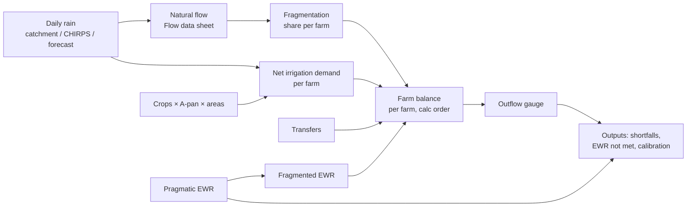

# Model reference

This document explains the water-balance model the web app reimplements. It
covers what the model does, the formulas step by step, where each step lives in
the source Excel workbooks, and which workbook behaviours look like bugs that we
need the hydrologist to confirm.

The engine (`packages/engine`) is a TypeScript port of this model. It is pure
code with no I/O, and it runs both in the browser and in the Lambda. Anything
here that differs from the engine code is a documentation bug. Fix whichever one
is wrong.

- [1. Background](#1-background)
- [2. The b023 model (what V1 ports)](#2-the-b023-model-what-v1-ports)
- [3. Workbook quirks and suspected bugs](#3-workbook-quirks-and-suspected-bugs)
- [4. The AI node-based model (v004 DEV)](#4-the-ai-node-based-model-v004-dev)
- [5. The AI runoff module (DEV 003)](#5-the-ai-runoff-module-dev-003)
- [6. Porting strategy and regression testing](#6-porting-strategy-and-regression-testing)
- [7. Glossary](#7-glossary)

---

## 1. Background

**Water Balance Tool (WBT) b023** is the Excel/VBA workbook the client used
before this app. It runs a
**daily** water balance for one river catchment, which is a network of farms
(each with an optional composite dam) that drain into one outflow gauge. It
answers three questions:

1. How much natural flow does the catchment produce each day? Rain is turned
   into flow by a calibrated recession model.
2. How much of each farm's irrigation demand can be met from its runoff,
   upstream inflow, dam storage and transfers?
3. After irrigation, is the **Environmental Water Requirement (EWR)** still met
   at each farm and at the outflow gauge? If not, by how much is it short?

**One workbook holds one catchment.** In the web app, one workbook becomes one
**project**. The user can keep several projects side by side (place A, B, C…)
and create or copy more.

Source workbooks (kept locally outside the repo in `../project-water-management-source/Original/` and `…/AI/`, never committed):

| Workbook | What it is | Status |
| --- | --- | --- |
| `Blank_WBT_b023_v001.xlsm` | The b023 template with sample data | Reference for formulas |
| the client workbook (`<client>_WBT_b023_v001_…WORKING 007.xlsm`) | Real catchment: a multi-decade daily record, a network of farms draining to one outflow gauge, several crops and a transfer (details in the private source repo) | **Regression target** for V1 |
| `AI/WBT_NodeBased_v004_DEV.xlsm` | An experimental node-based daily ledger with pump scenarios and stress classes | Unfinished; later phase |
| `AI/WBT_Runoff_Module_DEV_003.xlsm` | An experimental bucket rainfall-runoff model with one hydrological unit per farm | Unfinished; later, as an alternative flow generator |

---

## 2. The b023 model (what V1 ports)

### 2.1 Pipeline



Units: flows and volumes are **m³/day** internally. The workbook converts m³/s
with `86 400 s/day` (`rAppSet_ConvertSecToDay`). Months are laid out in
**water-year order** (Oct … Sep) wherever the workbook shows a monthly table.

**Rounding.** The workbook rounds at nearly every step (`ROUND(…, 0)` on
fragmented flows, dam splits, return flow, storage and capacity; `INT` on the
rain-added flow; 4 dp on recession indices; 2 dp / 1 dp / 0 dp in the demand
chain; 0, 1 and 3 dp and `ROUNDDOWN` in `[Shortfalls]`). **The engine (≥ 0.4.0)
rounds nothing**: rounding a model state is not neutral. It stopped every
recession at a floor of about `0.5 / (1 − f)` m³/day (32 m³/day for the
default tail factor), created or lost water whenever a flow was split (four
equal farms and 2 m³/day of natural flow gave 4 m³/day of runoff), and turned a
0.4 m³ dam into no dam ([audit R1](./engine-audit.md)). The formulas below show
the workbook's rounding for reference, marked *(workbook only)*; the UI and the
exports round for display.

### 2.2 Configuration (the "Cfg" sheets)

| Sheet | Holds | App equivalent |
| --- | --- | --- |
| `[Network]` | Elements (Farm or Gauge), upstream elements (up to 7), "Has transfer?", the one **outflow gauge**. The rows must be in calculation order (upstream first). Bifurcation is not allowed. | `node` rows; `downstream_node_id` gives the tree, and the engine works out the calculation order |
| `[Farm spec]` | Areas (total, high-MAP, low-MAP), the fragmentation method (Area / Hi-Lo / Specific), % upstream inflow "above dam", % farm runoff into dam, dam capacity, initial %, min % for transfers, downstream diversion back to dam (m³/s → m³/day), irrigation return flow % | `node` farm columns + `project.settings.flowShareMethod`, `hiLoSplit`. The return flow % becomes `irrigationEfficiency` and `lossReturnFraction` (N1); the min % is not imported (Q5) |
| `[Crop demand]` | WR90 A-pan evaporation by month, effective-rainfall %, crop factors by month | `settings.apanMm`, `settings.effectiveRainFraction`, `crop` |
| `[Farm demand]` | Crop area (m²) per farm per crop, days per month (Feb = 28.25 by default) | `crop_area`, `settings.februaryDays` |
| `[Transfers]` | Hand-written transfer formulas, plus per-transfer parameters (from, to, months, max m³/s, min dam %) | `transfer` rows (structured rules) |
| `[Flow Calibration Cfg]` | The rain→flow parameters and the recession curve | `settings.calibration` |
| `[EWR Cfg]` | Desktop Reserve Model tables, and the percentile pick with overrides that produce the **pragmatic EWR** (m³/day per month) | `settings.ewrPragmaticM3PerDay` (V1 stores the final table) |
| `[Flow data]` (left block) | Daily inputs: Pitman natural flow, observed gauge flow, logger flow (all m³/s), catchment-average rain, CHIRPS rain, forecast rain (mm) | `time_series` rows by `kind`; the Pitman column is not imported (engine ≥ 0.10.0, [audit P1](./engine-audit.md)) |

Element types: a **Farm** element can also stand for a stand-alone dam or a
natural (unused) area, depending on its parameters (see the `[Models]` sheet). A
**Gauge** only passes flow through and reports it.

### 2.3 Irrigation demand

Sheets `[Crop demand]` → `[Farm demand]` → `[Irrigation Demand]`.

1. **Gross crop requirement (mm/month)** for crop *c* in water-year month *m*:

   `grossMm[c][m] = apanMm[m] × cropFactor[c][m]` (workbook: `ROUND(…, 2)`)

2. **Gross farm demand (m³/day)** for farm *f*:

   `grossFarm[f][m] = Σc area[f][c] × grossMm[c][m] / 1000 / daysInMonth[m]` (workbook: `ROUND(…, 1)`)

   Here `daysInMonth` is 31, 30, 31, 31, **28.25**, 31, 30, 31, 30, 31, 31, 30 for
   Oct…Sep. February is configurable. 28.25 gives a 365.25-day year.

3. **Net daily demand (m³/day)** on day *t*:

   `netDemand[f][t] = MAX(0, grossFarm[f][month(t)] − croppedArea[f] × effRain / 1000 × rainUsed[t])` (workbook: `ROUND(…, 0)`)

   - `croppedArea[f]` = Σ crop areas of the farm (m²).
   - `effRain` = effective-rainfall fraction (0.65).
   - `rainUsed[t]` is the *thresholded* rain from the Flow data sheet (§2.4).
     Rain at or below the threshold counts as 0, so light rain does not reduce
     demand.

   The crop factors multiply **A-pan** evaporation (`grossCropMm` in
   `packages/engine/src/demand.ts`), not FAO reference evapotranspiration ET₀.
   ET₀ is about 0.7–0.85 × pan, so an FAO-56 Kc entered as it is overstates
   demand by roughly a quarter. The Crops tab says so and points out any factor
   above 1.0 (a hint, not an error).

4. **Soil-water carry-over (engine ≥ 0.14.0, [audit N3](./engine-audit.md)).**
   The workbook's rule above lets rain offset only the day it falls on: a 60 mm
   day cancels one day of demand and the rest is lost. The engine carries
   effective rain over through one soil-water store per farm, a one-bucket form
   of the FAO-56 root-zone balance (Allen et al. 1998, ch. 8), sized by
   `settings.effectiveRainStoreMm` (mm over the cropped area, default **25 mm**:
   0.5 × 100 mm/m × 0.5 m, the readily available water of 0.5 m of roots in a
   soil holding 100 mm/m, FAO-56 Tables 19 and 22). Each day, in this order:

   ```
   Pe        = croppedArea × effRain / 1000 × rainUsed[t]          (m³)
   available = W[t−1] + Pe                   (not capped yet)
   used      = MIN(available, MAX(0, grossFarm))
   netDemand = MAX(0, grossFarm) − used
   W[t]      = MIN(Smax, available − used)   Smax = croppedArea × effectiveRainStoreMm / 1000
   ```

   The store starts empty. Adding the day's rain *before* capping means a big
   rain still covers that day's demand first, however small the store, as the
   workbook's rule does; only what is left after that is capped. Rain above the
   store's size is lost to drainage and runoff (the catchment runoff model
   already counts that water, so nothing is double-counted). With
   `effectiveRainStoreMm = 0`, W is 0 every day and net demand is **bit for
   bit** the workbook's `MAX(0, gross − Pe)` (tested). Demand stays
   precomputed, independent of supply, so the network simulation is
   unchanged. The farm's `effective_rain` working column is now the effective
   rain *used* that day (from the day's rain or the store), and `soil_water`
   is W at the end of the day, in mm.

   This was decided on a simulated hydrologist's recommendation (2026-09-24)
   and is **pending the real hydrologist's review**; the size is a per-project
   setting so they can change it, or set 0 to reproduce the workbook.

   The result, net demand, is the farm's **crop water requirement** F (run
   series `crop_requirement`, the workbook's net irrigation demand).

5. **Abstraction demand (engine ≥ 0.16.0, [audit N1](./engine-audit.md))**:
   the farm abstracts enough to cover its application losses,

   `D[f][t] = F[f][t] / e[f]`

   with `e` = `irrigationEfficiency` (0 < e ≤ 1). D is the run series `demand`:
   supply, deficit, the fraction supplied and the curtailment report are all
   measured against it, so "100 % supplied" means the crop got its whole
   requirement (crop use = e × G = F). The workbook has no such step (e = 1).

### 2.4 Natural flow from rain (`[Flow data]`)

This is the calibrated rain→runoff routine, the engine's `legacy` runoff model
(`settings.runoffModel = 'legacy'`; GR4J, §2.4a, has been the default since
engine 0.11.0. `packages/engine/src/runoff/` holds the seam every runoff model
plugs into). **Decided (persona recommendation, 2026-09-24; pending the
hydrologist): legacy is kept exactly as it is — no numeric change — but every
run it produces is labelled workbook comparison only, not evidence** ([audit
H1](./engine-audit.md)): it doesn't conserve water at the event scale, so a
run can't be relied on for a licence, Reserve or compliance assessment. Every
legacy run's `summary.warnings` carries `LEGACY_NOT_EVIDENCE: …`
(`packages/engine/src/run.ts`), the app shows an amber "Workbook comparison"
badge on it, and its CSV exports start with a `# runoff_model=legacy; …`
comment line. GR4J is the model of record.
One row runs per day, and each row reads the previous row. Parameters come from `[Flow Calibration Cfg]`. The
defaults from the blank workbook are shown.

| Parameter | Blank default | Meaning |
| --- | --- | --- |
| `RainThreshold` | 2 mm | Rain at or below this produces no flow and does not offset demand |
| `a`, `b` | 0.09, 1.2 | Peak flow = `a · rain^b` |
| `RainToM3` | total farm area km² × 1000 | Converts mm over the catchment to m³ |
| `SummerMths` | 1,2,3,4,5,11,12 (blank; the engine default is the same) | Calendar months that are always "summer" |
| `FactorSummer` / `FactorWinter` | 0.1 / 1 | Seasonal response factor |
| `WinterTodayThresh` / `WinterNextDayThresh` | 35 mm / 9 mm | Rain that flips a non-summer month into winter response |
| `MinFlowRatioToResetBase` | 1.5 | Rain pulse / base flow ratio above which base flow resets |
| `ShiftPeakIndexLo` / `Hi` | 0.9 / 3.5 | Range of the recession index given to a new rain pulse |
| `Amplitude` | derived | Rain→flow amplitude used to scale the pulse index |
| `DaysMax` | rows in the curve − 1 (79) | Upper bound of the recession index |
| `RecessionCurve` / `RecessionFactors` | 80-row table | Flow (m³/day, descending) → daily recession factor |
| `BaseFlowInitial` | 300 m³/day | Base flow on the first day |

Per day *t*, with the workbook column letters:

| Col | Quantity | Formula |
| --- | --- | --- |
| R | **Rain used** | The first non-blank of catchment rain, CHIRPS or forecast, set to 0 if it is ≤ threshold. From engine 0.7.0, CHIRPS used here is **bias-corrected** per calendar month first (§2.4b, audit B1); the workbook used it raw |
| N | **Season** (1 = summer, 0 = winter) | Summer month → 1. Otherwise: if yesterday was winter → 0. Otherwise → 0 if `rain[t] ≥ 35` or `rain[t−1] ≥ 9`, else 1. In non-summer months "summer" response carries on until a big enough rain opens the winter. |
| V | **Rain-added flow** | `a · R^b · RainToM3 · seasonFactor` if R > 0, else 0 (workbook: `INT(…)`) |
| S | **Base flow** | `FB` = yesterday's base receded by yesterday's base index. The day before the run is a steady base-flow state: base = resultant = `BaseFlowInitial`, at that flow's own recession index (engine ≥ 0.4.0, [audit E1](./engine-audit.md); the workbook left the index blank, so day 1 receded at the extrapolated factor `2·f1 − f2`). If `V / FB > 1.5` the base resets to `V`, else it stays `FB` (the engine resets on any `V > 0` when `FB` is 0, where the workbook divides by 0; engine review F6). (Workbook: rounded to 0 dp.) |
| T | **Base recession index** | Where S sits on the recession curve, interpolated linearly and clamped to `[1, DaysMax]` (workbook: 4 dp) |
| U | **Response flow (start)** | Yesterday's resultant response receded by yesterday's resultant index |
| W | **Pulse index** | For a new pulse (V > 0): `Lo + (Hi − Lo)(1 − V/Amplitude)`, not below `Lo`. If that is above the base index, use `max(1, baseIndex − 0.2)`. With no pulse: yesterday's index + 1. Capped at `DaysMax` (workbook: 4 dp). The workbook used the base index when yesterday's was blank, which only happens on day 1, so a first-day storm lost its pulse index; the engine seeds the day before the run (E1). |
| X | **Response + added** | If V > 0: `U + V`. Else if yesterday's X = 0: `U`. Else yesterday's X receded by yesterday's W. |
| Y / Z | **Resultant response / index** | `max(X, S)` and the index of whichever one won |
| AB | **Natural flow (m³/day)** | `Y` if > 0, else 0. The workbook fell back to its Pitman column when `Y` was 0 (quirk Q7); from engine 0.10.0 the engine doesn't ([audit P1](./engine-audit.md)) |

`recede(flow, index) = flow × lerp(factor[floor(index)], factor[floor(index)+1], frac(index))` (workbook: `ROUND(…, 0)`)

The interpolated factor is clamped at 0, so an index below 1 (a pulse starting at
`ShiftPeakIndexLo` < 1) can shrink a flow to nothing but never make it negative
([audit E2](./engine-audit.md)).

**Checks on every run** (warnings, engine ≥ 0.4.0; [audit W1–W5](./engine-audit.md)):

- **Runoff coefficient** = natural-flow volume / rain volume on the catchment
  over the run (`summary.catchment.runoffCoefficient`). Above 1 the catchment
  gives back more water than fell on it, which is impossible over a whole
  record, so the run warns. The structure makes this easy to reach: a storm
  resets the base flow to the storm's peak, which then recedes along the slow
  part of the curve (audit H1 — decided provisionally, pending the hydrologist).
- **Days with no rainfall value** from any source are counted: the model treats
  them as dry (0 mm), for runoff and for demand.
- **Recession table**: a factor outside 0–1, a curve that rises, or tables of
  different length.
- **Not evidence**: every legacy run carries `LEGACY_NOT_EVIDENCE: …`
  (audit H1) — the model doesn't conserve water at the event scale, so its
  results are a workbook comparison only. GR4J never carries it.

The same sheet also:

- Picks the **observed** flow series used for calibration: Pitman (1), gauge
  (2) or logger (3) via `rUseFlow`. It converts it to m³/day (the workbook rounds).
  The app offers only the gauge and the logger (engine ≥ 0.10.0, audit P1).
- Carries the **pragmatic EWR** for the day's month (AF), the **simulated
  outflow** at the outflow gauge (AG), an "EWR not met" flag (AJ = 1 when
  AG < AF) and the shortfall volume (AK = AG − AF when not met).
- Reports mean annual runoff and mean daily runoff (all days and summer only)
  for observed and simulated flow.

> The engine's `CalibrationParams` (`settings.calibration`) holds every
> parameter above: `a`, `b`, the threshold, the seasonal factors, summer
> months, the initial base flow, the reset ratio, the winter thresholds, the
> shift-peak indices, the amplitude, `DaysMax`, the recession curve and
> factors, and an optional catchment-area override (`catchmentAreaKm2`, null =
> the sum of the farm areas). The importer reads them from the workbook's
> named ranges (`rCalibration_*`).

### 2.4a Rain to flow: GR4J (engine ≥ 0.5.0, issue #4)

`settings.runoffModel = 'gr4j'` replaces the legacy recession model (§2.4)
with **GR4J** (Perrin, Michel & Andréassian 2003, *J. Hydrol.* 279), a
published daily rainfall–runoff model with four parameters. It is written from
the paper's equations in `packages/engine/src/runoff/gr4j.ts`. The reference
implementation, the R package airGR, is GPL-2, and no code is taken from it.
Everything downstream (flow shares, farms, dams, transfers, EWR) is unchanged,
so the two models compare run against run. GR4J is the default since engine
0.11.0 (the calibration research's CR-17): a project that never picked a model
runs GR4J. Legacy stays selectable, and a stored run without a runoff model
predates the setting, so run comparison reads it as legacy.

**Parameters** (`settings.gr4j`). The typical range is Perrin's 80 % range over
429 catchments; the bounds are enforced by the API and searched by calibration.

| Param | Meaning | Unit | Default | Typical | Bounds |
| --- | --- | --- | --- | --- | --- |
| `x1` | production (soil-moisture) store capacity | mm | 350 | 100–1200 | 10–3000 |
| `x2` | groundwater exchange coefficient | mm/day | **0** (fixed) | — | −5–3 (opt-in) |
| `x3` | routing store reference capacity | mm | 90 | 20–300 | 1–1000 |
| `x4` | unit hydrograph time base | days | 1.7 | 1.1–2.9 | 0.5–10 |
| `warmupDays` | warm-up before day 1 | days | 365 | — | 0–3650 |

**Forcing** (`runoff/simulate.ts`, `runoffForcing`):

- **Rain P**: catchment rain, else CHIRPS (bias-corrected, §2.4b), else
  forecast, as for legacy, but with **no rain threshold** (that was part of
  the legacy model). A day with no
  value is dry, and the run counts those days (W2). Negative values count as 0.
- **Potential evaporation E** = `panCoefficient[month] × apanMm[month] / days
  in that calendar month`, so each month's PET totals exactly coefficient ×
  A-pan. `settings.panCoefficient` is 0.7 in every month by default and is
  edited per month (question 4 for the hydrologist). It doesn't touch
  irrigation demand. **It is held fixed, never calibrated**: it trades off
  against X1/X3 (a higher coefficient and a smaller store fit the same
  record), so automatic calibration (§2.10b) never searches it, and each fit
  records the coefficient (and, from the same forcing snapshot, the A-pan and
  CHIRPS bias correction mode) it ran under — a later change to any of them
  is fit provenance's `forcingChanged` (§2.10b).
  - **Presets** (`PAN_COEFFICIENT_PRESETS`, `packages/engine/src/project.ts`;
    a simulated hydrologist recommendation, pending the real one). Three
    water-year (Oct–Sep) starting points a Settings picker can fill the row
    with — the row stays monthly and editable after, and nothing records
    which preset (or whether one at all) was used:
    | Preset | Oct–Mar | Apr–Sep |
    | --- | --- | --- |
    | Generic | 0.70 every month | 0.70 every month |
    | Winter rainfall (e.g. Western Cape) | 0.70, 0.65, 0.65, 0.65, 0.65, 0.70 | 0.75, 0.80, 0.80, 0.80, 0.80, 0.75 |
    | Summer rainfall | 0.65, 0.70, 0.75, 0.75, 0.75, 0.75 | 0.70, 0.70, 0.70, 0.65, 0.60, 0.60 |

    They are **indicative, from FAO-56 Table 5 climate classes** (Allen et
    al. 1998); confirm against local humidity and wind before relying on
    them.
  - **Plausibility warning.** A run warns, and Settings hints
    (`panCoefficientOutOfRange`), when a month sits outside **0.6–0.85**,
    FAO-56's usual range for a Class A pan. This is a soundness check, not a
    bound: the API keeps the wider 0–2 it always has, so a stored project with
    a coefficient further out still loads, saves and runs — the warning just
    says so. All three presets sit inside 0.6–0.85.
  - **Testing the effect of a choice.** There is no automated sensitivity
    harness yet (that is CR-21, [calibration-research.md](./calibration-research.md));
    until it exists, `pnpm pan-sensitivity <project.json>`
    (`backend/scripts/pan-sensitivity.ts`) is the manual way to see how much a
    pan-coefficient choice moves a catchment's results: it runs GR4J at a few
    values (flat 0.60, 0.70, 0.85, and a preset) and reports MAR, Q95 and EWR
    compliance, both with GR4J's parameters held fixed and refitted, scored
    against the logger record. The script takes any project.json and carries
    no client data; a report run against the client catchment
    (`data/client-catchment/`, gitignored) stays local, never committed, per
    the public-repo rule.
- **No evaporation, no run** (engine ≥ 0.11.1). When A-pan × pan
  coefficient is 0 in every month, GR4J is refused (`GR4J_NO_PET`), as a run
  with no rainfall is. Without evaporation the production store only fills,
  so nearly all rain becomes flow; before 0.11.1 this was only a warning,
  which a new project (A-pan defaults to 0) met on its first run once GR4J
  became the default. Settings shows the same check (`hasPotentialEvaporation`)
  beside the model picker, and a fit is refused the same way.
- **No Pitman fallback.** Flow is whatever the model produces.

**One day** (P, E in mm):

1. **Net rain and net evaporation:** if P ≥ E then Pn = P − E and En = 0;
   otherwise Pn = 0 and En = E − P.
2. **Production store S:**
   Ps = X1·(1 − (S/X1)²)·tanh(Pn/X1) / (1 + (S/X1)·tanh(Pn/X1)) and
   Es = S·(2 − S/X1)·tanh(En/X1) / (1 + (1 − S/X1)·tanh(En/X1)).
   Then S ← S − Es + Ps.
3. **Percolation:** Perc = S·{1 − [1 + (4S/(9·X1))⁴]^(−¼)}, and S ← S − Perc.
4. **Routed water:** Pr = Perc + (Pn − Ps). 90 % goes to UH1 and 10 % to UH2.
5. **Unit hydrographs:** each ordinate is j = SH(j) − SH(j − 1).
   - UH1 has SH1(t) = (t/X4)^2.5 for 0 < t < X4, and ⌈X4⌉ ordinates.
   - UH2 has SH2(t) = ½(t/X4)^2.5 up to X4, then 1 − ½(2 − t/X4)^2.5 up to
     2·X4, and ⌈2·X4⌉ ordinates.
   - Both sum to 1. Each keeps a queue of water in transit. Q9 is today's UH1
     output and Q1 is today's UH2 output.
6. **Exchange:** F = X2·(R/X3)^3.5. It is 0 when X2 = 0.
7. **Routing store:**
   - R ← max(0, R + Q9 + F);
   - Qr = R·{1 − [1 + (R/X3)⁴]^(−¼)};
   - R ← R − Qr.
8. **Direct flow:** Qd = max(0, Q1 + F).
9. **Flow:** Q = Qr + Qd, in mm over the catchment. Natural flow (m³/day) =
   Q × area (km²) × 1000, over the same catchment area as legacy
   (`calibration.catchmentAreaKm2`, else the sum of the farm areas).

**Fluxes recorded:**

- AET = min(P, E) + Es.
- The applied exchange is the exchange left after the two clips:
  (R after the max − R before − Q9) + (Qd − Q1).

**The balance closes every day:**
P − AET − Q + exchange = Δ(S + R + water in the UH queues), to 10⁻⁹ mm. With
X2 = 0 the model is closed: water leaves only as evaporation or flow, or stays
stored. So a storm can never return more than fell, which fixes audit H1 by
construction.

**Warm-up.** The stores start half full (S = ½·X1, R = ½·X3) with empty queues.
The model then runs `warmupDays` days that cycle the run's own forcing from its
first day. Day k of the warm-up uses day k mod n, so a warm-up longer than the
run repeats it. Warm-up days are never output or scored. Day 1 starts from the
warm-up's end state.

**Outputs.** GR4J adds these catchment series:

- `rain_used` and `pet`;
- `aet`;
- the end-of-day stores `production_store`, `routing_store` and `uh_store`
  (water in transit);
- `exchange`, only when X2 ≠ 0.

`summary.runoff` holds the parameters used, the area and the whole-run totals
(rain, PET, AET, flow and exchange), plus the storage at the start (after the
warm-up) and at the end. Those totals satisfy
rain − AET − flow + exchange = end − start. When a short run's natural flow
exceeds its rain, the W1 warning names the starting storage instead of blaming
the calibration. An out-of-bounds parameter in stored settings (the API rejects
them) falls back to its default with a warning.

### 2.4b CHIRPS fallback bias correction

Engine ≥ 0.7.0, [audit B1](./engine-audit.md), `packages/engine/src/rain.ts`.
Setting: `settings.chirpsBiasCorrection`, `'monthly'` (default) or `'none'`.

**Why.** Rain used (column R, and GR4J's P) falls back to CHIRPS on every day
the catchment rain is blank. CHIRPS is a 0.05° satellite-and-gauge product.
At the scale of a small mountain catchment it can read a fraction of the
catchment's own gauges, and by different amounts in different seasons:
frontal and orographic rain on the ridges is what a satellite estimate
misses most. Used raw, a year whose
catchment rain is missing runs far too dry. The legacy model hides some of
this, because its base-flow reset makes flow out of little rain (H1). GR4J
conserves water, so in those years it makes almost no flow. In the
hydrologist's review of issue #4 phase 6 on the client catchment, those
fallback years made up most of the EWR-failure difference between the two
models. Correcting the fallback was the first condition for adopting GR4J.

**The factors.** For each calendar month *m*:

  factor(m) = Σ catchment rain / Σ CHIRPS, over the days in month *m* where
  both series have a reading (present, finite and not negative).

- **Suspect catchment rain is left out** (engine ≥ 0.18.0). Zeros that may
  be missing data would drag the factors down, so the fit leaves out:
  - every **low-vs-CHIRPS** water year (§2.10a), whole. A year that reads
    half its usual share may be partly zero-filled anywhere in it, and
    nobody has said which days;
  - the days of every **flagged zero-rain run that is not kept dry**, one by
    one, like the days of periods listed as missing in
    `settings.zeroRainRuns.missing` (§2.4c). A run set aside as missing
    tells the fit exactly which days are bad, so the rest of its water year
    is good data and stays in. In `'asRecorded'` mode every flagged day is
    left out this way: that mode runs them dry as a blanket choice, not
    because anyone confirmed them;
  - the days of every **multi-day accumulation window** (§2.4d; engine ≥
    0.20.0), one by one, in either accumulation mode, except a reading kept
    as recorded. Their recorded days are wrong (zeros, then the lot on one
    day), and their spread days are CHIRPS-shaped, so fitting on either
    would be circular. Keeping the windows' totals in instead would not be
    neutral either: the detected windows read well under the usual
    catchment / CHIRPS ratio (an unread gauge loses water, and the detection
    test itself prefers windows CHIRPS reads a lot over), so they would drag
    the factors down.

  **Kept-dry days stay in**, as confirmed readings. Leaving out real dry
  spells would be selection bias: they are the days when the catchment reads
  0 and CHIRPS its false-positive drizzle, so dropping them pushes every
  factor up. Up to engine 0.17 the fit dropped every water year a flagged
  run touched, kept dry or not.

  **Keep-dry guard.** A keep-dry is a claim the fit can check: in a real dry
  spell CHIRPS is dry too. So for each flagged run with kept-dry days, the
  fit adds up CHIRPS over those days, bias-corrected with factors fitted
  without any flagged-run day (so the verdict doesn't lean on the keep-dry
  it is judging; raw CHIRPS when the mode is `'none'`). When that is above
  **max(50 mm, 25 % of the catchment's usual annual rain)**
  (`KEEP_DRY_DOUBT_MIN_MM`, `KEEP_DRY_DOUBT_ANNUAL_SHARE` in `rain.ts`; usual
  annual rain = Σ over the calendar months of the series' own mean daily
  rain × the month's days, `usualAnnualRainMm` in `quality.ts`), the
  keep-dry looks doubtful: the run warns with the numbers, and the water
  years of the kept days are left out of the fit whole. The kept days still
  run dry, as Settings says; the guard only protects the factors. Why these
  limits: 50 mm is the floor the fit already uses for a month's sample, so a
  short dry spell with a little CHIRPS drizzle is never doubted. A quarter
  of a year's rain is what the zero-run check itself looks for (60 wet-season
  days), so CHIRPS putting that much rain on a "dry" run says it wasn't dry.
  The annual share scales the limit to the climate, so a semi-arid record
  isn't doubted on rain it would call ordinary.
- **Minimum sample.** A month's own factor needs **90 shared days** (about
  three years of that month) and **50 mm of CHIRPS** on them, so a dry month
  with a few millimetres can't produce a wild ratio. A month short of either
  takes the **pooled** factor: the same ratio over all months together, with
  the same minimums. With too little overlap for even that (for example a
  project with CHIRPS but no catchment rain), CHIRPS stays raw and the run
  warns how many days used it uncorrected.
- **Clamp: 0.25–4.** CHIRPS is known to miss orographic rain in mountain
  terrain, and the size of its bias changes with the season, so a factor of
  two or three in the frontal-rain months of a mountain catchment is
  plausible. A
  factor beyond four either way is more likely a sign that the two series
  don't describe the same area, or of a unit error, than a real bias. It is
  clamped, and the warning marks it "(clamped)". The range is engineering
  judgement, open for the hydrologist to confirm ([followups.md](./followups.md)).
- The factors come from the **whole stored record**, not only the run
  window, so a shorter simulation period doesn't change them. A monthly
  factor is *linear scaling* (Teutschbein & Seibert 2012, *J. Hydrol.*
  456–457): it corrects the monthly volume, not the number of wet days or the
  intensity distribution.

**Where it applies.** Only to CHIRPS that is actually used: a day with no
catchment rain value and a CHIRPS value gets `CHIRPS × factor(month)`.
Catchment rain is never changed. A day where the catchment reads 0 keeps its
0 (a zero is a reading and blocks the fallback, §2.10a), unless §2.4c sets
it aside as missing first: then it is a blank day like any other. **Forecast rain is
not corrected**: there is no overlap to fit a forecast factor from, and a
forecast product's bias is not CHIRPS's. The corrected rain then goes
through everything that reads rain used: the legacy model (before its rain
threshold), GR4J, the effective-rain offset on irrigation demand, automatic
calibration, and the runoff coefficient (W1). So both runoff models change,
and so does demand.

**Output.** `summary.chirpsCorrection` holds each month's shared days, sums,
own and applied factor, its source (`month`, `pooled` or none) and whether it
was clamped, the pooled factor, the excluded water years, and the numbers of
fallback days and corrected days, with the fallback rain before and after
correction. From engine 0.18.0 it also says why years were left out
(`lowVsChirpsYears`, `doubtfulKeepDry` with each doubted run's kept days,
CHIRPS millimetres and limit) and how many shared days were left out one by
one (`flaggedDaysLeftOut`, `missingDaysLeftOut`) or kept in as kept-dry
(`keptDryDaysInFit`). A run that corrected any day adds one warning listing
the factors (Oct–Sep), the day count and what the fit left out; a doubted
keep-dry adds its own warning whether or not CHIRPS filled any day. GR4J's `rain_used` series shows the
corrected rain day by day.

**Rain columns in every run (engine ≥ 0.10.1).** Beside the model's own
`rain_used`, a run outputs up to four catchment series (`chirpsColumns` and
`runRain` in `run.ts`), which sit next to each other in the daily CSV export
and the series explorer:

| Key | What | Missing days |
| --- | --- | --- |
| `rain_final` | Final catchment rainfall: catchment rain, else corrected CHIRPS, else forecast. Before any rain threshold, so the legacy `rain_used` can read 0 where this reads ≤ the threshold | NaN when no source has a value (the model treats the day as dry) |
| `rain_chirps` | CHIRPS as uploaded | NaN |
| `rain_chirps_corrected` | CHIRPS × its calendar month's factor on **every** day it has a value, not only the fallback days, so it can be read against catchment rain on the days both exist. A month without a factor keeps its raw value. Only output when the setting is `'monthly'` and some month has a factor | NaN |
| `chirps_factor` (engine ≥ 0.10.2) | The day's calendar-month factor (unit ×), so each row of the daily CSV shows what its CHIRPS was multiplied by. Output with `rain_chirps_corrected` | NaN for a month without a factor |
| `rain_catchment_missing` (engine ≥ 0.15.0) | 1 on a day whose catchment reading the run set aside as missing (§2.4c), 0 elsewhere. Only output when the run set aside at least one day | never missing |
| `rain_catchment_spread` (engine ≥ 0.20.0) | 1 on a day whose catchment rain came from a multi-day accumulation window (§2.4d): spread by CHIRPS, or the reading day and the zeros before it when CHIRPS was dry throughout. Only output when the run took at least one day from a window | never missing |

The run's **summary CSV** has a *CHIRPS bias correction* block: one row per
calendar month (Oct … Sep) with the factor applied, its source (own month,
pooled, or none), the unclamped own factor, whether it was clamped, the shared
days and the catchment and CHIRPS rain on them, and the days CHIRPS filled in;
then the pooled factor and the water years left out of the fit, with (engine
≥ 0.18.0) which were far below CHIRPS, each doubted keep-dry, and the day
counts left out or kept in (`chirpsFactorLines` in
`backend/src/export/run-tables.ts`). Run comparison notes when the two runs'
factors or left-out years differ (`RunComparison.chirpsFit`,
[run-comparison.md](./run-comparison.md)).

Runs saved before 0.10.1 don't have these series; re-run to see them.

**Why a setting.** The operator's policy is no workbook-compatibility modes
(plan.md risks; roadmap D3): an unsound workbook algorithm is replaced
outright, and `engineVersion` explains older results. `chirpsBiasCorrection`
is not such a mode. The correction is a data-preparation choice, like the
pan coefficient, and it has a legitimate "off": a project may load a CHIRPS
series that is **already** bias-corrected to the catchment (by the
hydrologist, or a product such as a station-blended CHIRPS), and correcting
it again would double the bias correction. So the default is `'monthly'`,
and `'none'` is there for that case, not to reproduce the workbook. Runs
saved before 0.7.0 used raw CHIRPS; run comparison flags the engine version
change, and compares a stored run without the setting as the default.

### 2.4c Zero-rain runs treated as missing

Engine ≥ 0.15.0, [audit B2](./engine-audit.md), CR-20
([calibration-research.md](./calibration-research.md)), issue #3,
`zeroRainMask` in `packages/engine/src/rain.ts`. Setting:
`settings.zeroRainRuns`.

**Why.** A zero is a reading, so a stretch of missing catchment rain exported
as zeros blocks the CHIRPS fallback (§2.4b) and runs the catchment dry, and
natural flow, demand and the EWR results with it. The issue #2 check (§2.10a)
finds these stretches: runs of zeros with 60+ days in the series' own six
wettest months. Up to 0.14 it only warned. A zero run that long in the wet
season is far more likely to be a logger or export gap than weather. Where
it is real weather, CHIRPS is dry over it too, so filling it adds little
rain. So a false alarm costs little and a missed gap costs a whole wet season.
That is why the default fills.

**The rule.** Before rain used is picked, the run blanks the catchment rain on:

1. every day of every zero run the issue #2 check flags, in mode `'missing'`
   (the default), except days inside a **keep-dry** period; and
2. every day inside a **missing** period, in either mode, whatever it reads.

Those days are then blank days like any other: bias-corrected CHIRPS fills
them, then forecast rain, then nothing (the model treats a day with no value
as 0 mm and the run warns). Flagged runs come from the **whole stored
record**, as the Data tab's checks see it, not only the run window. **The
stored series is never changed**, so turning the setting off gives back the
recorded rain exactly.

| Setting | Values | Meaning |
| --- | --- | --- |
| `mode` | `'missing'` (default), `'asRecorded'` | What to do with flagged zero runs. `'asRecorded'` runs them dry, as up to 0.14 and as the workbook does |
| `keepDry` | periods | Flagged zero runs the hydrologist confirms as real dry spells: their days stay 0 and count in the CHIRPS factor fit (§2.4b; engine ≥ 0.18.0). Only affects flagged runs |
| `missing` | periods | Extra periods whose catchment rain is bad, e.g. the gap days inside a low-vs-CHIRPS year. They are also left out of the CHIRPS factor fit (§2.4b) |

A period is a whole water year (`{ waterYear, reason }`) or a date range
(`{ start, end, reason }`), always with a reason, as for calibration
exclusions (§2.10b). A day in two periods counts once: a flagged run claims
its days first. **A multi-day accumulation window (§2.4d) takes precedence
over a flagged run** for its days, in accumulation mode `'spread'`: the
window's own recorded total covers them, so they are not filled from CHIRPS
as well (engine ≥ 0.20.0; up to 0.19 a flagged run that ended in an
accumulation reading was filled *and* the reading kept, counting that rain
twice). A listed missing period wins over a window.

**Not changed.** The data checks (§2.10a) still report the flagged runs,
because the data is still suspect. The low-vs-CHIRPS check never blanks a
year by itself: a year that reads half its usual rain may be partly real, so
the hydrologist lists the bad days as `missing`.

**The CHIRPS fit follows the same decisions** (engine ≥ 0.18.0, §2.4b). A
flagged run that is treated as missing, and a listed missing period, are
left out of the factor fit day by day; a kept-dry run stays in as a
confirmed reading, unless bias-corrected CHIRPS contradicts it (the keep-dry
guard), and then its water years stay out and the run warns. Up to 0.17 the
fit left out every water year a flagged run touched, even one kept dry.
Because `keepDry` now changes the factors as well as the kept days, a fit
record's `forcing.zeroRainRuns` (fit provenance, §2.10b) still flags
"Forcing changed since fit" on any change to it.

**Output.** `summary.zeroRainInfill` has the mode and each period set aside,
flagged or listed, with its reason, the run days set aside, the catchment
rain recorded on them, the rain used instead, and the days with nothing to
fill them. It also lists the keep-dry periods that kept any days, and, in
`'asRecorded'` mode, how many flagged-run days ran dry. It has totals too. The run
warns once for what it set aside and filled, once for what it kept dry, and
once when the mode left flagged runs dry. The `rain_catchment_missing` column
(§2.4b table) marks each day set aside. The run's summary CSV has a *Catchment rain
treated as missing* block (`zeroRainLines` in
`backend/src/export/run-tables.ts`). Run comparison lists changes to the
mode and to both period lists. A run saved before 0.15.0 compares as
`'asRecorded'`, which is what it did.

**Workbook regression.** The workbook runs the zeros dry, so the client
catchment suite replays with `'asRecorded'`. Its "B2:" test checks that the
default sets aside exactly the flagged runs, changes catchment rain on no
other day, finds CHIRPS for every day it sets aside, and passes the
self-checks. It runs with multi-day accumulations as recorded, so B2 is
judged on its own; the "B4:" test (§2.4d) runs both defaults.

### 2.4d Multi-day rainfall accumulations

Engine ≥ 0.20.0, [audit B4](./engine-audit.md), issue #2,
`packages/engine/src/accumulation.ts`. Settings: the accumulation fields of
`settings.zeroRainRuns`.

**Why.** When nobody reads a manual rain gauge for some days (a weekend, a
holiday, an observer away), the unread days are often entered as 0 or left
blank, and the whole accumulated total goes on the day the gauge was read.
Viney & Bates (2004, "It never rains on Sunday", *Int. J. Climatol.* 24)
found these *untagged* accumulations throughout the Australian high-quality
daily record; they are the classic fault of manually read stations. The
total is right and the days are wrong: the model sees a dry spell and then
one storm several times bigger than any day really was. Both runoff models
respond to daily rain non-linearly (the legacy model's a·Rain^b peak,
GR4J's production store), so one 150 mm day makes far more quick flow, and
carries far less soil moisture forward, than 150 mm over three weeks.
Worse, when the unread days form a flagged zero run (§2.4c), engine
0.15–0.19 filled them from CHIRPS and kept the reading too, counting that
rain twice.

**Detection** (`detectAccumulations`). Over the whole stored record, a
catchment reading is an accumulation when:

| Test | Value (`accumulation.ts`) | Why |
| --- | --- | --- |
| The reading is large | ≥ 20 mm (`ACC_MIN_MM`) | Spreading a few millimetres changes little, and small readings are where a storm CHIRPS missed is most likely |
| It follows days of 0 or blank | ≥ 3 days (`ACC_MIN_RUN_DAYS`) | A weekend is the shortest common gap. Blank days count like zeros: the total covers a tagged-missing day just as well |
| CHIRPS saw little rain on the reading day | bias-corrected CHIRPS on the day before, the day and the day after < 25 % of the reading (`ACC_READING_DAY_SHARE`) | If CHIRPS rained then, the reading is most likely that day's storm. The ±1 day is timing slop: a gauge read at 08:00 books the previous day's rain, and CHIRPS's day boundary differs |
| CHIRPS saw rain over the days before | bias-corrected CHIRPS over the run, leaving out the day just before the reading, ≥ 50 % of the reading (`ACC_RUN_SHARE`) | This separates an accumulation from a convective storm CHIRPS missed after a real dry spell: then CHIRPS is dry over the run too. The day before is left out so a storm CHIRPS booked a day early is not mistaken for rain in the run |
| Window length | the run, at most its last 92 days (`ACC_MAX_RUN_DAYS`), plus the reading day | About a season: a gauge left longer would have overflowed or lost its catch to evaporation |

CHIRPS is judged × the §2.4b monthly factors fitted before any accumulation
is left out. The detection compares amounts, so it uses the factors in
either CHIRPS mode (raw CHIRPS for a month without a factor). A day with no
CHIRPS value counts as 0, except that the reading day must have one.
Windows never overlap: each run ends at the reading before the next.

**Treatment** (`accumulationMode`, default `'spread'`). The window's recorded
total *T* (the reading plus any other readings in it) is kept and spread
over its days in proportion to bias-corrected CHIRPS there (× the month's
factor in CHIRPS mode `'monthly'`, raw in `'none'`):

  rain(d) = T × CHIRPS(d) / Σ CHIRPS over the window,

with the reading day taking what is left after the other days, so the
window adds up to *T*. This is Viney & Bates's disaggregation, with CHIRPS
as the reference series. If CHIRPS reads no rain over a window at all (only
possible for a window listed by hand), its total stays on the reading day,
the other days run as 0, and the run warns. **The stored series is never
changed.**

- **Precedence.** The window's days are not also set aside as a flagged zero
  run (§2.4c): its total covers them. A run longer than 92 days is split: the
  window takes its last 92 days, and the zero-run fill the rest. A detection
  is dropped when its window touches a period listed as missing, or (in
  zero-run mode `'missing'`) a keep-dry period: the hydrologist has already
  said what those days are.
- **The CHIRPS fit.** Window days are left out of the §2.4b fit day by day,
  in either mode (§2.4b says why), and the spread uses the factors fitted
  without them, so spread rain never feeds its own factors. A reading kept
  as recorded stays in, as a confirmed reading.
- **Mode `'asRecorded'`** leaves every reading on its day, as up to 0.19 and
  as the workbook does. Its windows are still reported and still left out of
  the fit, and the run warns when one ends a flagged zero run that CHIRPS
  fills, because that rain is then counted twice.

| Field | Values | Meaning |
| --- | --- | --- |
| `accumulationMode` | `'spread'` (default), `'asRecorded'` | What to do with detected and listed windows |
| `keepReadings` | periods | Detections the hydrologist confirms as one day's rain (e.g. a thunderstorm CHIRPS missed): a detection whose reading day is inside one stays as recorded, and counts in the CHIRPS fit |
| `addAccumulations` | periods | Windows the check misses, listed by hand; the period's last day is the reading day. A listed window wins over a detection it overlaps; one that overlaps a missing period or an earlier listed window is skipped with a warning |

Periods are shaped like the zero-run ones: a water year or a date range,
each with a reason. The Data tab shades the windows a run would spread.

**Why these thresholds, and their limits.** They are engineering judgement,
tuned on synthetic cases and checked against the client record, open for the
hydrologist to confirm ([followups.md](./followups.md)). A false positive
costs little: the gauge's own total is kept, only its timing changes. What
the check can't tell apart: a storm CHIRPS missed that fell just after
CHIRPS reported rain the gauge didn't catch (list it under `keepReadings`),
and an accumulation whose run CHIRPS also missed (list it under
`addAccumulations`). Some detected windows read far less than CHIRPS over
them. An unread gauge loses water to evaporation and overflow, so such a
total may be low, but the run keeps the gauge's total rather than guess a
correction.

**Output.** `summary.rainAccumulation` has the mode, the thresholds
(`criteria`), each window touching the run (dates, source, reason, what the
run did with it, the recorded total and reading, the detection figures, the
CHIRPS it was spread by, and the rain used from it), listed windows skipped,
and totals. `summary.chirpsCorrection.accumulationDaysLeftOut` counts the
window days the fit left out. The run warns for the windows spread, those
left on the reading day, those kept, those run as recorded, and listed
windows skipped. The `rain_catchment_spread` column (§2.4b table) marks each
day. The summary CSV has a *Multi-day rain accumulations* block
(`accumulationLines` in `backend/src/export/run-tables.ts`). Run comparison
lists changes to the mode and both lists; a run saved before 0.20.0 compares
as `'asRecorded'`. A fit record's `forcing.zeroRainRuns` carries the fields,
so changing them flags "Forcing changed since fit" (a record made before
0.20.0 has nothing to compare them with).

**Workbook regression.** The workbook keeps the readings as recorded, so the
client catchment suite replays with `accumulationMode: 'asRecorded'`. Its
"B4:" test runs the defaults: each window wholly inside the run adds up to
its recorded total, no window day is also filled as a zero run, catchment
rain changes on no other day, and every self-check passes.

### 2.5 Fragmentation (`[Fragmented flow]`, `[Fragmented EWR]`)

Each farm gets a fixed **share** (`frag[f]`, 0–1) of the catchment flow. The
method is chosen in `[Farm spec]`:

| Method | Share |
| --- | --- |
| **Area** | `farmArea / Σ farmArea`, where `farmArea = hiMapArea + loMapArea` |
| **Hi/Lo** | `hiArea/ΣhiArea × hiSplit + loArea/ΣloArea × loSplit` (Pitman split, default 0.81 / 0.19) |
| **Specific** | A value entered by hand ("external fragmentation") |

The shares should sum to 1 within `0.0002` (fragmentation tolerance). The run
also warns, once, about any farm whose area differs from its hi + lo areas by
more than 1 %: the hi/lo shares use hi + lo, the area share and the rain volume
use the area ([audit W3](./engine-audit.md), engine review F7; `areaMismatches`,
§2.10a). Then:

- Farm runoff: `runoff[f][t] = naturalFlow[t] × frag[f]` (workbook: `ROUND(…, 0)`)
- Farm EWR: `ewr[f][t] = pragmaticEwr[month(t)] × frag[f]` (workbook: `ROUND(…, 0)`)

Both sheets, every farm side by side, are the run's **Fragmented flow / EWR —
all farms** downloads (`export/farms.csv?key=runoff|ewr`, [api.md § Export](./api.md#export)).

### 2.5a Land-cover streamflow reductions (engine ≥ 0.24.0, roadmap WP-1.35)

**Why.** Invasive alien trees and commercial forestry (a streamflow reduction
activity under the National Water Act, s36) use more water than the natural
vegetation they replaced. Le Maitre et al. (2016, Water SA 42(4)) put the
national loss to invasive plants at 1 444 Mm³/yr, **2.9 % of the naturalised
MAR**, about 970 m³/ha/yr (97 mm/yr) over the condensed invaded area. It is
also what "clear the invasive trees and see what the river gets back" asks.
**Off by default**: a project with no land-cover patches runs exactly as
before.

**Data** (`ProjectModel.landCover`, table `land_cover`, migration 013): per
farm (the hydrological unit) a list of patches, each with a cover class, an
area (km²), a condensed (canopy) cover 0–1 and optional reductions overriding
the class's. A patch's share of its unit is `f = area × cover ÷ the farm's
area` (patches covering more than the unit are scaled down to it, with a
warning; patches on a gauge, a user or a farm without area are skipped, with
a warning).

**Classes** (`LAND_COVER_CLASSES`; reductions at full cover, **indicative**):

| Class | Flows above the low-flow threshold (`mar`) | Low flows (`lowFlow`) |
| --- | --- | --- |
| Eucalyptus plantation (mature) | 75 % | 90 % |
| Pine plantation (mature) | 40 % | 55 % |
| Invasive alien trees, dryland | 50 % | 60 % |
| Invasive alien trees, riparian | 75 % | 90 % |
| Other | 0 % (enter its own) | 0 % |

They follow the shape of the South African afforestation curves of Scott &
Smith (1997), on which both WR2012's forestry module and Le Maitre et al.
(2016) build: eucalypts reduce total flow more than pines (about 75 % against
40 % in afforested grassland catchments at maturity), and low flows
proportionally more than total flow. The invasive class sits between the two
genera (wattles, the biggest national user, are fast-growing like eucalypts),
and riparian invasions take 1.5 × the dryland reduction (Le Maitre et al.
2016's factor outside grassland and savanna), capped at the eucalypt values.
Age, site quality and rotation are not modelled: the numbers are mature-stand
values and the hydrologist should confirm or override them per catchment
(followups.md). As a check, `summary.landCover` reports each class's reduction
in mm/yr over its condensed area, the figure Le Maitre et al. compare
(≈ 97 mm/yr nationally).

**Each day**, per farm with land cover (network/landcover.ts), with I0 = its
natural runoff (natural flow × share) and q = share × the catchment's natural
flow exceeded on 75 % of the run's days (its low-flow threshold):

```
MAR_u  = Σ_p f_p × mar_p          LOW_u = Σ_p f_p × lowFlow_p
reduction = LOW_u × MIN(I0, q) + MAR_u × MAX(I0 − q, 0)      (never more than I0)
I = I0 − reduction                                           (what the farm routes, §2.7)
```

The part of each day's flow up to the low-flow threshold loses the low-flow
share and the part above it the other share, so the reduction is continuous
and never larger on a smaller flow. This applies the Pitman/WR2012 idea
(separate reductions to total and low flows, per unit, applied to the natural
runoff before the users take water) to a daily flow; which daily split the
hydrologist accepts is open (followups.md). The share of MAR removed is then
close to, but not exactly, `MAR_u` (low-flow days lose `LOW_u`).

- **Its own series**, never inside calibration: `landcover_reduction` per
  farm and for the catchment, `summary.landCover` (mean, share of natural
  flow, the threshold, per class), and the water balance's
  `landCoverReductionM3`. `natural_flow` stays natural (natural vegetation),
  as WR2012's naturalised flows are; farm runoff is natural less the
  reduction.
- **Calibration** runs the whole network, land cover included, so the fitted
  GR4J parameters describe the catchment *without* the invasives: keep the
  patches that were there while the record was measured in the project you
  calibrate (the same baseline-relative rule as boreholes, §2.7d). Because
  the threshold reads the whole run's natural flow, a calibration with land
  cover simulates the whole run instead of stopping at the last scored day.
- **Scenarios**: clearing a class is a copy of the project without its
  patches, compared with the baseline (run comparison lists land cover added,
  changed and removed per farm and class). Clearing every patch gives the
  unreduced run back exactly (tested).
- **Order**: a unit's patches are added up in patch-id order, not list
  order, so `MAR_u` and `LOW_u` are the same to the last bit however the
  patches are listed (engine ≥ 0.26.1, §6 "The ordering rule").
- **Checks** (`checkLandCover`): runoff + reduction = natural × share,
  0 ≤ reduction ≤ that, the reduction follows the formula from the run's own
  natural flow, and the catchment series and summary add up.

### 2.6 Transfers (`[Transfers]`)

The workbook has two blocks of columns:

- **Draw From** (one column per transfer): water available in the *source* dam,
  based on **yesterday's** end-of-day storage:

  `draw[t] = monthIn(t, months) ? MIN( MAX(storage[src][t−1] − cap[src] × minPct[src], 0), maxRate_m3s × 86400 ) : 0`

  **Engine (≥ 0.16.0, [audit N4, Q3, Q18](./engine-audit.md)).** Each rule
  moves `v = MAX(0, MIN(srcFree, dstRoom, maxDaily))` with
  `srcFree = storage[src][t−1] − drawn from src today − reserve` and
  `dstRoom = cap[dst] − (storage[dst][t−1] + rain on the dam − evaporation −
  seepage) + D[dst][t] − already scheduled into dst today` (D = the
  destination's abstraction demand, §2.3; the dam's gains and losses are
  today's, §2.7a, taken from yesterday's storage), so a transfer into a full
  dam doesn't spill straight away and one to a farm without a dam still
  serves its demand. **Engine ≥ 0.19.0** counts the destination dam's own
  rain, evaporation and seepage; 0.16.0–0.18.0 used `cap − storage[t−1] +
  D`, which left a dam that loses water short of its demand by those losses
  (below its dead storage it supplied nothing) while the source still had
  water it was allowed to send. That shortfall did not grow with the demand,
  so more irrigated land could raise a farm's supply fraction (fuzz seed
  921, `run.test.ts` › "counts the destination dam's own losses today in its
  room"). Rules run by `priority` (integer, lower
  first). Within one priority, rules into one destination share its room and
  rules from one source share its free water, each pro rata to its own limit
  (MIN(maxDaily, srcFree)), so results never depend on the list order.
  Transfers are still settled first from yesterday's storage, before any farm
  irrigates: the source does **not** irrigate first (a deliberate choice, no
  per-rule option). Migration 006 set each rule's priority to its old
  position (id order), so a dam with one rule runs as before apart from the
  room cap.

  The engine's reserve is `cap[src] × MAX(minPct, damMinPct[src])`: the
  rule's own minimum, or the source dam's minimum operating level when that
  is higher (engine ≥ 0.16.0, Q5).

- **InOut** (one column per farm with "Has transfer? = Yes"): the net volume
  entering (+) or leaving (−) that farm. Each is a **hand-written formula**, for
  example `<source farm> = −draw₁`, `<receiving farm> = +draw₁`.

The client catchment's transfer is of this kind: one farm dam to another, in some
months of the year, capped by a maximum rate and a minimum level kept in the source dam.

The app replaces the free-form formulas with structured rules
(`transfer` table: from, to, months, max rate, optional daily cap, min storage %,
enabled, priority). The out-leg and in-leg of each rule are the same volume, so they
always balance. Anything the hydrologist has written that doesn't fit this
shape has to be raised with them (see §3).

### 2.7 Farm balance (one sheet per element)

Farms are processed in network order. Upstream elements come first, so a farm
sees its upstream elements' **same-day** outflow. Per farm *f*, day *t* (the
sheet's column letters are in brackets). The workbook rounds L, M, T and the
storage to whole m³; the engine doesn't (R1).

| Step | Quantity | Formula |
| --- | --- | --- |
| F | Crop water requirement | from §2.3 (`crop_requirement`) |
| D | Abstraction demand | `F / e` (`demand`; engine ≥ 0.16.0, N1). The workbook has no column: D = F there |
| H | Upstream inflow | Σ outflow `U` of the elements directly upstream |
| I | Farm runoff | fragmented natural flow (§2.5) |
| J | Transfer in (+) / out (−) | from §2.6 |
| K | Upstream inflow "above dam" (into the dam) | `H × pctUpstreamToDam` (engine ≥ 0.9.0; the workbook computed L this way, see quirk Q1) |
| L | Upstream inflow "below dam" | `H − K` |
| M | Farm runoff into dam | `I × pctRunoffToDam` |
| N | Farm runoff below dam | `I − M` |
| O | Diverted back to dam | `MIN(divertCapacity, L + N)` |
| A, Pd, E, Sp | Dam area, rain on the dam, evaporation, seepage | §2.7a (engine ≥ 0.16.0, N2); the workbook has none |
| G | **Irrigation supplied** | `MIN(MAX(store[t−1] + Pd − E − Sp + M + O + K + J − damCapacity × damMinPct, 0), D)`: only the storage above the dam's minimum operating level (engine ≥ 0.16.0, Q5), up to the abstraction demand (N1) |
| P | Interim storage | `store[t−1] + Pd − E − Sp + M + O + K + J − G` |
| Q | **Storage, end of day** (`store[t]`) | `MIN(P, damCapacity)` |
| R | **Spill** | `MAX(P − damCapacity, 0)` |
| S | Below-dam flow not diverted | `L + N − O` |
| T | Irrigation return flow | `β × (1 − e) × G`: the share β (`lossReturnFraction`) of the application losses (engine ≥ 0.16.0, N1; the workbook's `G × returnPct`) |
| U | **Farm outflow** | `R + S + T + Sp` (seepage joins the outflow, engine ≥ 0.16.0) |
| V | Balance check | `(H+I+J+Pd) − (G − T) − E − (store[t] − store[t−1]) − U` must be 0 (the invariant tests check it on random networks) |
| W | **Irrigation deficit** | `D − G` |
| Y | Fragmented EWR | §2.5 |
| Z | Cumulative EWR | `Y + Σ Z` of the elements directly upstream (see quirk Q4) |
| AA | EWR shortfall (−) | `MIN(U − Z, 0)` |
| AB | Incremental EWR shortfall (−), the **reach shortfall** | `MIN(AA − Σ AA of the elements directly upstream, 0)`. From engine 0.17.0 a diagnostic only: curtailment uses the EWR charge (§2.7b, Q17) |

Initial storage = `initialPct × damCapacity` (workbook: `ROUND(initialPct × ROUND(damCapacity, 0), 0)`).

**Minimum operating level (engine ≥ 0.16.0, [Q5](#3-workbook-quirks-and-suspected-bugs)).**
`damMinPct` is the dam's dead storage: irrigation draws only what is above
`damCapacity × damMinPct` (G above), and a transfer keeps the higher of its
own minimum and this level in the source dam (§2.6). Storage can still sit
below the level (a dam that starts low, or that loses water to evaporation,
§2.7a); irrigation then waits until inflows lift it back above. 0 (the
default, and every imported dam) means irrigation may empty the dam, as in
the workbook; the network editor shows that as a hint. The workbook's
"min %" column is the transfer minimum, which each transfer rule carries, so
migration 006 reset every stored `dam_min_pct` to 0 and the importer no
longer fills it. Decided on persona recommendation (simulated hydrologist
review, 2026-09-24), pending the real hydrologist.

A **gauge** element records the sum of its upstream elements' outflow (`= simulated flow`),
the sum of their cumulative EWR (Z), and its shortfall `MIN(flow − Z, 0)`. The workbook's
gauge sums the upstream elements' AA instead, which reports a shortfall at a
confluence whose flow meets the EWR when one branch is short and another has
water to spare; the engine (≥ 0.4.0) doesn't ([audit G1](./engine-audit.md)). The **outflow gauge's** flow is the
catchment's simulated outflow that goes back into `[Flow data]` AG. That is
compared with the full pragmatic EWR and the observed flow.

**Irrigation efficiency and return flow (engine ≥ 0.16.0, [audit N1](./engine-audit.md)).**
Each farm has an application efficiency `e` (`irrigationEfficiency`,
0 < e ≤ 1) and a loss return fraction `β` (`lossReturnFraction`, 0–1). Per
day: abstraction demand `D = F / e`; `G = MIN(available, D)`; the crop gets
`e·G`; the losses `(1 − e)·G` split into return flow `T = β(1 − e)·G`, which
joins the farm's outflow the same day, and `(1 − β)(1 − e)·G`, which leaves
the catchment (evaporation, deep percolation); consumptive use is `G − T`;
the supplied fraction is `G / D` (= crop use / F); the deficit is `D − G`;
curtailment works in D and G. The balance keeps its form,
`V = (H + I + J) − (G − T) − ΔQ − U`, with the new T. New farms default to
e = 0.80 and β = 0.5; the one-node form offers indicative efficiencies by
system (drip 0.90, micro 0.85, pivot 0.85, sprinkler 0.75, flood 0.65).
Migration 006 converted the old `return_flow_pct` r so stored results stay
explainable: r = 0 → e = 1, β = 0 (bit-identical); r > 0 → e = 1 − r, β = 1
(the balance per unit supplied is unchanged, the crop is now fully supplied,
and abstraction rises by 1 / (1 − r)); r = 1 → e = 0.01. `upgradeLegacyModel`
applies the same mapping to project documents and run snapshots from older
engines. With return flow on, a farm upstream of a starved neighbour can
pass it water through its return flow; that is real under N1 (T is bounded by
the upstream farm's own abstraction, G ≤ D), and attributing shortfalls by net
consumptive use (Q17) accounts for it. Decided on persona recommendation
(simulated hydrologist and licensing-assessor reviews, 2026-09-24), pending
the real hydrologist.

### 2.7a Dam evaporation, rain on the dam and seepage (engine ≥ 0.16.0, [audit N2](./engine-audit.md))

A farm dam loses open-water evaporation and seepage and catches the rain on
its surface. Each day, for a farm with a dam (capacity > 0), **before
irrigation** and after the day's transfers are settled (§2.6):

```
A  = A_full × (store[t−1] / capacity)^b          surface area (m²); 0 when the dam is empty
Pd = rain[t] × A / 1000                           rain on the dam (m³); rain before any threshold
E  = MIN(k_lake × Apan[month] / daysInMonth[month] / 1000 × A,  store[t−1] + Pd + J)
     and, when b > 1, E ≤ (1 − seepage) × store[t−1] / b           (engine ≥ 0.21.1)
Sp = MIN(seepage × store[t−1],  store[t−1] + Pd + J − E)
start of the day = store[t−1] + Pd − E − Sp       (G, P and Q follow from it; J, M, O, K add to it)
```

A transfer into the dam (§2.6) counts Pd, E and Sp in the destination's
room (engine ≥ 0.19.0), E and Sp before the MINs above: when the room
binds, the transfer brings enough that neither MIN bites.

- `A_full` is `node.damAreaFullM2`. When it is not known (null), the run
  estimates `capacity ÷ 3 m`, about the median mean depth of South African
  minor dams (Mantel & Hughes 2023), and warns **W6** with the number of dams
  (and their names) that used the estimate.
- `b` is `node.damAreaExponent`, default **0.7** (Liebe et al. 2005, small
  reservoirs); allowed 0 < b ≤ 3.
- **The b > 1 limiter (engine ≥ 0.21.1).** The daily step applies the
  start-of-day surface to the whole day. When the surface grows faster than
  the volume (b > 1) and a day's evaporation is more than 1/b of the dam
  (a very shallow dam: mean depth below b × the day's evaporation depth),
  `store[t−1] − E − Sp` *falls* as `store[t−1]` rises, so a fuller dam
  ended the day with less water than a lower one (fuzz seed 15979: 149 m³
  all evaporated, 144 m³ kept 3 m³). The real process cannot do that: a
  dam evaporating as its surface shrinks through the day is a one-variable
  system, dV/dt = f(V), whose solutions never cross. The cap is the largest
  loss for which the daily step keeps that order (d(store − E − Sp)/d store ≥ 0;
  rain on the dam only adds to it). It is a limiter, not physics: it leaves
  at least (1 − seepage)(1 − 1/b) of the dam, which on an extremely shallow
  dam (a day's evaporation many times its contents) understates the
  evaporation the exact solution gives (b = 3, ten times the contents: the
  exact solution keeps 22 %, the cap 67 %), and the uncapped step, which kept
  0 %, overstated it. It never binds for b ≤ 1, where the clamped step
  already keeps the order, so default dams are unchanged. A single power law
  with b > 1 is not a real basin shape (any area–stage power law gives
  b = m/(m + 1) < 1; published small-reservoir fits give b ≈ 0.65–0.85), so
  the allowed range is due to narrow to b ≤ 1 ([followups.md](./followups.md),
  "Dam area exponent above 1").
- `k_lake` is `settings.lakeEvapFactor`, default **0.75**, an **A-pan**
  factor (open water is about 0.7–0.8 × Class-A pan, Linsley et al. 1982).
  The WR90 / WR2012 lake factors are ratios to **S-pan** evaporation and must
  not be applied to A-pan directly. 0 turns dam evaporation off.
- `seepage` is `node.damSeepagePerDay` (fraction of storage per day, default
  0). Seepage reaches the river below the wall and **joins the farm's outflow
  U the same day**, so it stays in the catchment.
- The clamps keep storage ≥ 0: evaporation takes at most what is there
  (yesterday's storage, the rain on the dam and today's net transfer), and
  seepage at most what evaporation leaves.
- Rain on the dam uses the day's rain after gap-filling (`rain_final`), not the
  thresholded rain, since open water catches every millimetre. The land
  runoff model's area also includes the dam's surface, so rain on a dam is
  counted twice to the extent of that surface's runoff coefficient; for farm
  dams (a few ha in a catchment of many km²) that is small, and it is flagged
  for the hydrologist.
- A farm without a dam (capacity 0) has A = 0 and is unaffected.

The run series are `dam_area` (m², start of day), `rain_on_dam`,
`dam_evaporation` and `dam_seepage` (m³/day, after the clamps). The balance
check becomes `V = (H + I + J + Pd) − (G − T) − E − ΔQ − U`, and the water
balance per water year gains rain on dams (in) and dam evaporation (out). A
100 000 m³ dam of 3 ha loses about 180 m³/day at 6 mm/day of open-water
evaporation. Decided on persona recommendation (simulated hydrologist and
licensing-assessor reviews, 2026-09-24), pending the real hydrologist.

**Every column is a run series (engine ≥ 0.12.0).** Besides F, G, H, I, J, Q,
R, U, W and Y–AB, each farm stores its working columns, so any day can be
redone by hand from the farm's daily CSV: `gross_demand` and `effective_rain`
(the two sides of F, §2.3; `effective_rain` is the rain *used* that day, and
`soil_water` beside it the soil-water store at the end of the day in mm,
engine ≥ 0.14.0), `crop_requirement` (F) and `demand` (D, engine ≥ 0.16.0),
`upstream_to_dam` (K), `upstream_below_dam` (L),
`runoff_to_dam` (M), `runoff_below_dam` (N), `diverted_to_dam` (O),
`interim_storage` (P), `below_dam_not_diverted` (S), `return_flow` (T) and
`balance_residual` (V, signed, float noise). The letters and formulas live in
one catalogue, `packages/engine/src/verify/columns.ts`, which the CSV headers,
the summary CSV's column guide and the results' day trace all read. The
simulator records them only for a saved run (`simulateNetwork(plan, {
workings: true })`), so calibration's thousands of runs don't pay for them.
Runs saved before 0.12.0 don't have them.

The runoff side has its own catalogue in the same file: `GR4J_COLUMNS` (P, E,
AET, S, UH, F, R, Q, with the GR4J step's equations) and
`LEGACY_RUNOFF_COLUMNS` (the [Flow data] columns R, N, V, S, X, Y, AB). The
results' day trace reads them to show the catchment's day, and for GR4J it
closes the day's store balance: stores the day before + P + F − AET − Q =
stores at the end of the day, in mm over the catchment. Only the stores'
total is recorded at the start of a run (after the warm-up), so on a run's
first day the balance uses the total and each store's starting value is
unknown.

### 2.7b EWR attribution: who is charged for a shortfall (engine ≥ 0.17.0, audit Q17)

**Decided on a simulated CMA-assessor recommendation (2026-09-24), pending
the real assessor and hydrologist.** The workbook charges each farm its
incremental shortfall AB (§2.7), which does not add up to the outlet
shortfall, charges a farm for a reach the next farm makes good, never credits
a farm that adds water, and can ask a farm to give up more than it took
(quirk Q17). The engine (`network/attribution.ts`) instead assesses the EWR at
**EWR sites** and charges each site's shortfall to the farms upstream of it in
proportion to their net impact. AB stays in the output as the diagnostic
**reach shortfall**; it no longer drives curtailment.

**EWR sites** are the catchment outlet (simulated outflow against the full
pragmatic EWR, the catchment `ewr_shortfall`) and every gauge (its flow
against the EWR of everything upstream, `MIN(ΣU − ΣZ, 0)`, G1). With no gauge
the outlet is the only site, and the curtailment panel says so: *EWR assessed
at 1 site (outlet). Add gauges at the Reserve determination's EWR sites to
protect upstream reaches.* Reserve compliance is judged at EWR sites (DWS
Reserve determinations and RQOs are set per resource unit / EWR site), not
per property.

For site *s* on day *t* (shortfalls as positive magnitudes here; the run
series keep the engine's ≤ 0 sign):

```
D_s     = MAX(Z_s − U_s, 0)                         the site's shortfall (noise below 1e-12 of the volumes = 0)
F_s     = the farms whose outflow reaches s (the site's own node when it is a farm)
e_f,s   = H + I + J_int − U                         net impact of farm f ∈ F_s
          J_int counts only the transfers with BOTH ends in F_s
e⁺      = MAX(e, 0)                                 (noise = 0: below 1e-12 of the farm's flows, or ~45 ulp (1e-14) of its dam storage, upstream flows (0.19.2) and the dams at both ends of its transfers (0.21.1))
E_s     = Σ_{f ∈ F_s} e⁺_f,s
D*_s    = MIN(D_s, E_s)                             charged to farms   (series ewr_charged = −D*)
N_s     = D_s − D*_s                                natural            (series ewr_natural = −N)
A_f,s   = D*_s × e⁺_f,s / E_s                       (every A = 0, N = D when E_s = 0)
R_f     = MAX over the sites f is upstream of of A_f,s   (series ewr_charge = −R)
```

- **Net impact.** By the farm balance, `e = (G − T) + E_dam − Pd + ΔQ +
  exports − imports`: consumptive irrigation, dam evaporation net of rain on
  the dam, storage gain, and water sent out of the site's catchment. With the
  outlet as the only site, `J_int = J` and `e = (H + I + J) − U`. A transfer
  out of *s*'s catchment really depletes *s*, so its source is charged for it;
  an import is credited to its receiver; a transfer inside the catchment moves
  the charge to whoever consumes the water.
- **A farm that adds water** that day (a dam release, return flow above its
  take: `e ≤ 0`) is neither charged nor credited; its addition is already in
  `U_s`.
- **Natural shortfall.** When natural flow was already below the EWR, the
  farms' whole impact is smaller than the shortfall. They are charged at most
  what they took (`A ≤ e⁺`); the rest, `N_s`, is what the EWR sites table
  reports as natural. No fallback to area or demand shares: that would charge
  users for a drought they did not cause.
- **Several sites.** A farm upstream of two or more sites carries the largest
  of its charges, not the sum: a cut upstream raises the flow at every site
  below it, so summing counts the same water twice. The site that sets it is
  the **binding site** (on a tie within 1e-9, the most downstream one); the
  curtailment table names the site that set most of the charged volume over
  the reporting window. *Known limitation:* a cut upstream can be recaptured
  by a dam between two nested sites; only a re-run with the cuts applied can
  show that.
- **Order-free.** Pro rata is symmetric, sums run over sets, and ties go by
  position in the network, so listing the nodes, sites or transfers in another
  order gives the same charges (the order-invariance check has no exemption).
  Σ impacts is added in a canonical order (furthest from the outlet first,
  then by node id; engine ≥ 0.26.1, §6 "The ordering rule"), so the charges
  are the same to the last bit, not just within float noise.

**Irrigation and storage parts (audit Q13).** A licence condition has to be
something the user can comply with, so each day's charge `A = R_f` splits by
the channel of impact, at the binding site's `e`:

```
c      = G − T = G × (1 − β(1 − e_irr))             consumptive irrigation (T the N1 return flow)
o      = e − c                                      storage gain and net export
A_irr  = A × c / (c + MAX(o, 0))   (0 when c + MAX(o, 0) = 0)     series ewr_charge_irrigation = −A_irr
A_store = A − A_irr                                 "store less / pass inflow"
```

When `o ≤ 0` all of `A` is irrigation, which is safe because `A ≤ e⁺ ≤ c`;
in every case `A_irr ≤ c`. A farm with no irrigation (`G = 0`) gets an
irrigation part of 0, so its whole charge is a storage or release condition.
**Supply cut.** Supplying ΔG less removes ΔG of abstraction but only
ΔG × (1 − β(1 − e_irr)) of consumptive use, because the share β of the losses
`(1 − e_irr)·ΔG` would have returned to the river anyway (N1). The cut that
removes `A_irr` of consumptive use is therefore

```
ΔG = A_irr / (1 − β(1 − e_irr))                     (the denominator ≥ e_irr > 0)
```

and `ΔG ≤ G`, since `A_irr ≤ c = G(1 − β(1 − e_irr))`. §2.11 averages these
over the reporting window.

**Checks.** `checkEwrAttribution` (per saved run, `verify/checks.ts`) and the
random-network tests (`network/attribution.test.ts`, the fuzz soak) assert:
per site per day `Σ A + N = D` and `N ≥ 0`; `0 ≤ A ≤ e⁺`; `A = 0` for a farm
not upstream of the site or with `e ≤ 0`; `D = 0 ⇒` every `A = 0`;
`E = 0 ⇒ N = D`; `R = MAX_s A`; `R ≥ A_irr ≥ 0` and `A_irr ≤ c`; and order
invariance. The per-run check recomputes a site exactly where no transfer
crosses its catchment boundary (always the outlet), because per-rule transfer
volumes are not run series.

### 2.7c Other water users (engine ≥ 0.22.0, roadmap WP-1.33)

**Why.** b023 has only farms and gauges, so water a town, industry or an
unlisted irrigator takes from the river stays in the model and is handed to
the listed farms and to the EWR, over-stating both. The logger measures the
impacted river, so a missing user also biases calibration (issue #4,
question 3 for the hydrologist). **Off by default**: a network with no node of
kind `user` runs exactly as before (no new series or summary fields).

**The element.** A node of kind `user` (`NetworkNode.kind = 'user'`) has:

| Field | Meaning |
| --- | --- |
| `userDemandM3Day` | demand from the river, m³/day per water-year month (Oct–Sep); null = none |
| `userReturnPct` r | share of what it takes that returns directly below it the same day (treated wastewater), 0–1, default 0 |
| `userPriority` | `senior` (default: a municipal allocation is usually senior) or `junior` |

It has no area, flow share, dam, crops, transfers or EWR share; the API
refuses crop areas and transfers on it (`backend/src/model/validate.ts`).

**Each day** (network/simulate.ts), with H = Σ upstream outflow and Zs_in =
Σ upstream senior requirement (below):

```
G  = MIN(D, H)                    senior
G  = MIN(D, MAX(0, H − Zs_in))    junior: leaves the senior users' water in the river
T  = r × G                        returned below it
U  = H − G + T
deficit = D − G
Z  = Σ upstream Z                 (no EWR share of its own; its shortfall MIN(U − Z, 0) is shown like a gauge's)
```

**Priority against the farms: the senior requirement.** The network is
solved upstream first, so without a rule a user below a farm could only have
what the farm leaves. A senior user's demand is instead a requirement the
farms upstream of it must pass, fragmented to them by flow share the way the
pragmatic EWR is (§2.5):

```
Y_f  = Σ over senior users u downstream of f of D_u × share_f / Σ_{g upstream of u} share_g
Zs   = Y_f + Σ upstream Zs              at a farm (series senior_requirement)
Zs   = MAX(0, Σ upstream Zs − D_u)      below a senior user; junior users and gauges pass it on
```

A farm then keeps MIN(Zs, H + I) below its dam before it fills the dam:
it diverts less first (O), then takes less of the upstream inflow and its own
runoff into the dam (K, M) pro rata, so the below-dam flow S = L + N − O is
at least MIN(Zs, H + I) (working column `passed_for_senior` = what was kept
out). This is the usual "pass inflow up to the downstream requirement"
condition on a dam, and for a dam-less farm it is real-time curtailment of its
river take. It never breaks the farm balance: only the split between the dam
and the river below it changes. It does not make a farm release stored water,
so a senior user can still be short when the farms upstream are dry. A senior
user with no farm flow share upstream of it can't be protected this way: it
takes what reaches it, and the run warns. Several senior users in series are
served by position (the upstream one first), never by list order: the claims
of several senior users on one farm, and each user's Σ upstream shares, are
added in node-id order (engine ≥ 0.26.1, §6 "The ordering rule"), and junior
users take by position too, since each node reads only what reaches it. A junior user upstream of a farm
still takes first: farms have no protected claim, the same as the EWR, which
the model reports rather than protects.

**EWR attribution (net impact).** Users are charged for EWR shortfalls
exactly like farms (§2.7b): their net impact is `e = H − U = G − T` (what they
take less what they return), so a site's charged part is split between farms
and users pro rata. A user's whole charge is met by taking less (no storage
part). The EWR sites table's "farms upstream" and "charged" include the users.

**Curtailment (decided, pending the hydrologist).** Other users are **outside
the irrigation equitable-share benchmark** (§2.11): their demand is not
irrigation, and the benchmark's totals and fraction stay farms only. They get
their own rows (`CurtailmentSummary.otherUsers`):

- a **junior** user is curtailed for its EWR charge like a farm: supply cut
  −ΔG = MAX(R ÷ (1 − r), −supplied) (taking ΔG less removes (1 − r)·ΔG of
  use), and whatever the cut can't remove stands;
- a **senior** user is **not** curtailed: its charge is reported and left
  standing (`uncurtailedChargeM3Day`). It is **not** moved onto the farms,
  which would charge irrigators for the town's use.

**Outputs.** Per user: `demand`, `supplied` (taken), `deficit`,
`inflow_upstream`, `outflow`, `return_flow`, `ewr_cumulative`,
`ewr_shortfall`, `ewr_charge` (and `senior_requirement` when any senior user's
demand is passed down, at every node, with the farms' `passed_for_senior`).
`summary.users` has the whole-run means; the water balance gains
`otherUseM3` = Σ (taken − returned) and closes with it (§6).

**Checks** (`verify/checks.ts`): the user's day (G as above, T = r·G,
U = H − G + T, deficit, shortfall), the farm keeps MIN(Zs, H + I) below its
dam and holds nothing back without a requirement, Zs never grows past a user,
the attribution check counts users as contributors, and the summaries and
curtailment rows are the means of the series. The fuzz generator adds up to
three users (senior or junior, any return share, demand from none to far more
than the river) to 30 % of networks.

### 2.7d Groundwater abstraction and stream depletion (engine ≥ 0.23.0, roadmap WP-1.34, audit N5)

**Why.** Many farms supplement from boreholes, and pumping near a river
lowers the dry-season base flow the EWR depends on. Without it a farm with
boreholes shows its full deficit and the river never feels the pumping.
**Off by default**: a node without a borehole capacity runs exactly as before.

**Fields** (farms and other users, not gauges; migration 012):

| Field | Meaning |
| --- | --- |
| `boreholeCapacityM3Day` | most that can be pumped per day; null / 0 = no boreholes |
| `boreholeRule` | `supplemental` (default): only what the dam and river leave unmet; `primary`: pumped first, the dam and river cover the rest; `drought`: supplemental while the dam holds less than `boreholeTriggerPct` × capacity at the start of the day (farms with a dam only) |
| `boreholeTriggerPct` | the drought trigger, 0–1 of dam capacity (default 0.3) |
| `streamDepletionFrac` d | share of the pumped volume the river eventually loses (0–1, default 0) |
| `streamDepletionLagDays` k | time constant of the lag between pumping and depletion (days, default 0 = the same day) |

**Each day**, with *surface* = what the dam and river can give (a farm:
MAX(avail − dead storage, 0), §2.7; a user: its river take, §2.7c):

```
supplemental:  Gs = MIN(surface, D)          GW = MIN(cap, D − Gs)
primary:       GW = MIN(cap, D)              Gs = MIN(surface, D − GW)
drought:       as supplemental while Q[t−1] < trigger × dam capacity, else GW = 0
G  = Gs + GW                                 (supplied; the dam or river gives only Gs, so P = avail − Gs)
T  = β(1 − e) × G                            (the losses of pumped water return too)
Sd = Sd[t−1] + d × GW;   due = α × Sd;   Sd ← Sd − due,   α = 1 − e^(−1/k)  (α = 1 when k = 0)
Dep = MIN(due, R + S + T + seepage)          taken from the flow leaving the node
unmet = due − Dep                            reported (series depletion_unmet) and warned about
U  = R + S + T + seepage − Dep
```

The farm balance gains groundwater in and depletion out:
`(H + I + J + Pd + GW) − (G − T) − E − ΔQ − U − Dep = 0` (column V).

The drought trigger is a strict threshold on yesterday's storage, so the
storage must not depend on how the network is listed even in its last bit: a
dam that settles exactly at the trigger pumps in one order and not in the
other otherwise (fuzz seed 3899, engine 0.26.0). Each node's boreholes are its
own (no borehole order), and every sum feeding the storage runs in id order
(engine ≥ 0.26.1, §6 "The ordering rule").

**Method: a lagged, linear-reservoir draw on the river at the borehole's
node, not an analytical Glover/Hunt solution and not the GR4J routing store.**

- *Analytical stream depletion* (Theis 1941; Glover & Balmer 1954; Jenkins
  1968; Hunt 1999 with a streambed conductance) needs the aquifer's
  transmissivity and storativity, the borehole's distance from the river and,
  for Hunt, the streambed leakance. Those are rarely known for South African
  farm boreholes, and a daily convolution of the Glover response over a
  multi-decade run is costly in calibration's thousands of runs. The two
  parameters used here span the same behaviour: d is the long-run capture
  share (1 for a well-connected alluvial aquifer, where Glover's depletion
  tends to the whole pumping rate; lower where pumping captures evaporation
  or regional outflow instead), and k is the response time. A first estimate
  of k is Jenkins' stream depletion factor SDF = a²S/T (a the distance, S the
  storativity, T the transmissivity): the Glover response to a step reaches
  about half the pumping rate at t ≈ SDF. The exponential kernel is a
  simplification of that response (it front-loads the depletion slightly);
  the hydrologist can replace it with a Glover or Hunt kernel per borehole
  when aquifer data exist.
- *The GR4J routing store* is catchment-wide and belongs to the natural-flow
  model: drawing on it would put a human impact inside the runoff model's
  balance (§2.4a) and could not say which reach loses the water. The legacy
  model has no store to draw on at all. Taking the depletion from the river at
  the node works identically for both runoff models, keeps natural flow
  natural, and puts the loss where the EWR is checked.
- *Volume is conserved.* Over the run d × Σ GW = Σ Dep + Σ unmet + Sd at the
  end: depletion keeps going for a while after pumping stops, and the store's
  content at the end is depletion still to come. `checkGroundwater` asserts
  this and every day's recursion.
- *The river never goes negative.* Depletion due on a day with no flow left
  at the node is unmet: in reality the aquifer's storage (or a losing reach)
  supplies it. It is not carried over, which slightly understates depletion
  in a dry spell; the run warns with the volume and the nodes.

**Double counting and calibration.** A gauge or logger record measured while
the boreholes pumped already carries their depletion. Because calibration
scores the whole run, network included (§2.10b), the fitted GR4J parameters
describe natural flow **only if the boreholes (and their depletion) are in the
model while calibrating**, as they were during the record. The app therefore
handles it baseline-relative: keep the historical pumping in the project you
calibrate, and model a change (more boreholes, less pumping) as a copy whose
run is compared with the baseline (run comparison, docs/run-comparison.md).
Every run whose project has an observed record and depleting boreholes warns
about this. Development can't vary within a run, so a record that spans the
drilling of the boreholes is only approximately represented (followups.md).

**EWR and curtailment.** Depletion lowers the node's outflow, so it is part
of the node's net impact (e = H + I + J − U, §2.7b) and of any EWR charge.
`supplied` includes groundwater, so the fraction supplied, the equitable
share (§2.11) and the curtailment supply cut count it too.

**Outputs** (only on nodes with boreholes): `groundwater_used`,
`baseflow_depletion`, `depletion_unmet`, `depletion_store` (m³);
`FarmSummary` / `UserSummary` `avgGroundwaterM3Day` and
`avgBaseflowDepletionM3Day`; the water balance's `groundwaterM3` and
`streamDepletionM3`.

### 2.8 Outputs

| Workbook sheet | What it shows | App equivalent (V1) |
| --- | --- | --- |
| `[EWR shortfalls]` | Per day: unfragmented EWR, EWR volume not met at the gauge, a not-met flag, Σ incremental farm shortfalls, and per-farm incremental shortfall | Run series (`ewr_*` keys) + chart. From engine 0.17.0 also each EWR site's charged and natural parts (`ewr_charged`, `ewr_natural`) and each farm's charge (`ewr_charge`, `ewr_charge_irrigation`), §2.7b |
| `[Shortfalls]` | Per farm over a reporting window: average demand, supply, deficit, % supplied, target volume, reduce/gain (m³/day and l/s), average EWR shortfall, total reductions, volume left after irrigation is balanced and the EWR is met | `RunSummary.curtailment` over `settings.reportStart … reportEnd` (§2.11); `RunSummary.farms` keeps the whole-run averages |
| `[Flow data]` rain columns (I, J, R) | Catchment rain, CHIRPS, rain used | Run series `rain_final`, `rain_chirps`, `rain_chirps_corrected` beside `rain_used` (§2.4b) |
| `[EWR analysis]` / pivots | Shortfall by farm × year × month, count and % of days not met | `RunSummary.ewrCompliance` + EWR heat map (§2.9) |
| (none: the Reserve's assurance rules, from a Reserve determination) | Monthly compliance at each EWR site with a rule table | `RunSummary.ewrAssurance` + the Reserve compliance panel, headline and CSV block (§2.9c, engine ≥ 0.21.0) |
| `[Flow Calibr. Graph Full]`, `[Flow Calibration Cfg]` | Observed vs simulated flow over the calibration window | Calibration chart + `CalibrationStats` (§2.10) |

### 2.9 EWR compliance grid (`[EWR shortfalls Pivot Data]` → `[EWR analysis]`)

The workbook's VBA macro `sProEp_GenerateEWRpivotData` walks the
`[EWR shortfalls]` sheet and writes one row per calendar year × month × farm:
the month's summed incremental shortfall (AB, m³), a "not met" day count, and
that count / days in the month (February = `INT(28.25)` = 28). A pivot table
then shows it as farm × month.

The engine's `ewrCompliance` (`network/ewr.ts`) builds the same grid, laid
out as **water-year rows × Oct…Sep columns**, for the outlet (simulated
outflow vs the full pragmatic EWR, i.e. `[Flow data]` AK) and for each farm:
from engine 0.17.0 its EWR charge (`ewr_charge`, §2.7b: days charged and the
volume charged), before that its incremental shortfall
(`ewr_shortfall_incremental`). Each cell holds the days simulated, the days
not met and the shortfall volume (m³, positive).

**Which days count as "not met".** The macro adds each day's shortfall to a
running monthly total and counts the day when *the total* is below zero. Once
a month has one short day, every later day of that month counts, even days
when the EWR was met. The engine counts a day only when **that day** is short
(`countMethod: 'daily'`), which is what "% of days EWR not met" means; the
summary uses this. `countMethod: 'runningTotal'` reproduces the macro, and the
client-catchment regression test checks it against the extracted pivot. Volumes are
the same either way. The percentage the UI shows is days not met / days
simulated in that month, so a leap February is out of 29 and a part month at
either end of the run is out of the days actually simulated.

**The workbook's pivot is stale.** It is written by a macro, not by formulas,
so it reflects the model as it was when someone last ran the macro. In the
client workbook a sizeable share of farm-months hold volumes that no longer match
the Element sheets or `[EWR shortfalls]` (for example a farm whose daily AB is
constant through a February shows a monthly sum that is not 28 × that value).
Where the volumes are current, the running-total counts match exactly.

### 2.9b EWR agreement with the observed record (engine ≥ 0.5.3, issue #4)

The two runoff models can disagree strongly on how many days the EWR is not
met at the outlet. The count alone can't say which is right, but the observed
record can. A gauge or logger measures the same **impacted outflow** the
outlet EWR test uses, so on every day with an observation the river can take
the same test as the model. `ewrAgreement` (`network/ewrAgreement.ts`)
cross-tabulates the two answers:

| | Observed below the EWR | Observed at or above |
| --- | --- | --- |
| **Model below the EWR** | both below (hit) | false alarm |
| **Model at or above** | miss | both above |

"Below" is exactly the outlet test behind `ewrDaysNotMet`: `MIN(flow − EWR,
0) < 0`, with float noise counted as met (`shortfall`, `belowEwr`). Observed
flow is converted from m³/s to m³/day first. From the table:

| Score | Formula | Reads as |
| --- | --- | --- |
| Hit rate | both below ÷ (both below + miss) | share of the river's failures the model also shows; 1 is ideal |
| False-alarm ratio | false alarm ÷ (both below + false alarm) | share of the model's failures the river didn't have; 0 is ideal |
| Frequency bias | (both below + false alarm) ÷ (both below + miss) | the model's share of days below ÷ the observed share; 1 = unbiased, > 1 = the model fails the EWR too often |

A ratio whose denominator is 0 is null (for example no observed failure in a
month). The table is given **overall, per calendar month** (water-year order,
Oct … Sep) **and per water year**, so a model that is right on average but
wrong in the dry season shows up.

- **Which days.** Every day in the run with a finite observation. Missing days
  are skipped. The run scores the whole observed record, not only the
  calibration window: the parameters are fitted to flows, not to this test,
  and days outside the window are out-of-sample evidence. The function takes
  an optional window and **calibration exclusions** (`exclusions`, the same
  shape as the automatic calibration's); excluded observed days are counted
  in `excludedDays`, not scored. From engine 0.8.0 `runModel` passes the
  project's stored calibration exclusions (§2.10), so a period whose record
  isn't trusted is left out of this test too.
- **Which record.** The one `pickObservedKind` chooses (§2.10): a gauge or
  logger record. The agreement is `null` when the project has none.
- **Where it lives.** `RunSummary.catchment.ewrAgreement`, next to
  `ewrDaysNotMet`; absent on runs saved before 0.5.3. Run comparison carries
  the overall scores of both runs (`RunComparison.ewrAgreement`).
- **How to use it.** Copy the project, set one copy to GR4J, run both, and
  compare: the model with frequency bias nearer 1, the higher hit rate and the
  lower false-alarm ratio reproduces the river's EWR failures better. Note that
  on days inside the calibration window the scores are partly in-sample: the
  same days were used to fit the flows.

### 2.9c EWR compliance by the Reserve's assurance rules (engine ≥ 0.21.0, hydrologist Q6)

The pragmatic EWR (§2.5) is one fixed flow per month, and the headline it
gives is a count of days below it. A South African Reserve determination
states the requirement differently, and judges compliance differently:

- **The rule table.** The Desktop Reserve Model (Hughes & Hannart 2003) and
  its revised form (Hughes et al. 2014) give the EWR as a set of monthly
  flows at fixed **assurance levels**, the "% points" 10 %, 20 % … 90 %, 99 %.
  Assurance is the share of time a flow should be equalled or exceeded
  (Hughes & Hannart 2003), so the low points are the requirement in wet
  conditions and the high points the drought flows. A gazetted table pairs it
  with the site's natural flow at the same points (the natural flow duration
  curve), usually in Mm³ per month or in m³/s, as maintenance low flows,
  drought low flows or the total with high flows (Pollard et al. 2011, Table 4).
- **The EWR follows the natural flow.** The requirement in a given month is
  read at the point the month's *natural* flow sits at on that month's natural
  duration curve: a naturally dry month asks for the drought flow, a wet one
  for more (Hughes & Münster 2000; Hughes & Mallory 2008; Sawunyama & Hughes
  2010, who call the natural percentile a drought severity index). So
  compliance needs an estimate of natural flow at the site, which this model
  makes anyway.
- **Compliance is monthly.** Retrospective Reserve compliance compares the
  flow in each month with that month's requirement, and reports the share of
  months (or of time) not met, per month of the year and by season, the
  magnitude, and how many months in a row fail (contiguity) (Pollard et al.
  2011; Riddell et al. 2014).

**Settings.** `settings.ewrRules` holds at most one table per EWR site (§2.7b:
the outlet, `siteNodeId: null`, or a gauge), at most 20
(`packages/engine/src/reserve/rules.ts`). Each has the % points (2–20, rising,
in (0, 100], default the ten DRM points), a 12 × points EWR grid (water-year
rows Oct … Sep), the unit (`mcm` Mm³ per month or `m3s` the month's mean
flow), what it covers (`total` or `lowFlow`, a label only), a required
`source`, a `scale` (default 1; multiplies every value, for a table given for
a larger or smaller catchment, e.g. site area ÷ table area), and where the
natural percentile comes from (`naturalSource`):

- `run` (default): the month's natural flow ranked among the same calendar
  month in every complete year of the run. The natural curve at the points is
  the run's own, at Weibull plotting positions i / (n + 1), linear between
  and held at the ends. It needs no gazetted natural curve, and a model that
  is wet or dry overall doesn't shift every month into wetter or drier
  conditions. Its weakness is a short run: with fewer than 10 years of a
  calendar month the run warns that the percentiles are coarse.
- `table`: the natural flow at the points as entered from the gazette (each
  row's running minimum, since a duration curve can't rise). This is the
  determination's own curve, so the requirement is the gazette's for a given
  natural flow, but a model biased against that curve shifts the conditions.

No table: nothing changes. The pragmatic EWR stays the daily EWR everywhere
(the shortfall charge, curtailment, days not met), with or without tables; the
rule tables add a report, they don't replace the daily EWR.

**Per site, per complete calendar month** (a part month at either end of the
run is not assessed; `packages/engine/src/reserve/assurance.ts`):

```
V  = the month's natural flow at the site = Σ runoff I of the farms upstream   (table unit)
A  = the month's simulated flow at the site (outlet: simulated outflow; gauge: its flow)
N  = that calendar month's natural curve at the points (run or table, × scale)
T  = that calendar month's EWR row (× scale)
k  = the first point with N_k ≤ V
     k = first:  p = P_1,               R = T_1                (V at or above the wettest point)
     between:    w = (N_k−1 − V) / (N_k−1 − N_k)
                 p = P_k−1 + w (P_k − P_k−1),  R = T_k−1 + w (T_k − T_k−1)
     none:       p = P_last,            R = T_last × V / N_last  (drier than the driest point)
met      = A ≥ R        (relative float tolerance 1e-9)
deficit  = MAX(R − A, 0) as m³
```

- **Units.** Everything is compared in the table's unit: Mm³ over the month,
  or the mean m³/s over the month's actual days (so a leap February is 29
  days).
- **Interpolation.** Linear between points, in both the % and the flow,
  with the same weight, as Pollard et al. (2011) interpolate a requirement
  between the 80th and 90th percentiles. Sawunyama & Hughes (2010) describe
  log interpolation in their operating model; linear is kept because a gazette
  table has zeros (log of 0) and because the same weights make the invariant
  below exact. The choice is a question for the hydrologist.
- **Flat stretches.** Where the natural curve is flat at V, the wettest point
  of the stretch is taken (the strictest requirement).
- **Below the table.** Drier than the driest point, the requirement scales
  with the flow (T_last × V / N_last: the table's EWR-to-natural ratio at its
  driest point, applied to the flow), rather than asking a river with less
  than its driest natural flow for the full drought flow.
- **Above the table.** Wetter than the wettest point, the requirement stays
  T_1: the rule table does not ask for more than its wettest flow.

**Report** (`RunSummary.ewrAssurance`, outlet first, then gauges by node id):
each month (natural, percentile, whether it was beyond the table, required,
actual, met, deficit), and per site:

| Measure | What it is |
| --- | --- |
| Months met | met ÷ complete months: the headline |
| By month of the year | the same per calendar month (water-year order), with the deficit volume and mean required and actual flow |
| Deficit | Σ deficit, m³ |
| Longest run not met | consecutive months not met (contiguity, Riddell et al. 2014) |
| Mean shortfall | mean (R − A) ÷ R over the months not met |
| FDC check | per calendar month and % point: the simulated flow duration curve (Weibull) against the EWR curve T; the share of month × point cells met |

The **FDC check** is the other reading of an assurance rule: the flow the
rule gives at p % should be equalled or exceeded at least p % of the time, so
the simulated duration curve should lie on or above the EWR curve at every
point (Pollard et al. 2011, Fig. 4). It needs no natural flow; the monthly
test needs it. The run also stores each site's requirement as a daily series,
`ewr_rule` (m³/day, the month's R as a volume ÷ its days; NaN outside
complete months), so it can be charted and downloaded beside the flow.

**Warnings.** A table that isn't usable (validation below) is skipped; so is
one whose site is missing or isn't the outlet or a gauge. When a site has
two usable tables (the API refuses that; stored settings can still carry it),
**neither** is used, from engine 0.24.1: keeping the first made the result depend
on the list's order. **Order invariance** (engine ≥ 0.24.1): a site's natural
flow is summed over its farms in node-id order, and a natural flow within 1e-12
of a curve point counts as reaching it, so a one-ulp difference can't move the
percentile across a flat stretch of the curve (equal natural flow at several %
points). Plausibility notes don't block a table but are repeated as
run warnings: an EWR row that rises with the % point, a natural row that rises
(its running minimum is used), and an EWR above the natural flow at a point
(`table` source), which even natural flow can't meet. A calendar month the
run has no complete year of is named, and so is a record shorter than 10
years of a calendar month.

**Invariants (tested, `reserve/assurance.test.ts`).**
- **Natural flow meets its own rules.** When every EWR value is at most the
  natural curve it is read against (T ≤ N at every point), natural flow meets
  the requirement in every month, because R interpolates T with the weights
  that return V from N (and T_last V / N_last ≤ V, T_1 ≤ N_1 ≤ V). Tested on
  random series for both natural sources, and on random undeveloped networks
  (no crops, dams, diversions or transfers) at every site.
- **More abstraction can only lose months.** R depends only on natural flow,
  so less simulated flow keeps the requirement and the percentile, never
  meets a month that was not met, never shrinks a deficit and never passes
  more FDC cells. Tested on random series and on random networks with three
  times the crop area (return flow off, as `checkDoubledCropAreas`).
- **The summaries add up**: the months of the year sum to the whole, and
  rates are met ÷ months.
- The fuzz generator gives rule tables to 30 % of its random projects, so the
  order-invariance and finiteness checks cover them too.

**Surfaces.** The results headline shows the monthly compliance at the outlet
(else the first site) when a table exists, with days not met beside it as the
secondary measure; the Reserve compliance panel has the per-month-of-year
table and chart; the summary CSV has a block per site; run comparison compares
each site's rates (docs/ui.md, docs/run-comparison.md).

**Pending the hydrologist.** The method is from the literature above, not
from the client's hydrologist: which table applies at which site (and
whether total or low-flow), whether the percentile should come from the run
or the gazette's natural curve, linear or log interpolation, and whether the
requirement below the driest point should scale or hold.

**Sources.** Full references are in
[calibration-research.md § References](./calibration-research.md#references).
Hughes & Hannart 2003, *J. Hydrol.* 270:167 (the DRM and its assurance
rules) · Hughes & Münster 2000, WRC TT 137/00 (natural flow → EWR time
series) · Hughes & Mallory 2008, *River Res. Appl.* 24:852 (EWRs in real-time
operation) · Hughes, Desai, Birkhead & Louw 2014, *HSJ* 59:673 (the revised
DRM) · Sawunyama & Hughes 2010, *Water SA* 36(4) (the natural percentile as a
drought index; log interpolation) · Pollard, Mallory, Riddell & Sawunyama
2011, WRC K8/881/2 (rule tables in Mm³ or m³/s against the natural curve; FDC
and monthly compliance; interpolating a requirement between points) ·
Riddell et al. 2014, *HSJ* 59:831 (historical compliance: share of time,
months, seasonality, magnitude, contiguity).

### 2.10 Calibration statistics (`[Flow Calibration Cfg]`)

The hydrologist calibrates on a window, not the whole record:
`zCalibration_Date1`…`zCalibration_DateN` (the client catchment's workbook sets
one), against the flow record `rUseFlow` picks in `[Flow data]`
(1 = Pitman, 2 = the gauge, 3 = the logger; the client catchment uses the
logger, whose record starts partway through that window). The importer copies both into
`settings.calibrationStart/End` and `settings.calibrationFlowKind`. With no
window the whole overlap is scored; with no flow kind the engine uses the gauge
series if present, else the logger. From engine 0.5.1 that default is never
silent: when a project has **both** a gauge and a logger series and no flow
kind is set, the run (and an automatic fit) adds a warning that the gauge was
picked by default and that the record should be chosen in Settings →
calibration flow series (`pickObservedKind`, `DEFAULT_GAUGE_PICK_WARNING` in
`run.ts`; issue #1). A project with only one of the two, or with the kind set,
gets no such warning. The setting only picks which record the statistics are
scored against; results change only when the parameters are re-tuned.

**A workbook "gauge" column is not necessarily on the modelled river.** A b023
workbook's gauge column can hold a neighbouring river's gauge, and it may be
scaled by catchment area for part of the record and unscaled for the rest. Such
a record is not a valid calibration target for natural flow on the modelled
river; at most it is a regional wet/dry indicator. So check where each observed
record was measured before trusting the default. For the client catchment,
research on issue #1 found exactly this: its gauge column is a neighbouring
river's gauge (area-scaled for part of the record), and the logger's magnitude
is verified against independent field gaugings, so the **logger is the
calibration target**, which is also what the workbook and the imported settings
already use. This is **pending the hydrologist's sign-off**, now put to them
as a confirmation with three follow-on questions (rating, area, the short
record) rather than an open choice between records
([plan.md](./plan.md#model-and-hydrology-for-the-hydrologist)). Caveats on the
logger: high flows above the highest field gauging come from an extrapolated
rating curve, so peak days and wet-season volumes are uncertain, and the record
is short and mostly dry, so wet-year behaviour is weakly constrained.

**Importing such a column as a reference gauge (engine ≥ 0.7.1).** By default the importer maps
the gauge column to `flow_observed_m3s`, because for most workbooks it really is
the catchment's own gauge. `extract_project.py --gauge-as-reference` imports it
as **`flow_reference_m3s`** ("Reference gauge (other catchment)") instead, and
`--gauge-scaling-from YYYY-MM-DD --gauge-scale-factor F` undoes a known
scaling (values on or after the date are divided by F). The engine never reads
that kind: it is not in `CALIBRATION_FLOW_KINDS` (so it can't be the
calibration or validation record, and the API refuses it as
`calibrationFlowKind`), `pickObservedKind` never falls back to it, it is not
one of the two records `observedAgreement` compares, and it plays no part in the
EWR results, including the EWR agreement with the observed record (§2.9b). A project with a logger and a reference gauge therefore
calibrates on the logger with no default-pick warning. The only thing a run does
with it is list data-quality checks (outliers, flat stretches) under its own
name. It can be charted on the Time series tab, where it serves as a regional
wet/dry index (for example, to rank water years for the dry → wet test).
`reference-series.test.ts` pins all of this. If the workbook's `rUseFlow`
pointed calibration at the gauge (2), the importer leaves `calibrationFlowKind`
unset and prints a `WARNING`: a run then falls back to the logger, or has no
calibration record. `pnpm seed:demo` imports the client catchment this way
(`bin/seed-demo.sh`, with the scaling taken from `WBT_GAUGE_SCALING_FROM` /
`WBT_GAUGE_SCALE_FACTOR`, kept outside the repo). Its workbook-faithful
extraction, which the regression tests read, keeps the column as
`flow_observed_m3s`.

**What is scored against what.** Gauge and logger records measure the river as
it is, with farms, dams and abstraction, so they are compared with the
**simulated outflow**. Engines 0.4.0–0.9.0 also accepted a naturalised Pitman
record and scored it against the **natural flow** ([audit C1](./engine-audit.md));
engine 0.10.0 removed Pitman as a calibration record ([audit P1](./engine-audit.md)).
A stored `calibrationFlowKind` of `flow_pitman_m3s` is treated as unset, with a
run warning. `CalibrationStats.simulatedKey` says
which series was scored.

**Calibration exclusions (engine ≥ 0.8.0).** `settings.calibrationExclusions`
lists periods left out of every calibration score: a whole water year
(`{ waterYear: 2015, reason }` = 1 October 2015 to 30 September 2016) or a date
range (`{ start, end, reason }`, inclusive). Each needs a reason, so an awkward
period (a suspect rain year, the gauge after a known break) can't be dropped
without leaving a record. The run's statistics skip excluded days. The annual
table leaves them out of each year's scored days but not its window days, so
a year with more than a tenth excluded reads as a part year, and a wholly
excluded year has no row. `CalibrationStats.exclusions` and `excludedDays`
record what was applied and how many observed days it removed. Automatic calibration
(§2.10b) always applies the same list. With none, every number is unchanged.
Invalid stored entries are dropped with a run warning; the API rejects them on
save. `calibrate/provenance.ts` holds the helpers.

`calibrationStats` (`network/stats.ts`) scores the days inside the window that
have an observation and are not excluded, in m³/s:

| Metric | Formula | Reads as |
| --- | --- | --- |
| NSE | 1 − Σ(o − s)² / Σ(o − ō)² | 1 perfect; ≤ 0 no better than the observed mean |
| PBIAS | 100 × Σ(o − s) / Σo | %; positive = model under-estimates volume |
| RMSE | √(Σ(o − s)² / n) | m³/s |
| KGE | 1 − √((r − 1)² + (α − 1)² + (β − 1)²) (Gupta et al. 2009) | 1 perfect; > −0.41 beats the mean flow (Knoben et al. 2019) |
| r, α, β | Pearson r; α = σs/σo; β = s̄/ō (population σ) | timing, variability and volume ratios |
| R² | r² | share of variance explained |
| log-NSE | NSE of ln(Q + ε), ε = ō / 100 (Pushpalatha et al. 2012) | fit of low flows |
| Volume error | 100 × (Σs − Σo) / Σo | %; positive = model too wet (= −PBIAS) |
| Annual volumes | Σ per water year of paired days, Mm³, and % difference | the annual water balance |

No score is rated. Moriasi et al.'s (2007, 2015) "very good … unsatisfactory"
thresholds were set for mostly monthly, SWAT-type work and don't carry over to
daily fits, so the app no longer labels daily NSE or PBIAS with them
(calibration research CR-6). The benchmark that does carry over is the mean
flow, which scores NSE 0 and KGE −0.41 (Knoben et al. 2019).

The workbook's own summary (`[Flow data]` AF16/AG16) differs slightly: it
treats blank observations as 0 and then only counts days with observed flow
> 0. The engine skips blank days and keeps observed zeros.

**The client catchment (engine 0.3.0, end to end from rain).** Against the
gauge, over the whole record (V1's behaviour) and over the workbook's window,
the scores were poor (NSE below 0, a large volume bias). Over the workbook's
window against the logger it actually calibrates to, the fit was moderate, with
the model too wet in volume; the engine's β matches the workbook's own
"Calibration / Logger" volume ratio (`[Flow Calibration Cfg]` K27). The gauge
and the logger disagree badly in several water years (in one the gauge records
a small fraction of the logger's volume). As above, the gauge is on a different
river, so the gap says nothing about either instrument, and the scores against
the gauge are not a measure of fit (issue #1; sign-off pending). Figures are in
the private source repo.

### 2.10b Automatic calibration (engine ≥ 0.5.0, issue #4 phase 4)

> How this compares with published practice, and what should change (ensembles,
> low-flow objectives, quality flags, WR2012 statistics), is reviewed in
> [calibration-research.md](./calibration-research.md).

`packages/engine/src/calibrate/` fits a runoff model's parameters to the
project's observed record. It is pure and deterministic for a seed, so the
browser runs it in a Web Worker and a test can pin it. It doesn't change
`runModel`.

- **What is fitted.**
  - GR4J: X1, X3 and X4 by default; X2 only when asked (`free`).
  - Legacy: a, b and the two season factors by default; the base-flow reset
    ratio when asked. The rain threshold is left out, because it also decides
    which rain days reduce demand. The recession tables stay as imported.

  Legacy can be fitted too so that the two models are compared calibrated
  against calibrated (issue #4 phase 6).
- **Bounds** (`CalibrateOptions.bounds`, `CalibrationReport.bounds`; issue #4
  phase 6 §"make the logger fit identifiable"): the box the search may
  explore, per parameter.
  - `'wide'` (default): each `ParamSpec`'s min/max (§2.4a for GR4J,
    `runoff/legacy.ts` `LEGACY_PARAMS` for legacy).
  - `'typical'`: Perrin et al.'s (2003) 80 % confidence range (`ParamSpec.typical`)
    over 429 catchments — for GR4J, X1 100–1200 mm, X3 20–300 mm, X4 1.1–2.9
    days. A short, drought-dominated record often can't pin down X1 and X3, so
    the free fit can land well outside where GR4J parameters usually sit;
    restricting the search to the typical range keeps the fit plausible, at
    the cost of the fit to the observed record when the catchment genuinely
    falls outside it — read the validation scores under both before trusting
    one. The starting point is clamped into whichever box is used, so a
    current value outside `typical` doesn't error.

  Recorded on the report and the fit record, so a run's provenance says which
  box was searched.
- **What is scored.** The whole run, exactly as `runModel` scores it:
  runoff model → natural flow → network → simulated outflow, which is what a
  gauge or logger record measures. So the fitted parameters
  describe the natural catchment, and the network adds the impacts. A test
  checks this, day for day, on random networks for both models.
  `prepareCalibration` builds everything but natural flow once
  (`prepareRun` + `buildNetworkPlan`, shared with `runModel`). Each candidate
  swaps in its natural flow and simulates only up to the last scored day,
  which is exact because the network is causal.
- **Scored days.** Days with an observation inside the calibration window,
  outside every stored calibration exclusion (§2.10, whole water years or
  date ranges, each with a reason) and any extra `exclusions` passed in. At
  least 30 are needed. The report lists the exclusions it applied, and the
  run's statistics score exactly the same days.
- **Optimiser: DDS** (Tolson & Shoemaker 2007, `calibrate/dds.ts`). It is
  greedy, with perturbation size r = 0.2 of each parameter's range. Early on
  it perturbs every parameter, and later fewer (probability 1 − ln i / ln m).
  Candidates are reflected into the bounds, so no model run ever uses an
  out-of-bounds value. It starts from the project's current parameters.
  The budget is 1 500 runs per fit by default. It replaces WP-1.18's
  Nelder–Mead, which handles bounds and surfaces of 4+ parameters worse.
- **Multi-start** (`starts`, engine ≥ 0.13.0, calibration research CR-2). The whole-record fit
  runs `starts` times (1–`MAX_STARTS` = 10; the app asks for
  `DEFAULT_STARTS` = 5), each DDS search from its own seed:
  `startSeed(seed, i) = (seed + i × 1 000 003) mod 2³¹`, so start 0 is the
  seed itself and one start is exactly the single-start fit. The lowest loss
  (penalty included) is kept, first on a tie; the validation fits and the
  unpenalised fit run once, as before. `report.startResults` lists each
  start's seed, parameters and objective score (without any penalty). A more
  capable optimiser wouldn't help much: the record, not the search, limits
  the fit, and a flat X1/X3 ridge just gives an arbitrary point on the ridge
  more precisely. What the starts add is evidence of that. `startsNotes` adds
  two notes: when two or more starts score within `NEAR_BEST` (0.01) of the
  best but a free parameter spreads over more than `SCATTER_SHARE` (10 %) of
  its search range across them ("the record can't pin these down"), and when
  starts stop more than 0.01 below the best.
- **Objectives** (`calibrate/objective.ts`; the optimiser minimises 1 − score):
  - **KGE′** (Kling et al. 2012), the default. Simulating the mean observed
    flow scores 1 − √2 ≈ −0.41, the benchmark of Knoben et al. (2019);
  - **year-balanced KGE′**: the mean KGE′ over the water years with at least
    30 scored days (Fowler et al. 2018; issue #1 item 5). Each year counts
    once, so a few wet years can't dominate a drought-heavy record;
  - **non-parametric KGE** (Pool et al. 2018);
  - **NSE on √Q** (medium flows);
  - **NSE on ln(Q + ε)**, with ε = 1 % of the mean observed flow (low flows).

  KGE is never applied to log flows (Santos et al. 2018).
- **Reported with every fit** (`FitScores`): all of the above, plain NSE, the
  volume error, and the Yilmaz et al. (2008) flow-duration signatures:
  - %BiasFHV: volume of the top 2 % of flows;
  - %BiasFMS: the slope between 20 % and 70 % exceedance, in log space;
  - %BiasFLV: the low 30 %, log flows above the minimum, scored
    −100·(sim − obs)/obs.

  The project's parameters before the fit are scored on the same days
  (`before`).
- **Validation, always.**
  - **Split-sample** (Klemeš 1986): fit on the first half of the scored
    days, score the second half.
  - **Differential split-sample**, when at least 4 water years have 180 or
    more observed days: fit on the driest half of those years (by mean
    observed flow), score the wettest half. The dry and wet years
    interleave, so the two sets' first and last days overlap even though no
    year is in both. Every `ScoredPeriod` therefore carries the `waterYears`
    it scored, and the report shows this test by those years
    ("WY 2001/02, 2003/04"), never as a date range.
  - **Independent record** (optional, `validationRecord`): the parameters
    fitted to the calibration record, scored against a second observed
    record, for example the logger when the fit used the DWS gauge. It is
    scored over that record's own observed days outside the exclusions,
    whatever the calibration window, with the same objectives and FDC
    signatures, against simulated outflow. It
    costs one model run, not a fit, so it runs with or without the other
    tests. It tests the fit against a second instrument rather than a
    second period, which catches a gauge that measures another reach.
    `overlapDays` counts its days that were also fitted to (on the other
    record). Unset, nothing changes; set but missing from the project, or
    with fewer than 30 days, there is no block and a note says why. Scoring
    the calibration record itself reproduces the fit score exactly (the
    positive control in `calibrate.test.ts`).
  - `notes` state the limits in plain language:
    - too few years to test wet years;
    - wet years that carry under 1.5× the dry years' flow;
    - a validation score more than 0.2 below its calibration score (on
      either test, or on the independent record);
    - a dry → wet test resting on fewer than 3 years each way;
    - independent-record days that were also fitted to, since that part
      tests the instrument, not the model on unseen days.

  A short record that is mostly drought gets these notes rather than a
  clean bill of health.
- **In the app:** Settings → Flow calibration → Fit automatically runs it in a
  Web Worker and can apply the result to the form ([ui.md](./ui.md)).
- **Fit provenance (`settings.fitRecord`, `calibrate/provenance.ts`).** Apply
  stores a `FitRecord` with the parameters: when (`fittedAt`), the engine
  version, the runoff model, objective, the bounds searched, seed, the starts
  and each start's result (absent on records from before multi-start: one
  start), budget and runs used, the parameters fitted and their values before and after, the
  record fitted to, the calibration window and exclusions, whether validation
  was asked for and against which independent record, every scored period
  (the in-sample fit, the split-sample and dry → wet tests, the independent
  record), the forcing it ran under (`forcing`: `panCoefficient` and `apanMm`,
  water-year months, `chirpsBiasCorrection`, and `zeroRainRuns` (§2.4c), because
  it decides which zero-rain days CHIRPS fills. `forcing` is absent on records made
  before it was tracked, and each of the last two is absent on a `forcing`
  made before it was added), the WR2012 MAR penalty when it was on
  (§2.10c: its weight, the MAR band when one was used, the simulated MAR ratio
  and the fit without it) and the notes.
  The same engine version, inputs and seed reproduce the fit exactly.
  `editedParams` lists fitted parameters whose value in the settings no
  longer matches the fit; the backend recomputes it on every save
  (`resolveFitRecord`), so a hand edit marks the record ("parameters edited
  since fit") rather than silently keeping it valid, and a client can't clear
  the mark. Each run snapshots the record in effect in `model_run.inputs`.
  `fitRecordStatus` also says when the runoff model, window, exclusions or
  flow record have changed since the fit — and, from `forcing`, when the pan
  coefficient, A-pan evaporation or CHIRPS bias correction has
  (`forcingChanged`): the pan coefficient is fixed, never calibrated (§2.4a),
  because it trades off against X1/X3, and CHIRPS bias correction changes the
  rain GR4J sees on the days CHIRPS fills a gap (§2.4b), so a fit is only
  valid for the forcing it was fitted under and a later change to any of them
  marks the record stale, with a caveat naming the trade-off. The record never
  changes a result.
- **Cost.** Each candidate is a full model run, so 1 500 runs per fit and
  three fits (full, split, dry → wet) take on the order of a minute in Node on
  a multi-decade catchment. `onProgress` reports every run and returns true to cancel, which
  keeps the best found so far.

On a short logger record, expect the validation columns to score well below
the fit: a few years mostly of drought constrain the parameters poorly. That is
why the hydrologist's decision gate (issue #4 phase 6) weighs validation, not
the fit. (Client results are never recorded here: the repo is public.)

### 2.10c WR2012 check (engine ≥ 0.6.0, issue #4 phase 8)

Optional. `settings.wr2012.reference` holds the naturalised flow WR2012 (*Water
Resources of South Africa 2012*) publishes for the quaternary catchment the
project lies in. The user **enters** it from the public study; the app never
bundles WR2012 data. `packages/engine/src/reference/wr2012.ts` compares every
run with it (`RunSummary.wr2012`). It never changes model results.

- **Reference** (all required except the MAP):
  - `quaternary`: the code, e.g. "A21B";
  - `areaKm2`: the quaternary's area;
  - `marMm3`: naturalised mean annual runoff, **Mm³ a year**;
  - `monthlyMm3`: 12 mean monthly naturalised flows, **Mm³ per month**, in
    water-year order (Oct … Sep), the unit of WR2012's naturalised flow
    tables. Not m³/s: 1 m³/s for a 31-day month is 2.6784 Mm³;
  - `periodStart` / `periodEnd`: the hydrological years the reference
    covers, each labelled by the year it starts in (1920 = Oct 1920 – Sep 1921);
  - `mapMm`: the quaternary's mean annual precipitation, optional;
  - `source`: where the numbers come from.
- **Plausibility** (`wr2012ReferenceIssues`; the backend's zod schema and the
  Settings form apply the same function):
  - with a MAP, the MAR can't exceed the rain on the quaternary,
    MAP × area ÷ 1 000 Mm³ a year (1 mm on 1 km² is 1 000 m³);
  - the 12 monthly means must add up to the MAR within
    `WR2012_MONTHLY_SUM_TOLERANCE` = **5 %**, the rounding a published table
    can carry. Monthly values typed in m³/s fail this check.

  A stored reference that fails (older data, a hand-edited row) is skipped
  with a run warning.
- **What is compared: simulated natural flow, never the outflow.** WR2012 flows
  are naturalised (no farms, dams or abstraction), so they compare with the
  rain → flow model's output before the network takes water out. A test
  fails if the outflow were used.
- **Scaling** (`settings.wr2012.scaling`) to the modelled catchment
  (`resolveCatchmentAreaKm2`):
  - `area` (default): × modelled area ÷ quaternary area;
  - `areaRain`: also × the run's mean annual rain ÷ the quaternary MAP. It
    needs the MAP and at least a year of rain values covering 90 % of the
    compared days; without them it falls back to area alone, with a warning.
    Runoff isn't proportional to rain (its elasticity is usually above 1), so
    this is a first estimate.

  The report names the rule and the factor.
- **Periods.** The MAR ratio is simulated ÷ scaled WR2012 MAR:
  - over the **overlapping years**: the run's complete water years (1 Oct –
    30 Sep all simulated) inside the reference period, their total ÷ their
    number;
  - over the **whole run**: mean daily flow × 365.25.

  The 12 monthly means (mean daily flow of the month × its mean length,
  February 28.25 days, in Mm³) use the overlapping years when there are any,
  else the whole run.
- **Report:** the two MAR ratios, the 12 monthly ratios, the ratio over the
  dry-season months, and the Pearson correlation of the 12 monthly means
  (the seasonal shape, whatever the volume). The dry season is
  `settings.wr2012.lowFlowMonths` when set; otherwise the project's own
  low-flow months: those whose simulated mean flow is below half the average
  month (the lowest month when none is). Nothing is hard-coded, so winter- and
  summer-rainfall catchments both get their own dry season.
- **Deviation flags** (`settings.wr2012.flags`), on the MAR ratio over the
  overlapping years (the whole run when none overlap). With d = ratio − 1:
  - |d| ≥ `unusablePct` (default 50 %): *not usable for EWR findings* until
    the difference is explained;
  - |d| ≥ `queryPct` (25 %), or d > `queryWetterPct` (15 %, a wetter model
    overstates the water available): *query*;
  - |d| ≥ `notePct` (10 %): *note*.

  Each flag is a plain-language run warning. The thresholds must rise
  (note ≤ query ≤ not usable, wetter ≤ query). The explanation a *query* or
  *not usable* flag asks for is the run's **notes** (`model_run.notes`, the
  one editable field of a run, [data-model.md](./data-model.md)), shown under
  the WR2012 panel and in run comparison. The summary CSV has a *WR2012 check*
  block (reference, scaling, MAR ratios, monthly table, flag) that says
  whether the run has one.
- **Other warnings:** no complete water year inside the reference period;
  the scaled MAR larger than the rain on the modelled catchment.
- **Calibration penalty** (`settings.wr2012.calibrationPenalty`, **off** by
  default). When on, automatic calibration (§2.10b) adds a term to the loss
  (1 − score) in every stage, on the simulated natural MAR taken over the
  complete water years inside the reference period among the simulated days
  (else those days):
  - **single target** (default: `marLowMm3` and `marHighMm3` both unset):
    weight × |ln(simulated natural MAR ÷ scaled WR2012 MAR)|. The log makes it
    symmetric: half is as bad as double.
  - **MAR band** (`marLowMm3` / `marHighMm3`, both set, low ≤ high): zero
    inside `[marLowMm3, marHighMm3]`, else weight × |ln(simulated ÷ the
    nearer bound)|. Unlike `marMm3` (the quaternary's own figure, scaled to
    the modelled catchment by area/rain), the band bounds are entered
    **already at the modelled catchment's scale**: use it when two published
    natural-MAR estimates for *this* catchment disagree (e.g. a scaled WR2012
    figure and a quinary estimate that differ widely),
    so there is a range to pull towards instead of one number picked between
    them. Both-or-neither and low ≤ high are validated (`wr2012PenaltyIssues`,
    shared by the engine, the backend's zod schema and the Settings form); an
    invalid band is dropped with a warning and calibration falls back to the
    single target.

  `CalibrationReport.marPenalty` records the weight, the target (the band's
  geometric mean when one is set, so it's the point equally far from both
  bounds in log space), the band bounds (null without one), the MAR ratio of
  the fitted parameters, and the **same fit without the penalty** (one more
  optimisation, stage `unpenalised`, same seed), so its cost to the fit is
  visible. Default weight 0.5, at most 10.
- **Deterministic:** the same inputs and engine version give an identical
  report (tested).

### 2.10a Data quality: do the observed flow records agree?

Not in the workbook — added after comparing the client catchment's two observed records.
When a project has both an observed gauge series (`flow_observed_m3s`)
and a logger series (`flow_logger_m3s`), every run compares
them per water year on the days **both** have a reading
(`observedAgreement`, `packages/engine/src/quality.ts`): volume of each in
Mm³, and the ratio gauge / logger. A year is **flagged** when the ratio falls
outside 2/3 … 3/2 (one instrument reads less than two-thirds or more than 1.5×
the other) on at least 90 shared days, or when one records nothing while the
other records flow. Flagged years produce a run warning and are listed in
`RunSummary.dataQuality.observedAgreement`. A shared day needs a valid reading
in both records: present, finite and not negative.

The three thresholds are a project setting, `settings.dataQuality`
(`agreementMinRatio` 2/3, `agreementMaxRatio` 1.5, `agreementMinDays` 90 by
default; Settings tab → *Data quality*). They change only which years are
flagged, never a model result. An invalid stored value (min ratio outside
0 < r ≤ 1, max ratio below 1, days not a whole number in 1–366) falls back to
its default with a run warning. The Time series tab shows the same table
before any run, with the project's thresholds.

**Other input checks** (`seriesChecks`, `areaMismatches` in `quality.ts`),
reported as run warnings, in `RunSummary.dataQuality.seriesChecks` /
`areaMismatches`, and on the Time series tab:

| Check | Rule | Why |
| --- | --- | --- |
| Negative values | any rain or flow value < 0 | impossible; the gauge-vs-logger comparison skips such days |
| Outliers | a value above 5× (rain) or 10× (flow) the 99th percentile of the series' positive values, once there are at least 100 of them | wide on purpose: catches typing and unit errors (l/s loaded as m³/s, a misplaced decimal), not real floods |
| Flat-lines | the same non-zero value on 5+ consecutive days (rain) or 14+ days (observed / logger flow). Zero stretches are normal | a stuck logger or a filled-in gap |
| Zero-rain runs (issue #2) | catchment rain (`rain_catchment_mm`) exactly 0 on consecutive days, with **60+ of those days in the wet season**: the six calendar months with the highest mean daily rain in the series itself. Without a usable climatology (a calendar month with fewer than 56 valid days, or a series that never rains) the rule is a plain **180+ days** in any season. A blank, negative or non-zero day ends a run | missing data exported as 0 (see below) |
| Low vs CHIRPS (issue #2) | per water year, catchment rain on the days both it and CHIRPS have a reading, as a share of CHIRPS on those days, **below 50 % of the record's usual share** (the median over the judged years). A year is judged with 180+ shared days and 50+ mm of CHIRPS; with fewer than 5 judged years the usual share is taken as 100 % | as above; also catches years that are only partly zero-filled |
| Double mass vs CHIRPS (CR-20, engine ≥ 0.18.0) | cumulative catchment rain against cumulative CHIRPS over water years with **300+ shared days and 100+ mm of CHIRPS** (10+ such years, else no result); a **break** where the slope (Σ catchment / Σ CHIRPS) changes by **20 %+** and a Pettitt test or the BIC gain confirms it (see below) | a station change, a moved gauge or a new way of building the catchment average; the CHIRPS factors then blend eras |
| Farm area vs hi + lo (review F7) | \|areaKm2 − (areaHiKm2 + areaLoKm2)\| > 1 % of the larger. Farms with hi = lo = 0 are skipped unless the flow-share method is hi/lo | the area share and rain volume use `areaKm2`, the hi/lo share uses the split, so drift makes the two methods disagree |

The outlier, flat-line and rain limits are engine constants
(`OUTLIER_FACTOR`, `FLATLINE_MIN_DAYS`, `ZERO_RUN_MIN_WET_DAYS`,
`ZERO_RUN_PLAIN_DAYS`, `CLIMATOLOGY_MIN_DAYS_PER_MONTH`, `LOW_VS_CHIRPS_*`,
`RATIO_BASELINE_MIN_YEARS`, `DOUBLE_MASS_*`), not settings; whether they suit these catchments
is a question for the hydrologist. Like the other series checks they look at
the whole stored series, not only the run window.

**Why the two rain checks (engine ≥ 0.5.2, issue #2).** Rain used (§2.4,
column R) is the first *non-blank* of catchment rain, CHIRPS and forecast. A
blank day falls back to CHIRPS; a **0 does not**, because a zero is a reading.
So a stretch of missing data exported as zeros runs the catchment artificially
dry, and natural flow, farm supply and the EWR results with it. Both warnings
name the dates or water years. Up to engine 0.14 they were warnings only.
From engine 0.7.0 the water years they flag are also left out of the
CHIRPS bias-correction fit (§2.4b); from 0.18.0 a flagged zero run's days are
left out one by one instead (kept-dry days stay in), while a low-vs-CHIRPS
year is still left out whole. From engine 0.15.0 a run sets the flagged
zero runs aside as missing by default, so corrected CHIRPS fills them, with
per-project keep-dry and missing periods (§2.4c). The low-vs-CHIRPS check
still only warns. The lasting fix is still in the data (re-export the stretch as
blank, or fill it from a trusted source) once the hydrologist or client
confirms it is missing.

- *Zero runs: why the wet season, from the series itself.* A South African
  catchment may get its rain in winter (the south-western Cape) or summer
  (most of the interior), so no fixed set of months fits both. Ranking the
  calendar months by the series' own mean daily rain and taking the top six
  finds the wet half in either case; a dry-season spell, however long, never
  counts, because months-long dry seasons are normal in both regimes. Sixty
  zero days inside the wet half means two months of the rainy season with not
  one wet day in a *catchment-average* series (an average over several gauges
  is zero only when all of them are), which is implausible anywhere with
  enough rain to farm. The warning also gives the rain the series' monthly
  means would usually bring over the run. Those means include the suspect
  zeros, so they lean low: the rule errs towards not flagging. The plain
  180-day fallback is for records too short to tell the seasons (about two
  years); half a year of continuous zeros is suspicious in any regime.
- *Low vs CHIRPS: why 50 % of the usual share.* CHIRPS is a 0.05° blended
  satellite-and-gauge product; at catchment scale it can carry a systematic
  bias of tens of percent, in either direction, especially in mountainous
  terrain. Comparing each year with the record's own **median** share (rather
  than with CHIRPS directly) cancels that bias, so a record that always reads,
  say, twice CHIRPS is judged against 2×, not 1×. Below half the usual share
  means the year lost about half its rain relative to the others. That is well
  beyond normal year-to-year scatter in the ratio, and it is what zero-filling
  roughly half a year looks like. Subtler shortfalls can't be told apart from
  CHIRPS error, so they are not flagged. The median tolerates a minority of
  bad years; if most years were bad the median would be too, and the zero-run
  check still fires. The 180-day and 50 mm minimums keep a partial first or
  last year, or a dry half-year, from producing a noisy ratio. Days where
  either series is blank are left out, so a blank stretch (which already falls
  back to CHIRPS) doesn't count against the year.

**Double mass against CHIRPS (engine ≥ 0.18.0, CR-20, `doubleMass` in
`packages/engine/src/doublemass.ts`).** Two records of the same rain should
keep a steady ratio, so cumulative catchment rain plotted against cumulative
CHIRPS is a straight line; a kink means one record changed (Searcy & Hardison
1960, USGS WSP 1541-B; WMO 2011, WMO-No. 100, on homogenisation). In South
Africa the likeliest cause is the catchment average itself: the rain-gauge
network has thinned since about 2000 (the WR2012 documentation discusses
it), so a "catchment average" can be built from different stations in
different decades. The CHIRPS factors (§2.4b) are one ratio per calendar
month over the whole record, so a break means they blend eras that disagree,
and a gap in the latest era is filled with an older era's ratio.

- *Inputs.* Catchment rain and CHIRPS on the days both have a reading,
  leaving out the days a run treats as suspect (a flagged zero run not kept
  dry, a period listed as missing: `suspectRainDays` in `rain.ts`), over the
  whole stored record.
- *Water-year totals, not days.* A year is judged with at least **300**
  shared days and **100 mm** of CHIRPS (`DOUBLE_MASS_MIN_DAYS`,
  `DOUBLE_MASS_MIN_CHIRPS_MM`). A daily curve is dominated by timing
  mismatches (CHIRPS days run from 06:00 UTC, gauge days from 08:00 local)
  and overstates the sample size. With fewer than **10** judged years
  (`DOUBLE_MASS_MIN_YEARS`) there is no result.
- *Output per year.* Totals, the ratio, the cumulative sums, and the
  departure from the whole-record line, (cumulative catchment − whole slope ×
  cumulative CHIRPS) ÷ cumulative catchment. That departure shows drift far
  better than the curve; it ends at 0 by construction.
- *Breaks.* A segment's slope is Σ catchment / Σ CHIRPS over its years, the
  same ratio the CHIRPS fit uses, so consecutive segment lines meet on the
  curve. For 0, 1 and 2 breaks (`DOUBLE_MASS_MAX_BREAKS`) the best positions
  come from an exhaustive search (O(N²) for two breaks), each segment at
  least **5** water years long (`DOUBLE_MASS_MIN_SEGMENT_YEARS`). The number
  of breaks is the one with the lowest BIC on the **annual ratios**, weighted
  by CHIRPS (so the weighted least-squares level of a segment is exactly its
  slope), with 2k + 1 parameters for k breaks. BIC on the cumulative curve
  would overstate significance, because its residuals are autocorrelated.
  Two breaks, not one, because the thing to catch can be a rise followed by
  a fall, which a single-change test misses.
- *Reported only when big and real.* A chosen break is reported when the
  slope changes by at least **20 %** (`DOUBLE_MASS_MIN_CHANGE`) **and**
  either a Pettitt test (Pettitt 1979) on the annual ratios of the two
  segments either side gives **p < 0.05** (`DOUBLE_MASS_PETTITT_P`) or
  keeping the break improves BIC by at least **6**
  (`DOUBLE_MASS_MIN_BIC_GAIN`, "strong" evidence on the usual scale). Two
  tests guard against one odd year making a break. A failing break is
  dropped (the weakest first) and the rest are judged again; the remaining
  breaks keep their place.
- *It only warns.* A slope break doesn't say which record is wrong: it may be
  the catchment network, CHIRPS, or a real improvement such as a better-placed
  gauge. Leaving a segment out automatically could remove the only era that
  matches today's network. So the fit and the rain a run uses don't change.
  The run reports the result in `RunSummary.dataQuality.doubleMass`, a
  `doublemass` data check lists the breaks, and a **run warning** says when
  CHIRPS fills days in a segment whose slope differs by
  `DOUBLE_MASS_RUN_WARN_CHANGE` (20 %) or more from the fit's pooled
  catchment / CHIRPS ratio (a water year before the first judged year counts
  in the first segment, after the last in the last). The Data tab draws the
  curve with the whole-record line and the segments, and the departure by
  year; the run's summary CSV has a *Double-mass check* block
  (`doubleMassLines` in `backend/src/export/run-tables.ts`). The durable
  response to a real break, a fit period or per-segment factors, is a
  followup ([followups.md](./followups.md), *CHIRPS fit period*).

On the client catchment both checks flag the stretches issue #2 describes;
which runs and years are client data, so only their presence is tested (the
skipped-without-`data/` suite in `quality.test.ts`).

The warning is deliberately neutral: it says the two records disagree and
asks which to calibrate against, without presuming an instrument fault. Two
instruments on the same reach should roughly agree, and a sustained gap can
mean something physical at one of them (a damaged or silted weir, a changed
rating curve, flow bypassing the structure, zero-filled gaps). It can equally
mean the two records **do not measure the same reach or period**: a workbook
"gauge" column may be a neighbouring river's gauge, possibly scaled by
catchment area for part of the record (§2.10). Check where and when each
record was measured before choosing one; calibrating to the wrong record skews
every farm's supply and EWR result.
On the client catchment the two records roughly agree in the early shared
years, then several consecutive years fall far below the lower limit and are
flagged (figures in the private source repo). Here the records are two different rivers, so the
flag is expected and is not evidence of a fault in either; the logger is the
calibration target, pending the hydrologist's sign-off (§2.10, issue #1, and the
first hydrologist question in
[plan.md](./plan.md#model-and-hydrology-for-the-hydrologist)).

### 2.10d Hydrologist plausibility checks (engine ≥ 0.25.0, issue #4 phase 6)

Not in the workbook. Four checks a reviewing hydrologist makes by hand
([followups.md](./followups.md), *Issue #4 Phase 6: simulated review
findings*), run on every run by `packages/engine/src/plausibility/`. They
**only report and warn**: no check changes a model result. The run keeps them
in `RunSummary.plausibility`; the Runs & results tab has a *Plausibility
checks* panel ([ui.md](./ui.md)) and the summary CSV a *Plausibility checks*
block ([api.md](./api.md#export)). Every threshold below is an engine
constant, with its reasoning; the values are for the hydrologist to confirm
([followups.md](./followups.md), *Hydrologist plausibility checks*).

**The dry season** (`season.ts`). Checks 3 and 4 need one. It is the **six
consecutive calendar months with the lowest mean daily flow**, wrapping past
December: South African practice splits the year into a wet and a dry half
(the Reserve's wet- and dry-season low flows, WR2012's seasonal index), and
which half is dry differs by region (about May–October in summer-rainfall
catchments, December–May in winter-rainfall ones), so it is found from the
catchment's own flow rather than fixed. The flow is the first record whose
every calendar month has **28 or more** valid days: the calibration record,
then the other observed record, then the run's simulated natural flow.
Observed flow comes first because it doesn't depend on the runoff model, so
runs of different models get the same months and their curves can be
overlaid. A tie keeps the window starting earliest in the water year.

**1. Natural flow ≥ observed flow + net abstraction, per water year**
(`naturalised.ts`). A gauge or logger at the outlet measures the impacted
river. Adding back what the network took out upstream rebuilds the natural
flow that record implies (naturalisation, §7), and that can't exceed the
simulated natural flow beyond measurement error. On the calibration record's
days (missing, negative and calibration-excluded days left out), per water
year:

- N = simulated natural flow, O = observed flow, S = simulated outflow;
- the **modelled net abstraction** A = N − S, from the network's own water
  balance (the self-check `balance` closes it every day), split into
  **dams** (Σ over dams of the storage gained + evaporation − rain on the
  surface), **land cover** (§2.5a) and **use net of return flows**, the rest
  (irrigation G − T, other users, stream depletion by boreholes, and flow
  from any node that doesn't drain to the outlet);
- a year **fails** when O + A − N > tolerance. Since A = N − S this is the
  same as S < O − tolerance: the simulated outflow's volume falls short of
  the observed beyond the gauge's error. It is reported in the naturalised
  form so the split shows which term would have to be wrong: natural flow
  simulated too low (rain, parameters), abstraction over-estimated, or the
  record.

A year is judged with **300 or more** observed days (both seasons, as the
double-mass checks require); shorter years are listed but not judged. The
**tolerance** is **10 % of the year's observed volume**
(`NATURALISED_TOLERANCE`): rated South African gauging weirs are good to
about ±5 % in their gauged range (Wessels & Rooseboom 2009), but a year's
volume also carries extrapolated floods and low flows, and published reviews
put annual-volume uncertainty at about 10 % for a well-rated station
(McMillan, Krueger & Freer 2012). A **floor** of 1 % of the record's mean
observed volume over the same number of days (`NATURALISED_FLOOR`) keeps a
near-dry year, whose own 10 % is a few hundred cubic metres, from failing on
noise. A failing year warns ("Natural flow below observed + abstraction in …").

**2. EWR days by good-rain and fallback-rain years** (`rainSource.ts`). A
day's rain is a **station** reading when the catchment rain series has a
value the run used as recorded: not blank, not a suspect zero run or listed
missing period set aside (§2.4c), not a day a multi-day accumulation was
spread over (§2.4d, `rain_catchment_spread`). Every other day is
**fallback**: bias-corrected CHIRPS or forecast rain filled it, its rain was
spread onto it, or nothing did and it ran dry. A water year is a **fallback
year** when **more than half its rain** (the run's final rain, mm) fell on
fallback days, **or more than half its days** were fallback days
(`FALLBACK_YEAR_SHARE` 0.5). The day rule catches a year of blanks that ran
dry: almost no fallback rain, but no station record either. Every other year
is a **good-rain year**. The outlet's days not met (the pragmatic EWR, the
headline count) are totalled per group, and so are the months met at each
Reserve rule-table site (`summary.ewrAssurance`, §2.9c). The run warns when
the share of days not met, or of Reserve months met, differs between the
groups by **10 percentage points or more** (`RAIN_SOURCE_WARN_DIFF`), and
when a project with a catchment rain series has only fallback years. The
difference can be real climate (a station out of action through a drought),
which is why it only warns: it says how far the EWR result leans on the
fallback years, whose rain misses small storms and places large ones badly
even after bias correction.

**3. Double-mass curve of observed flow against rain** (`flowDoubleMass.ts`).
Cumulative observed flow (mm over the catchment) against cumulative rain (the
run's final rain) is a straight line while the catchment, its development and
the gauge stay the same (Searcy & Hardison 1960). It runs on the calibration
record's water years with **300+ days** having both and **100+ mm** of rain,
10 such years or no result, and uses the rain-vs-CHIRPS check's break
detection unchanged (`doubleMassSegments` in `doublemass.ts`, §2.10a: up to
two breaks by BIC, segments of 5+ years, reported at a slope change of
**20 %+** confirmed by Pettitt p < 0.05 or a BIC gain of 6). Because the
runoff ratio isn't linear in rain (a run of dry years lowers it on its own),
each break is set against the **simulated outflow** over the same days, which
has the same rain and fixed development: `unexplained` = (1 + observed
change) ÷ (1 + simulated change) − 1. Then a **hint**, not a verdict:

| Hint | Rule | Reading |
| --- | --- | --- |
| `rain` | \|unexplained\| < 20 % | the model shows the same change with the same rain: no warning |
| `newUse` | a fall, and the dry season's unexplained change is at least 10 points below the wet season's (`FLOW_DM_SEASON_MARGIN`) | abstraction and dams filling take a larger share of low flows |
| `gauge` | a fall the wet season takes more of, or any rise | a weir bypassed or drowned in floods under-reads high flows; a rise can't come from new use (a rating change, or use that stopped) |
| `unclear` | anything else, or no dry season | |

Every break with a hint other than `rain` warns. The model keeps development
fixed over a run (followups: *development can't vary over time*), so a real
change in use biases the fit before or after it; confirm with the gauge's
records and the development history.

**4. Dry-season low-flow duration curves** (`lowFlow.ts`). The flow duration
curve of the dry-season days only (Weibull positions, as §2.9c), in m³/s at
the exceedance points 1, 2, 5, 10, 20 … 90, 95, 98 and 99 %, for the gauge
and the logger (each on its own days, calibration exclusions left out), the
simulated outflow and natural flow (every dry-season day of the run), and the
simulated outflow again on each observed record's days. A curve needs **90
dry-season days** (half a dry season). The results panel overlays them with
the whole-run simulated outflow of the latest run of each other runoff
model, when that run used the same dry season. The run warns when, on the
calibration record's dry-season days, the simulated **Q90** is more than a
**factor of 2** above or below the observed (`LOW_FLOW_WARN_FACTOR`), with
flows under 0.001 m³/s (the gauge's published resolution) counted as 0.001.
Low flows are where a gauge is least certain (a weir's rating near its crest,
silt and weed), and low-flow discharge uncertainty runs to ±50–100 %
(McMillan, Krueger & Freer 2012), so a factor of 2 is outside what gauging
error explains (CR-16's low-flow FDC bias).

Checks 1, 3 and the Q90 comparison use the calibration record only, by
design: the other record may be a different river (§2.10a). **Not yet**
([followups.md](./followups.md)): the checks at a gauge node inside the
network (the observed records are the outlet's), and the checks in the run
comparison.

### 2.10e Uncertainty bands (engine ≥ 0.26.0, issue #4 phase 9)

A single run gives one number for EWR days not met, curtailment and the annual
volumes. Phase 9 reports how far those numbers move across every parameter set
and forcing the record can't rule out: a **behavioural ensemble** in the GLUE
sense (Beven & Binley 1992), built to the assessor's criteria in
[followups.md](./followups.md). The code is `packages/engine/src/uncertainty/`;
it never changes a run's results.

- **The sample** (`ensembleMembers`): a seeded **Latin hypercube** (McKay et al.
  1979) of `members` points (30–1 000, default 300) across the free
  parameters' bounds, **never the optimiser's search path** (a DDS trajectory
  crowds where one fit happened to look). Each point falls in a different
  one of `members` equal strata of every dimension.
  - Parameters: the model's free parameters (GR4J X1, X3, X4; legacy a, b and
    the season factors) inside the **typical** bounds (Perrin et al. 2003's
    80 % range) by default, or the fit record's bounds when the project's
    parameters come from a fit of this model (§2.10b), or `wide`. A range
    spanning a factor of ten or more is sampled **log-uniformly** (X1, X3,
    and X4 in the wide bounds): a uniform draw would put nearly every member
    in its top decade. Parameters not free keep the project's values.
  - **Pan coefficient** (GR4J only; the legacy model uses no PET): an
    additive shift of the whole monthly row, uniform in ±`panOffset`
    (default ±0.1, at most 0.3). A shifted month stays inside the FAO-56
    Class A range 0.35–0.85 (or at the project's own value when that is
    outside it). §2.4a shows the pan coefficient moves MAR and EWR days
    even after refitting, so it belongs in the band, not in the fit.
  - **Rain source**, when the project has both station rain and CHIRPS
    covering ≥ 99 % of the run: half the members use the rain as a run does
    (station rain, bias-corrected CHIRPS where it is blank, §2.4b), half use
    **CHIRPS alone**, every day bias-corrected by the run's own monthly
    factors (the station series dropped, correction then off, the run
    window pinned). The spread between them is the rain-data uncertainty
    the record can't settle.
  - **Observed record**, when both a gauge and a logger record have at least
    30 scored days: half the members are judged against each. A record that
    measures a different river (a neighbouring gauge) belongs in
    `flow_reference_m3s`, which the engine never reads.
  - Categories are LHS dimensions too, so they split evenly (± 1).
  - **Member 0** is always the run itself: the project's parameters, no pan
    shift, its rain and its primary record. It is judged by the same rule;
    when it passes, every band's [min, max] contains the run it qualifies
    (tested), and when it fails the summary says so.
- **Acceptance** (`rejectReasons`), on thresholds stored with the ensemble
  (`options.thresholds`) so two ensembles' rules can be diffed
  (`diffEnsembleOptions`, shown in the Runs tab history and run comparison):
  - a **skill score** (default KGE′, or the fit record's objective) of at
    least `minSkill` (default **0.5**) on the member's record, on the scored
    days (window, exclusions) **before the split date**;
  - the **WR2012 flag** (§2.10c) on the member's natural MAR no worse than
    `wr2012MaxLevel` (default *query*: a member "not usable for EWR findings"
    is rejected; `unusable` switches the check off), and inside the MAR band
    when `settings.wr2012.calibrationPenalty` sets one. No reference, no check;
  - the **low-flow check**: |FDC low-flow volume bias| (Yilmaz et al. 2008,
    the bottom 30 % of days, §2.10b) at most `maxLowFlowBiasPct` (default
    **50 %**; null switches it off). A bias that can't be computed fails.
- **Held-out coverage.** The split date is the median scored day of the
  primary record: acceptance uses the days before it, and the days from it
  are **held out**. For each record, `coverage` counts the held-out
  observations inside that day's 5–95 % band of the kept members' simulated
  outflow (`bandCoverage`); below **70 %** it warns that the band is too
  narrow to trust.
- **Bands** (`band`, `summariseEnsemble`): the 5th, 50th and 95th percentiles
  (linear, type 7) of the kept members, **none with fewer than 30 kept**
  (`MIN_BAND_MEMBERS`; the coverage statistic is withheld too). Banded:
  - outlet EWR days not met, in total and per month of the year;
  - the shortfall volume against the outlet EWR (Mm³ over the run);
  - each farm's curtailment (total change in supply, §2.11 column S);
  - natural and simulated-outflow volume per water year, and both MARs;
  - the monthly Reserve compliance rate per site with a rule table (§2.9c);
  - monthly **flow-duration curves** of simulated outflow at 5 … 99 %
    exceedance, each read against the month's mean outlet EWR.
- **One runoff model per ensemble.** Bands of GR4J and legacy are never
  pooled: each ensemble has one `model`, and paired bands refuse two.
- **The decision rule** (`ensembleDecisionRule`) states the thresholds, the
  split date, the percentiles, the 30-member gate, the coverage test and the
  sample (members, seed, bounds) in one paragraph, printed next to every band.
- **Paired bands** (`runPairedEnsemble`, `summarisePaired`): every kept
  member of a baseline run's ensemble is run again, unchanged, on another
  run's inputs (same project, same model, same period), and the difference
  other − baseline is banded member by member, with the share of pairs in
  which the other run fails the EWR on more days. Pairing cancels the
  catchment-response uncertainty both runs share, so the band is the change's
  own impact (a licence application's extra impact, [run-comparison.md](./run-comparison.md)).
  Members are judged once, on the baseline: an application changes the
  network, not the observed history. The same inputs give exactly zero.
- **Reproducible and checked.** The same input and options give an identical
  ensemble (tested); metrics are rounded to 6 significant figures. The server
  assigns the seed and stores the resolved options before the browser runs
  anything, then stores the result only after regenerating the whole sample
  and re-running three randomly chosen members (`verifyEnsemble`,
  `verifyPaired`; [security.md](./security.md#authorization-per-project-roles-enforced-by-postgres-rls)). Storage:
  [data-model.md](./data-model.md) (`run_uncertainty`).
- **Cost.** Every member is a full `runModel`: 25–55 ms on the example
  catchments, so 300 members take 8–16 s in the browser's calibration worker.
- **For the hydrologist** (plan.md question 18): the default thresholds
  (KGE′ ≥ 0.5, ±50 % low-flow bias, WR2012 up to *query*), the pan
  coefficient's ±0.1, and whether 300 members suffice, are defaults to
  confirm, not findings.

### 2.11 Curtailment targets (`[Shortfalls]`)

The `[Shortfalls]` sheet answers *how much must each farm cut (or may it
gain) so that irrigation is shared fairly and the EWR is met?* It works on
averages over a **reporting window** the user types into two cells
("Set reporting period", named range `zShortfalls_PeriodStart` and the cell
below it). The engine reads the window from `settings.reportStart` /
`settings.reportEnd` (ISO dates, inclusive; `null` = the run's own start or
end; clipped to the run with a warning). It computes the table in
`packages/engine/src/network/curtailment.ts` and returns it as
`RunSummary.curtailment`.

**The idea in plain words.** Over the window, add up what every farm asked
for and what it actually got. The ratio is the catchment's **equitable supply
fraction**: if the water that was supplied had been shared in proportion to
demand, every farm would have received that fraction of its demand. That
share is the farm's **target volume**. A farm that received more than its
target must **reduce** by the difference; one that received less may
**gain**. Across all farms these reductions and gains cancel out (up to
rounding), so this step only *redistributes* water. The farm's average **EWR
charge** is then added on top: from engine 0.17.0 its share of the shortfall
at the EWR sites below it (§2.7b, Q17), where the workbook uses the
incremental shortfall it causes (§2.7 AB). The result is the **total change** that both balances irrigation and
meets the EWR, and **target + EWR shortfall** is the volume the farm has left
to irrigate once both are done.

**Cell formulas.** One row per farm, in `[Network]` order, and gauges are
left out. *W* is the reporting window, and every average is a plain mean over
the days in *W*. Column letters are the workbook's. Signs follow the
workbook: **negative = reduce / shortfall, positive = gain**. The sheet rounds
and truncates as shown in brackets; the engine (≥ 0.4.0) computes every column
unrounded and the UI rounds for display ([audit R1, Q14, Q15](./engine-audit.md)).

| Col | Engine field (`CurtailmentFarm`) | Workbook label | Formula |
| --- | --- | --- | --- |
| H | `demandM3Day` | Average demand (m³/day) | `AVERAGE(F over W)` [sheet: `ROUND(…, 0)`], where F is the Element sheet's net demand. Engine ≥ 0.16.0: the average abstraction demand D = F / e (§2.3 step 5, N1) |
| I | `suppliedM3Day` | Average supply (m³/day) | `AVERAGE(G over W)` [sheet: `ROUND(…, 0)`], where G is irrigation supplied |
| J | `deficitM3Day` | Average deficit (m³/day) | `I − H` (≤ 0) |
| K | `fractionSupplied` | %Supply | `IF(H = 0, "-", I / H)` (not rounded) |
| K<sub>tot</sub> | `equitableFraction` | (totals row) | `ΣI / ΣH` [sheet: over the rounded averages]. App label: **Equitable share of supply (fairness benchmark)** (Q11) |
| M | `targetM3Day` | Target volume (m³/day) | `H × K_tot` [sheet: `ROUND(…, 1)`]. App label: **Equitable share volume** |
| N | `reduceGainM3Day` | − = Reduce, + = Gain (m³/day) | `M − I`. App label: **Above (−) / below (+) equitable share**, never "gain" (Q11) |
| O | `reduceGainLs` | − = Reduce, + = Gain (l/s) | `N / 86.4` [sheet: `ROUNDDOWN(…, 1)`, truncated toward zero]. App label as N |
| P | `targetFraction` | %Supply (of target) | `IF(H = 0, "-", M / H)` [sheet: `ROUND(…, 3)`]. This is K_tot for every farm with demand |
| R | `ewrShortfallM3Day` | Average EWR shortfall for the period (m³/day) | Engine ≥ 0.17.0: `AVERAGE(−R_f over W)`, the EWR charge (§2.7b, Q17). The sheet: `AVERAGE(incremental EWR shortfall over W)` [`ROUND(…, 0)`] (≤ 0), read from `[EWR shortfalls]`, which copies Element sheet AB |
| – | `ewrChargeIrrigationM3Day` | – | `AVERAGE(−A_irr over W)`: the part of R met by irrigating less (§2.7b; engine ≥ 0.17.0) |
| – | `ewrChargeStorageM3Day` | – | `R − R_irr`: the part met by storing less or passing inflow |
| – | `ewrSupplyCutM3Day`, `ewrSupplyCutLs` | – | `R_irr / (1 − β(1 − e))` (≤ 0): −ΔG, the cut in supply that removes R_irr of consumptive use (§2.7b); l/s = ÷ 86.4 |
| – | `ewrBindingSiteId` | – | The EWR site that set most of the farm's charged volume over W; null when not charged |
| S | `totalChangeM3Day` | Total reductions (m³/day) | Engine ≥ 0.17.0 (Q13): `N − ΔG`, the change in **supply** (the storage part of the charge is not a supply cut). The sheet and older engines: `N + R` |
| T | `totalChangeLs` | Total reductions (l/s) | `S / 86.4` [sheet: `ROUNDDOWN(…, 1)`] |
| U | `volumeLeftM3Day` | Volume left after irrigation balanced & EWR met (m³/day) | Engine ≥ 0.17.0 (Q13): `MAX(M − ΔG, 0)`, never below 0. The sheet and older engines: `M + R`, which went negative for a farm with little or no demand |
| V | `fractionOfDemandLeft` | Reduction of demand required (%) | `IF(H = 0, "-", U / H)` [sheet: `ROUND(…, 3)`] (see quirk Q12); in 0–1 from engine 0.17.0 |
| – | `ewrCutBeyondShareM3Day` | – | `MAX(ΔG − M, 0)` (engine ≥ 0.17.0, Q13): how far the EWR supply cut exceeds the farm's equitable share; flagged "EWR cut exceeds this farm's equitable share" when > 0 |

**Demand left % (engine ≥ 0.17.0, Q13).** The UI shows V as a whole
percentage, never outside 0–100: "no demand" when H = 0; "—" with the
tooltip *demand under 1 m³/day; % not meaningful* when 0 < H < 1 m³/day
(`DEMAND_PCT_FLOOR_M3_DAY`, about 0.012 l/s, below any meter's resolution);
"<1%" for values in (0, 0.5 %) and ">99%" for [99.5 %, 100 %), so neither
rounds to a misleading 0 or 100. The summary CSV keeps the unrounded value
(empty for H = 0) and adds `demand_pct_note` (`no_demand`, `below_floor` or
empty); a CSV never blanks a number. A farm with no demand has no
irrigation to cut (`A_irr = 0`, §2.7b), so its supply cut, total change and
volume left are 0, and any EWR charge it carries is *store less / pass
inflow* (a release or bypass condition), which the table shows as its own
column and badge.

**A fairness benchmark, not an allocation (engine ≥ 0.17.0 labels, Q11).**
The equitable share gives every farm the same fraction of its demand, as if
water could move freely between any two farms. So the app labels K_tot
*Equitable share of supply (fairness benchmark)*, M *Equitable share volume*
and N *Above (−) / below (+) equitable share*; no label calls a positive N
water a farm may "gain". The table in the UI and the summary CSV carry a fixed
footnote (`EQUITABLE_SHARE_FOOTNOTE`): *Fairness benchmark only: assumes
water can move freely between farms, and ignores network position, storage,
licensed or registered volumes and existing lawful use. Not an allocation or
licence condition.* The computation is unchanged. A network-aware allocation
based on authorisations is future work: its base would be MIN(demand,
authorised volume) from the licence or the WARMS-registered volume, a
restriction under NWA Schedule 3 item 6 would be a % cut of the authorised
volume per user category (the way DWS gazettes restrictions), and a re-run of
the network would check it is feasible; it would ship as a new, separately
labelled table, not a silent redefinition of M.

**Other water users (engine ≥ 0.22.0, WP-1.33).** Users are not rows of this
table and not in its totals or equitable fraction. `CurtailmentSummary.otherUsers`
lists each over the same window: demand, taken, returned, the mean EWR charge,
whether it is curtailed (junior) and its supply cut and the charge left
standing (§2.7c).

The totals row (`CurtailmentSummary.totals`) is a plain `SUM` of H, I, J, M,
N, O, R, S and U (and, from engine 0.17.0, R_irr, R_store, −ΔG and the cut
beyond the equitable share).
`CurtailmentSummary.ewrSites` lists each EWR site over the same window (outlet
first, then gauges by node id): farms (and, from engine 0.22.0, other water users) upstream, days not met, and the mean
shortfall, charged and natural parts (≤ 0; charged + natural = shortfall);
`ewrAttribution` names the rule (`netImpactProRata`). (The sheet's l/s total is the sum of the *truncated* farm
values.) T has no total. 86.4 converts m³/day to l/s (1 m³/day = 1000 l /
86 400 s). With nothing rounded, the reductions and gains (N) sum to 0 up to
floating-point noise.

The client catchment regression test feeds the workbook's own daily Element-sheet
values into `computeCurtailment` and checks every column against the cell
formulas written out unrounded, and the saved window's averages against the
sheet within its rounding (½ m³/day).

---

## 3. Workbook quirks and suspected bugs

The engine no longer has to reproduce the workbook (operator decision,
2026-09). Where a workbook algorithm is physically or numerically unsound, the
engine **replaces it outright** (no workbook-compatible mode) and the row below
says so; every run records the engine version, so older results stay
explainable. Where the question is one of policy or hydrological judgement, the
row stays **mirrored** until the hydrologist decides. The soundness audit
([engine-audit.md](./engine-audit.md)) has the evidence and a recommendation for
each, and the client catchment regression suite lists where and why results differ
from the workbook.

| # | Where | What we see | Why it matters |
| --- | --- | --- | --- |
| Q1 | Farm sheet K/L | **"Upstream inflow above dam %" was applied backwards. Resolved (client, 2026-09; engine 0.9.0).** The column's label says "above dam", but the formula put `H × pct` *below* the dam (L) and only `H × (1 − pct)` into the dam (K). The label, the sibling column "Farm runoff above (into) dam %", the `[Models]` sheet ("100%" for a stand-alone dam, "0%" for a natural area) and the South African convention (the Pitman/WRSM farm-dam parameter is the share of the catchment that drains *into* the dams) all mean the share entering the dam, and the client confirmed that meaning. **Fixed:** `K = H × pctUpstreamToDam`, `L = H − K`; the DB column `pct_upstream_to_dam` already has the right name. The client catchment regression replays the workbook with `1 − pct`. On the client catchment the change moves no result measurably, because each farm's diversion capacity already refills its dam; it matters for a dam with little or no diversion. | Existing projects keep their stored values, which now mean what the label says. A project built on the old behaviour with 0 (all into the dam) needs 1 instead. New farms (the editor, the DB column default and the importer's fallback for a farm missing from `[Farm spec]`) start at 1, a dam on the river. |
| Q2 | Blank `[Transfers]` | One "Draw From" column points at the source's **Spill** column (R) instead of **Storage** (Q) (`<Farm>!R6`). The client catchment's live transfer correctly uses Q. | Shows how fragile hand-written formulas are. Confirm that no other catchment workbook carries the R reference. |
| Q3 | Transfers | A draw is capped by the source's *yesterday* storage and min %. It is **not** capped by the receiving dam's free space (the excess spills straight away), and irrigation at the source the same day can use the water first. **Decided (persona recommendation, 2026-09-24; pending the hydrologist), engine 0.16.0:** a rule is capped at the destination's room, cap − storage[t−1] + its demand that day (§2.6; from 0.19.0 the storage after that day's rain on the dam, evaporation and seepage); transfers stay settled before irrigation, so the source doesn't irrigate first. | Confirm both rules. |
| Q4 | Farm sheet Z/AB | **Corrected 2026-09 (engine review):** earlier versions of this table said Z was only the farm's own fragment. The client catchment Element sheets have `Z = Y + Σ upstream Z` (e.g. `FarmC!Z17 = Y17+FarmA!Z17+FarmB!Z17`) and `AB = MIN(AA − Σ upstream AA, 0)`; farms with nothing upstream have `Z = Y`, `AB = MIN(AA, 0)`. The engine already did this. Attribution is Q17 (decided, engine 0.17.0). | Only the doc was wrong; results unchanged. |
| Q5 | Farm sheet G | Irrigation can empty the dam completely. The **min dam %** only applies to transfers, not to irrigation. **Decided (persona recommendation, 2026-09-24; pending the hydrologist), engine 0.16.0:** `damMinPct` is the dam's minimum operating level; irrigation draws only above `cap × damMinPct` and transfers keep `cap × MAX(rule min, damMinPct)`. Stored values were reset to 0 (they held the transfer minimum), so no result changes until a level is entered (§2.7). | Confirm the rule, and which dams keep a reserve. |
| Q6 | Flow data R | The same thresholded rain drives both runoff and the effective-rain offset. Light rain (≤ 2 mm) never reduces demand. | Probably intended, but should be confirmed. The larger issue, rain offsetting only the day it falls on, is N3: engine 0.14.0 carries it over through a soil-water store (§2.3 step 4). |
| Q7 | Flow data AB | When the rain model gives 0, natural flow falls back to **Pitman** flow if present. The trigger is "the model gave 0", not "no rain data": a day without rain data counts as dry and keeps receding, so the fallback mostly fires before the first rain when `BaseFlowInitial` is 0. | Mixed sources in one series. Engines 0.4.0–0.9.0 warned with the number of fallback days (audit W5); engine 0.10.0 removed the fallback and the Pitman input (audit P1). Days without rain data are still warned about (W2). |
| Q8 | Farm spec | The Hi/Lo method uses Σ hi-areas and Σ lo-areas over the listed farms, not over the whole catchment. In the client catchment the Hi+Lo area sum differs slightly from the total area. The share sum is checked with a 0.0002 tolerance. | Small drift, but visible in the regression test. |
| Q9 | Several | The blank and the client catchment differ in summer months (1–5, 11, 12 vs other sets) and in crop factors. | Settings are per project, so this is fine. It shows that defaults must not be trusted blindly. |
| Q10 | EWR Cfg | Pragmatic EWR = one percentile of the Desktop Reserve "without high flows" table, scaled and converted to m³/day, with manual overrides. The source table and scale factor are catchment-specific. | V1 stores only the final 12 numbers. Ask whether the app must derive them. |
| Q11 | Shortfalls M/N | **The target ignores the network.** The equitable share gives every farm the same fraction of its demand (ΣI/ΣH), as if water could be moved freely between any two farms. In practice, a downstream farm's surplus can't reach an upstream farm, and a farm without a dam can't store a "gain". The reduce/gain column is a *fairness* target, not a feasible schedule. It also sets no farm-specific priorities or licensed volumes. **Decided (simulated CMA-assessor recommendation, 2026-09-24; pending the real assessor and hydrologist), engine 0.17.0 — labels only:** K_tot is the *equitable share of supply (fairness benchmark)*, M the *equitable share volume*, N *above (−) / below (+) equitable share*; no label says "gain", and the UI and summary CSV carry the footnote "… Not an allocation or licence condition." (§2.11). The computation is unchanged. | A network-aware, authorisation-based allocation (licensed / WARMS volumes, NWA Schedule 3 item 6 restrictions as % of authorised use) is future work and would change every target. |
| Q12 | Shortfalls V | The column is labelled **"Reduction of demand required (%)"**, but the formula is `U / H`, the share of demand that is *left*: 1.000 means no reduction, and 0.600 means a 40 % cut. **Mirrored**: `fractionOfDemandLeft` holds `U / H`, and the UI labels it "demand left", not "reduction". | The label invites exactly the wrong reading. We should ask which one the client reports. |
| Q13 | Shortfalls R/S/U | The EWR shortfall is the farm's **incremental** shortfall (Element AB). With quirk Q4 in play, that is the whole outflow compared with the farm's own fragment. A farm with no irrigation demand can still carry an EWR "reduction" (S < 0, U < 0) that it has no irrigation to cut. **Decided (simulated CMA-assessor recommendation, 2026-09-24; pending the real assessor and hydrologist), engine 0.17.0:** the EWR charge (Q17) splits into an irrigation part and a *store less / pass inflow* part (§2.7b); only the irrigation part becomes a supply cut ΔG = R_irr / (1 − β(1 − e)). A farm with no demand gets a supply cut of 0. S = N − ΔG, U = MAX(M − ΔG, 0), V in 0–1, and a cut beyond the equitable share is flagged (§2.11). | Confirm the split and that the storage part is to be written as a release / bypass condition. |
| Q14 | Shortfalls K total | `K_tot = ΣI / ΣH` has no zero guard. With no demand in the window the workbook shows `#DIV/0!` in every target. The engine returns `equitableFraction = null` and targets of 0. The sheet also divides the **rounded** farm averages (H, I). **Fixed (engine 0.4.0, audit R1):** the engine uses the unrounded averages. | Cosmetic. The rounding effect was at most ½ m³/day per farm. |
| Q15 | Shortfalls O/T | The l/s columns use `ROUNDDOWN` (truncate toward zero), not `ROUND`. A cut below 0.1 l/s (8.64 m³/day) therefore shows as 0 l/s, and the l/s total is a sum of truncated values. **Fixed (engine 0.4.0, audit R1):** the engine returns `N / 86.4` unrounded and the UI rounds for display, so a small cut stays visible. | Truncation understated every cut and every gain by up to 0.1 l/s. |
| Q16 | Farm spec M | **Selected fragmentation is hard-coded to the area method for some farms.** In the client catchment `M32`, `M33` and `M42` (Farm B, Farm C, Farm D) are `=G/rFarmSpec_AreaTotal`, not the `IF(method = Area, H, IF(method = Hi/Lo, K, L))` every other row uses. The client catchment uses Area, so nothing changes today, but switching the workbook to Hi/Lo or Specific would give those three farms area shares and the sum would no longer be 1. The engine applies the chosen method to every farm. | Confirm this is a leftover edit. Otherwise a Hi/Lo run in the workbook and in the app will disagree. |
| Q17 | Farm sheet AB, Shortfalls R | **Incremental shortfalls do not add up to the outlet shortfall.** AA is clamped at 0, so a surplus on one branch is never credited against a deficit on another. Example: tributary A is 100 m³/day short (AA = AB = −100), tributary B has 300 m³/day to spare (AA = 0), and confluence farm C passes both through. Then `AA_C = MIN(200, 0) = 0` and `AB_C = 0`. Σ AB = −100 even though C and the outlet meet the EWR, and [Shortfalls] still asks A to cut 100 m³/day. A farm that adds water (return flow, a dam release) also gets no credit, because AB ≤ 0. A gauge with several upstream elements summed their AA (`I = Σ AA`) instead of computing `MIN(ΣU − ΣZ, 0)`; **fixed in engine 0.4.0** (audit G1). The farm attribution (AB) was **mirrored** until engine 0.17.0. **Decided (simulated CMA-assessor recommendation, 2026-09-24; pending the real assessor and hydrologist), engine 0.17.0:** the EWR is assessed at EWR sites (the outlet and every gauge); each site's shortfall is charged to the farms upstream pro rata to their net impact `H + I + J_int − U`, at most what each took, the rest reported as natural; a farm under several sites carries the largest charge (§2.7b). AB stays as the diagnostic reach shortfall. | Confirm the rule and the site list (a per-gauge EWR-site flag and gazetted tables are WP-3.7). It changes every farm's curtailment. |
| Q18 | Transfers | **Several transfers from one dam can overdraw it.** Each "Draw From" column is `MIN(MAX(Q[t−1] − reserve, 0), cap)` on its own, so two transfers from the same source can each take yesterday's full storage. Example: storage 1 000 m³, two rules of 800 m³/day: 1 600 m³ leaves, the source has `avail = −600 + inflows`, and G, P and Q can go **negative**. The workbook has the same flaw, because its columns are independent. No dam in the client catchment feeds more than one transfer, so no result is affected. **Not mirrored:** the engine first split the available volume in rule order (engine review F1), which makes no difference when the draws fit. **Decided (persona recommendation, 2026-09-24; pending the hydrologist), engine 0.16.0:** each rule has a `priority` (lower first); rules of equal priority from one dam share it pro rata to their limits (§2.6), so results never depend on list order. | Confirm the priority rule. |

---

## 4. The AI node-based model (v004 DEV)

This is an experimental rewrite of the ledger as a **node-based daily table**
(`Daily_Node_Ledger`) for the client catchment, over part of its record. It is not
ported in V1. It shapes the later data model: the app's `node` table is already
general enough to hold these nodes.

- **Nodes:** headwaters, dam/bypass nodes, farms, a run-of-river node, a natural
  node, a confluence and the outlet gauge. Each node has an upstream (up to
  2), a downstream, a calculation order, a local flow share, a dam-capture
  fraction, a river-abstraction fraction, a pump capacity (m³/day, computed as pumps ×
  m³/h × 24 h), pump trigger/stop %, pool storage, and flags
  (demand node, storage node, EWR node, include in outlet flow).
- **Ledger per node per day:** opening storage, local natural flow, captured to
  dam, bypass, upstream inflow, river available, transfers in/out, groundwater
  in, export, demand, pumped from river, demand met, shortfall, provisional and
  closing storage, spill, outflow, mass-balance and storage-balance errors.
- **Pump scenarios** (per farm): *Dam-first* (the dam until it drops below the
  trigger, then the river), *River-first*, *Trigger-based* (switch at 40–60%
  storage), *Run-of-river* (no storage). These are planned: seasonal
  river-first, no river pumping, drought-saving, opportunistic pumping, and
  groundwater (none / supplemental / primary / emergency; direct or to-dam).
- **Stress classes** (supply ratio): **≥ 95% Low, ≥ 85% Moderate, ≥ 70% High,
  ≥ 50% Severe, otherwise Critical**, reported per farm and per month.
- **Naturalisation:** present-day flow + irrigation demand = naturalised flow,
  compared with observed and simulated flow at the outlet.

**Unfinished or wrong as found:**

- Every farm shows 100% met. Naturalisation adds demand back into the flow that
  then supplies that same demand, which makes the result circular.
- Opening storage uses `OFFSET(…, −N, 0)`, N a hard-coded node count, to find
  the same node's previous day. It only works while the table is sorted by date
  then node and has exactly that many nodes.
- Parameters are defined but unused, and `LocalFlowShare` doesn't sum to 1.
- Some node names are spelled differently from b023, so matching by name
  between the two workbooks fails.

---

## 5. The AI runoff module (DEV 003)

This is an experimental **bucket rainfall-runoff model**, meant to replace the
b023 rain→flow recession routine as a *natural flow generator*. It uses Power
Query and table formulas.

- **Hydrological units**, one per client catchment farm. Each has an area, a MAP
  and a reference rain gauge. At present every unit uses the same single gauge.
- **Routing nodes** that match the node-based model.
- **Per unit per day:** a soil store (capacity `SoilMax`) and a constant daily
  ET loss. Runoff starts above a threshold. A quickflow store and a
  baseflow store each drain with their own coefficients. Unit runoff is then
  routed through the nodes to the outlet.
- **Calibration at the outlet gauge:** NSE and PBIAS are reported, but they
  can't be trusted while the water balance leaks (below).

**Known issues found in review:**

- **A large share of effective rain is untracked**: it leaves the soil bucket
  without being counted as ET, runoff or storage, so the water balance does not
  close.
- `RainfallFactor` is defined but not used in the formulas.
- Soil drainage can **create water**: drainage is not limited by the store's
  contents.
- Node 16 (the outlet) is hard-coded instead of taken from the network.
- Parameters are left unused (`LagWeight`, `RainfallExponent`,
  `BaseflowFraction`, `QuickflowRecession`).

**The author's own TODO (P1–P6):** P1 diagnose the hydrograph (best/worst years,
peaks, recession), P2 annual water-balance table (observed vs simulated MAR by
year), P3 multiple rainfall stations per unit, P4 metrics (R², NSE, KGE),
P5 per-unit calibration multipliers, P6 feed the node flows into the WBT.

In the app, this becomes an **alternative flow generator** behind the same
interface as §2.4: `rain (+ params) → natural flow per node`. The b023 farm
balance can then run on either. That work waits until the water-balance leak is
fixed and the hydrologist trusts the module ([plan.md phase 5](./plan.md)).

---

## 6. Porting strategy and regression testing

1. **Port b023's formulas, not its rounding** (engine 0.4.0,
   [audit R1](./engine-audit.md)). The workbook rounds almost every column
   (gross mm to 2 dp, farm demand to 1 dp, net demand, fragments, storage,
   return flow and the transfer cap to 0 dp, `INT` on rain flow, `ROUND` /
   `ROUNDDOWN` in `[Shortfalls]`). That rounding creates and destroys water
   and stops recessions at a floor, so the engine keeps full float64
   precision everywhere; only presentation (UI, exports) rounds for display.
   Excel's `ROUND` survives in `network/round.ts` for tests that replay
   workbook cells. The one deliberate tolerance in the model is in EWR
   shortfalls: a difference within 1e-12 of the volumes involved is float
   noise and counts as no shortfall (`SHORTFALL_NOISE`, review F8).
2. **Fixtures come from the client workbook and are never committed.**
   `scripts/wbt-import` reads the client catchment inputs and the workbook's own
   computed columns into `data/` (for example `data/client-catchment/expected.json`; gitignored). The engine's
   regression tests load them when present and skip with a clear message when
   absent (for example on CI). Small synthetic fixtures that *are* committed
   cover the same code paths.
3. **Stage by stage:** natural flow (§2.4) → demand (§2.3) → fragmentation
   (§2.5) → farm balance and transfers (§2.6–2.7) → EWR and outputs (§2.8).
   Each stage is compared with the workbook's column for every day of the record.
   Where the workbook's rounding or a corrected algorithm makes the engine
   differ, the difference is listed and explained
   ([engine-audit.md § Regression suite](./engine-audit.md)); elsewhere the
   match is exact (within 1e-6 m³/day or mm).
4. **Performance budget:** a full run of a multi-decade catchment takes tens of
   milliseconds in Node (budgets on the example catchments below), which is
   fast enough to run in the browser as you type and in Lambda on request.
5. **Every run records `engine_version`** and a snapshot of its inputs, so an
   old result can always be explained after the model or the project changes.

### Verification

Matching the workbook shows the port is faithful; it can't show the model is
*sound*, and it stops being the goal wherever an algorithm is corrected. The
main safety net is therefore a suite of **physical invariants** that any
correct water balance must satisfy, whatever the formulas inside. The per-run
checks live in `packages/engine/src/verify/checks.ts`; the ones that re-run the
model (order invariance, doubled crop areas, determinism) in
`packages/engine/src/testing/invariants.ts`, which re-exports the rest (as
`@water-management/engine/testing`). Each returns the first broken property as
text:

| Check | What must hold |
| --- | --- |
| `checkBalance` | Every value finite. Each farm's day closes: upstream + runoff + transfer + rain on the dam + yesterday's storage = outflow + supplied − return flow + dam evaporation + storage, with return flow β(1 − e) × supplied and seepage inside the outflow; rain on the dam, evaporation and seepage are ≥ 0. 0 ≤ storage ≤ capacity; spill only from a full dam; 0 ≤ supplied ≤ demand; deficit = demand − supplied; EWR shortfall = MIN(outflow − EWR required, 0). Gauges pass the sum of their upstream through; the outlet's outflow is the simulated outflow. Other water users (engine ≥ 0.22.0, §2.7c): taken G = MIN(D, H) when senior, MIN(D, MAX(0, H − senior requirement arriving)) when junior; return = r × G; outflow = H − G + return; deficit = D − G; the senior requirement never grows past a user. Transfers net to zero each day, and the catchment closes over the run (opening storage + runoff = outflow + consumptive use + the users' taken − returned + closing storage). |
| `checkWorkings` | Each farm's working columns (§2.7) follow their formulas: F = MAX(0, gross demand) − effective rain used, F ≥ 0; D = F / e; the dam's area, rain on it, evaporation and seepage follow §2.7a; G = MIN(MAX(Q[t−1] + Pd − E − Sp + M + O + K + J − dead storage, 0), D); K + L = H and M + N = I with K ≤ H × %, M ≤ I × %; 0 ≤ O ≤ MIN(capacity, L + N); P = Q[t−1] + Pd − E − Sp + M + O + K + J − G; Q and R split P at the capacity; S = L + N − O; T = β(1 − e) × G; U = R + S + T + Sp; V is the recomputed residual and float noise. With senior other users below (§2.7c): the farm's senior requirement ≥ what arrives from upstream, S ≥ MIN(requirement, H + I), and nothing is kept out of the dam without a requirement. |
| `checkSoilWater` | Engine ≥ 0.14.0 (§2.3 step 4), redone from the run's own `rain_final` and settings: each farm's soil-water store stays within 0 … `effectiveRainStoreMm`; the rain used each day is MIN(store[t−1] + Pe, MAX(0, gross)); the store is MIN(size, store[t−1] + Pe − used); and over the run Σ used ≤ Σ Pe, so the store never hands out more rain than fell. Runs without a `soil_water` column have nothing to check. |
| `checkTransferLimits` | Per day, whatever the priority between rules (Q18): a farm no active rule touches moves nothing (months); received ≤ Σ limits of its incoming rules and sent ≤ Σ limits of its outgoing rules (limit = MIN(rate × 86 400, daily cap)); sent ≤ yesterday's storage − the lowest reserve (minimum storage); a farm that sends nothing receives at most its room, capacity − (storage[t−1] + rain on the dam − evaporation − seepage) + demand D (N4; the dam terms from engine 0.19.0). For a source whose destinations are fed only by it, no water is left on the table: it sends at least MIN(Σ over destinations of MIN(Σ limits into it, its room), storage − highest reserve). |
| `checkEwrAttribution` | Engine ≥ 0.17.0 (Q17, §2.7b), per day: at every EWR site charged + natural = shortfall, both ≤ 0, nothing on a met day, and the farms upstream carry at least the charged part in all; every farm's charge ≤ its irrigation part ≤ 0, the irrigation part ≤ G − T. Other water users (engine ≥ 0.22.0) are contributors like farms, with e = H − U and no runoff or transfers. Where no transfer crosses a site's catchment boundary (always the outlet) the site is recomputed from H, I, J and U: charged = MIN(shortfall, Σ MAX(e, 0)), each farm's charge ≥ its pro-rata share, and = the largest share when all its sites can be recomputed. |
| `checkReportTotals` | The EWR grid's cells add up to the run's days, each cell has 0 ≤ not met ≤ days ≤ days in the month, and per site Σ volume = −Σ daily shortfall and Σ days not met = the summary counts. The EWR agreement (§2.9b) counts every observed day once, either scored or left out by a calibration exclusion, its 2×2 cells and its month and water-year breakdowns add up to the overall table, and its model-below days equal the outlet test's days not met on the scored observed days (before this was fixed, any run with a calibration exclusion failed this check spuriously); it is present whenever a gauge or logger record is. Farm summaries are the means of the daily series. Curtailment H, I and R are the window means of demand, supplied and the EWR charge (AB before engine 0.17.0; I ≤ H, R ≤ 0); farm EWR grids and summaries use the charge too; totals are column sums; targets redistribute the water supplied (Σ target = Σ supplied) and never exceed demand; N = M − I, l/s = m³/day ÷ 86.4; from engine 0.17.0 R_irr + R_store = R, S = N − ΔG, U = MAX(M − ΔG, 0), the cut beyond the share = MAX(ΔG − M, 0) and demand left is in 0–1 (before: S = N + R, U = M + R). |
| `checkOrderInvariance` | Display order doesn't matter: shuffling the node array, every `sortOrder`, the crops, the crop-area rows, the land-cover patches and the EWR rule tables gives the same results. Every daily series must be **identical to the last bit** (engine ≥ 0.26.1); the summary is compared with counts exact, volumes to 10⁻⁹ of the catchment's largest volume, a fraction of a farm's demand to that volume noise divided by the demand, other ratios to 10⁻⁹ of themselves. Transfer order is shuffled too, with no exception: rules run by their priority and equal priorities share pro rata (engine ≥ 0.16.0, Q18). Why exact: see "The ordering rule" below. |
| `checkDoubledCropAreas` | More irrigated land can't leave anyone better supplied: with every loss return fraction set to 0 (efficiencies kept), doubling every crop area never raises any farm's supply fraction or the catchment's Σ supplied / Σ demand (demand doubles exactly; the only slack is 10⁻¹² float noise). With return flow the fraction *can* rise legitimately: extra draw on stored water partly returns to the river and a starved farm downstream gains more than twice the water (soak seed 4660: 25.43 % → 25.72 %). Dam evaporation is *not* neutralised: a lower dam has a smaller surface and loses less, but never so much less that it ends the day with more water, so the law holds with it. It failed on seeds 4197, 7686, 15979 and 17277 (up to 0.838 → 0.870) until engine 0.21.1, because the daily step broke that order for b > 1 on very shallow dams (§2.7a, the b > 1 limiter). Drought borehole rules (§2.7d) run as supplemental for this check (`droughtBoreholesAsSupplemental`): a dam emptied sooner by more demand switches them on earlier and can raise the fraction legitimately (fuzz seed 4623). |
| `checkGroundwater` | Engine ≥ 0.23.0 (§2.7d), every node with boreholes: 0 ≤ groundwater ≤ capacity and ≤ supplied; the lag store Sd = Sd[t−1] + d × GW − due with due = α × (Sd[t−1] + d × GW) and Sd ≥ 0; taken + unmet = due, both ≥ 0, unmet only when nothing flows out; over the run d × Σ GW = Σ due + Sd at the end. `checkBalance` and `checkWorkings` add groundwater in and depletion out to the node's day and its supply rule. |
| `checkLandCover` | Engine ≥ 0.24.0 (§2.5a): on a farm with land cover, runoff + reduction = natural flow × share, 0 ≤ reduction ≤ that natural runoff, and the reduction = low-flow share × MIN(I0, q) + MAR share × MAX(I0 − q, 0) with q from the run's own natural flow; the catchment `landcover_reduction` is the sum over the farms and the summary's mean and class split add up to it; nothing without land cover. |
| `checkRunoffBalance` | GR4J runs: every day rain − AET − Q + exchange = Δ(production + routing + UH stores) from the run's own series, with Q = natural flow in mm; Q ≥ 0, 0 ≤ AET ≤ PET, stores ≥ 0 and the production store ≤ X1; `summary.runoff` equals the sums of the series and closes. |
| `checkAll` | `runModel`, all of the above, and determinism (a second run is identical). |

**The ordering rule (engine ≥ 0.26.1).** Floating-point addition is not
associative, so a sum over a list in display order can change in its last bit
when the user reorders the list. On its own that is noise, but the balance has
thresholds that turn one ulp into a different result: a drought-borehole
trigger (§2.7d), a dam that runs dry (whose area–storage power then gives a
residue a surface, §2.7a), the stream-depletion clamp. The first 20 000-case
soak with other users, boreholes and land cover found it (seed 3899: a dam
sat at its drought trigger, 481.22408531730883 against …088 m³, and its
boreholes pumped 116 938 m³ in one order and nothing in the other; 7094: the
catchment area, and with it every natural flow, differed in the last bit; 27
seeds over both runoff models). So every sum that feeds the daily balance runs
in **id order** (`packages/engine/src/order.ts`), never list order: the
farms' flow shares (area and hi/lo totals), the catchment area Σ farm area,
each farm's crops and crop areas (crop id, then area), the land-cover patches
on a unit (patch id, §2.5a), the senior users' claims on a farm and each
user's upstream share total (node id, §2.7c), the transfer rules (id, §2.6),
each node's upstream inflows (node id, review F8) and the EWR attribution's
impacts (`canonicalOrder`: furthest from the outlet first, then by id, §2.7b).
Whatever sums over a list in a new feature follows the same rule, and the
bit-exact check catches one that doesn't even when no threshold amplifies it.

The runoff models have their own checks, stated on the model alone (rain and
PET in, mm out), in `testing/runoff.ts`. Every model offered must pass them
(issue #4 §4):

| Check | What must hold |
| --- | --- |
| `checkDailyBalance` | P − AET − Q + exchange = Δ storage every day, to 10⁻⁹ mm. Bounds: Q ≥ 0, 0 ≤ AET ≤ PET, 0 ≤ every store ≤ its capacity. Whole run: ΣP = ΣAET + ΣQ + Δstorage − Σexchange, and ΣQ ≤ ΣP + opening storage + imported water. |
| `checkEventScale` | The H1 regression. After a dry year, a storm of 1–400 mm returns at most its own rain over the next two years, measured against the same run without the storm. The event runoff coefficient never falls as the storm grows. |
| `checkMonotonicity` | More rain on any day never lowers cumulative flow at any later day. More PET never raises it. This holds for a closed model (X2 = 0). |
| `checkSteadyState` | Constant P > E converges to Q = P − AET, from empty and from full stores. With P ≤ E the stores empty only algebraically (power-law outflows), so that case has no fixed horizon. |
| UH ordinates (`gr4j.test.ts`) | Non-negative, summing to 1, of length ⌈X4⌉ and ⌈2·X4⌉ for any X4 in bounds. |

`EVENT_SCALE_EXEMPT` names the legacy model, with the reason. The test
asserts that an exempt model still *fails* the check, so the exemption can't
outlive the problem. From a June start, 20 mm returns 1.05× its rain and
200 mm returns 16.6×.

**Every saved run checks itself (engine ≥ 0.12.0).** The backend saves runs
through `runModelChecked` = `runModel` + `withVerification`, which calls
`verifyRun` (`packages/engine/src/verify/verify.ts`) on the run's own output:
`checkBalance`, `checkWorkings`, `checkSoilWater`, `checkRunoffBalance`, `checkTransferLimits`,
`checkReportTotals` and (engine ≥ 0.17.0) `checkEwrAttribution`. Each runs separately, so one failure doesn't hide
another, and a check that throws counts as failed with the reason. The result
is `RunSummary.verification`: pass/fail per check, the first broken property
with node ids and day numbers turned into farm names and dates, and the largest
|V| of any farm-day. A failure is never thrown: the run is kept so it can be
looked into, and each failed check is added to the run's warnings. A failure
means an engine bug, not bad data.

The checks are a step *after* `runModel`, not inside it. On a 15-year example
catchment they take about 15 ms against the model's 25 ms (measured
2026-09-24 under load), and `runModel` has a 50 ms budget, checked separately
from the correctness suite (`backend/src/model/examples.perf.test.ts`,
`pnpm test:backend:perf` — median of 7, run alone; see docs/STACK.md). The
tests which re-run the model many times (order invariance, calibration) also
rely on it staying in that ballpark. Recording
the working columns stays inside `runModel` (about 8 ms on the same run).
Keep the checks cheap all the same: series are looked up once per node, never
per day.

`verifyRun` also records **`RunSummary.waterBalance`**: per water year (Oct–Sep)
and over the run, the catchment rain (`rain_final`), natural flow as depth and
runoff coefficient, the GR4J store balance (AET, exchange, Δstorage and its
residual in mm), and the network balance in m³: start storage + farm runoff +
transfers + rain on dams = consumptive use (supplied − return flow) + dam
evaporation + other users' use (taken − returned, engine ≥ 0.22.0, §2.7c,
`otherUseM3`, only when the network has users) − groundwater pumped +
stream depletion (engine ≥ 0.23.0, §2.7d, `groundwaterM3` /
`streamDepletionM3`, only with boreholes) + outflow + end storage +
residual (the dam terms from engine 0.16.0, §2.7a; seepage is inside the
outflow). Farm runoff equals natural flow only when the farm shares sum to 1,
so both are shown. The residual is float noise; anything else is a bug.

The results page shows both (Self-checks panel, [ui.md](./ui.md#self-checks)),
and the summary CSV has them as blocks.

They run on:

- **Random networks** (`run.invariants.test.ts`, generator in `testing/fuzz.ts`):
  400 seeded cases per `pnpm test` — chains, fans, binary trees, gauges in the
  middle, empty and huge dams, zero areas, share sums ≠ 1, several transfers
  per dam, transfers to upstream farms, missing days, leap days, runs that
  start mid water-year, calibration exclusions in and around the run. A failure prints the seed, the broken property and a
  **shrunk** reproduction (greedily dropping transfers, crops, nodes and days
  while the same property still fails).
- **The same generator with GR4J runoff** (`randomInput(seed, { runoffModel: 'gr4j' })`):
  the same networks and series, with GR4J parameters drawn from a second
  generator (sometimes at the bounds, X2 ≠ 0 a quarter of the time). A second
  400-case loop runs every check above plus `checkRunoffBalance`. The model-only
  checks run on 400 random parameter sets and forcings (`runoff/gr4j.test.ts`).
- **The three example catchments** (`backend/src/model/examples.invariants.test.ts`),
  15 years each, through the full rain model, with legacy and with GR4J. A GR4J
  run of one example must take under 50 ms (median of 7,
  `backend/src/model/examples.perf.test.ts`, its own `pnpm test:backend:perf`
  target — not part of `pnpm test`, since a loaded machine trips a hard
  wall-clock budget; docs/STACK.md).
  `backend/scripts/examples/catchments.test.ts` holds them, as seeded, to the
  current project schema and runs each one clean:
  every self-check passes and the only warnings are the ones the example is
  built to show ([run-locally.md § Example catchments](./run-locally.md#example-catchments)).
- **The client catchment** when `data/client-catchment` is present (skipped otherwise).

The suite also checks itself: `run.invariants.test.ts` feeds each check a
deliberately broken result (an unbalanced day, a transfer outside its months
or above its limit, one below the reserve or held back, a grid cell or target
that doesn't add up) and expects an objection.

**Soak after any engine change** (about 35 ms per case; 20 000 cases take
roughly 12 minutes):

```bash
FUZZ_CASES=20000 pnpm -C packages/engine exec vitest run src/run.invariants.test.ts
FUZZ_SEED=20001 FUZZ_CASES=20000 pnpm -C packages/engine exec vitest run src/run.invariants.test.ts   # the next range
FUZZ_CASES=20000 pnpm -C packages/engine exec vitest run src/runoff/gr4j.test.ts src/run.invariants.test.ts -t GR4J   # GR4J only
FUZZ_MAX_FAILURES=100 FUZZ_CASES=20000 pnpm -C packages/engine exec vitest run src/run.invariants.test.ts -t "random cases"   # diagnostic: list every failing seed
```

Each random-cases test stops after `FUZZ_MAX_FAILURES` failing seeds
(default 3, since each failure is shrunk, which is slow); a diagnostic soak
raises it so one run lists every failing seed.

Seeds are reproducible: `randomInput(seed)` is a pure function of the seed.
Write a new property as a physical statement ("storage never exceeds
capacity"), not as a snapshot of today's numbers, so it survives algorithm
fixes. The order-invariance check found **F8** ([engine-review.md](./engine-review.md)):
float residue in EWR shortfalls counted as days not met, depending on node
order. It is fixed at the source (upstream sums in node-id order, noise below
10⁻¹² of the volumes reported as no shortfall), and the seeds that exposed it
are pinned as a regression test.

Tolerances are float noise only, because the engine no longer rounds: daily
balances close to 10⁻⁶ m³ (plus 10⁻⁹ relative), single-operation identities
to 10⁻¹² relative, run-long sums to 10⁻¹⁰ of Σ|x|. Don't widen one to make a
failure pass; a failure is either a broken invariant (fix the check) or an
engine bug (fix the engine).

---

## 7. Glossary

The app's `/help` page carries a fuller, searchable version of this glossary
plus per-field help (`frontend/src/lib/help/content.ts`). Keep the two in
step when a definition changes.

| Term | Meaning |
| --- | --- |
| **A-pan** | Class-A evaporation pan. Monthly A-pan evaporation (mm) × crop factor ≈ crop water requirement. |
| **WR90 / WR2012** | *Water Resources of South Africa* studies (1990, 2012). They provide the A-pan, MAP and naturalised flow data per quaternary catchment. |
| **Crop factor** | A monthly multiplier from **A-pan** evaporation to crop water use. Not an FAO-56 Kc, which multiplies ET₀ (≈ 0.7–0.85 × pan). |
| **Effective rainfall** | The share of rain on cropped land that reduces irrigation need (65% here). |
| **Soil-water store** | Effective rain the crop can't use on the day it falls, kept for the following days up to `effectiveRainStoreMm` (25 mm by default, engine ≥ 0.14.0). |
| **MAP** | Mean Annual Precipitation (mm/yr). "Hi/Lo MAP" splits a catchment into high- and low-rainfall parts. |
| **MAR** | Mean Annual Runoff (M.m³/yr). |
| **M.m³** | Million cubic metres (10⁶ m³). 1 m³/s = 86 400 m³/day. |
| **Pitman** | A monthly rainfall-runoff model used in South African water-resource studies (WR90/WR2012). "Pitman flow" = its naturalised flow series. |
| **Natural flow** | Flow as it would be with no farms, dams or abstraction. |
| **Naturalisation** | Rebuilding natural flow from observed flow by adding back abstraction and storage changes. |
| **Fallback-rain year** | A water year where more than half the rain, or more than half the days, came from CHIRPS, forecast, spread or blank days instead of a catchment station reading (§2.10d). |
| **Dry season** | Here: the six consecutive calendar months with the lowest mean flow (§2.10d). |
| **Low-flow duration curve** | The flow duration curve of the dry-season days only; Q90 is the flow equalled or exceeded 90 % of them. |
| **Fragmentation** | Splitting catchment flow (or EWR) into per-farm shares. |
| **EWR** | Environmental Water Requirement: the flow that must stay in the river for the ecosystem. |
| **IFR / Reserve** | Instream Flow Requirement or Ecological Reserve, the South African legal terms for the EWR. |
| **Desktop Reserve Model** ("Desktop Version 2") | Software that produces monthly EWR tables by percentile and ecological category (e.g. by ecological category and regional hydrological type). |
| **Pragmatic EWR** | b023's simplification: one fixed m³/day per month instead of a flow-dependent requirement, so farmers can plan for it. |
| **Ecological category** | A–F class of river condition that the EWR aims to maintain. |
| **Quaternary catchment** | The smallest standard SA catchment unit (e.g. A21A). |
| **CHIRPS** | Climate Hazards Group InfraRed Precipitation with Station data: satellite-based daily rainfall. |
| **Untagged accumulation** | Several days' rain entered on the day the gauge was read, with 0 or blank on the unread days and nothing marking it (Viney & Bates 2004). Spread back by CHIRPS from engine 0.20.0 (§2.4d). |
| **Water year** | Oct–Sep in South African hydrology. The workbook orders monthly tables this way. |
| **Recession curve** | How flow decays day by day without rain. b023 uses a table from flow to daily factor. |
| **Base flow / quickflow** | The slow groundwater-fed part of the flow, and the fast storm response. |
| **Spill** | Water that overflows a full dam and continues downstream. |
| **Condensed cover** | The area of a patch of trees as if its canopy were closed: area × canopy cover. Land-cover reductions scale with it (engine ≥ 0.24.0, §2.5a). |
| **Stream depletion** | River flow a borehole's pumping captures: a share d of the pumping, lagged, taken from the river at the node (engine ≥ 0.23.0, §2.7d). |
| **Other water user** | A town, industry or unlisted irrigator taking a monthly demand from the river at its node, with a return share and a senior/junior priority (engine ≥ 0.22.0, §2.7c). |
| **Dam evaporation** | Open-water evaporation from a farm dam's surface: lake factor × A-pan × area (engine ≥ 0.16.0). |
| **Seepage** | Water that leaks out of a dam each day; it reaches the river below the wall. |
| **Irrigation efficiency** | The share of the water abstracted for irrigation that reaches the crop (engine ≥ 0.16.0). Abstraction demand = crop requirement ÷ efficiency. |
| **Return flow** | The part of the irrigation losses that runs back to the river the same day: loss return fraction × (1 − efficiency) × supplied. |
| **Transfer** | Water moved from one farm's dam to another farm (pipeline or canal). |
| **NSE** | Nash–Sutcliffe Efficiency = 1 − Σ(obs−sim)² / Σ(obs−mean obs)². 1 is perfect; ≤ 0 means no better than the mean. |
| **PBIAS** | Percent bias = 100 × Σ(obs−sim) / Σobs (the engine's sign). Positive means the model under-predicts volume. |
| **KGE** | Kling–Gupta Efficiency (Gupta et al. 2009): 1 − distance from perfect correlation, variability ratio and bias ratio. |
| **Log-NSE** | NSE on the logarithm of flow, which weights low flows. |
| **Calibration window** | The period the fit is scored over (set in the workbook for the client catchment). |
| **Water year** label | The app labels a water year by the year its October falls in: 2010 = Oct 2010 – Sep 2011, shown as 2010/11. |
| **RMSE** | Root-mean-square error. |
| **Hydrological unit (HU)** | A sub-catchment with its own area, MAP and rain gauge (runoff module). |
| **Stress class** | Low / Moderate / High / Severe / Critical, from the supply ratio (node-based model). |
