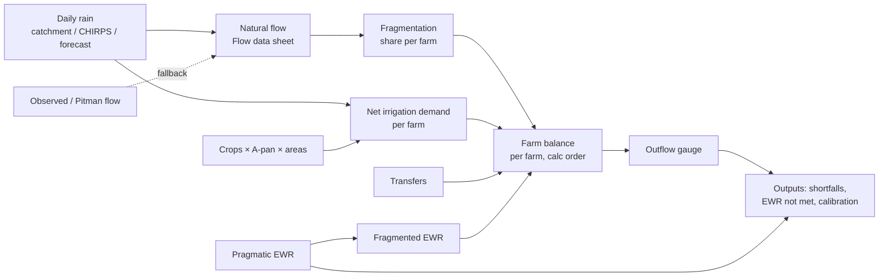

# Model reference

This document explains the water-balance model the web app reimplements. It
covers what the model does, the formulas step by step, where each step lives in
the source Excel workbooks, and which workbook behaviours look like bugs that we
need the hydrologist to confirm.

The engine (`packages/engine`) is a TypeScript port of this model. It is pure
code with no I/O, and it runs both in the browser and in the Lambda. Anything
here that differs from the engine code is a documentation bug. Fix whichever one
is wrong.

- [1. Background](#1-background)
- [2. The b023 model (what V1 ports)](#2-the-b023-model-what-v1-ports)
- [3. Workbook quirks and suspected bugs](#3-workbook-quirks-and-suspected-bugs)
- [4. The AI node-based model (v004 DEV)](#4-the-ai-node-based-model-v004-dev)
- [5. The AI runoff module (DEV 003)](#5-the-ai-runoff-module-dev-003)
- [6. Porting strategy and regression testing](#6-porting-strategy-and-regression-testing)
- [7. Glossary](#7-glossary)

---

## 1. Background

**Water Balance Tool (WBT) b023** is an Excel/VBA workbook. SmartMatix wrote it
for the Freshwater Research Centre (FRC, Scarborough, South Africa). It runs a
**daily** water balance for one river catchment, which is a network of farms
(each with an optional composite dam) that drain into one outflow gauge. It
answers three questions:

1. How much natural flow does the catchment produce each day? Rain is turned
   into flow by a calibrated recession model.
2. How much of each farm's irrigation demand can be met from its runoff,
   upstream inflow, dam storage and transfers?
3. After irrigation, is the **Environmental Water Requirement (EWR)** still met
   at each farm and at the outflow gauge? If not, by how much is it short?

**One workbook holds one catchment.** In the web app, one workbook becomes one
**project**. The user can keep several projects side by side (place A, B, C…)
and create or copy more.

Source workbooks (kept locally in `Original/` and `AI/`, never committed):

| Workbook | What it is | Status |
| --- | --- | --- |
| `Blank_WBT_b023_v001.xlsm` | The b023 template with sample data | Reference for formulas |
| `Client_WBT_b023_v001_…WORKING 007.xlsm` | Real catchment: 1981-01-01 … 2025-03-31 (16 161 days), 12 farms + 1 outflow gauge, 9 crops, 1 transfer | **Regression target** for V1 |
| `AI/WBT_NodeBased_v004_DEV.xlsm` | An experimental 16-node daily ledger with pump scenarios and stress classes | Unfinished; later phase |
| `AI/WBT_Runoff_Module_DEV_003.xlsm` | An experimental bucket rainfall-runoff model with 12 hydrological units | Unfinished; later, as an alternative flow generator |

> **Licence note.** The workbook's copyright statement says the *model
> architecture* is © FRC and the *code and formulas* are © SmartMatix. It allows
> the licensee to modify and use the workbook within the licensed organisation.
> Before this app is used beyond a demo, we need the client to confirm that a
> web reimplementation is covered. See [plan.md § Questions](./plan.md#questions-for-the-client).

---

## 2. The b023 model (what V1 ports)

### 2.1 Pipeline

Units: flows and volumes are **m³/day** internally. The workbook converts m³/s
with `86 400 s/day` (`rAppSet_ConvertSecToDay`). Months are laid out in
**water-year order** (Oct … Sep) wherever the workbook shows a monthly table.

### 2.2 Configuration (the "Cfg" sheets)

| Sheet | Holds | App equivalent |
| --- | --- | --- |
| `[Network]` | Elements (Farm or Gauge), upstream elements (up to 7), "Has transfer?", the one **outflow gauge**. The rows must be in calculation order (upstream first). Bifurcation is not allowed. | `node` rows; `downstream_node_id` gives the tree, and the engine works out the calculation order |
| `[Farm spec]` | Areas (total, high-MAP, low-MAP), the fragmentation method (Area / Hi-Lo / Specific), % upstream inflow "above dam", % farm runoff into dam, dam capacity, initial %, min % for transfers, downstream diversion back to dam (m³/s → m³/day), irrigation return flow % | `node` farm columns + `project.settings.flowShareMethod`, `hiLoSplit` |
| `[Crop demand]` | WR90 A-pan evaporation by month, effective-rainfall %, crop factors by month | `settings.apanMm`, `settings.effectiveRainFraction`, `crop` |
| `[Farm demand]` | Crop area (m²) per farm per crop, days per month (Feb = 28.25 by default) | `crop_area`, `settings.februaryDays` |
| `[Transfers]` | Hand-written transfer formulas, plus per-transfer parameters (from, to, months, max m³/s, min dam %) | `transfer` rows (structured rules) |
| `[Flow Calibration Cfg]` | The rain→flow parameters and the recession curve | `settings.calibration` |
| `[EWR Cfg]` | Desktop Reserve Model tables, and the percentile pick with overrides that produce the **pragmatic EWR** (m³/day per month) | `settings.ewrPragmaticM3PerDay` (V1 stores the final table) |
| `[Flow data]` (left block) | Daily inputs: Pitman natural flow, observed gauge flow, logger flow (all m³/s), catchment-average rain, CHIRPS rain, forecast rain (mm) | `time_series` rows by `kind` |

Element types: a **Farm** element can also stand for a stand-alone dam or a
natural (unused) area, depending on its parameters (see the `[Models]` sheet). A
**Gauge** only passes flow through and reports it.

### 2.3 Irrigation demand

Sheets `[Crop demand]` → `[Farm demand]` → `[Irrigation Demand]`.

1. **Gross crop requirement (mm/month)** for crop *c* in water-year month *m*:

   `grossMm[c][m] = ROUND(apanMm[m] × cropFactor[c][m], 2)`

2. **Gross farm demand (m³/day)** for farm *f*:

   `grossFarm[f][m] = ROUND( Σc area[f][c] × grossMm[c][m] / 1000 / daysInMonth[m], 1 )`

   Here `daysInMonth` is 31, 30, 31, 31, **28.25**, 31, 30, 31, 30, 31, 31, 30 for
   Oct…Sep. February is configurable. 28.25 gives a 365.25-day year.

3. **Net daily demand (m³/day)** on day *t*:

   `netDemand[f][t] = ROUND( MAX(0, grossFarm[f][month(t)] − croppedArea[f] × effRain / 1000 × rainUsed[t]), 0 )`

   - `croppedArea[f]` = Σ crop areas of the farm (m²).
   - `effRain` = effective-rainfall fraction (0.65).
   - `rainUsed[t]` is the *thresholded* rain from the Flow data sheet (§2.4).
     Rain at or below the threshold counts as 0, so light rain does not reduce
     demand.

### 2.4 Natural flow from rain (`[Flow data]`)

This is the calibrated rain→runoff routine. One row runs per day, and each row
reads the previous row. Parameters come from `[Flow Calibration Cfg]`. The
defaults from the blank workbook are shown.

| Parameter | Blank default | Meaning |
| --- | --- | --- |
| `RainThreshold` | 2 mm | Rain at or below this produces no flow and does not offset demand |
| `a`, `b` | 0.09, 1.2 | Peak flow = `a · rain^b` |
| `RainToM3` | total farm area km² × 1000 | Converts mm over the catchment to m³ |
| `SummerMths` | 1,2,3,4,5,11,12 (blank); 10–3 in the engine defaults | Calendar months that are always "summer" |
| `FactorSummer` / `FactorWinter` | 0.1 / 1 | Seasonal response factor |
| `WinterTodayThresh` / `WinterNextDayThresh` | 35 mm / 9 mm | Rain that flips a non-summer month into winter response |
| `MinFlowRatioToResetBase` | 1.5 | Rain pulse / base flow ratio above which base flow resets |
| `ShiftPeakIndexLo` / `Hi` | 0.9 / 3.5 | Range of the recession index given to a new rain pulse |
| `Amplitude` | derived | Rain→flow amplitude used to scale the pulse index |
| `DaysMax` | rows in the curve − 1 (79) | Upper bound of the recession index |
| `RecessionCurve` / `RecessionFactors` | 80-row table | Flow (m³/day, descending) → daily recession factor |
| `BaseFlowInitial` | 300 m³/day | Base flow on the first day |

Per day *t*, with the workbook column letters:

| Col | Quantity | Formula |
| --- | --- | --- |
| R | **Rain used** | The first non-blank of catchment rain, CHIRPS or forecast, set to 0 if it is ≤ threshold |
| N | **Season** (1 = summer, 0 = winter) | Summer month → 1. Otherwise: if yesterday was winter → 0. Otherwise → 0 if `rain[t] ≥ 35` or `rain[t−1] ≥ 9`, else 1. In non-summer months "summer" response carries on until a big enough rain opens the winter. |
| V | **Rain-added flow** | `INT(a · R^b · RainToM3 · seasonFactor)` if R > 0, else 0 |
| S | **Base flow** | `FB` = yesterday's base receded by yesterday's base index (or `BaseFlowInitial` on day 1). If `V / FB > 1.5` the base resets to `V`, else it stays `FB`. Rounded to 0 dp. |
| T | **Base recession index** | Where S sits on the recession curve, interpolated linearly and clamped to `[1, DaysMax]`, 4 dp |
| U | **Response flow (start)** | Yesterday's resultant response receded by yesterday's resultant index |
| W | **Pulse index** | For a new pulse (V > 0): `Lo + (Hi − Lo)(1 − V/Amplitude)`, not below `Lo`. If that is above the base index, use `max(1, baseIndex − 0.2)`. With no pulse: yesterday's index + 1 (or the base index if yesterday's was 0). Capped at `DaysMax`, 4 dp. |
| X | **Response + added** | If V > 0: `U + V`. Else if yesterday's X = 0: `U`. Else yesterday's X receded by yesterday's W. |
| Y / Z | **Resultant response / index** | `max(X, S)` and the index of whichever one won |
| AB | **Natural flow (m³/day)** | `Y` if > 0, else the Pitman natural flow (m³/day) if > 0, else 0 |

`recede(flow, index) = ROUND(flow × lerp(factor[floor(index)], factor[floor(index)+1], frac(index)), 0)`

The same sheet also:

- Picks the **observed** flow series used for calibration: Pitman (1), gauge
  (2) or logger (3) via `rUseFlow`. It converts it to m³/day, rounded.
- Carries the **pragmatic EWR** for the day's month (AF), the **simulated
  outflow** at the outflow gauge (AG), an "EWR not met" flag (AJ = 1 when
  AG < AF) and the shortfall volume (AK = AG − AF when not met).
- Reports mean annual runoff and mean daily runoff (all days and summer only)
  for observed and simulated flow.

> The engine's `CalibrationParams` currently holds `a`, `b`, the threshold, the
> seasonal factors, summer months and the initial base flow. The recession
> curve, shift-peak indices, reset ratio and winter thresholds also have to be
> in project settings for a number-for-number match. The importer reads them
> from the workbook's named ranges (`rCalibration_*`).

### 2.5 Fragmentation (`[Fragmented flow]`, `[Fragmented EWR]`)

Each farm gets a fixed **share** (`frag[f]`, 0–1) of the catchment flow. The
method is chosen in `[Farm spec]`:

| Method | Share |
| --- | --- |
| **Area** | `farmArea / Σ farmArea`, where `farmArea = hiMapArea + loMapArea` |
| **Hi/Lo** | `hiArea/ΣhiArea × hiSplit + loArea/ΣloArea × loSplit` (Pitman split, default 0.81 / 0.19) |
| **Specific** | A value entered by hand ("external fragmentation") |

The shares should sum to 1 within `0.0002` (fragmentation tolerance). Then:

- Farm runoff: `runoff[f][t] = ROUND(naturalFlow[t] × frag[f], 0)`
- Farm EWR: `ewr[f][t] = ROUND(pragmaticEwr[month(t)] × frag[f], 0)`

### 2.6 Transfers (`[Transfers]`)

The workbook has two blocks of columns:

- **Draw From** (one column per transfer): water available in the *source* dam,
  based on **yesterday's** end-of-day storage:

  `draw[t] = monthIn(t, months) ? MIN( MAX(storage[src][t−1] − cap[src] × minPct[src], 0), maxRate_m3s × 86400 ) : 0`

- **InOut** (one column per farm with "Has transfer? = Yes"): the net volume
  entering (+) or leaving (−) that farm. Each is a **hand-written formula**, for
  example `<source farm> = −draw₁`, `<receiving farm> = +draw₁`.

client catchment has one transfer: one farm dam to another, in six months of the
year, capped by a maximum rate and a minimum level kept in the source dam.

The app replaces the free-form formulas with structured rules
(`transfer` table: from, to, months, max rate, optional daily cap, min storage %,
enabled). The out-leg and in-leg of each rule are the same volume, so they
always balance. Anything the hydrologist has written that doesn't fit this
shape has to be raised with them (see §3).

### 2.7 Farm balance (one sheet per element)

Farms are processed in network order. Upstream elements come first, so a farm
sees its upstream elements' **same-day** outflow. Per farm *f*, day *t* (the
sheet's column letters are in brackets). Rounding is to whole m³ where shown.

| Step | Quantity | Formula |
| --- | --- | --- |
| F | Net irrigation demand | from §2.3 |
| H | Upstream inflow | Σ outflow `U` of the elements directly upstream |
| I | Farm runoff | fragmented natural flow (§2.5) |
| J | Transfer in (+) / out (−) | from §2.6 |
| L | Upstream inflow "below dam" | `ROUND(H × pctUpstream, 0)` (see quirk Q1) |
| K | Upstream inflow "above dam" | `H − L` |
| M | Farm runoff into dam | `ROUND(I × pctRunoffToDam, 0)` |
| N | Farm runoff below dam | `I − M` |
| O | Diverted back to dam | `MIN(divertCapacity, L + N)` |
| G | **Irrigation supplied** | `MIN(store[t−1] + M + O + K + J, F)` |
| P | Interim storage | `store[t−1] + M + O + K + J − G` |
| Q | **Storage, end of day** (`store[t]`) | `MIN(P, damCapacity)` |
| R | **Spill** | `MAX(P − damCapacity, 0)` |
| S | Below-dam flow not diverted | `L + N − O` |
| T | Irrigation return flow | `ROUND(G × returnPct, 0)` |
| U | **Farm outflow** | `R + S + T` |
| V | Balance check | `ROUND(abs((H+I+J) − G·(1−returnPct) − (store[t] − store[t−1]) − U), 0)` must be 0 |
| W | **Irrigation deficit** | `F − G` |
| Y | Fragmented EWR | §2.5 |
| Z | "Cumulative" EWR | `= Y` (see quirk Q4) |
| AA | EWR shortfall (−) | `MIN(U − Z, 0)` |
| AB | Incremental EWR shortfall (−) | `MIN(AA, 0)` |

Initial storage = `ROUND(initialPct × ROUND(damCapacity, 0), 0)`.

A **gauge** element records its upstream element's outflow (`= simulated flow`),
its "cumulative" EWR and its shortfall. The **outflow gauge's** flow is the
catchment's simulated outflow that goes back into `[Flow data]` AG. That is
compared with the full pragmatic EWR and the observed flow.

### 2.8 Outputs

| Workbook sheet | What it shows | App equivalent (V1) |
| --- | --- | --- |
| `[EWR shortfalls]` | Per day: unfragmented EWR, EWR volume not met at the gauge, a not-met flag, Σ incremental farm shortfalls, and per-farm incremental shortfall | Run series (`ewr_*` keys) + chart |
| `[Shortfalls]` | Per farm over a reporting window: average demand, supply, deficit, % supplied, target volume, reduce/gain (m³/day and l/s), average EWR shortfall, total reductions, volume left after irrigation is balanced and the EWR is met | `RunSummary.curtailment` over `settings.reportStart … reportEnd` (§2.9); `RunSummary.farms` keeps the whole-run averages |
| `[EWR analysis]` / pivots | Shortfall by farm × year × month, count and % of days not met | Later phase (reports) |
| `[Flow Calibr. Graph Full]` | Observed vs simulated flow | Calibration chart + `CalibrationStats` (NSE, PBIAS, RMSE) |

### 2.9 Curtailment targets (`[Shortfalls]`)

The `[Shortfalls]` sheet answers *how much must each farm cut (or may it
gain) so that irrigation is shared fairly and the EWR is met?* It works on
averages over a **reporting window** the user types into two cells
("Set reporting period", named range `zShortfalls_PeriodStart` and the cell
below it). The engine reads the window from `settings.reportStart` /
`settings.reportEnd` (ISO dates, inclusive; `null` = the run's own start or
end; clipped to the run with a warning). It computes the table in
`packages/engine/src/network/curtailment.ts` and returns it as
`RunSummary.curtailment`.

**The idea in plain words.** Over the window, add up what every farm asked
for and what it actually got. The ratio is the catchment's **equitable supply
fraction**: if the water that was supplied had been shared in proportion to
demand, every farm would have received that fraction of its demand. That
share is the farm's **target volume**. A farm that received more than its
target must **reduce** by the difference; one that received less may
**gain**. Across all farms these reductions and gains cancel out (up to
rounding), so this step only *redistributes* water. The farm's average **EWR
shortfall** (the incremental shortfall it causes, §2.7 AB) is then added on
top. The result is the **total change** that both balances irrigation and
meets the EWR, and **target + EWR shortfall** is the volume the farm has left
to irrigate once both are done.

**Cell formulas.** One row per farm, in `[Network]` order, and gauges are
left out. *W* is the reporting window, and every average is a plain mean over
the days in *W*. Column letters are the workbook's. Signs follow the
workbook: **negative = reduce / shortfall, positive = gain**.

| Col | Engine field (`CurtailmentFarm`) | Workbook label | Formula |
| --- | --- | --- | --- |
| H | `demandM3Day` | Average demand (m³/day) | `ROUND(AVERAGE(F over W), 0)`, where F is the Element sheet's net demand |
| I | `suppliedM3Day` | Average supply (m³/day) | `ROUND(AVERAGE(G over W), 0)`, where G is irrigation supplied |
| J | `deficitM3Day` | Average deficit (m³/day) | `I − H` (≤ 0) |
| K | `fractionSupplied` | %Supply | `IF(H = 0, "-", I / H)` (not rounded) |
| Ktot | `equitableFraction` | (totals row) | `ΣI / ΣH`, over the **rounded** farm averages |
| M | `targetM3Day` | Target volume (m³/day) | `ROUND(H × K_tot, 1)` |
| N | `reduceGainM3Day` | − = Reduce, + = Gain (m³/day) | `M − I` |
| O | `reduceGainLs` | − = Reduce, + = Gain (l/s) | `ROUNDDOWN(N / 86.4, 1)`, truncated toward zero |
| P | `targetFraction` | %Supply (of target) | `IF(H = 0, "-", ROUND(M / H, 3))`. This is K_tot, rounded, for every farm with demand |
| R | `ewrShortfallM3Day` | Average EWR shortfall for the period (m³/day) | `ROUND(AVERAGE(incremental EWR shortfall over W), 0)` (≤ 0). The sheet reads it from `[EWR shortfalls]`, which copies Element sheet AB |
| S | `totalChangeM3Day` | Total reductions (m³/day) | `N + R` |
| T | `totalChangeLs` | Total reductions (l/s) | `ROUNDDOWN(S / 86.4, 1)` |
| U | `volumeLeftM3Day` | Volume left after irrigation balanced & EWR met (m³/day) | `M + R` |
| V | `fractionOfDemandLeft` | Reduction of demand required (%) | `IF(H = 0, "-", ROUND(U / H, 3))` (see quirk Q12) |

The totals row (`CurtailmentSummary.totals`) is a plain `SUM` of H, I, J, M,
N, O, R, S and U. Its l/s figure is the sum of the *truncated* farm values,
so it is not `ROUNDDOWN(ΣN / 86.4, 1)`. T has no total. 86.4 converts m³/day
to l/s (1 m³/day = 1000 l / 86 400 s).

The engine reproduces this number for number. For the saved window, the
client catchment regression test compares every column and the totals with the
workbook. That window happens to be fully supplied, so the test also replays
the cell formulas over the whole run, which has deficits, on the workbook's
own daily Element-sheet values. The one addition is that differences and
sums of 1-dp values are rounded to 1 dp, to drop binary noise
(`120.3 − 120` would otherwise be `0.29999999999999716`).

---

## 3. Workbook quirks and suspected bugs

The V1 engine reproduces these **as the workbook does them**, so it can be
regression-tested against client catchment. Each one needs a decision from the
hydrologist. When one is fixed, the fix goes behind a project setting (a
"workbook-compatible" mode against a "corrected" mode). That way old results
stay reproducible and the engine version records which one was used.

| # | Where | What we see | Why it matters |
| --- | --- | --- | --- |
| Q1 | Farm sheet K/L | **Naming mismatch on "Upstream inflow above dam %"**. The column's label says "above dam", but the formula puts `H × pct` *below* the dam (L) and only `H × (1 − pct)` into the dam (K). client catchment sets it to 100% for most farms, so under the formula no upstream water enters those dams (except through the diversion capacity). The `[Models]` sheet says "set to 100%" for a stand-alone dam, which contradicts the formula. The DB column is named `pct_upstream_to_dam` after the label. | This may change every downstream number. We must ask which meaning is intended. |
| Q2 | Blank `[Transfers]` | One "Draw From" column points at the source's **Spill** column (R) instead of **Storage** (Q) (`<Farm>!R6`). client catchment's live transfer correctly uses Q. | Shows how fragile hand-written formulas are. Confirm that no other catchment workbook carries the R reference. |
| Q3 | Transfers | A draw is capped by the source's *yesterday* storage and min %. It is **not** capped by the receiving dam's free space (the excess spills straight away), and irrigation at the source the same day can use the water first. | It is unclear whether the order (transfer vs irrigation) and the spill of transferred water are intended. |
| Q4 | Farm sheet Z | "Cumulative EWR" = only the farm's own fragment, not the sum of upstream fragments. A farm's shortfall compares its whole outflow (which includes upstream water) with its own fragment only. | This decides what "EWR shortfall per farm" means. The gauge check against the full EWR is not affected. |
| Q5 | Farm sheet G | Irrigation can empty the dam completely. The **min dam %** only applies to transfers, not to irrigation. | Confirm whether farmers keep a reserve. |
| Q6 | Flow data R | The same thresholded rain drives both runoff and the effective-rain offset. Light rain (≤ 2 mm) never reduces demand. | Probably intended, but should be confirmed. |
| Q7 | Flow data AB | When the rain model gives 0, natural flow falls back to **Pitman** flow if present. Days with no rain data silently use a different source. | Mixed sources in one series. The UI should flag these days. |
| Q8 | Farm spec | The Hi/Lo method uses Σ hi-areas and Σ lo-areas over the listed farms, not over the whole catchment. In client catchment the Hi+Lo area sum differs slightly from the total area. The share sum is checked with a 0.0002 tolerance. | Small drift, but visible in the regression test. |
| Q9 | Several | The blank and client catchment differ in summer months (1–5, 11, 12 vs other sets) and in crop factors. | Settings are per project, so this is fine. It shows that defaults must not be trusted blindly. |
| Q10 | EWR Cfg | Pragmatic EWR = one percentile of the Desktop Reserve "without high flows" table, scaled and converted to m³/day, with manual overrides. The source table and scale factor are catchment-specific. | V1 stores only the final 12 numbers. Ask whether the app must derive them. |
| Q11 | Shortfalls M/N | **The target ignores the network.** The equitable share gives every farm the same fraction of its demand (ΣI/ΣH), as if water could be moved freely between any two farms. In practice, a downstream farm's surplus can't reach an upstream farm, and a farm without a dam can't store a "gain". The reduce/gain column is a *fairness* target, not a feasible schedule. It also sets no farm-specific priorities or licensed volumes. | Decides whether "gain" may be shown as water a farm can actually get. A network-aware redistribution (or licences, see planned-work) would change every target. |
| Q12 | Shortfalls V | The column is labelled **"Reduction of demand required (%)"**, but the formula is `U / H`, the share of demand that is *left*: 1.000 means no reduction, and 0.600 means a 40 % cut. **Mirrored**: `fractionOfDemandLeft` holds `U / H`, and the UI labels it "demand left", not "reduction". | The label invites exactly the wrong reading. We should ask which one the client reports. |
| Q13 | Shortfalls R/S/U | The EWR shortfall is the farm's **incremental** shortfall (Element AB). With quirk Q4 in play, that is the whole outflow compared with the farm's own fragment. A farm with no irrigation demand can still carry an EWR "reduction" (S < 0, U < 0) that it has no irrigation to cut. | We need to confirm how a cut is meant to be applied to a natural or stand-alone-dam element. |
| Q14 | Shortfalls K total | `K_tot = ΣI / ΣH` has no zero guard. With no demand in the window the workbook shows `#DIV/0!` in every target. The engine returns `equitableFraction = null` and targets of 0. It also uses the **rounded** farm averages (H, I), not the raw ones. | Cosmetic. The rounding effect is at most ½ m³/day per farm. |
| Q15 | Shortfalls O/T | The l/s columns use `ROUNDDOWN` (truncate toward zero), not `ROUND`. A cut below 0.1 l/s (8.64 m³/day) therefore shows as 0 l/s, and the l/s total is a sum of truncated values. **Mirrored.** | Small cuts disappear in l/s. We should confirm this is deliberate (a conservative presentation). |

---

## 4. The AI node-based model (v004 DEV)

This is an experimental rewrite of the ledger as a **16-node daily table**
(`Daily_Node_Ledger`) for client catchment, running 2013-04-24 … 2018-12-31. It is not
ported in V1. It shapes the later data model: the app's `node` table is already
general enough to hold these nodes.

- **Nodes:** headwaters, dam/bypass nodes, farms, a run-of-river node, a natural
  node, a confluence and the A1 gauge outlet. Each node has an upstream (up to
  2), a downstream, a calculation order, a local flow share, a dam-capture
  fraction, a river-abstraction fraction, a pump capacity (m³/day, computed as pumps ×
  m³/h × 24 h), pump trigger/stop %, pool storage, and flags
  (demand node, storage node, EWR node, include in outlet flow).
- **Ledger per node per day:** opening storage, local natural flow, captured to
  dam, bypass, upstream inflow, river available, transfers in/out, groundwater
  in, export, demand, pumped from river, demand met, shortfall, provisional and
  closing storage, spill, outflow, mass-balance and storage-balance errors.
- **Pump scenarios** (per farm): *Dam-first* (the dam until it drops below the
  trigger, then the river), *River-first*, *Trigger-based* (switch at 40–60%
  storage), *Run-of-river* (no storage). These are planned: seasonal
  river-first, no river pumping, drought-saving, opportunistic pumping, and
  groundwater (none / supplemental / primary / emergency; direct or to-dam).
- **Stress classes** (supply ratio): **≥ 95% Low, ≥ 85% Moderate, ≥ 70% High,
  ≥ 50% Severe, otherwise Critical**, reported per farm and per month.
- **Naturalisation:** present-day flow + irrigation demand = naturalised flow,
  compared with observed and simulated flow at the outlet.

**Unfinished or wrong as found:**

- Every farm shows 100% met. Naturalisation adds demand back into the flow that
  then supplies that same demand, which makes the result circular.
- Opening storage uses `OFFSET(…, −16, 0)` to find the same node's previous day.
  It only works while the table is sorted by date then node and has exactly 16
  nodes.
- Parameters are defined but unused, and `LocalFlowShare` sums to **1.01**.
- Some node names are spelled differently from b023, so matching by name
  between the two workbooks fails.

---

## 5. The AI runoff module (DEV 003)

This is an experimental **bucket rainfall-runoff model**, meant to replace the
b023 rain→flow recession routine as a *natural flow generator*. It uses Power
Query and table formulas.

- **12 hydrological units** (one per client catchment farm). Each has an area, a MAP
  and a reference rain gauge. At present every unit uses the same single gauge.
- **16 routing nodes** that match the node-based model.
- **Per unit per day:** a soil store (`SoilMax` 80 mm) and a constant ET loss
  (1.5 mm/day). Runoff starts above a threshold. A quickflow store and a
  baseflow store each drain with their own coefficients. Unit runoff is then
  routed through the nodes to the outlet.
- **Calibration at the outlet gauge:** NSE **0.624**, PBIAS **−7.7%**.

**Known issues found in review:**

- About **56% of effective rain is untracked**: it leaves the soil bucket
  without being counted as ET, runoff or storage, so the water balance does not
  close.
- `RainfallFactor` is defined but not used in the formulas.
- Soil drainage can **create water**: drainage is not limited by the store's
  contents.
- Node 16 (the outlet) is hard-coded instead of taken from the network.
- Parameters are left unused (`LagWeight`, `RainfallExponent`,
  `BaseflowFraction`, `QuickflowRecession`).

**The author's own TODO (P1–P6):** P1 diagnose the hydrograph (best/worst years,
peaks, recession), P2 annual water-balance table (observed vs simulated MAR by
year), P3 multiple rainfall stations per unit, P4 metrics (R², NSE, KGE),
P5 per-unit calibration multipliers, P6 feed the node flows into the WBT.

In the app, this becomes an **alternative flow generator** behind the same
interface as §2.4: `rain (+ params) → natural flow per node`. The b023 farm
balance can then run on either. That work waits until the water-balance leak is
fixed and the hydrologist trusts the module ([plan.md phase 5](./plan.md)).

---

## 6. Porting strategy and regression testing

1. **Port b023 exactly, rounding included.** The workbook rounds at specific
   steps: gross mm to 2 dp, farm demand to 1 dp, and net demand, fragmented
   flows, storage and return flow to 0 dp. The engine must round at the same
   points with Excel's `ROUND` semantics (half away from zero). `INT` floors.
2. **Fixtures come from the client workbook and are never committed.**
   `scripts/wbt-import` reads the client catchment inputs and the workbook's own
   computed columns into `data/` (for example `data/client-catchment/expected.json`; gitignored). The engine's
   regression tests load them when present and skip with a clear message when
   absent (for example on CI). Small synthetic fixtures that *are* committed
   cover the same code paths.
3. **Stage by stage:** natural flow (§2.4) → demand (§2.3) → fragmentation
   (§2.5) → farm balance and transfers (§2.6–2.7) → EWR and outputs (§2.8).
   Each stage is compared with the workbook's column for all 16 161 days. The
   target is **exact equality** on rounded columns and < 1e-9 relative
   difference elsewhere.
4. **Performance budget:** a full client catchment run (16k days × 13 elements) takes
   about **18 ms** in Node, which is fast enough to run in the browser as you
   type and in Lambda on request.
5. **Every run records `engine_version`** and a snapshot of its inputs, so an
   old result can always be explained after the model or the project changes.

---

## 7. Glossary

The app's `/help` page carries a fuller, searchable version of this glossary
plus per-field help (`frontend/src/lib/help/content.ts`). Keep the two in
step when a definition changes.

| Term | Meaning |
| --- | --- |
| **A-pan** | Class-A evaporation pan. Monthly A-pan evaporation (mm) × crop factor ≈ crop water requirement. |
| **WR90 / WR2012** | *Water Resources of South Africa* studies (1990, 2012). They provide the A-pan, MAP and naturalised flow data per quaternary catchment. |
| **Crop factor (Kc)** | A monthly multiplier from A-pan evaporation to crop water use. |
| **Effective rainfall** | The share of rain on cropped land that reduces irrigation need (65% here). |
| **MAP** | Mean Annual Precipitation (mm/yr). "Hi/Lo MAP" splits a catchment into high- and low-rainfall parts. |
| **MAR** | Mean Annual Runoff (M.m³/yr). |
| **M.m³** | Million cubic metres (10⁶ m³). 1 m³/s = 86 400 m³/day. |
| **Pitman** | A monthly rainfall-runoff model used in South African water-resource studies (WR90/WR2012). "Pitman flow" = its naturalised flow series. |
| **Natural flow** | Flow as it would be with no farms, dams or abstraction. |
| **Naturalisation** | Rebuilding natural flow from observed flow by adding back abstraction and storage changes. |
| **Fragmentation** | Splitting catchment flow (or EWR) into per-farm shares. |
| **EWR** | Environmental Water Requirement: the flow that must stay in the river for the ecosystem. |
| **IFR / Reserve** | Instream Flow Requirement or Ecological Reserve, the South African legal terms for the EWR. |
| **Desktop Reserve Model** ("Desktop Version 2") | Software that produces monthly EWR tables by percentile and ecological category (e.g. category B, W. Cape wet). |
| **Pragmatic EWR** | b023's simplification: one fixed m³/day per month instead of a flow-dependent requirement, so farmers can plan for it. |
| **Ecological category** | A–F class of river condition that the EWR aims to maintain. |
| **Quaternary catchment** | The smallest standard SA catchment unit (e.g. A21A). |
| **CHIRPS** | Climate Hazards Group InfraRed Precipitation with Station data: satellite-based daily rainfall. |
| **Water year** | Oct–Sep in South African hydrology. The workbook orders monthly tables this way. |
| **Recession curve** | How flow decays day by day without rain. b023 uses a table from flow to daily factor. |
| **Base flow / quickflow** | The slow groundwater-fed part of the flow, and the fast storm response. |
| **Spill** | Water that overflows a full dam and continues downstream. |
| **Return flow** | The share of irrigation water that runs back to the river. |
| **Transfer** | Water moved from one farm's dam to another farm (pipeline or canal). |
| **NSE** | Nash–Sutcliffe Efficiency = 1 − Σ(obs−sim)² / Σ(obs−mean obs)². 1 is perfect; ≤ 0 means no better than the mean. |
| **PBIAS** | Percent bias = 100 × Σ(sim−obs) / Σobs. Negative means the model under-predicts volume. |
| **KGE** | Kling–Gupta Efficiency: combines correlation, bias and variability. |
| **RMSE** | Root-mean-square error. |
| **Hydrological unit (HU)** | A sub-catchment with its own area, MAP and rain gauge (runoff module). |
| **Stress class** | Low / Moderate / High / Severe / Critical, from the supply ratio (node-based model). |
